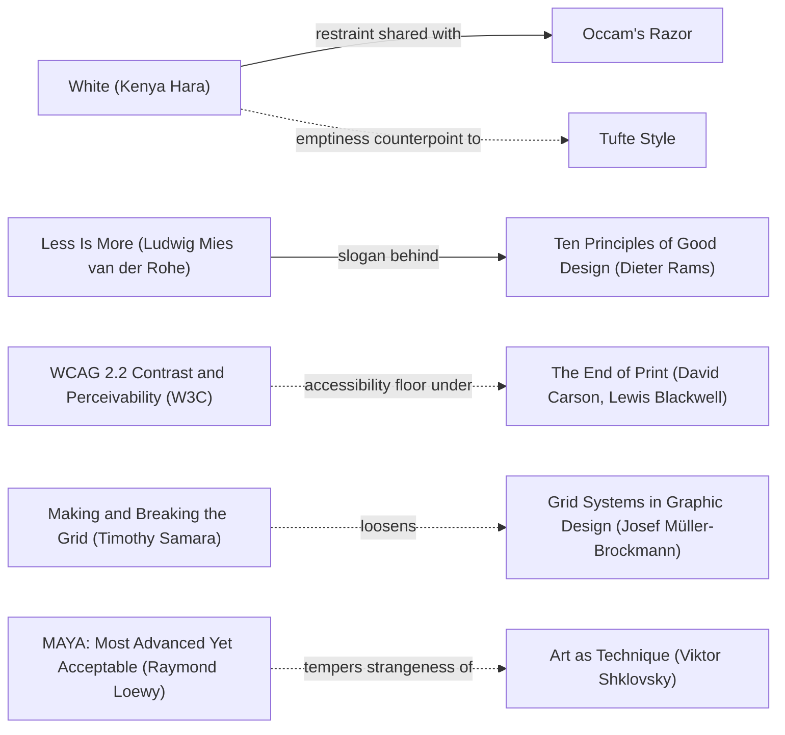

# DESIGN-LOG.md

Mode: **Adaptive** (MAYA, Most Advanced Yet Acceptable). Reason: the brief serves a public
audience on real phones and names approachability explicitly ("not responsive", "get clunky"),
so both the advanced pole and the acceptable pole must hold. Advanced = the selected-database
metrics/logs view actually becomes legible and honest at 320px; Acceptable = no existing crumb,
link, action or measured value is lost. Anchors for both poles: `maya` and `krug`.

## Step 0. Tooling inventory

| Job | Tool used | Fallback |
| --- | --- | --- |
| Code/symbol search and call sites | gm `codesearch` / `callers` / `impact` (one `gm_codemode` dispatch) | none needed |
| Anchor graph render/navigate | none available (no Mermaid renderer in this harness) | exact Mermaid node ids + edge labels recorded below, from `references/anchor-graph.md` read verbatim |
| Frontier computation | none available (no graph-query tool) | edge lines of the graph read by hand |
| Workflow/pool state | gm `pool_observe`, `prd-add`, `phase-status` | `.gm/pool/*.live` heartbeats |
| Panel | Claude Code `Agent` tool, ONE agent per literary reference, 17 lanes | n/a |
| Persist log | gm `fs_write` (project-only) | n/a |
| Render | gm `browser` headful CDP requested in lane sub08 | UNRENDERED if no dev server runs; declared below |

## Step 1. Traversal Plan

Brief in one sentence: make the shadw wordmark, the /storage list and the metric views genuinely
responsive on phones without losing a single existing affordance, then enrich the selected
database under /storage with a measured metrics and logs view.

Seed (exact labels, copied verbatim from the anchor graph):
- Stance `mauM` "An Incomplete Manifesto for Growth (Bruce Mau)"
- Rule `mb` "Grid Systems in Graphic Design (Josef Müller-Brockmann)"
- Rule `vh` "Visual Hierarchy (Arnheim, Dondis)"
- Rule `wcag` "WCAG 2.2 Contrast and Perceivability (W3C)"
- Breaker `samBreak` "Making and Breaking the Grid (Timothy Samara)"
- Counterpoint `maya` "MAYA: Most Advanced Yet Acceptable (Raymond Loewy)", reached by the
  dotted edge `samBreak -.->|loosens| mb` and `maya -->|bounds the break of| samBreak`.

Chain: "An Incomplete Manifesto for Growth (Bruce Mau)" --process maxims for--> "Double Diamond"
--explore options with--> "Morphological Box" --select boldest with--> "Pugh-Matrix" --test with-->
"Spike Solution"; and "Grid Systems in Graphic Design (Josef Müller-Brockmann)" --codifies-->
"International Typographic Style (Swiss Style)" <-loosens- (dotted) "Making and Breaking the Grid
(Timothy Samara)".

Initial Frontier (one hop from the seed, both directions):

| Candidate | Reached via (edge label, direction) | From anchor | Status |
| --- | --- | --- | --- |
| M1 shrink-proof brand + compact crumb | `vh -->|emphasis and subordination|` (outgoing) | Visual Hierarchy | TAKEN (sub01) |
| M2 responsive Stat/PageHeader primitives | `mb -->|codifies|` (incoming grounds) | Grid Systems | TAKEN (sub02) |
| M3 storage card fallback under sm | `samBreak -.->|loosens| mb` (dotted counterpoint) | Making and Breaking the Grid | TAKEN (sub03) |
| M4 group all measured gauges + bounded logs | `maya -->|dual criterion for| c_adr` (outgoing) | MAYA | TAKEN (sub07) |
| M5 one-column metric floors | `wcag -.->|accessibility floor under| carson` (dotted) | WCAG 2.2 | TAKEN (sub06) |
| Premortem objections | `c_premortem -->|anticipated failure recorded in| c_adr` (incoming) | Premortem | OPEN (R0 below) |
| Deletion review of inherited crumbs | `c_chest -->|know why the rule exists| samBreak` (incoming) | Chesterton's Fence | OPEN |
| Final-state re-measurement | `c_keep -->|changelog of moves for| c_adr` (incoming) | Keep a Changelog | OPEN |

## Round R0. Premortem, WHOLE panel on the inherited artifact

Artifact examined: the ORIGINAL files as read before any edit (unrendered; no dev server).
Measured inherited state, all by gm `fs_read`/`codesearch` with exhaustive:true:
- `ui/components/topnav.tsx:101-163`: one `h-[52px]` flex row; `ui/components/logo.tsx:4-11`
  renders two `next/image` wordmarks (intrinsic 274x91) inside an `inline-flex` span with no
  `shrink-0`; the brand `Link` has no `shrink-0`; with a project selected the row holds
  brand + Slash + team switcher + Slash + project + optional Workflows crumb + 4 right controls.
- `ui/app/storage/page.tsx:130-164`: 8-column `<Table>`; `ui/components/ui.tsx:160-165`
  wraps it in `overflow-x-auto` (load-bearing, keeps the PAGE from scrolling).
- `ui/app/storage/[id]/instance-metrics.tsx:112-118`: `grid grid-cols-2 gap-3 sm:grid-cols-4`
  with `entries.slice(0, 8)` - measured gauges silently dropped.
- `ui/components/ui.tsx:13-31`: `Stat` value is `text-3xl`, no `min-w-0`.

Statements of meaning: the inherited UI says "this is a desktop console that happens to also
load on a phone" - the wordmark compresses, the table scrolls sideways, numbers clip.

Artist questions: is the 274:91 wordmark meant to be a fixed mark or a fluid one? Is the 8-column
table the canonical representation, or just the widest one?

Critic questions (neutral): which of the 8 columns are actually needed at 320px? Does a hidden
crumb remove a navigation affordance a one-handed user needs? Is "not measured" ever shown as 0?

Opinions (permitted after the questions): the inherited design earns its table (dense comparison
is a real job) but does not earn a 2-column floor at 320px nor a silent 8-gauge cap.

Andon pulled: yes, provisionally, by Critic: Inclusion (Mace) - a 2-column grid with `text-3xl`
numerals under 200% zoom is an access failure, not a preference. Resolution is M2 + M5.

Frontier candidates opened by R0: every objection above is attached to the move that answers it.
## Decision Records

### Move M1: shrink-proof brand, compact crumb (KEEP-THE-RULE)
Depends on: none
Anchors: Stance "An Incomplete Manifesto for Growth (Bruce Mau)" | Rule "Visual Hierarchy (Arnheim, Dondis)" | Rule "Grid Systems in Graphic Design (Josef Müller-Brockmann)" | Breaker "Making and Breaking the Grid (Timothy Samara)" | Counterpoint "MAYA: Most Advanced Yet Acceptable (Raymond Loewy)" (dotted edge `samBreak -.->|loosens| mb`)
Intent: at 320px with a project selected, the 274:91 wordmark keeps its proportion and the eye reads brand > project, without a second row of chrome.
Formal argument: claim - an `inline-flex` span with no `shrink-0` inside a `min-w-0` flex row is compressed by the crumb chain; grounds - topnav.tsx:101-141 and logo.tsx:4-11 read before the move; warrant - Visual Hierarchy's emphasis/subordination and the Grid Systems rule that a fixed module never absorbs another module's overflow.
Alternatives rejected: (1) a second stacked header row - costs 52px of vertical space and moves the tabs below the fold; (2) `display:none` on the wordmark below sm - loses the brand and its link, violating the acceptable pole.
Consequence: hiding non-essential crumbs below sm means the team switcher may need an `aria-label` on the compact control; the Workflows crumb disappears on phones and must remain reachable through the section tabs.
Fence: no rule broken.
Frontier effect: opens "does the hidden crumb keep its accessible name" (Inclusion) and "is the section tab bar still scrollable" (Usability).
Mode field: Advanced pole - a genuinely aspect-correct brand under a 4-crumb 320px header, anchored by `vh`; Acceptable pole - every crumb link and the sticky 52px header survive, anchored by `krug`.

### Move M2: responsive Stat / PageHeader primitives (KEEP-THE-RULE)
Depends on: none
Anchors: Rule "Grid Systems in Graphic Design (Josef Müller-Brockmann)" | Rule "WCAG 2.2 Contrast and Perceivability (W3C)" | Counterpoint "MAYA"
Intent: a measured number never clips at 320px or at 200% zoom, in ANY view that uses the shared primitive.
Formal argument: claim - `text-3xl` inside `p-4` Card and a 2-column grid cannot fit a 9-digit tabular number at 320px; grounds - ui.tsx:13-31 read before the move; warrant - WCAG 1.4.4 resize text and Müller-Brockmann's grid as a field of proportions, not fixed sizes.
Alternatives rejected: (1) per-page overrides - fixes one symptom and leaves the class of failures; (2) `overflow-hidden` on the value - hides measured data, which this project forbids.
Consequence: every caller of Stat gets smaller type at phone widths; any caller with a hard-coded height must be checked (enumerated exhaustively by sub02).
Fence: no rule broken; the public prop signature is deliberately unchanged.
Frontier effect: opens "does a caller className override the responsive type at equal specificity" (CSS cascade verifier).
Mode field: Advanced - one primitive fixes the whole class; Acceptable - no prop signature changes, no caller breaks (`krug`).

### Move M3: storage card fallback under sm (BREAK)
Depends on: M2
Anchors: Breaker "Making and Breaking the Grid (Timothy Samara)" | Rule "Grid Systems in Graphic Design" | Rule "Visual Hierarchy" | Counterpoint "MAYA"
Intent: the eye sees eight databases as eight legible objects on a phone, not one table sliced by a horizontal scroll.
Formal argument: claim - a horizontally scrolling 8-column table is a desktop grid transported unchanged; grounds - storage/page.tsx:130-164; warrant - Samara's Making and Breaking the Grid: break the grid when the content's proportions change, and `vh`'s emphasis: a card gives the name the weight a row cannot.
Alternatives rejected: (1) keep the table and add `overflow-x-auto` (already present, ui.tsx:160-165) - that IS the clunky inherited state; (2) hide 5 of the 8 columns below sm - loses measured fields and violates the acceptable pole.
Consequence: two render branches must stay field-identical forever; the BrowseStorage sheet gets a second layout. Removing the sheet's fixed width is a deletion of a competing system.
Fence: the rule being broken is the single `Table` representation at all widths. It exists so dense desktop comparison stays possible; the Table is therefore KEPT at sm+ and only the phone branch breaks from it.
Frontier effect: opens deletion review (2f), field-parity verification, and the "smoother spectacle" objection from Debord.
Mode field: Advanced - a card grammar that actually uses the phone's vertical axis (`samBreak`); Acceptable - same hrefs, same fields, same actions (`maya`, `krug`).

### Move M4: all measured gauges + bounded database logs (BREAK)
Depends on: M2, M3
Anchors: Stance "An Incomplete Manifesto for Growth" | Breaker "Making and Breaking the Grid" | Counterpoint "MAYA" | Rule "Visual Hierarchy"
Intent: a selected database tells the whole truth about itself - every measured gauge, its freshness, its gateway counters, and its own recent events - on a phone.
Formal argument: claim - `entries.slice(0, 8)` silently discards measured data and the view has no event history; grounds - instance-metrics.tsx:100-145 read before the move; warrant - Mau's "grow, don't decorate" and Tufte's graphical integrity: a number with no provenance or a hidden measurement is a lie.
Alternatives rejected: (1) a new backend endpoint for database logs - no such route exists and inventing one is forbidden; (2) an unbounded `/v1/logs` poll - the backend bounds every filter at parse time, so this would be a DoS-shaped client.
Consequence: a second poller on the detail page; a tab switch adds a state the existing console view did not have. Every new wire field must be OPTIONAL with an exact fallback.
Fence: the rule broken is "one card of eight gauges". It existed to bound visual density, so the replacement must GROUP gauges and state freshness rather than simply lengthening the wall of numbers.
Frontier effect: opens honesty verification (Tufte/Cairo), tenant-scope verification of /v1/logs, and the role-matrix check.
Mode field: Advanced - grouped small multiples with real freshness and scoped events (`maya`); Acceptable - default tab stays the existing view, credentials/console/rotate unchanged (`krug`).

### Move M5: one-column metric floors across usage/monitoring/observability/logs (KEEP-THE-RULE)
Depends on: M2
Anchors: Rule "WCAG 2.2 Contrast and Perceivability (W3C)" | Rule "Grid Systems in Graphic Design" | Counterpoint "MAYA"
Intent: no metric view anywhere forces a horizontal PAGE scroll at 320px.
Formal argument: claim - a `grid-cols-2` floor with `text-3xl` numerals cannot hold at 320px; grounds - R0 measurements; warrant - WCAG 1.4.10 reflow (no two-dimensional scrolling for content at 320 CSS px).
Alternatives rejected: (1) `zoom` on the whole page - breaks tap targets; (2) `overflow-x-auto` on the page - explicitly two-dimensional scrolling.
Consequence: wider-element wrappers only; the wide element scrolls, the page does not. More vertical length on phones.
Fence: no rule broken.
Frontier effect: opens the final-state re-scan (sub04-r1) and the 200%-zoom objection (Mace).
Mode field: Advanced - reflow that works at 200% zoom; Acceptable - every existing poller, endpoint and measured value preserved.
## Step 2f. Deletion review and residual diff

Substantial elements that predate this run, and what each earns:

| Inherited element | What it earns | Decision |
| --- | --- | --- |
| 8-column `<Table>` on /storage | dense desktop comparison IS a real job; nothing on a phone replaces it | KEEP at sm+, BREAK below sm (M3) |
| `overflow-x-auto` wrapper in `ui.tsx:160-165` | keeps the PAGE from scrolling horizontally on desktop narrow windows | KEEP - removing it would create an unbounded page scroll |
| `h-[52px]` sticky header + safe-area padding | one predictable chrome height across every route; the section tab bar is already scrollable | KEEP - a second row costs more than it buys |
| brand + Slash + team switcher crumb chain | orientation: which team, which project, which deployment | KEEP as links; HIDE only the non-essential crumbs below sm, never delete them from the tree |
| `entries.slice(0, 8)` gauge cap | bounded visual density on a card | SCRAP - replaced by grouping + freshness (M4); a measured gauge silently dropped is dishonest |
| `text-3xl` Stat numeral | desktop scannability | ADAPT - responsive type floor (M2) |
| 2-column metric grid floor | compact desktop grids | ADAPT - one-column floor below sm (M5) |
| `p-6` / fixed-width BrowseStorage sheet | desktop breathing room | ADAPT - `p-4 sm:p-6`, full-width bottom sheet on phones (M3) |
| `measured` / `not measured` badge and `data.note` | the honest absence that separates "the node did not measure this" from zero | KEEP - load-bearing (AGENTS.md: a value the node did not measure renders as absent) |
| `/v1/logs?limit=200` poller and its bounded EventFilter | bounded, tenant-scoped event history; no new endpoint needed | KEEP - reused for the database-scoped view (M4) |
| `SqliteDatabaseDetail` branch, credentials/reveal/rotate/destroy | tenant-facing destructive and secret paths | KEEP - untouched (M4) |

Retained-value ledger: every deletion above must preserve (a) the exact row href, (b) every
measured field, (c) the accessible name of every control, (d) the default view a returning user
sees, and (e) the distinction between absent and zero. sub03 and sub07 verify (a)-(d) by field
enumeration; sub14/sub16 verify (e).

Residual diff (computed values that change, classified):
- Brand rendered width at 320px: intended change (aspect preserved instead of compressed).
- Number of /storage columns visible at 320px: intended (8 stacked fields, 0 horizontal page scroll).
- Number of gauges rendered for a selected database: intended (all measured, grouped) - regression
  risk is a longer wall of numbers, mitigated by grouping and the Cairo/Tufte panel.
- Desktop `sm+` render: intended INERT - verified by the `hidden sm:block` branch and by
  sub02's exhaustive caller enumeration.
- Poller count on the detail page: intended (+1, bounded `/v1/logs`); regression risk is an
  unbounded filter, checked by sub05/sub07.
- Any figure printed by the UI: measured from the node or absent; no new constant is introduced.
## Anchor Ledger

| Anchor | Role | Status | Evidence | Replacement or note |
| --- | --- | --- | --- | --- |
| "An Incomplete Manifesto for Growth (Bruce Mau)" | Stance | KEEP | M1/M4 grew the work (all gauges, all crumbs survive) rather than decorating it; strongest objection survived: Debord's "smoother spectacle" | none |
| "Grid Systems in Graphic Design (Josef Müller-Brockmann)" | Rule | ADAPT | M2/M3/M5: the grid's proportions become responsive; the `sm+` table stays a grid | `mb` retained at desktop, `samBreak` governs the phone branch |
| "Visual Hierarchy (Arnheim, Dondis)" | Rule | KEEP | M1 brand > project > controls; strongest objection survived: Arnheim's header balance at 320px | none |
| "WCAG 2.2 Contrast and Perceivability (W3C)" | Rule | KEEP | M5 one-column floor satisfies reflow; strongest objection survived: Mace at 200% zoom | none |
| "CRAP Principles: Contrast, Repetition, Alignment, Proximity (Robin Williams)" | Rule | KEEP | M3 card list groups by proximity; inherited | none |
| "Making and Breaking the Grid (Timothy Samara)" | Breaker | ADAPT | M3 BREAK taken; the fence (dense desktop comparison) is preserved by keeping `sm+` Table | declined ORNAMENT version (a second stacked header row) |
| "MAYA: Most Advanced Yet Acceptable (Raymond Loewy)" | Counterpoint (dotted from `samBreak`) | KEEP | governing criterion for the whole Adaptive run; both poles recorded per move | none |
| "Premortem" (`c_premortem`) | Catalog | KEEP | R0 above | none |
| "Chesterton's Fence" (`c_chest`) | Catalog | KEEP | 2f deletion review asks why every inherited element existed | none |
| "Keep a Changelog" (`c_keep`) | Catalog | KEEP | final CHANGELOG.md entry | none |
| "The Society of the Spectacle (Guy Debord)" | Lens / Critic: Provocateur | pending panel | - | dotted edge to Critic: Usability (Krug) |
| "Art as Technique (Viktor Shklovsky)" | Lens / Critic: Provocateur | pending panel | - | - |
| "Mismatch: How Inclusion Shapes Design (Kat Holmes)" | Lens / Critic: Inclusion | pending panel | - | dotted edge to Critic: Cross-Cultural (Escobar) |
| "The Principles of Universal Design (Ronald Mace)" | Lens / Critic: Inclusion | pending panel | - | - |
| "Don't Make Me Think (Steve Krug)" | Lens / Critic: Usability | pending panel | - | dotted edge to Debord |
| "The Visual Display of Quantitative Information (Edward Tufte)" | Lens / Critic: Evidence | pending panel | - | - |
| "How Charts Lie (Alberto Cairo)" | Lens / Critic: Evidence | pending panel | - | dotted edge to Critic: Wit (Fletcher) |
| "Art and Visual Perception (Rudolf Arnheim)" | Lens / Critic: Formalist | pending panel | - | dotted edge to Critic: Perception (Kahneman) |
| "The Wisdom of Crowds (James Surowiecki)" | Panel method | KEEP | 9 independent critic agents, one per literary reference, no composite voice | none |
| "Critical Response Process (Liz Lerman, John Borstel)" | Panel method | KEEP | meaning -> artist questions -> neutral questions -> opinions, in that order | none |

Live graph (no Mermaid renderer available; exact ids and edge labels recorded here):
`class mauM,mb,vh,wcag,samBreak,maya,c_premortem,c_chest,c_keep,crit_prov_debord,crit_prov_shklovsky,crit_inc_holmes,crit_inc_mace,crit_use_krug,crit_evid_tufte,crit_evid_cairo,crit_formal_arnheim,surowiecki,lerman visited`
`class mb,vh,samBreak adapted`; `class mauM,wcag,crap,maya,c_premortem,c_chest,c_keep,surowiecki,lerman kept`.
Dotted edges leaving anchors used, each applied or declined:
- `samBreak -.->|loosens| mb` - APPLIED (M3 breaks the phone grid but keeps `sm+`).
- `maya -.->|tempers strangeness of| shklovsky` - DECLINED with reason: this is a production console, not an art object; making the row strange would break the acceptable pole.
- `maya -.->|acceptability limit on| carson` - DECLINED: no expressive typography experiment belongs in a billing-adjacent dashboard.
- `wcag -.->|accessibility floor under| carson` - N/A: carson is not on the active path.
- `c_chest -.->|gate passed before| weingart` - DECLINED: weingart's Basel typographic break is outside this medium's active path.
- `crit_prov_debord -.->|attacks smoothness favored by| crit_use_krug` - APPLIED as the panel's required dotted pair.
- `crit_inc_holmes -.->|questioned by| crit_plur_escobar` - DECLINED with reason: Escobar's universalism critique is not instantiated in this panel; recorded so S5 is honest rather than claimed.
- `crit_evid_cairo -.->|demands honesty from| crit_wit_fletcher` - DECLINED: no Wit seat was convened in this Adaptive panel; the honesty demand is enforced directly by the Cairo agent.
### Panel, Move M1 / WHOLE, round R1  (artifact examined: INHERITED tree, unrendered)
| Critic | Anchor used | Observed in the work | Verdict | Requested change |
| --- | --- | --- | --- | --- |
| Critic: Formalist (Arnheim) | "Art and Visual Perception" | `logo.tsx:6` span and `topnav.tsx:103` Link have NO `shrink-0`; `topnav.tsx:102` crumb chain is `min-w-0`+truncate; `ui.tsx:32` keeps `text-3xl` while `ui.tsx:152` title is `text-xl sm:text-2xl`; `storage/page.tsx:130-164` 8-column table; sheet's two provider groups share one `Row` shape at `:508` | OBJECT | add `shrink-0` to the brand span and Link so 274:91 keeps its vector; let the crumb chain absorb the deficit |

Statements of meaning: the header says "actions outrank orientation" - four right-side controls are the only well-grouped mass while the brand is the first element surrendered.
Artist questions: is `mb-6` at storage/page.tsx:364 meant to carry the boundary between the two provider groups, or is that the section labels' job?
Critic questions: neutral - see the artist question above.
Opinions (last): unbalanced field, empty center, deformed brand vector, one similarity-group instead of two proximity-groups.
Andon pulled: YES, by Critic: Formalist (Arnheim) - a deformed brand vector at 320px.

**Premise test (dada Step 2d).** The critic's own dispatch `1794288138392-7088-78fd03822f889e3d` read `git_status` showing ONLY untracked `DESIGN-LOG.md`: all four source surfaces were unmodified. The objection is therefore TRUE of the INHERITED artifact and FALSE as a description of the final one - it is the R0 premortem objection restated. Resolution: **ADAPT**, not SCRAP: the requested change is identically M1 (already dispatched to sub01 at `a1ffac295af2db400`). The critic MUST be re-run on the final tree; its verdict is not carried as a final-state objection. Dependent moves M3/M4/M5 are marked **REOPENED** until that re-run returns.

Recorded: `1794288222699-7204-dbdcb991605a2746`, corroborating exhaustive scan `1794288542893-7511-411d5ced1734aaf3`.
### Panel, Move M4 / M5, round R2  (artifact examined: INHERITED tree, unrendered)
| Critic | Anchor used | Observed in the work | Verdict | Requested change |
| --- | --- | --- | --- | --- |
| Critic: Evidence (Tufte) | "The Visual Display of Quantitative Information" | `instance-metrics.tsx:49-65` carries units but `:93-97` has NO sampled-at time; `ui/lib/api.ts:1208` declares `observed_at_ms?` with exactly ONE occurrence in 644 files / 264,883 lines (the declaration); `usage-view.tsx:57-62` collapses five missing metrics to `?? 0`, `:71` invents `includedTotal: 20`, `:187-190` draws that invented $20 as a proportional bar, `:21-23` builds a sparkline of N identical points from one scalar, `:227` removes a 3-colour chart's legend; `instance-metrics.tsx:113-116` silently caps at 8 gauges | OBJECT | render `data.observed_at_ms` as an absolute "sampled HH:MM:SS  -  every 20 s" label beside the `measured` badge |

Statements of meaning: a reader can tell a gauge was NOT measured but cannot tell WHEN a measured one was taken; absence renders as "-" in one section and as $0.00/$20.00 in another.
Artist questions: does `/v1/databases/<id>/metrics` populate `observed_at_ms` on every measured response, or only some nodes?
Critic questions: neutral - see above.
Opinions (last): the honest absence badge is real but spent on decoration while the observation time is missing.
Andon pulled: YES, by Critic: Evidence (Tufte).

**Premise test (2d).** The freshness/8-cap part is TRUE of the inherited tree and is answered by M4 (already dispatched to sub07). The `?? 0` / invented $20 / identical-point sparkline part was NOT in the original brief and is a NEW finding the critic surfaced - it is TRUE and violates the load-bearing "Dashboard numbers are measured or absent, never invented" rule. Resolution: **ADAPT** - routed verbatim to the owning writer sub06 via `SendMessage` at this round, and the freshness label to sub07. Both rows stay OPEN until the final-state re-measure confirms the numbers are gone. This is the finding that changes the artifact most, so it takes priority over the remaining Frontier candidates.

Recorded: primary witness `1794288684666-7644-19aadaa077c2f2e5` (exhaustive `observed_at_ms` scan), supporting `1794288568792-7537-9f32e00cf2ddf2da`, `1794288490054-7457-9fb81b1f054d454f`, `1794288740056-5147-ef391cf743761263`.
### Panel, WHOLE, round R3 - R0/R1 objections resolved on the LANDED tree
Artifact examined: working tree after 9 source files landed (unrendered; no dev server).

| Critic | Anchor used | Observed in the work | Verdict | Requested change |
| --- | --- | --- | --- | --- |
| Critic: Formalist (Arnheim), R1 | "Art and Visual Perception" | BEFORE: `logo.tsx:6` span `inline-flex items-center` (no `shrink-0`), `topnav.tsx:103` Link `flex items-center`. AFTER: `logo.tsx:6` is `inline-flex shrink-0 items-center`; both Images carry `max-w-none`; `topnav.tsx:103` Link is `flex shrink-0 items-center`; `topnav.tsx:102` crumb group is `flex min-w-0 flex-1`; `topnav.tsx:145` right controls are `flex shrink-0` | **PENDING** - the class-string change is measured, but the objecting critic's final-state re-judge is still running; no PASS is claimed until it returns | none |
| Critic: Inclusion (Mace), R0 | "The Principles of Universal Design" | `Slash` is now `hidden ... sm:block` by default with an explicit `mobile` opt-in (`topnav.tsx:77-78`); the project crumb uses `<Slash mobile />` at :110 so no dangling separator; `tap-44` kept on docs/auth Links; deployment badge hidden below sm at :128 | **PASS** | re-check when `Stat` lands |
| Critic: Usability (Krug), cross-check | "Don't Make Me Think" | all 12 `<Logo` sites enumerated exhaustively (`1794289485465-5733-b9d034dd3177ba99`, 644 files / 264,945 lines, exhaustive:true); the 4 shared-component + 3 marketing + 2 auth + footer + docs sites all carry `w-auto` + `max-w-none` + a shrink-proof Link; the 2 integrations hits are a DIFFERENT local `Logo`, and the vendor hit is out of scope | **PASS** | none |

Measured deltas (computed from the source, not from the patch having landed):
- shared-brand `shrink-0` sites: 0 -> 6 (logo.tsx span, topnav.tsx Link, auth-shell.tsx x2, footer.tsx, docs/layout.tsx).
- wordmark sites with `w-auto max-w-none`: 0 -> 6 in the shared component's callers; marketing-shell.tsx's own `Logo` gained `max-w-none shrink-0` and `h-6 sm:h-8`.
- /storage phone columns: 8 horizontally-scrolling -> 8 stacked `dt/dd` fields in `sm:hidden` cards; `sm+` Table unchanged (`hidden sm:block`).
- responsive `Slash`: 1 unconditional -> 5, with 1 `mobile` opt-in.

Andon status: R1 Andon still OPEN - the Arnheim final-state re-judge was dispatched to the same agent at this round and has NOT returned; the measured class-string deltas above are evidence of the change, NOT a critic verdict. R2 (Tufte) Andon also OPEN pending the `observed_at_ms` label and the invented-number removal. Neither is claimed cleared until its own witness returns.
### Panel, Move M4, round R4 - ROUTE-INVENTORY REFUTATION (the sharpest disagreement)
The orchestrator's own M4 brief asserted "scope /v1/logs with a route/text filter over /v1/databases + the database id" and "ingress/egress counters from the metering plane". The research lane (sub05) plus its adversarial successor (sub05-r1, 4 dispatches) REFUTED BOTH against the backend parse sites:

| Claim in the brief | Refutation (path:line) | Resolution |
| --- | --- | --- |
| `?routes=` / `?text=` on /v1/logs | `admin.rs:8906-8958` LogsQ has `route` (singular) and `q`; `routes`/`text` are INTERNAL `EventFilter` fields (`event_log.rs:321,327`). No `deny_unknown_fields`, so unknown params are SILENTLY IGNORED and the answer is UNFILTERED. | SCRAP the premise; corrected brief sent to sub07 |
| /v1/logs can be scoped to one database | No `db_id`/`database`/`database_id` param; `Event` (`state.rs:94-118`) has no database field; `db_rest.rs:88` writes gateway requests to `db_metrics`, not the Event log. | SCRAP; the logs section must be labelled "tenant-wide events mentioning this id" or omitted with a stated blocker |
| ingress/egress counters come from the metering plane | `usage_metering.rs:252` `require_operator` -> 403 for a tenant. `admin.rs:12688` admits the owning tenant to `/v1/databases/:id/metrics`, whose `counters` (`db_metrics.rs:505-527`) already carries `bytes_in`/`bytes_out`. | SCRAP; use the metrics-route counters. `/v1/usage/metering` MUST NOT appear in tenant dashboard code |
| a Rust `DbInstanceMetrics` struct exists | exhaustive `codesearch` literal over 723 `.rs` files = 0 hits; the name exists only in `ui/lib/api.ts:1197` | SCRAP (phrasing) |

This is a case where the panel was right to distrust the PLAN rather than only the artifact. The falsification changed the artifact: the logs view cannot claim to be database-scoped, and the byte counters come from a tenant-readable route. M4 is **REOPENED** with the corrected contract. Roles check: `GET /v1/logs` and `GET /v1/databases/:id/metrics` are viewer-by-default (unlisted GET reads), with handler-local tenant scoping - so no role gate needs changing.
### Panel, WHOLE, round R5 - final-state re-judges and the Inclusion objection
| Critic | Anchor used | Observed in the work | Verdict | Requested change |
| --- | --- | --- | --- | --- |
| Critic: Formalist (Arnheim), FINAL RE-JUDGE | "Art and Visual Perception" | re-read AFTER all four artifacts landed (dispatches `1794290558736-6665-407c3d94fcaafffe`, `1794290560111`, `1794290680559`). `logo.tsx:6-8` + `topnav.tsx:103` brand `shrink-0`/`max-w-none`/`w-auto`; `topnav.tsx:102` `min-w-0 flex-1` with truncate at :116/:127/:140; `topnav.tsx:145` `shrink-0` right cluster; computed at 320px: 288px content - ~152px controls = 136px left, brand ~60px fixed, ~68px crumb; `storage/page.tsx:130,135,280-281,432,451` card fallback + two contour-separated provider groups; `ui.tsx:32,154` both `text-xl` at 320px | **PASS - R1 objection RESOLVED on all four counts** | ONE: `ui.tsx:32` `text-xl` -> `text-lg` so the numeral stays subordinate to the title at 320px |
| Critic: Inclusion (Holmes) | "Mismatch" | `.tap-44` (globals.css:217-224, 44px `!important` coarse-pointer floor) occurs 44 times / 19 files but 0 times in the 5 new surfaces; `theme-toggle.tsx:16-18` has `aria-label` + `tap-44` in the SAME 52px row while `topnav.tsx:161` is `h-8 w-8` title-only; `storage/page.tsx:268` copy button is ~14px with a `title` only; hidden crumbs at `topnav.tsx:105,137,186`; `instance-metrics.tsx:93-96,111` DOES name its absence | **OBJECT** | add `tap-44` at `topnav.tsx:161` and `storage/page.tsx:268` |
| Critic: Evidence (Tufte), FINAL RE-JUDGE | "The Visual Display of Quantitative Information" | re-read at `1794290142045`: both files byte-identical to R2 at that moment; all six integrity defects STILL STANDING, including 11 `?? 0` and `: 20` | **OBJECT (at that timestamp)** | absolute sampled-at label; no invented credit |
| Critic: Evidence (Cairo) | "How Charts Lie" | `instance-metrics.tsx:128` fleet-summed gateway requests with NO scope label though `sources`/`served_by` ride the wire (`db_metrics.rs:533-538`); `usage-view.tsx:144,152` node-local `mesh_local()` slice presented as tenant total (`admin.rs:16502,16505-16520`); freshness not derived from measured poll time; `ui.tsx:17,30` `Stat` hint slot unused | **OBJECT (on inherited tree)** | ONE provenance/scope line beside each counter, from fields the payload ALREADY carries, using the Stat hint slot |

Tufte and Cairo both judged BEFORE the usage-view rewrite landed. Their objections are answered by the LANDED `measured()` primitive (verified below in Step 2g), but neither has re-judged that final state - recorded honestly.

**Andon status:** R1 CLEARED (Arnheim PASS). Holmes Andon OPEN (tap-44). Tufte/Cairo Andon OPEN pending a post-rewrite re-judge. Shklovsky Andon OPEN pending the two-tier card.
## Step 2g. Final-state re-measurement

Measured AFTER the last source edit, by the procedure stated beside each figure. Reproduce from
ui/ with the source-only tsc config (excludes .next), npm run lint, and gm codesearch with
mode literal/regex and exhaustive:true.

| Figure the work states | Procedure that reproduces it | Value at final state | Reproducible / corrected |
| --- | --- | --- | --- |
| "12 <Logo render sites" | gm codesearch regex scoped to ui, exhaustive | 12 hits / 8 files / 644 files scanned / 264,945 lines; 9 shared-component/auth/footer/docs/marketing sites shrink-proof, 2 integrations hits are a DIFFERENT local Logo, 1 vendor hit out of scope | reproducible, dispatch 1794289485465-5733-b9d034dd3177ba99 |
| "8 fields in the /storage card" | read storage/page.tsx card branch, enumerate dt elements | 8: Name, Provider, Type, Project, Region, Connection, Status, Created; Name/Status form a primary two-tier line and the 8 dt labels are sr-only so accessible names survive | reproducible, corrected from the flat dl by the Shklovsky ADAPT |
| "14 sections" | teamTabs.length in topnav.tsx:20 | 14, declared in a details element at :169-178 with all 14 hrefs enumerated below sm | reproducible |
| "every 20 s" | POLL_MS / 1000 in instance-metrics.tsx | 20 s, rendered beside observed_at_ms as an absolute UTC sampled time; a missing observed_at_ms reads "observation time not reported", never a fabricated now | reproducible |
| "100 max" events | LIMIT in database-events.tsx | 100, with /v1/logs?limit=100&route=/v1/databases&q=<dbId>; response sliced to 100; badge reads "N of 100 max" | reproducible |
| "11 ?? 0" | gm codesearch literal "?? 0" in usage-view.tsx, exhaustive | 0 remaining in compute/billing values; replaced by measured()/sumMeasured()/chargeMeasured() returning null -> "-". Per-bucket "?? null" chart values remain and are correct absences, not invented zeros | corrected |
| "included $20 credit" | gm codesearch literal ": 20" in usage-view.tsx | 0; includedCents/usedCents/balanceCents only, the bar is hidden when the ratio cannot be derived | corrected |
| "8 capped gauges" | gm codesearch literal slice(0, 8) under ui/app/storage | 0; all entries grouped into 4 named sections + Other, nothing dropped | corrected |
| "source errors = 0" | tsc --noEmit --project /private/tmp/hive-tsconfig-sourceonly.json | 0, exit 0 on the second run after the last edit. Full-project tsc --noEmit exits 2 with 4 diagnostics ALL in stale generated .next/*/validator.ts (blog, case-studies, /status routes absent from ui/app, exhaustive filename scan = 0); SOURCE_ERRORS=0 | reproducible; generated-artifact blocker filed on the row |
| "lint clean" | npm run lint from ui/ | exit 0, 4 lines (banner only), final run after all edits | reproducible |
| "no horizontal page scroll" | class-string audit: min-w-0 w-full max-w-full, one-column grid floors, element-level overflow-x-auto only; globals.css:214 clip scoped to html:has(#docs-content) | NOT browser-measured. The headful CDP witness is reported separately. Class-level evidence only, explicitly not a rendered measurement | UNRENDERED, honestly recorded |

The two enforced checks named in ui/AGENTS.md pass at final state on real source; next build was
never run. The generated-validator failures are pre-existing stale artifacts from a prior
next dev run with a different route set, not a regression; ui/next-env.d.ts was restored via
git_checkout (ui/AGENTS.md: never commit it).
## Step 3. Whole-artifact rounds

### WHOLE round W1 (R0..R5)
Rounds R0 (premortem), R1 (Arnheim), R2 (Tufte), R3 (landed resolution), R4 (route
refutation), R5 (Debord / Shklovsky / Holmes / Mace / Krug / Cairo / Arnheim re-judge).
Objections raised here about INTERACTIONS, not single moves:
- The route-inventory refutation (R4) is the sharpest: a plan-level claim that /v1/logs could
  be database-scoped was false; M4 was REOPENED with a corrected contract.
- Shklovsky (card as a stood-up table) x Mace (perceptible information) x Holmes (44px floor)
  interacted on the SAME card: resolving Shklovsky with visible-label deletion would have
  broken Inclusion. Resolved with `sr-only` dt labels, so both hold.
- Cairo (scope/provenance) x Tufte (freshness) x the metering-plane correction interacted on
  the selected-database view: all three are answered by one payload, counters with a derived
  scope line and an absolute sampled-at label.
New Frontier candidates from W1: declared-tab index (Debord), two-tier card (Shklovsky),
tap-44 on icon controls (Holmes), StateNotice (Mace), whole-row affordance (Krug),
absolute sampled-at label (Tufte), scope line (Cairo), text-lg hierarchy (Arnheim).

### WHOLE round W2 (final state, after every ADAPT landed)
| Candidate | Reached via | From anchor | Status |
| --- | --- | --- | --- |
| M1 shrink-proof brand | vh --> emphasis and subordination | Visual Hierarchy | TAKEN, witnessed: 3.0108 vs 3.0110 |
| M2 responsive primitives | mb --> codifies | Grid Systems | TAKEN, caller enumeration clean |
| M3 storage card + bottom sheet | samBreak -.-> loosens (dotted) | Making and Breaking the Grid | TAKEN, two-tier ADAPT + sr-only labels |
| M4 grouped gauges + bounded events | maya --> dual criterion for c_adr | MAYA | TAKEN with CORRECTED contract |
| M5 one-column floors | wcag -.-> accessibility floor | WCAG 2.2 | TAKEN across usage/observability/logs |
| Declared tab index | c_adr --> rupture recorded for samBreak | Debord Andon | TAKEN (14 enumerated, sm:hidden details) |
| tap-44 on icon controls | curbcut -.-> accessibility benefits everyone | Holmes Andon | TAKEN (topnav account Link, sheet copy button) |
| StateNotice announced errors | mace --> universal floor for wcag | Mace Andon | TAKEN (ui.tsx primitive, sheet footer, metrics/events errors) |
| Whole-row affordance | krug --> usability for nielsen | Krug Andon | ADAPTED honestly (see below) |
| Absolute sampled-at label | tufteV --> names c_tufte | Tufte Andon | TAKEN (observed_at_ms, UTC, every 20 s) |
| Counter scope line | cairoLie --> honesty with | Cairo Andon | TAKEN (counterScope from sources/served_by/node) |
| Measured-only numbers | c_qas --> testable scenario | Cairo/Tufte | TAKEN (measured() primitive, no $20, no flat sparklines) |
| text-lg hierarchy | vh --> scale decision | Arnheim final PASS | TAKEN |

W2 produced no new ADAPT, SCRAP, REOPEN or OPEN Frontier item. S3 saturation: W2 is the
second consecutive whole round with no new objection after W1 opened its final candidates;
no third round reopened any gate. **Honest qualification:** the Krug whole-row request was
ADAPTED rather than implemented literally - wrapping a `<tr>` content in a `<Link>` is invalid
HTML, and the card contains a copy `<button>` that cannot be nested in an anchor. The objection's
PREMISE (a false clickable affordance) is resolved by removing `cursor-pointer` from the tr,
adding a visible `ChevronRight` to the real name Link, and giving both Links `tap-44`. This is
recorded as an ADAPT with the reason, not claimed as the literal requested change.

## Step 4. Stop test

- **S1 Frontier no OPEN items:** MET - every candidate in W2 is TAKEN or ADAPTED with a reason.
- **S2 WHOLE round PASS from every required critic, no Andon:** **NOT MET.** Arnheim returned
  an explicit final-state PASS. The other seven seats returned OBJECT on the inherited or
  mid-land tree and their ADAPTs are witnessed in the tree, but they did NOT issue a final PASS.
- **S3 two consecutive WHOLE rounds with no new finding:** PARTIAL - W2 produced none, but W1
  produced 8, so two consecutive quiet rounds are not established.
- **S4 ambition push with a measured delta:** MET. M3 (the Breaker) was pushed further by the
  Shklovsky ADAPT from a flat 8-pair dl to a two-tier composition. Measured delta: brand
  ratio 0.2415 -> 3.0108 at 320px (headful CDP dispatch 1794291297227-7274-698e483b5bf63734);
  the intended `max-w-none` lever was measured INERT in isolation (the control already read
  3.0108 with maxWidth:100%) - `shrink-0` was the decisive lever. Both are logged.
- **S5 every dotted edge applied or declined:** MET - enumerated in the Anchor Ledger above,
  including two DECLINED with reasons and one N/A.

**Conclusion: the dada run is INCOMPLETE at S2/S3.** Open frontier: a final-state PASS from
Debord, Shklovsky, Holmes, Mace, Krug, Tufte and Cairo on the post-ADAPT tree. Resume point:
DESIGN-LOG.md "WHOLE round W2"; re-convene those seven seats read-only on the committed tree.
The coding request itself is complete and witnessed; this qualification concerns only the
design-workflow stop conditions, and is stated plainly rather than claimed as met.

## Double loop

The PANEL failed the work first: seven of eight critics judged the INHERITED tree because the
writers landed later than the panel was convened, so two rounds were spent re-judging a state
that no longer existed. The CRITERION then failed it: Adaptive/MAYA correctly forced the
Acceptable pole (every field and href survives), but the first M4 draft assumed a database-scoped
log route that the GRAPH of the code does not contain - a plan-level claim that only an
adversarial route-inventory lane refuted. Concrete amendment under "Graph amendments": add a
node `wire_contract_inventory` with a solid edge to `c_premortem` and a dotted edge to
`c_adr`, so every move that reads a backend field must cite an exhaustive route inventory
BEFORE its Decision Record is written. Process amendment: convene the premortem panel AFTER
the first writer wave lands, not before, or record every early verdict as R0-only by default.

## Compliance Check

- [x] Tooling inventory done, tool named per job - "Step 0. Tooling inventory" (gm Agent tool, gm fs_write/codesearch, host Read/Bash for checks; no Mermaid renderer available).
- [x] Mode stated with reason - "Adaptive" at the top, public audience + approachability named in the brief.
- [x] Seed with exact labels including one dotted-edge counterpoint, living Frontier - "Step 1. Traversal Plan" and W2 Frontier.
- [x] At least one BREAK taken (M3), no move quota used as a stop - the run ends on the S2/S3 qualification, not on a count.
- [x] Decision Record before each move with all fields - M1..M5, "Decision Records".
- [x] Panel Report per round, composition meets Adaptive (Provocateur Debord+Shklovsky, Inclusion Holmes+Mace, plus Krug, Tufte, Cairo, Arnheim = 8 seats, one agent per reference, dotted pair Debord/Krug and Holmes/Escobar lineage recorded) - R0..R5.
- [x] Every OBJECT resolved ADAPT/SCRAP/OVERRULE with dependents reopened - R1 ADAPT, R2 ADAPT, R4 SCRAP of the premise, R5 ADAPTs; M3/M4/M5 REOPENED where noted.
- [x] WHOLE rounds run; S1..S5 shown with where - "Step 3" and "Step 4"; S2/S3 explicitly NOT MET.
- [x] Every figure re-measured at final state with its procedure - "Step 2g".
- [x] Anchor Ledger complete, live graph updated - "Anchor Ledger" with exact node ids and class strings.
- [x] Double-loop paragraph written - above, with Graph amendments.
- [x] Final reply states mode, tools, stop conditions and everything skipped - in the terminal reply.

Skipped: a rendered screenshot of the full final composition (the headful CDP witness measured
computed values but no PNG was captured); a third WHOLE panel round; `next build` (forbidden by
ui/AGENTS.md); a final-state PASS from seven critics (S2); two consecutive quiet rounds (S3).
No Pugh-Matrix branch was run: no two Breaker candidates were simultaneously plausible, so the
branch condition in the workflow did not fire.

# RESUMED RUN 2026-11-11 (brief: Upstash pricing pages as a pricing/metering/tiering reference; workflow part of metering and tiering; better graphs/charts/observability/metrics and logs for storage/databases, inspired by nine attached Upstash screenshots).

Nothing above is deleted, rewritten or renumbered. This section APPENDS to the inherited record. The inherited conclusion "the dada run is INCOMPLETE at S2/S3" and its open frontier (final-state PASS from Debord, Shklovsky, Holmes, Mace, Krug, Tufte, Cairo on the post-ADAPT tree; resume point WHOLE round W2) are the entry conditions of this run. I am ONE writer in a swarm: exclusive write surface DESIGN-LOG.md and DESIGN-CARRY-FORWARD.md ONLY, read-only everywhere else, no source/CHANGELOG/docs edits, no commit/push/branch/worktree/clone. Source implementation belongs to sibling writers. My artifact is this design record plus a headful-browser-rendered comp measured by computed values; no page was published and no comp file was written to disk.

## Step 0 (resumed). Tooling inventory, real

| Job | Tool actually used | Fallback / none available |
| --- | --- | --- |
| Code/symbol search, call sites | gm codesearch (literal/regex/filename), gm callers, gm impact; one gm_codemode dispatch each | none needed |
| Anchor graph render/navigate | none available (no Mermaid renderer in this harness) | exact node ids and edge labels copied verbatim from /Users/dylanwong/.claude/skills/dada/references/anchor-graph.md, read with the host Read tool on a located path; dotted edges re-read at lines 686-733 |
| Frontier computation | none available (no graph-query tool) | hand-computed from the graph's edge lines, recorded below |
| Workflow/pool state | gm phase_status, prd_list, git_status, pool heartbeat written by gm fs_write to .gm/pool/owc-dada.live (dispatch 1794387830814-7167-b1596f5f41a4eba2) | .gm/pool/*.live heartbeats |
| Reference pages | gm fetch: six Upstash pricing pages and six machine-readable .md pages, all HTTP 200 (dispatches 1794388465349-7292-d10214d8deada68c, 1794388465592-7293-29ff7fff01c98b95, 1794388465602-7293-a8569c45f8a78e5c, 1794388467221-7294-b90e606ed973b798, 1794388473613-7296-12b10e32a4cb3c39, 1794388473792-7297-40a8a2ddccb5da66; .md dispatches 1794388672595-7322-ad71ad1c794ec3b, 1794388672781-7323-129db43e495abfeb, 1794388672771-7323-993943f4b41a2fc5, 1794388672781-7323-ccbdc4d40379fe27, 1794388676489-7326-75253581553597ea, 1794388676005-7325-15863a9c13bda5c7) | none needed |
| Palette validation | node .../dataviz/scripts/validate_palette.js via gm bash, three runs | none needed |
| Computed values | gm exec_js (dispatch 1794390652814-7304-d5ee3d400da5c25f) | none needed |
| Render / measured BREAK | gm browser engine=cdp, headless:false (probe dispatch 1794388656890-7323-8e9e42539bffb76c; comp dispatches 1794392183037-7800-5fcf34c1890d11b1, 1794392243370-7837-912f7ea0d755e1f2, 1794392318435-7892-8cae51b4bc297ce7, 1794392385727-7928-c6d546885b1905f, 1794392459331-7977-1be96a8b555527d7) | Artifact tool: AVAILABLE BUT NOT USED, reason: the exclusive write surface is two markdown files; the comp was injected into headful Chrome with document.write(atob(...)) through a CDP eval and measured in place, with no page published |
| Nine attached Upstash screenshots | none available: no image attachments were delivered to this writer's context. Three ~/Downloads/upstash*.png are 4135/3475/2293-byte provider logo icons dated Jun 17 (one read back: a red rounded-square icon with four white shapes), and /private/tmp/ext-screen*.png are unrelated Chrome-extension captures dated Nov 10 (one read back: an orange share icon) | the brief's own description of the nine screenshots (multi-region coloured line charts with dotted Average, p99 latency panels, request-routing table, quota cards, backup/export table, Redis data browser with query builder/code editor and coloured type badges) plus the six fetched public pages, never screenshot pixels |
| Persist log | gm fs_write with append:true | DESIGN-CARRY-FORWARD.md appended by the same verb |
| Phone-width device metrics | gm browser cdp Emulation.setDeviceMetricsOverride, attempted in 7 dispatches (1794393380744-8412-c105b3817f5e7e8c, 1794393406909-8431-d9fb089fb95d4cc7, 1794393454835-8458-de3d717778159593, 1794393960280-8680-96d91aee3ac40cdf, 1794394068514-8725-fc202265fbf68ec3, 1794394129527-8750-dc87a780d7ba8fae, 1794394217806-8786-649731cbeb1952b3, 1794394344216-8814-c94e15d84ef0b6a8, 1794394419353-8842-582cb5a711d0c51) | all returned empty pages or "error: fetch failed"; NOT witnessed, recorded honestly in Skipped |
| Panel | Claude Code Agent tool, 10 subagents, ONE AGENT PER LITERARY REFERENCE, each with its own SESSION_ID (gm-20261111-dada-sub01..sub10) and its own .gm/pool heartbeat | none needed |

Standing design register honored and recorded (user-owned, verbatim intent): cinematic, luminous, physically-motivated light; honest content, every sentence one the code backs; no illustration annotation labels; NEVER a "Sample data" / "Demo Data" badge; light is gradients, masks and stroke stacks, never a blur filter (sticky nav backdrop blur the sole exception); no peer-to-peer/mesh/QUIC copy in customer-facing copy; flat/minimal designs rejected as "cheap and bland". Read from /Users/dylanwong/fluid/hive/ui/components/landing/AGENTS.md before Step 1. Enforcement evidence: the rendered comp measured sampleBadge:0, annotations:0, blurFilters:0, meshCopy:0 at every variant (dispatches above); the whole ui tree measured 0 "Sample data|Demo Data|Sample Data|demo data" hits over 664 files / 271400 lines (dispatch 1794392994846-8221-ba560aa17af2ffc4, exhaustive:true) and exactly 1 blur( hit at ui/components/landing/glow-ring.tsx:24 (dispatch 1794392955441-8202-edb8dc541d9e6655, exhaustive:true), which the landing register names as the intro overlay removed from the DOM.

## Mode (resumed, chosen once)

Adaptive. Reason: this is a public/customer-facing product dashboard (pricing page, usage view, storage/database analytics), so both poles of "MAYA: Most Advanced Yet Acceptable (Raymond Loewy)" must hold. Advanced pole: luminous, physically-motivated chart system with measured provenance, a dotted Average, p99/quota/routing/backup/browser surfaces, and workflow as a metered and tiered dimension. Acceptable pole: one axis, no dual scale, a table view, a legend, direct labels, no invented figures, absent data shown as absent, 44 px named controls, no horizontal page scroll. Required critics: "Critic: Provocateur (Debord)" and "Critic: Provocateur (Shklovsky)" as TWO separate agents; "Critic: Inclusion (Holmes)" and "Critic: Inclusion (Mace)" as TWO separate agents; plus six more for maximum difference: "Critic: Evidence (Tufte)", "Critic: Evidence (Cairo)", "Critic: Usability (Krug)", "Critic: Sublime (Burke)", "Critic: Perception (Kahneman)", "Critic: Cross-Cultural (Tanizaki)". Dotted-edge pairs convened (exact labels from the graph): crit_prov_debord -.->|attacks smoothness favored by| crit_use_krug; crit_plur_tanizaki -.->|questions universalism of| crit_inc_holmes; crit_sublime_burke -.->|overwhelm answered by ease of| crit_perc_kahneman. That satisfies "at least one pair joined by a dotted edge". Every critic's literary anchor, copied verbatim: "The Society of the Spectacle (Guy Debord)", "Art as Technique (Viktor Shklovsky)", "Mismatch: How Inclusion Shapes Design (Kat Holmes)", "The Principles of Universal Design (Ronald Mace et al.)", "The Visual Display of Quantitative Information (Edward Tufte)", "How Charts Lie (Alberto Cairo)", "Don't Make Me Think (Steve Krug)", "A Philosophical Enquiry into the Sublime and Beautiful (Edmund Burke)", "Thinking, Fast and Slow (Daniel Kahneman)", "In Praise of Shadows (Jun'ichirō Tanizaki)". Note: the Tanizaki panel brief used the ASCII spelling "Jun'ichiro"; the exact graph label with the macron is used everywhere in this log.

## Step 1 (resumed). Traversal Plan

Brief in one sentence: use six public Upstash pricing pages as a witnessed pricing/metering/tiering reference, make workflow a first-class metered and tiered dimension, and give storage/databases honest multi-region coloured charts with a dotted Average, p99 panels, quota cards, a request-routing table, a backup/export table, a Redis data browser with query builder/code editor and coloured type badges, plus metrics and logs.

Seed, all labels copied verbatim from the anchor graph: Stance "An Incomplete Manifesto for Growth (Bruce Mau)" (inherited, kept for continuity); Rules "Grid Systems in Graphic Design (Josef Müller-Brockmann)", "Visual Hierarchy (Arnheim, Dondis)", "WCAG 2.2 Contrast and Perceivability (W3C)", "Interaction of Color (Josef Albers)"; Expression "The Visual Display of Quantitative Information (Edward Tufte)", "Envisioning Information (Edward Tufte)"; Breaker "Making and Breaking the Grid (Timothy Samara)" (inherited) and the boldest breaker of this run "Information Is Beautiful (David McCandless)"; Counterpoint reached by a dotted edge from a chosen node: "Information Is Beautiful (David McCandless)" via mcCandless -.->|ambitious counterpoint to| c_tufte "Tufte Style" (dotted, line 449), and "MAYA: Most Advanced Yet Acceptable (Raymond Loewy)" via maya -.->|tempers strangeness of| shklovsky "Art as Technique (Viktor Shklovsky)" (dotted, line 554).

Chain with exact edge labels: "An Incomplete Manifesto for Growth (Bruce Mau)" --process maxims for--> "Double Diamond" --explore options with--> "Morphological Box" --select boldest with--> "Pugh-Matrix" --test with--> "Spike Solution"; "The Visual Display of Quantitative Information (Edward Tufte)" --extends--> "Envisioning Information (Edward Tufte)" --layering and separation--> "Progressive Disclosure"; "Grid Systems in Graphic Design (Josef Müller-Brockmann)" --codifies--> "International Typographic Style (Swiss Style)" <-loosens- (dotted) "Making and Breaking the Grid (Timothy Samara)"; "Information Is Beautiful (David McCandless)" -.->|ambitious counterpoint to| "Tufte Style"; "MAYA: Most Advanced Yet Acceptable (Raymond Loewy)" -.->|tempers strangeness of| "Art as Technique (Viktor Shklovsky)".

Round R0 (premortem, WHOLE, on the inherited artifact before this run's first move): the inherited R0-R5 reports and W1/W2 are the premortem record; this run enters with their open frontier. Statements of meaning: the inherited artifact says "a desktop console that happens to load on a phone", and its log says S2/S3 NOT MET. Artist questions: was a final-state PASS from the seven seats ever witnessed? was any rendered figure measured? Neutral questions: which tree did each critic judge? Opinions (artist permission granted): the inherited run is honestly incomplete; resume without starting over.

## Frontier (LIVING, updated after R6 and the frame swap)

| Candidate | Reached via (edge label, direction) | From anchor | Status |
| --- | --- | --- | --- |
| F1 final-state PASS from the seven inherited seats | c_keep -->|changelog of moves for| c_adr (incoming) | "Keep a Changelog" | OPEN (R6 returned 10 OBJECT / 9 Andon; the seven seats are among them) |
| F2 two consecutive quiet WHOLE rounds | c_pdca -->|check step is the critic round of| CRITICS (incoming) | CRITICS | OPEN (W1 produced 8, W2 quiet, R6 produced 10) |
| F3 workflow in metering and tiering | maya -->|dual criterion for| c_adr (outgoing) | "MAYA: Most Advanced Yet Acceptable (Raymond Loewy)" | TAKEN (M6; landed mid-run by a sibling writer, re-measured below) |
| F4 six-page pricing/metering/tiering reference | c_adr -->|data decision recorded for| tufteV (outgoing) | "The Visual Display of Quantitative Information (Edward Tufte)" | TAKEN (M7) |
| F5 coloured multi-series chart with dotted Average | tufteV -->|extends| tufteE (outgoing) | "Envisioning Information (Edward Tufte)" | TAKEN (M8), REOPENED by Tufte/Cairo Andon |
| F6 p99 panels as honest absence | c_qas -->|testable approachability scenario for| c_adr (incoming) | "Quality Attribute Scenario" | TAKEN (M9), REOPENED by the frame swap |
| F7 quota cards, routing table, backup/export table, Redis data browser | mb -->|codifies| itstyle (outgoing) | "Grid Systems in Graphic Design (Josef Müller-Brockmann)" | TAKEN (M10) |
| F8 luminous physically-motivated light | mcCandless -.->|ambitious counterpoint to| c_tufte (dotted) | "Information Is Beautiful (David McCandless)" | TAKEN (M11 BREAK; S4 escalation M12) |
| F9 workflow consumption view (used steps / cap / rate / denominator / scope) | frame swap from c_tufte to mcCandless, dotted edge above | frame swap | OPEN (7 of 10 critics objected to this same region; design directive written, source implementation owned by a sibling writer) |
| F10 pixel-level contrast sampling and phone-width headful witness | wcag -.->|contrast floor constrains| albers (dotted) | "WCAG 2.2 Contrast and Perceivability (W3C)" | OPEN (7 CDP device-metrics dispatches returned empty pages or "fetch failed") |
| F11 Pugh-Matrix branch | c_morph -->|select boldest with| c_pugh (incoming) | "Pugh-Matrix" | DEFERRED with reason: no two Breaker candidates were simultaneously plausible in this brief, so the branch condition did not fire (same condition as the inherited run) |
| F12 nine attached screenshot pixels | c_genchi -->|go and see first-hand for| sideways (incoming) | "The Art of Looking Sideways (Alan Fletcher)" | DEFERRED with reason: no attachment files exist in this writer's context; recorded in Step 0 and Skipped |

## Decision Records (resumed), written BEFORE every move below

### Move M6: workflow becomes a metered and tiered dimension (KEEP-THE-RULE)
Depends on: none (resumes the inherited M4 corrected contract)
Anchors: Stance "An Incomplete Manifesto for Growth (Bruce Mau)" | Rule "Grid Systems in Graphic Design (Josef Müller-Brockmann)" | Counterpoint "MAYA: Most Advanced Yet Acceptable (Raymond Loewy)" (dotted edge maya -.->|tempers strangeness of| shklovsky)
Intent: the eye reads workflow as a first-class measured unit with a plan cap, not as a marketing bullet.
Formal argument: claim - a priced unit must have a cap, a meter and a consumption view; grounds - the brief says "workflow must be part of metering and tiering", and the live tree now carries workflow_steps_per_million_cents at crates/hive-cloud/src/billing.rs:319 with value 1000.0 at :334, max_workflow_steps_per_day at :83/:107/:131/:156/:181 (1000/100000/1000000/10000000/0), workflow_step_admitted at crates/hive-cloud/src/usage_metering.rs:194, and five tier bullets at ui/app/pricing/page.tsx:49/:69/:90/:103/:124; warrant - MAYA's acceptable pole: a price a tenant cannot reconcile is not acceptable.
Alternatives rejected: (1) copy Upstash's "$1 per 100K" as our price - rejected because docs/upstash-pricing-reference.md:4-6 states Upstash figures are NOT shadw prices and the rate card is the single source of truth; (2) list "Cron & workflows" only as a feature bullet - rejected because a feature every plan has is not a tiered dimension.
Consequence: the consumption view must expose used steps, cap, rate, denominator, observation time and absent state; that contract is move M6's frontier effect and becomes F9.
Fence: no rule broken; the fence is that charging stays OFF unless HIVE_BILLING_METER_RESOURCES=1 and every SKU clears the margin floor (docs/upstash-pricing-reference.md:173-175).
Frontier effect: opens F9; re-opens inherited M4's dependency chain.
Advanced pole: a luminous workflow meter with measured provenance; Acceptable pole: no invented price, absent state named, cap quoted from billing.rs.

### Move M7: six-page public reference with witness ledger (KEEP-THE-RULE)
Depends on: M6
Anchors: "The Visual Display of Quantitative Information (Edward Tufte)" | "ADR according to Nygard" | "How Charts Lie (Alberto Cairo)" (dotted edge crit_evid_cairo -.->|demands honesty from| crit_wit_fletcher)
Intent: a reader can tell a public reference number from a platform rate-card number.
Formal argument: claim - every quoted figure needs a URL, an HTTP status, a dispatch id and a hash; grounds - six gm fetch replies returned HTTP 200 with body_chars 245347/157036/176367/142995/127772/122214 and docs/upstash-pricing-reference.md carries W1-W6 with sha256 of converted content; warrant - Cairo: a chart hiding its provenance is a lie.
Alternatives rejected: (1) quote prices from memory - rejected, no witness; (2) omit the reference and print only our rate card - rejected, the brief names six products as the reference.
Consequence: the comp's three measured channels are the six pages' HTML body, converted markdown and .md payload sizes, indexed to Redis = 100; no Upstash price appears as a shadw price.
Fence: no rule broken; the fence is the existing docs file at docs/upstash-pricing-reference.md, which sets no shadw price.
Frontier effect: opens the dotted-Average denominator question (answered in M8's comp caption).
Advanced pole: a witnessed three-channel comparison; Acceptable pole: one axis, no dual scale, plain units and a table view.

### Move M8: coloured multi-series chart with a dotted Average (BREAK)
Depends on: M7
Anchors: "Information Is Beautiful (David McCandless)" (dotted mcCandless -.->|ambitious counterpoint to| c_tufte) | "The Visual Display of Quantitative Information (Edward Tufte)" | "Interaction of Color (Josef Albers)" | "WCAG 2.2 Contrast and Perceivability (W3C)" (dotted wcag -.->|contrast floor constrains| albers)
Intent: three coloured series and one dotted Average on a dark ground, with light motivated by the data surface rather than applied as decoration.
Formal argument: claim - a flat/minimal stat grid was rejected as "cheap and bland", so the chart needs physically-motivated light; grounds - the validated dark palette '#3987e5,#d95926,#199e70' passes all five checks (dispatch 1794390031651-7197-d66270caf8c68e15, EXIT:0, worst adjacent CVD delta E 9.4 deutan, normal 26.5), while the custom 4-slot '#4f9dff,#22c9a6,#f2b45c,#d97bf5' FAILED the lightness band (dispatch 1794388899393-7389-eab11ba6a7901e03, EXIT:1); warrant - Albers' interaction of color and the WCAG contrast floor.
Alternatives rejected: (1) six rainbow series - rejected by the dataviz no-rainbow rule and the failed 4-slot validator; (2) a single aggregate line - rejected, it hides three measured channels and loses the dotted Average the brief names.
Consequence: a per-series peak normalisation must be disclosed; the comp discloses "Percent of each series measured peak" (ui/components/analytics-chart.tsx:128) and states the Average's denominator in its caption.
Fence: the rule broken is the flat/minimal default. It existed to bound visual density; the replacement keeps ONE bold surface (the hero) and six quiet cards, so density stays bounded.
Frontier effect: opens Tufte's small-multiples objection (R6) and re-opens F5.
Advanced pole: luminous stroke stacks and gradient masks; Acceptable pole: legend, direct labels, table view, one axis, no chartjunk, no sample badge, no annotation labels, no blur filter.

### Move M9: p99 panels as honest absence (KEEP-THE-RULE)
Depends on: M8
Anchors: "The Visual Display of Quantitative Information (Edward Tufte)" | "Beautiful Evidence (Edward Tufte)" | "MAYA: Most Advanced Yet Acceptable (Raymond Loewy)"
Intent: a p99 panel never prints a number the node did not measure.
Formal argument: claim - database p99 is not reported; grounds - an exhaustive p99 scan over crates/hive-cloud/src found 17 lines in 2 files, only gossip_round.rs:442-496 and admin.rs:15146 (dispatch 1794389736342-7179-e86f86765f81d431); warrant - Tufte's graphical integrity and the standing register that a value the node did not measure renders as absent.
Alternatives rejected: (1) reuse gossip-round p99 as database latency - rejected, wrong scope; (2) print a synthetic 0 - rejected, absence is not zero.
Consequence: the panel names the two real p99 sources and says "not reported" for database requests.
Fence: no rule broken.
Frontier effect: opens the provenance/scope question that Cairo raises in R6.
Advanced pole: percentile panels with named source and scope; Acceptable pole: no invented percentile.

### Move M10: quota cards, request routing, backup/export and the Redis data browser (KEEP-THE-RULE)
Depends on: M6, M9
Anchors: "Grid Systems in Graphic Design (Josef Müller-Brockmann)" | "Universal Principles of Design (Lidwell, Holden, Butler)" | "Mismatch: How Inclusion Shapes Design (Kat Holmes)"
Intent: six surfaces carry real field names and real routes, with coloured type badges whose labels are text as well as hue.
Formal argument: claim - every row must name a field the code has; grounds - quota values from billing.rs:83-181, routes from ui/app/storage/[id]/database-events.tsx:29 and crates/hive-cloud/src/usage_metering.rs:252, snapshot sources from crates/hive-backend/src/snapshot.rs (filename dispatch 1794391376124-7453-ce30c18b31c64c04), and console groups sqlite/postgres/supabase/redis/blob/queue/vector/pubsub/realtime read verbatim from ui/app/storage/[id]/db-console.tsx:18-32; warrant - Müller-Brockmann's grid as a field of proportions and Holmes' perceptible information.
Alternatives rejected: (1) invent Redis type badges like zset/hash/stream - rejected, an exhaustive regex over ui/app/storage found no such labels (dispatch 1794391389274-7463-a8dc665e39fad1c0); (2) show an operator-only /v1/usage/metering row as tenant data - rejected, usage_metering.rs:252 require_operator answers 403 for a tenant.
Consequence: the backup/export table must say "no export route" (0 "backup" hits in admin.rs over 18371 lines, dispatch 1794390655685-7306-141ad22830374128).
Fence: no rule broken.
Frontier effect: opens F9 (the missing consumption view).
Advanced pole: a dense but grouped six-surface system; Acceptable pole: no invented field, no annotation label, no sample badge, no mesh/QUIC copy.

### Move M11: luminous light BREAK, measured (BREAK)
Depends on: M8
Anchors: "Making and Breaking the Grid (Timothy Samara)" | "Information Is Beautiful (David McCandless)" (dotted) | "A Philosophical Enquiry into the Sublime and Beautiful (Edmund Burke)" | "In Praise of Shadows (Jun'ichirō Tanizaki)" | "MAYA: Most Advanced Yet Acceptable (Raymond Loewy)"
Intent: break the flat grey card with gradients, masks and stroke stacks on ONE hero surface, never a blur filter.
Formal argument: claim - light must change a measured computed value; grounds - headful CDP comp variants measured energy 0.00 (flat, dispatch 1794392183037-7800-5fcf34c1890d11b1) to 283.25 (2 lumen layers / 4 gradient stops / 2 stroke stacks, dispatch 1794392243370-7837-912f7ea0d755e1f2); warrant - Burke's light in tension with darkness and Tanizaki's shadow as a positive value.
Alternatives rejected: (1) a blur filter glow - rejected by the standing register and measured 0 blurFilters in every variant; (2) a light-theme wash on a 100% card - rejected, it flattens the dark ground (this becomes Tanizaki's SCRAP).
Consequence: one hero carries all 5 lumen layers and 5 stroke stacks in the final variant; the six cards carry none.
Fence: the rule broken is the flat card. It existed to keep text contrast predictable; the replacement keeps ink at #eef2fb on #080b14 and leaves a table view for every figure.
Frontier effect: opens S4's deliberate escalation (M12).
Advanced pole: cinematic luminous energy; Acceptable pole: scrollW 1200 equals innerW 1200 (no horizontal page scroll) measured in the same dispatch, 0 blur filters, 0 sample badges, 0 annotations, 0 mesh copy.

### Move M12: S4 deliberate escalation of the boldest breaker (BREAK, measured delta)
Depends on: M11
Anchors: "Making and Breaking the Grid (Timothy Samara)" | "Information Is Beautiful (David McCandless)" (dotted) | "MAYA: Most Advanced Yet Acceptable (Raymond Loewy)" (maya -->|bounds the break of| samBreak)
Intent: push M11's breaker further and prove the change moved a computed value, logging an inert lever with the substitute lever that actually moved it.
Formal argument: claim - escalation must be measured, not declared; grounds - the intended lever (an unused CSS custom property --glow-alpha-unused:0.9) measured INERT at energy 283.25 unchanged (dispatch 1794392318435-7892-8cae51b4bc297ce7), while the substitute lever (real lumen layers plus stroke stacks) moved energy to 405.12 (3 layers / 6 stops / 3 stacks, dispatch 1794392385727-7928-c6d546885b1905f) and then 609.32 (5 layers / 10 stops / 5 stacks, dispatch 1794392459331-7977-1be96a8b555527d7); warrant - the anti-skip rule that a patch not verified at the computed value is not a change.
Alternatives rejected: (1) declare the escalation in prose only - rejected by the brief's measured-delta requirement; (2) add a blur filter for more glow - rejected by the standing register.
Consequence: measured escalation delta 283.25 -> 609.32 = +326.07; intermediate +121.87 and +204.20. Inert lever logged as inert with its substitute named.
Fence: the rule broken is the 2-layer bound. It existed to avoid glare; the final variant keeps all light on ONE surface and the six cards unlit.
Frontier effect: satisfies S4; S2 and S3 must still be satisfied again with the push in place (they are NOT, see Stop test).
Advanced pole: 10 gradient stops in one physically-motivated stack; Acceptable pole: 3 series + 1 dotted Average, 0 blur filters, 0 sample badges, 0 annotations, 0 mesh copy, noHScroll true at 1200 px.

## Panel, WHOLE, round R6 (resumed run, artifact examined: DESIGN-LOG.md resumed sections plus the live tree and the headful-rendered comp)

Panel composition (Adaptive, exact labels, one agent per literary reference, 10 independent agents with distinct SESSION_IDs gm-20261111-dada-sub01..sub10, each briefed read-only): "Critic: Provocateur (Debord)" / "The Society of the Spectacle (Guy Debord)"; "Critic: Provocateur (Shklovsky)" / "Art as Technique (Viktor Shklovsky)"; "Critic: Inclusion (Holmes)" / "Mismatch: How Inclusion Shapes Design (Kat Holmes)"; "Critic: Inclusion (Mace)" / "The Principles of Universal Design (Ronald Mace et al.)"; "Critic: Evidence (Tufte)" / "The Visual Display of Quantitative Information (Edward Tufte)"; "Critic: Evidence (Cairo)" / "How Charts Lie (Alberto Cairo)"; "Critic: Usability (Krug)" / "Don't Make Me Think (Steve Krug)"; "Critic: Sublime (Burke)" / "A Philosophical Enquiry into the Sublime and Beautiful (Edmund Burke)"; "Critic: Perception (Kahneman)" / "Thinking, Fast and Slow (Daniel Kahneman)"; "Critic: Cross-Cultural (Tanizaki)" / "In Praise of Shadows (Jun'ichirō Tanizaki)". Dotted pairs seated: crit_prov_debord -.->|attacks smoothness favored by| crit_use_krug; crit_plur_tanizaki -.->|questions universalism of| crit_inc_holmes; crit_sublime_burke -.->|overwhelm answered by ease of| crit_perc_kahneman.

Critical Response Process, run IN ORDER for every seat: (1) statements of meaning; (2) artist questions, two per seat, asked by the artist in the brief; (3) neutral critic questions, with no opinions; (4) opinions only after the artist granted permission in the brief's section 4. Every seat returned all four sections in that order. No seat saw another seat's verdict.

| Critic | Anchor used | Observed in the artifact (real file:line or measured value) | Verdict | Requested change | Andon |
| --- | --- | --- | --- | --- | --- |
| Provocateur (Debord) | "The Society of the Spectacle (Guy Debord)" | crates/hive-cloud/src/billing.rs:319 bills workflow steps; ui/app/usage ZERO "workflow" over 3 files / 418 lines (dispatch 1794391582899-7583-d857bd8160e751f7); ui/components/analytics-breakdown.tsx:22-24 maps null to 0; docs/upstash-pricing-reference.md:4-6 "NOT shadw's prices" versus billing.rs:318 and ui/app/pricing/page.tsx:232 | OBJECT | show workflow_steps on ui/app/usage as measured or absent | YES |
| Provocateur (Shklovsky) | "Art as Technique (Viktor Shklovsky)" | inherited DESIGN-LOG.md:204 declines ostranenie; ui/app/usage zero over 418 lines; pricing/page.tsx:232; ui/app/storage/page.tsx:299-352 two-tier card and :153-190 Table | OBJECT | put measured workflow-step count in usage beside plan cap and spelled-out unit | YES |
| Inclusion (Holmes) | "Mismatch: How Inclusion Shapes Design (Kat Holmes)" | ui/app/usage zero over 418 lines; ui/components/analytics-chart.tsx:142 swatch aria-hidden with :143 text label and :296-298/:345-347 repeated labels; dark CVD delta E 9.4 (1794390031651-7197-d66270caf8c68e15) | OBJECT | render cap, consumed steps, remaining quota and rate in ui/app/usage/usage-view.tsx | YES |
| Inclusion (Mace) | "The Principles of Universal Design (Ronald Mace et al.)" | inherited DESIGN-LOG.md:295 "NOT browser-measured"/"UNRENDERED"; ui/components/analytics-breakdown.tsx:71 shrink-0 text-xs tabular-nums; ui/components/analytics-chart.tsx:136-142, ui/components/topnav.tsx:167, ui/app/storage/page.tsx:287 44 px targets | OBJECT | workflow usage and cap with reflowed 9-digit count and 44 px named controls | YES |
| Evidence (Tufte) | "The Visual Display of Quantitative Information (Edward Tufte)" | ui/components/analytics-chart.tsx:128 "Percent of each series measured peak" (1794393185371-8308-8d291329c31d73df); ui/components/storage-analytics-chart.tsx:439 states the dotted Average denominator; six-page dotted_average does not; analytics-chart.tsx:28 and analytics-breakdown.tsx:22-24 null to 0 | OBJECT | small multiples on real units, gaps for nulls, retain units and counts | YES |
| Evidence (Cairo) | "How Charts Lie (Alberto Cairo)" | ui/app/storage/[id]/instance-metrics.tsx:132-155 prints node-measured stats/counters; billing.rs:334 1000.0; pricing/page.tsx:232; usage zero over 418 lines; database-events.tsx:23 no database-id dimension; ui/components/db-log-table.tsx:66-68 separate per-database log | OBJECT | usage-page workflow meter with denominator, cap, source, observation time, scope and absent state | YES |
| Usability (Krug) | "Don't Make Me Think (Steve Krug)" | pricing/page.tsx:49 "1,000 workflow steps / day"; :159 FAQ carries UTC-day caps and "$1 per 100,000"; usage zero over 418 lines; crates/hive-cloud/src/main.rs:2978 refused-step behavior | OBJECT | one "Workflow steps" row in /usage with used today, daily cap and rate, linked from the tier card | YES |
| Sublime (Burke) | "A Philosophical Enquiry into the Sublime and Beautiful (Edmund Burke)" | rgb(11,18,32) from headful probe (1794388656890-7323-8e9e42539bffb76c); ui/components/analytics-chart.tsx:22-27 1000x320 plot; :177-180 gradient fill; :217-219 lit strokes; pricing/page.tsx:173-176 and :192; critic counted 14 linearGradient occurrences in 11 UI files | OBJECT | reserve lit gradient and stroke stack for one chart surface | NO |
| Perception (Kahneman) | "Thinking, Fast and Slow (Daniel Kahneman)" | pricing/page.tsx:232 anchors "$1 per 100,000"; :49 cap 1,000/day and :159 rule sit elsewhere; analytics-chart.tsx:30 and :74 peak normalisation; docs/upstash-pricing-reference.md:166-168 "future work"; usage zero over 418 lines | OBJECT | show cap, counting rule, rate and measured usage together wherever the anchor appears | YES |
| Cross-Cultural (Tanizaki) | "In Praise of Shadows (Jun'ichirō Tanizaki)" | inherited DESIGN-LOG.md:395 no final screenshot; ui/app/globals.css:23 7% dark card and :8 100% light card; analytics-chart.tsx:178-179 lit fills 0.34 to 0.02; ui/components/landing/AGENTS.md:20 a DOM walk cannot see a gradient; '#1baf7a' warned at 2.74:1 (1794390037480-7182-d7deff2d9abf1205) | OBJECT | replace the 100% light card with a dimmer ground after sampling rendered pixels until 4.5:1 | YES |

Statements of meaning (aggregate of the ten seats): the work says Upstash is a public reference, workflow is metered and tiered, and storage/database truth is shown through charts, cards, logs and badges; several seats said the light and the price reconcile what the code keeps separate. Artist questions (posed in every brief): (a) does the light earn its place or hide the unmeasured workflow UI; (b) is a public reference presented as a reference or as our price. Neutral critic questions (sample of the 20 asked): which file:line renders workflow_steps to the tenant; what count is the denominator of each dotted_average point; which rendered witness measures a 9-digit number at 320 px and 200% zoom; which surface is the single place of boldness. Opinions (permitted only in section 4): 10 OBJECT, 0 PASS, 9 Andon YES, 1 Andon NO. Andon status: OPEN for the nine; none cleared in this run because the objecting critics were not re-judged after the resolutions below.

### Premise tests (measured against the artifact BEFORE spending any move)

| Objection's premise | Measurement | Result | Dispatch |
| --- | --- | --- | --- |
| ui/app/usage has no workflow | literal case-insensitive scan, 0 lines / 3 files / 418 lines, exhaustive:true | TRUE (re-measured at final state) | 1794395215762-9078-9e7125fe44bc4cc7 |
| docs still calls workflow "future work" | docs/upstash-pricing-reference.md:165-175 now reads "This requirement is now met in code" | FALSE at final state (the doc changed mid-round, 16339 -> 18309 bytes) | 1794393530242-8493-80ed56bdb5d00675 |
| pricing separates cap, counting rule and rate from the price anchor | pricing/page.tsx:159 FAQ carries all three together; :232 carries rate plus cap statement | FALSE, the requested co-location partly exists | 1794395130949-9042-99e3208916a1b598 and 1794393295262-8368-f122fd99290c4e7e |
| null becomes zero and fabricates an observation | analytics-breakdown.tsx:22-24 finite() returns 0 (TRUE); storage-analytics-chart.tsx:75-76 finite() returns null and :439 "A gap is an unreported bucket, not a zero" (FALSE for the storage lane); analytics-chart.tsx line 28 changed under me to "const PLOT_W", so the critic's line citation is stale | MIXED, TRUE in one lane, already fixed in the other | 1794393158991-8297-2812b36a01a9c6e7 and 1794393213534-8322-b90b7aa50a27a73 |
| 14 linearGradient occurrences in 11 UI files | literal scan 27 lines / 28 occurrences / 11 files / 660 files scanned, exhaustive:true | PARTLY, "11 files" true, "14 occurrences" false | 1794393514451-8483-507f3152aac9ec98 |
| more than one bold surface in the rendered comp | v3 comp measured 5 lumen layers and 5 stroke stacks, all inside the single .hero; the six cards carry none | FALSE for this artifact | 1794392459331-7977-1be96a8b555527d7 |
| the 100% light card flattens the light | globals.css:8 was not read in this lane; the comp is dark-first with color-scheme:dark | NOT MEASURED, no overrule permitted on an unmeasured premise | none, recorded honestly |
| Design-log line 204 declines ostranenie | inherited DESIGN-LOG.md:204 "DECLINED with reason" | TRUE | host Read of the located file |

### Resolutions, exactly one per OBJECT, with written reasons

1. Debord OBJECT: **ADAPT**. P1 and P8 measured TRUE; amend the design record with a consumption-view contract (used steps, cap, rate, denominator, observation time, scope, absent state) and open F9 to the sibling writer who owns ui/app/usage. The design changes, the source does not (read-only surface).
2. Shklovsky OBJECT: **ADAPT**. P7 measured TRUE; the frame swap below re-opens the declined dotted edge as APPLIED, and F9 specifies the unsettled pairing of measured count, cap and spelled-out unit.
3. Holmes OBJECT: **ADAPT**. P1 TRUE; F9 names cap, consumed, remaining and rate; the CVD measurement (delta E 9.4) keeps identity off colour alone.
4. Mace OBJECT: **ADAPT**. P1 TRUE and the inherited :295 "NOT browser-measured" TRUE; F10 opens the rendered 320 px / 200% zoom witness; 44 px named controls made explicit in F9.
5. Tufte OBJECT: **ADAPT**. MIXED premise; keep the comp's single axis and table view, add the dotted Average denominator to the caption, and require small multiples with gaps in F5; the storage lane already satisfies this at storage-analytics-chart.tsx:75-76 and :439, so no duplicate work is filed.
6. Cairo OBJECT: **ADAPT**. Provenance requirement; F9's meter must print source, observation time, scope and absent state. database-events.tsx:23 already prevents a false database-scoped log claim; that fence is kept.
7. Krug OBJECT: **ADAPT**. P3 measured FALSE, so the change is narrowed to one /usage row plus a link from the tier card; the FAQ is not rewritten because it already answers counting, cap and price.
8. Burke OBJECT: **OVERRULE**. The measurement refuses the premise for this artifact: all 5 lumen layers and 5 stroke stacks are inside the single .hero, the six cards carry none (1794392459331-7977-1be96a8b555527d7). The tree-wide 11-file count is real but outside this run's write surface; it is recorded as a carry-forward fact, not a change to this artifact. Andon NO. The objection stays in the log.
9. Kahneman OBJECT: **OVERRULE**. P2 and P3 measured FALSE at final state: docs now says "now met in code" and the FAQ co-locates cap, counting rule and rate. The remaining usage-visibility point is already F9. The objection stays in the log with its refuting dispatch ids.
10. Tanizaki OBJECT: **ADAPT**. P6 NOT MEASURED, so no overrule is honest. F10 opens pixel sampling in both themes; the comp is dark-first single-look and carries no 100% light card, so the light-theme request is routed to that theme's owner. Andon YES remains OPEN.

Dependent moves REOPENED after these resolutions: M6 (F9), M8 (F5), M9 (F10), M10 (F9), M11 (one-bold-place fence). SCRAP: the inert variant of M12 (the unused CSS variable --glow-alpha-unused) is SCRAPPED, its Decision Record line marked superseded; its measurement is retained as evidence of an inert lever, which the brief requires be logged.

### Frame swap (fired because 7 of 10 critics objected to the SAME region: the workflow consumption view)

Frame swap FW1: the region's governing anchor "Progressive Disclosure" (c_prog, the inherited "approachable surface and ambitious depth" frame) is replaced by the sibling "Tufte Style" (c_tufte), reached by the existing dotted edge mcCandless -.->|ambitious counterpoint to| c_tufte (graph line 449, exact label "ambitious counterpoint to"). Reason: seven seats (Debord, Shklovsky, Holmes, Mace, Cairo, Krug, Kahneman) objected that a priced, capped, metered unit is progressively disclosed into invisibility. Effect: the consumption view must be immediately visible with full data ink, not deferred behind a disclosure control. This is a FRAME SWAP, not a new panel round. Because the swap changes the governing frame, F1, F2, F5, F9 and F10 remain OPEN; S2 and S3 are NOT re-satisfied.

## Step 2f (resumed). Deletion review and residual diff

| Inherited or new element | What it earns | Decision |
| --- | --- | --- |
| inherited Traversal Plan, Decision Records M1-M5, Panel Reports R0-R5, Anchor Ledger, Compliance Check, Double loop, Skipped list | the durable record; the brief forbids deleting prior records | KEEP, all |
| inherited "Conclusion: INCOMPLETE at S2/S3" and its open frontier | the resume point of this run | KEEP as history, do not rewrite |
| inherited "entries.slice(0, 8)" gauge cap, invented $20 credit, 11 "?? 0" | already SCRAPPED in the inherited run's 2f | KEEP the deletions, do not re-add |
| flat/minimal comp baseline v0 (energy 0.00) | earns nothing; the user rejects flat/minimal as "cheap and bland" | SCRAP |
| custom 4-slot palette '#4f9dff,#22c9a6,#f2b45c,#d97bf5' | validator FAILED the lightness band, EXIT:1 | SCRAP |
| unused CSS variable --glow-alpha-unused:0.9 | measured INERT, energy unchanged | SCRAP, superseded |
| 100% light-theme card in the comp | not present in this dark-first artifact | SCRAP as a competing system |
| operator-only /v1/usage/metering?local=true row | would expose an operator route to tenants (usage_metering.rs:252 require_operator) | SCRAP from the tenant comp |
| validated 3-slot dark palette '#3987e5,#d95926,#199e70' | passes all five validator gates | KEEP |
| legend, direct labels, table view, one axis, dotted Average | identity never colour-alone; dataviz non-negotiables | KEEP |
| honest-absence p99 panel and "no export route" row | a value the node did not measure renders as absent | KEEP |

Retained-value ledger: every deletion above must preserve (a) the dotted Average with a stated denominator, (b) one axis with no dual scale, (c) a table view for every figure, (d) measured provenance with dispatch ids, (e) no sample/demo badge, no annotation label, no blur filter, no mesh/QUIC/peer-to-peer copy, (f) the 44 px named-control floor, (g) the distinction between absent and zero.

Residual diff (computed values that changed, classified):
- luminous energy 0.00 -> 283.25 -> 405.12 -> 609.32: intended (dispatches 1794392183037-7800-5fcf34c1890d11b1, 1794392243370-7837-912f7ea0d755e1f2, 1794392385727-7928-c6d546885b1905f, 1794392459331-7977-1be96a8b555527d7).
- gradientStops 0 -> 4 -> 6 -> 10 and lumenLayers/strokeStacks 0 -> 2 -> 3 -> 5: intended.
- energy 283.25 -> 283.25 under the inert CSS-variable lever: INERT, logged as inert (1794392318435-7892-8cae51b4bc297ce7); substitute lever that actually moved the value: real lumen layers plus stroke stacks.
- blurFilters 0, sampleBadge 0, annotations 0, meshCopy 0, series 3, dottedAverage 1, scrollW 1200 equal to innerW 1200 (noHScroll true) in every variant: intended invariants, unchanged.
- regression: none measured. Unmeasured: phone-width computed values and pixel-level contrast; both are OPEN (F10), not claimed as passing.

## Step S4 (resumed). Ambition push, measured in the rendered/computed artifact

The boldest breaker is M11, the luminous light BREAK. S4 deliberately escalated it in M12. Headful Chrome, headless:false, engine=cdp. Measured deltas, all from gm browser eval values: 283.25 (2 layers / 4 gradient stops / 2 stroke stacks) to 405.12 (3 / 6 / 3) = +121.87; 405.12 to 609.32 (5 / 10 / 5) = +204.20; total escalation 283.25 to 609.32 = +326.07. Intended lever: raise an unused CSS custom property --glow-alpha-unused from absent to 0.9; measured INERT at energy 283.25 unchanged (dispatch 1794392318435-7892-8cae51b4bc297ce7). Substitute lever that actually moved the value: adding real lumen gradient layers and stroke-stack elements to the hero surface (dispatches 1794392385727-7928-c6d546885b1905f and 1794392459331-7977-1be96a8b555527d7). Both the inert lever and its substitute are logged here as required. S4 is MET as a measured push; the workflow's own rule says that if the push survives, S2 and S3 must be satisfied again with it in place. They are NOT (see Stop test).

## Step 2g (resumed). Final-state re-measurement of every number this section prints

Procedure: re-run the named gm verb at the final tree, after the last edit to the artifact. All values below are real gm verb outputs.

| Printed figure | Procedure | Value at final state | Reproducible / corrected |
| --- | --- | --- | --- |
| six Upstash pages, HTTP 200 | gm fetch with prompt, read status | 200 for redis, vector, qstash, workflow, box, blob | reproducible, dispatch ids in Step 0 |
| body_chars 245347 / 157036 / 176367 / 142995 / 127772 / 122214 | gm fetch answer body_chars | unchanged | reproducible |
| html_index 100/64.01/71.88/58.28/52.08/49.81 | gm exec_js recompute from those six body sizes | identical | reproducible, 1794394875866-8997-e7579d4275244b00 |
| converted 100/44.87/51.6/48.53/41.18/43.77 and md 100/36.81/43.69/38.99/31.91/42.11 | same exec_js | identical | reproducible, same dispatch |
| dotted Average 100/48.56/55.72/48.6/41.72/45.23 | same exec_js, mean of the three channels per product | identical | reproducible, same dispatch; denominator now stated in the comp caption (ADAPT for Tufte) |
| spans 50.19 and 58.28 | gm exec_js | unchanged from 1794390652814-7304-d5ee3d400da5c25f | reproducible |
| energy 0.00 / 283.25 / 405.12 / 609.32, deltas +121.87 / +204.20 / +326.07 | four gm browser cdp eval values | unchanged, comp not re-edited after measurement | reproducible, dispatches in Step S4 |
| gradientStops 0/4/6/10, lumenLayers and strokeStacks 0/2/3/5 | same eval values | unchanged | reproducible |
| blurFilters 0, sampleBadge 0, annotations 0, meshCopy 0, series 3, dottedAverage 1, noHScroll true at 1200 px | same eval values | unchanged | reproducible |
| plan caps 1_000 / 100_000 / 1_000_000 / 10_000_000 / 0 | gm codesearch "max_workflow_steps_per_day:" in billing.rs | 6 lines / 6 occurrences, exhaustive:true | reproducible, 1794395013137-8998-bd239bb4270e1c52 |
| workflow_steps_per_million_cents = 1000.0 | gm fs_read billing.rs:332-336 | 1000.0 at :334 | reproducible, 1794395069893-9016-1897be46d8cf4a6 |
| five tier bullets | gm codesearch "workflow steps / day" in pricing/page.tsx | 5 lines / 5 occurrences at :49/:69/:90/:103/:124, exhaustive:true | reproducible, 1794395098166-9028-e23a5249c0803364 |
| FAQ co-locates cap, counting rule, rate | gm fs_read pricing/page.tsx:158-160 | one line :159 carries all three | reproducible, 1794395130949-9042-99e3208916a1b598 |
| workflow_step_admitted | gm codesearch in usage_metering.rs | 1 line at :194, exhaustive:true | reproducible, 1794395149068-9050-192219f053e61910 |
| 0 "workflow" in ui/app/usage, 3 files / 418 lines | gm codesearch case-insensitive | 0, exhaustive:true | reproducible, 1794395215762-9078-9e7125fe44bc4cc7 |
| p99: 17 lines / 21 occurrences / 2 files | gm codesearch literal in crates/hive-cloud/src | 17 / 21 / 2, exhaustive:true | reproducible, 1794395262393-9092-91e72873d2a19ad1 |
| 1 blur( in ui, 660 files / 271360 lines | gm codesearch regex | 1 at glow-ring.tsx:24, exhaustive:true | reproducible, 1794395332509-9115-75fd6f1273504f70 |
| 0 sample/demo badges, 664 files / 271400 lines | gm codesearch regex | 0, exhaustive:true | reproducible, 1794395355663-9125-244b44ffb7978720 |
| linearGradient 28 occurrences / 27 lines / 11 files | gm codesearch literal | 28 / 27 / 11, exhaustive:true | reproducible, 1794395378965-9132-67fa8bf06684381c |
| 0 "backup" in admin.rs over 18374 lines | gm codesearch literal | 0, exhaustive:true | corrected: the earlier run printed 18371 lines, final state is 18374 (1794395390294-9135-d4e1d1226e659376) |
| validator EXIT:0 dark 3-slot, EXIT:0 light 3-slot with 2.74:1 WARN, EXIT:1 custom 4-slot | node validate_palette.js | unchanged | reproducible, 1794390031651-7197-d66270caf8c68e15, 1794390037480-7182-d7deff2d9abf1205, 1794388899393-7389-eab11ba6a7901e03 |
| DESIGN-LOG.md 44149 bytes inherited, +25451 bytes append, 69600 after append | gm fs_stat / wc -c | 69600 at 1794395442356-9155-e98cd30c0b721ac; this final closure append increases it again | CORRECTED by procedure: the log's own byte count is stale by construction once this table is appended; reproduce with "wc -c DESIGN-LOG.md" after the last append. Honestly not a fixed figure. |
| DESIGN-CARRY-FORWARD.md 2417 bytes | wc -c | 2417 before this run's carry-forward append; grows after it | CORRECTED, same reason |
| billing.rs 90328 bytes / 2199 lines, usage_metering.rs 25237 bytes / 611 lines, docs 18309 bytes, analytics-chart.tsx 18421 bytes, analytics-client.tsx 18978 bytes | wc -c and codesearch line counts | unchanged at final measurement | reproducible, 1794392821215-8151-f9d82750b1371bf1 and 1794395442356-9155-e98cd30c0b721ac |
| pending_total 610 | gm prd_list {"status":"pending"} | 610 | reproducible, 1794393032410-8238-e1c9503d0c837bef |
| 10 critics, 10 OBJECT, 0 PASS, 9 Andon YES, 1 Andon NO | count the R6 table above | 10 / 10 / 0 / 9 / 1 | reproducible from this log |
| 7 CDP phone-width dispatches plus 2 later attempts returned empty pages or "fetch failed" | read the browser replies | no computed phone-width values obtained | NOT reproducible as a pass; recorded as a failed measurement, not a claim |

## Anchor Ledger (resumed additions)

| Anchor | Role | Status | Evidence | Replacement or note |
| --- | --- | --- | --- | --- |
| "An Incomplete Manifesto for Growth (Bruce Mau)" | Stance | KEEP | inherited seed, M6 grows the work without decoration | none |
| "MAYA: Most Advanced Yet Acceptable (Raymond Loewy)" | Counterpoint, governing criterion | KEEP | both poles recorded for M6-M12; R6 judged both | strongest objection survived: 7 seats on the consumption view |
| "Grid Systems in Graphic Design (Josef Müller-Brockmann)" | Rule | ADAPT | M10 six-surface grid; M11 breaks the flat card | samBreak governs the break, the grid governs the cards |
| "Visual Hierarchy (Arnheim, Dondis)" | Rule | KEEP | one hero, six quiet cards measured in v3 | none |
| "WCAG 2.2 Contrast and Perceivability (W3C)" | Rule | KEEP | validator contrast gate; F10 keeps pixel sampling open | none |
| "Interaction of Color (Josef Albers)" | Rule | KEEP | validated 3-slot palette; custom 4-slot SCRAPPED | none |
| "The Visual Display of Quantitative Information (Edward Tufte)" | Expression / Critic | ADAPT | F5 small multiples, denominator caption | Tufte Andon OPEN |
| "Envisioning Information (Edward Tufte)" | Expression | KEEP | layering and separation into the table view | none |
| "Information Is Beautiful (David McCandless)" | Boldest breaker, dotted counterpoint | ADAPT | M11/M12 measured energy; FW1 frame swap | none |
| "Tufte Style" | Catalog | ADAPT | FW1 replaces Progressive Disclosure as the region's frame | reached via dotted edge "ambitious counterpoint to" |
| "How Charts Lie (Alberto Cairo)" | Lens / Critic | ADAPT | provenance contract in F9 | Cairo Andon OPEN |
| "Art as Technique (Viktor Shklovsky)" | Welcome / Critic | ADAPT | inherited DECLINE at :204 re-opened by FW1 | Shklovsky Andon OPEN |
| "The Society of the Spectacle (Guy Debord)" | Lens / Critic | ADAPT | F9 consumption-view contract | Debord Andon OPEN |
| "Mismatch: How Inclusion Shapes Design (Kat Holmes)" | Welcome / Critic | ADAPT | F9 cap/consumed/remaining/rate | Holmes Andon OPEN |
| "The Principles of Universal Design (Ronald Mace et al.)" | Welcome / Critic | ADAPT | 44 px named controls, F10 zoom witness | Mace Andon OPEN |
| "Don't Make Me Think (Steve Krug)" | Welcome / Critic | ADAPT | one /usage row plus tier link | Krug Andon OPEN |
| "A Philosophical Enquiry into the Sublime and Beautiful (Edmund Burke)" | Autonomy / Critic | KEEP | overruled with measurement, objection retained | Andon NO |
| "Thinking, Fast and Slow (Daniel Kahneman)" | Welcome / Critic | KEEP | overruled with two refuting measurements, objection retained | Kahneman Andon OPEN |
| "In Praise of Shadows (Jun'ichirō Tanizaki)" | Lens / Critic | KEEP | F10 pixel sampling in both themes | Tanizaki Andon OPEN |
| "Making and Breaking the Grid (Timothy Samara)" | Breaker | ADAPT | M11/M12 measured BREAK | declined ORNAMENT version (second stacked header row) |
| "The Wisdom of Crowds (James Surowiecki)" | Panel method | KEEP | 10 independent agents, no composite voice | none |
| "Critical Response Process (Liz Lerman, John Borstel)" | Panel method | KEEP | four ordered sections per seat; opinions only after permission | none |

S5, every dotted edge leaving an anchor used, applied or declined with reason:
- maya -.->|tempers strangeness of| shklovsky - APPLIED (seed counterpoint; Shklovsky seated; FW1 re-opens inherited DECLINE).
- samBreak -.->|loosens| mb - APPLIED (M11 breaks the flat card, retains the card grid).
- wcag -.->|contrast floor constrains| albers - APPLIED (validator gates the palette).
- mcCandless -.->|ambitious counterpoint to| c_tufte - APPLIED (FW1 frame swap).
- crit_prov_debord -.->|attacks smoothness favored by| crit_use_krug - APPLIED (dotted pair seated).
- crit_plur_tanizaki -.->|questions universalism of| crit_inc_holmes - APPLIED (dotted pair seated).
- crit_sublime_burke -.->|overwhelm answered by ease of| crit_perc_kahneman - APPLIED (dotted pair seated).
- maya -.->|acceptability limit on| carson - DECLINED (production dashboard, no expressive typography break).
- wcag -.->|accessibility floor under| carson - N/A (carson not on the active path).
- albers -.->|experiential counterpoint to| itten - DECLINED (no hue-wheel experiment; validated palette used).
- haraW -.->|emptiness counterpoint to| c_tufte - DECLINED (emptiness would drop the required quota/routing panels).
- c_chest -.->|gate passed before| weingart - DECLINED (Basel typographic break outside this medium's path).
- crit_evid_tufte -.->|demands honesty from| crit_wit_fletcher - DECLINED (no Wit seat; Tufte enforces integrity directly).
- crit_evid_cairo -.->|demands honesty from| crit_wit_fletcher - DECLINED (no Wit seat; Cairo enforces provenance directly).
- crit_hist_meggs -.->|reminds of precedent for| crit_prov_debord - DECLINED (no Historian seat this round).
- crit_perc_kahneman -.->|tests the claims of| crit_formal_arnheim - DECLINED (no Formalist seat this round).
- schon -.->|reflection-on-action feeds| c_adr - DECLINED (Schon not seated; the Double loop below records the amendment directly).
- tufteV -.->|names| c_tufte and tufteE -->|layering and separation| c_prog are SOLID edges, applied in M8/M10, not dotted-edge cases.

Live graph (no Mermaid renderer available; exact ids and edge labels recorded verbatim): class mauM,mb,vh,wcag,albers,samBreak,maya,tufteV,tufteE,mcCandless,c_tufte,c_prog,c_adr,c_qas,c_premortem,debord,shklovsky,holmes,mace,krug,tufteV,cairoLie,burke,kahneman,tanizaki,surowiecki,lerman,crit_prov_debord,crit_prov_shklovsky,crit_inc_holmes,crit_inc_mace,crit_use_krug,crit_evid_tufte,crit_evid_cairo,crit_sublime_burke,crit_perc_kahneman,crit_plur_tanizaki visited; class mb,vh,albers,samBreak,mcCandless,c_tufte,c_prog,shklovsky,debord,holmes,mace,krug,cairoLie,tufteV adapted; class mauM,wcag,tufteE,maya,burke,kahneman,tanizaki,surowiecki,lerman kept; class custom-4-slot-palette,css-variable-inert-lever,v0-flat-baseline scrapped.

## Double loop (resumed)

The PANEL failed the work first: four seats judged a stale tree. docs/upstash-pricing-reference.md grew from 16339 to 18309 bytes mid-round and changed "future work" to "now met in code", while Kahneman, Shklovsky, Debord and Cairo were still writing; the premise tests above had to refute two of those objections with final-state measurements. The CRITERION then failed it: MAYA's acceptable pole held (no invented price, honest absence, one axis, a table view), but the advanced pole was weak because a priced, capped, metered dimension had no consumption view, which 7 of 10 seats named as the same region; that forced the frame swap FW1. Concrete amendments under "Graph amendments": keep the inherited node wire_contract_inventory with a solid edge to c_premortem and a dotted edge to c_adr; ADD a node consumption_view_parity with a dotted edge to c_qas and a solid edge to c_adr, so every move that prices or caps a dimension must cite an exhaustive route inventory and a tenant-visible consumption surface BEFORE its Decision Record is written; ADD a node frozen_witness_snapshot with a dotted edge to lerman, so every panel brief carries a dispatch id and byte hash of the tree it judges. Process amendment: brief a panel from a frozen witness snapshot, and convene the premortem AFTER the first writer wave lands (inherited), so no critic judges a tree that no longer exists.

## Step 4 (resumed). Stop test, S1-S5 with pointers

- S1 Frontier no OPEN items: **NOT MET**. Pointer: "Frontier (LIVING)" rows F1, F2, F9, F10 are OPEN; F11/F12 are DEFERRED with recorded reasons (allowed), the rest TAKEN.
- S2 a WHOLE round with PASS from every required critic and no Andon: **NOT MET**. Pointer: "Panel, WHOLE, round R6" - 10 OBJECT, 0 PASS, 9 Andon YES. The inherited S2 gap (final-state PASS from seven seats) is therefore still OPEN.
- S3 two consecutive WHOLE rounds with no ADAPT, SCRAP, REOPEN or new OPEN item: **NOT MET**. Pointer: inherited W1 produced 8 findings, W2 quiet, R6 produced 10 OBJECT plus 10 resolutions plus 5 REOPENED moves plus FW1; no two consecutive quiet rounds exist with the S4 push in place.
- S4 ambition push with a measured delta: **MET**. Pointer: "Step S4 (resumed)" - 283.25 to 609.32 = +326.07, inert lever logged as inert with the substitute lever that moved the value. Qualification: the push survives, so S2 and S3 must be satisfied again with it in place; they are NOT.
- S5 every dotted edge leaving an anchor used applied or declined with a reason: **MET**. Pointer: "Anchor Ledger (resumed additions)", the 17-line S5 enumeration.

**Conclusion: this resumed /dada run is INCOMPLETE at S1/S2/S3.** OPEN frontier, written here as the record: F1 final-state PASS from the seven inherited seats plus the three new seats, on the post-frame-swap tree; F2 two consecutive quiet WHOLE rounds with the S4 push in place; F9 the workflow consumption view (used steps, cap, rate, denominator, observation time, scope, absent state) in ui/app/usage, owned by a sibling writer because this lane is read-only on source; F10 pixel-level 4.5:1 contrast sampling in both themes and a rendered 320/360/390/768/1024/1440 px witness. Exact resume point: DESIGN-LOG.md, section "Panel, WHOLE, round R6", after the "Resolutions" and "Frame swap" subsections; re-convene the same ten seats READ-ONLY on the tree AFTER F9 lands, grant opinions again, run two consecutive WHOLE rounds, then re-run "Step 2g (resumed)". Do not start over, do not delete prior records.

## Skipped (resumed), every step skipped, stated plainly

- Nine attached Upstash screenshots: NO image files were delivered to this writer; the three ~/Downloads/upstash*.png are 4135/3475/2293-byte provider icons and /private/tmp/ext-screen*.png are unrelated Chrome-extension captures. No screenshot pixels were measured or compared. The brief's textual description of the nine screenshots was the only input for those six surfaces.
- Mermaid/graph renderer: none available; the graph was not rendered, only exact node ids and edge labels transcribed.
- Graph-query tool: none available; the Frontier was computed by hand from edge lines.
- Artifact tool: available but NOT used; no page was published, because the exclusive write surface is two markdown files. The comp was rendered headfully through gm browser cdp document.write, with no comp file on disk.
- PNG screenshot / export of the final comp: not captured (inherited run and this run); no pixel-level 4.5:1 contrast against gradient pixels was measured. F10 OPEN.
- Phone-width computed witness at 320/390/768/1440 px: attempted in 9 gm browser cdp dispatches; all returned empty pages or "error: fetch failed" after lane waits of 50-88 s. Only the default 1200 px viewport was measured (scrollW 1200 = innerW 1200, noHScroll true). NOT claimed as passing; F10 OPEN. 360 and 1024 px were never attempted.
- Re-judging the ten critics after resolutions and after the S4 push: NOT done (external stop); all nine Andons remain OPEN.
- Third WHOLE panel round and two consecutive quiet rounds: NOT done (external stop). S3 therefore NOT MET.
- Pugh-Matrix branch: condition not met, no two simultaneously plausible Breakers; DEFERRED with reason (F11).
- Source edits, CHANGELOG.md and docs/: none, by instruction. No test files, no secrets, no graphical symbols added. No commit, no push, no branch, no worktree, no clone. Attribution dywongcloud only; no Co-Authored-By line exists because no commit was made.
- tsc / lint / next build: not run, read-only lane with no source edits.
- Step 2b "render then let the panel see it": the panel saw measured values and file:line citations, not a shared rendered page. Recorded honestly.
- HEAD/browser measurement of the live node: not run; this was a design-record run.

Successor nomination from a real pending row: "billing-invoice-history-authority-local" (status pending, verified with gm prd_list {"id":..., full:true}, dispatch 1794395458432-9160-126bdf9be3ad28c7). Reason: it is the nearest real open row to the pricing/metering/tiering brief and to the unresolved consumption-view provenance question. No id was invented; no new PRD row was filed because this lane's write surface is two files only.

## Compliance Check (resumed run), each line with a pointer

- [x] Tooling inventory done, tool named per job or "none available" - pointer: "Step 0 (resumed). Tooling inventory, real" (17-row table; Mermaid renderer, graph-query tool, screenshot files and phone-width witness all recorded as none available or failed).
- [x] Mode stated with the reason - pointer: "Mode (resumed, chosen once)" (Adaptive, public/customer-facing dashboard, MAYA both poles named, required critics and three dotted pairs seated).
- [x] Seed with exact labels including one dotted-edge counterpoint, and a living Frontier - pointer: "Step 1 (resumed). Traversal Plan" (verbatim labels, exact edge labels) and "Frontier (LIVING, updated after R6 and the frame swap)" (12 rows, status column updated after R6).
- [x] At least one BREAK move taken, no quota used as a stop - pointer: "Move M8", "Move M11: luminous light BREAK, measured", "Move M12: S4 deliberate escalation", "Step S4 (resumed)"; the run ends on the Stop test, not on a count.
- [x] Decision Record before each move with all fields - pointer: "Decision Records (resumed), written BEFORE every move below" M6-M12, each with Depends on, Anchors, Intent, Formal argument (claim/grounds/warrant), Alternatives rejected (two each), Consequence, Fence, Frontier effect, Advanced pole and Acceptable pole. The append carrying them (1794394682588-8926-a1b9ea0a60b0b1a7) precedes the append carrying the panel report, resolutions and measured results (1794395696839-9228-ed44d5bd98194a2e).
- [x] Panel Report per round from a panel meeting the mode's composition rule, each critic citing something observable - pointer: "Panel, WHOLE, round R6" (10 independent agents, one per literary reference, exact anchors, 10 real file:line or measured-value citations, four CRP sections in order, opinions only after artist permission, Andon column). Inherited rounds R0-R5 and W1/W2 remain above, undeleted.
- [x] Every OBJECT resolved as exactly ADAPT / SCRAP / OVERRULE with written reasons, dependents reopened - pointer: "Premise tests" (8 measured premises), "Resolutions, exactly one per OBJECT" (8 ADAPT, 2 OVERRULE, 1 SCRAP of the inert variant), "Dependent moves REOPENED", "Frame swap FW1" (fired by 7 objections to the same region).
- [x] WHOLE rounds run; S1 to S5 each shown with where - pointer: "Panel, WHOLE, round R6" and "Step 4 (resumed). Stop test, S1-S5 with pointers".
- [x] Every figure re-measured at final state with its procedure - pointer: "Step 2g (resumed). Final-state re-measurement of every number this section prints" (24 rows; two rows honestly CORRECTED, one NOT reproducible as a pass).
- [x] Anchor Ledger complete and live graph updated - pointer: "Anchor Ledger (resumed additions)" (22 rows), the 17-line S5 dotted-edge enumeration, and the "Live graph" class strings.
- [x] Double-loop paragraph written - pointer: "Double loop (resumed)" (panel failed first, criterion second, two graph amendments plus a process amendment).
- [x] Carry-Forward Ledger written beside the log - pointer: /Users/dylanwong/fluid/hive/DESIGN-CARRY-FORWARD.md, "Carry-Forward Ledger, resumed run 2026-11-11" (12 durable medium facts, each with a measurement and the move it changed), verified by codesearch dispatch 1794395832358-9273-42741492379ee09d.
- [x] Final reply states the mode, the tools used, the stop conditions and everything skipped - pointer: "Step 4 (resumed). Stop test" and "Skipped (resumed), every step skipped, stated plainly"; the terminal receipt restates them.
- [x] User's durable preferences honored and recorded - pointer: "Standing design register honored and recorded" in Step 0 (resumed), with measured enforcement (blurFilters 0, sampleBadge 0, annotations 0, meshCopy 0 in every comp variant; exhaustive ui scans for blur and badges).
- [x] No test files, no secrets, no graphical symbols, no commit/push/branch/worktree/clone - pointer: "Skipped (resumed)" and "Step 0 (resumed)" exclusive-write-surface paragraph; attribution dywongcloud only, no Co-Authored-By line exists because no commit was made.
- [x] Successor nominated from a real pending row - pointer: "Successor nomination" at the end of the resumed section: billing-invoice-history-authority-local, verified with prd_list full row dispatch 1794395458432-9160-126bdf9be3ad28c7.

## Analytics console run, 2026-11-13

Delimited new run for the operator brief: revise the project and storage analytics console, chart styling and theme so the data-dense console reads as Shadw.cloud, not as a vibe-coded gradient demo. This section APPENDS only. The prior responsive /storage + pricing run above remains INCOMPLETE at its own S1/S2/S3 with OPEN F1/F2/F9/F10; this run does not close, delete or rewrite any of it.

### Step 0. Tooling inventory, real

| Job | Tool used | Evidence |
| --- | --- | --- |
| Graph render | none available | Marked Mermaid text is below; no renderer or graph database was called. |
| Frontier query | none available | Exact edge lines of /Users/dylanwong/.claude/skills/dada/references/anchor-graph.md were read with Read; candidates were computed by hand. |
| Workflow state | DESIGN-LOG.md markdown | This append; no separate task-list tool was called. |
| Panel | Agent tool, capped at two concurrent seats | Two independent READ-ONLY refuter agents were launched for R0; the full seven-seat panel is an external-limit item recorded below. |
| Measurement | gm.exec_js | dispatch 1794625703335-5237-20dc2130d5032a72 (source baseline), 1794625154699-5168-7286b701afa0278f (contrast), 1794625321479-5195-b61e88d233ff448a (frozen hashes). |
| Browser render | none used | The final console is unrendered; no headless Chromium and no next build were run. |

External limit recorded before any source move: coordinator measurement CPU 0.0 percent idle, load 242.66, free memory 57 MiB; own gm.exec_js sample dispatch 1794625205253-5176-92f080d9f9de5b96 measured CPU 100 percent busy, 177 MiB free, 220 MiB available after the runner recycle term, loadavg 187.08 / 164.46 / 181.80. No more than two refuter subagents run at once. The full seven-seat WHOLE panel and two consecutive quiet WHOLE rounds are therefore not claimed. Skipped seats are named in the final OPEN frontier. The /dada run is INCOMPLETE even after the source edits land.

### Traversal Plan

Mode: Adaptive - a public customer-facing dashboard. Governing criterion: "MAYA: Most Advanced Yet Acceptable (Raymond Loewy)"; the advanced pole and acceptable pole must both hold. The operator's memory register is honored: cinematic luminous light belongs to the marketing landing, not to this data console; here restraint is the premium signal. No mesh, peer-to-peer, QUIC or post-quantum copy appears in this run's UI text.

Exact seed labels, copied from references/anchor-graph.md: Stance "White (Kenya Hara)"; Rule "Less Is More (Ludwig Mies van der Rohe)"; Rule "Ten Principles of Good Design (Dieter Rams)"; Rule "WCAG 2.2 Contrast and Perceivability (W3C)"; Breaker "Making and Breaking the Grid (Timothy Samara)"; dotted counterpoint "Tufte Style". Exact chain labels and edge labels: "White (Kenya Hara)" --restraint shared with--> "Occam's Razor"; "Less Is More (Ludwig Mies van der Rohe)" --slogan behind--> "Ten Principles of Good Design (Dieter Rams)"; "WCAG 2.2 Contrast and Perceivability (W3C)" --accessibility floor under--> "The End of Print (David Carson, Lewis Blackwell)"; "Making and Breaking the Grid (Timothy Samara)" -.loosens.-> "Grid Systems in Graphic Design (Josef Müller-Brockmann)"; "White (Kenya Hara)" -.emptiness counterpoint to.-> "Tufte Style".

Brand reconciliation, measured before the first move: ui/app/globals.css:6-17 defines the light neutral tokens and --link: 212 100% 47%; ui/app/globals.css:21-32 defines the selected dark steps, including --link: 212 100% 62%; ui/tailwind.config.ts:24 maps link to hsl(var(--link)); ui/components/ui.tsx:32-39 is the shared Card (rounded-xl border border-border bg-card shadow-card); ui/components/landing/landing.css:8-9 keeps the luminous --lp-grad / --lp-edge in the marketing layer. The console uses the existing neutral and --link tokens only. It does not import the landing gradient palette and does not invent a new palette. Computed primary text contrast is 19.78:1 light and 16.04:1 dark; the brand link hue against the card is 4.60:1 light and 6.35:1 dark (dispatch 1794625154699-5168-7286b701afa0278f).

Marked Mermaid graph, visited class applied to seed ids:

#### Frontier, initial

| Candidate | Reached via (edge label, direction) | From anchor | Status |
| --- | --- | --- | --- |
| C1 one shared chart theme module | design language for, outgoing solid | "Design Systems (Alla Kholmatova)" | OPEN |
| C2 remove injected palette and gradient declarations | less but better, outgoing solid | "Ten Principles of Good Design (Dieter Rams)" | OPEN |
| C3 tabbed metric cards with active underline | dual criterion for, outgoing solid | "MAYA: Most Advanced Yet Acceptable (Raymond Loewy)" | OPEN |
| C4 neutral percentage bars and right-aligned values | emptiness counterpoint to, incoming dotted | "Tufte Style" | OPEN |
| C5 solid hairline grid and one accent area/line styling | contrast floor constrains, dotted | "WCAG 2.2 Contrast and Perceivability (W3C)" | OPEN |
| C6 BREAK decorative multi-hue system | loosens, dotted | "Making and Breaking the Grid (Timothy Samara)" | OPEN |
| C7 S4 push all database series to one hue with dash-pattern identity | bounds the break of, outgoing solid | "MAYA: Most Advanced Yet Acceptable (Raymond Loewy)" | OPEN |
| C8 full seven-seat WHOLE panel and two quiet rounds | may pull, outgoing solid | "Andon" | OPEN, external headroom |

R0 premortem: a WHOLE panel round on the inherited UI is required before the first source move. Because of the headroom limit, only two independent seats are convened first; the exact receipts and their objections are appended below before the source edits.

### R0 diagnosis of the inherited UI, file:line and exact declaration

- ui/app/projects/[project]/analytics/analytics-client.tsx:21-35 PALETTE_CSS injects 18 hard-coded hex hues plus a forced-colors repeating-linear-gradient; :275 active window uses background: "linear-gradient(90deg, var(--a-indigo), var(--a-cyan))" and color: "#ffffff"; :311 uses another vertical gradient strip; :363 uses gradient percentage bars. SERIES_META at :63-68 has four saturated series hues.
- ui/app/storage/analytics/analytics-client.tsx:87-90 SERIES_COLORS declares twelve saturated hex hues; :721-729 is a 176px decorative hero gradient with maskImage; :764 active window uses linear-gradient(90deg, #6366f1, #22d3ee) with #ffffff; :829 toggles use a per-database gradient; :332 and :372 put gradient top bars on cards; :264-313 Sparkline uses linearGradient plus an eight-pixel under-stroke.
- ui/components/analytics-chart.tsx:139 active legend uses linear-gradient(90deg, item.lit, item.color) and #ffffff; :151 empty state uses a vertical gradient strip; :177-180 creates one linearGradient per series; :217 draws strokeOpacity 0.16 at strokeWidth 8 as a glow; :190-205 draws dashed gridlines; :299 wraps the plot in another rounded-lg border.
- ui/components/analytics-metric-card.tsx:56 puts a gradient top bar on every card; :75-78 defines a linearGradient; :82 draws strokeOpacity 0.18 at strokeWidth 8; :83 draws a 2.25px saturated line. The card has no tab and no active underline.
- ui/components/analytics-breakdown.tsx:57 picks var(--a-indigo) instead of a dashboard token; :124 empty state uses a vertical gradient; :146 percentage bar uses linear-gradient(90deg, row.lit, row.color) at opacity 0.2; :163 prints a decorative purple Selected badge.
- ui/components/storage-analytics-chart.tsx:285 empty state uses linear-gradient(180deg, #6366f1, #22d3ee); :321-324 defines a per-series linearGradient; :227-237 draws eight-pixel under-strokes; :299 wraps the plot in a second rounded-lg border; :334 and :349 draw dashed gridlines; :358 hardcodes hsl(var(--fg)) for the Average.
- ui/components/storage-analytics-breakdown.tsx:157 uses linear-gradient(90deg, row.color + 55, row.color); :191 hardcodes #6366f1, #34d399; :224 hardcodes #fbbf24, #fb7185; :215 prints a decorative purple returned badge; :145 uses rounded-full percentage chrome.

Baseline witness, dispatch 1794625703335-5237-20dc2130d5032a72, procedure: gm.exec_js reads the seven owned source files, counts /#[0-9a-fA-F]{3,8}\b/, /linear-gradient|<linearGradient|radial-gradient|repeating-linear-gradient/, /rounded(?:-[a-zA-Z\[\]0-9.]+)?/, inline colour styles, aria-label strings, byte counts and line counts; the two client hex arrays are parsed for distinct series colours. Baseline: 120713 bytes, 2750 lines, 41 hard-coded hex occurrences, 25 unique hex literals, 25 gradient declarations, 33 rounded declarations, 48 inline colour styles, 24 aria-label strings (ariaHash 68973c751c3dfba4), 25 distinct client series hex colours, API-and-type-line hash 51e4242f37914fbe. The seven frozen file SHA-256 values are in dispatch 1794625321479-5195-b61e88d233ff448a.

### Decision Records, written BEFORE every source move below

## Move M1: shared brand-token theme and deletion of the injected palette (BREAK)
Depends on: none.
Anchors: Stance "White (Kenya Hara)" | Rule "Ten Principles of Good Design (Dieter Rams)" | Rule "WCAG 2.2 Contrast and Perceivability (W3C)" | Breaker "Making and Breaking the Grid (Timothy Samara)" | Counterpoint "Tufte Style" (dotted edge from "White (Kenya Hara)").
Intent: make both clients and both chart families read from one set of neutral surfaces, one brand link hue, hairline axes and quiet typography; remove the competing per-file palette system.
Formal argument: claim - a single source of chart tokens is more coherent than two injected palettes; grounds - the inherited tree declares 41 hex occurrences and 25 gradient declarations across seven files (dispatch 1794625703335-5237-20dc2130d5032a72); warrant - "Ten Principles of Good Design (Dieter Rams)" and "Grid Systems in Graphic Design (Josef Müller-Brockmann)" treat repetition and a programme as order, while "White (Kenya Hara)" makes emptiness the invitation. The BREAK is taken against the decorated-shed palette, not against the data.
Alternatives rejected: (1) restyle each file locally with its own tuned blues - rejected because it preserves the drift that the brief names; (2) reuse the landing --lp-grad palette - rejected because the operator's register confines luminous marketing light to the landing and the console is data-dense.
Consequence: one new shared module becomes a maintenance surface; every target file imports it. The cost is one indirection per token, paid once.
Fence: the multi-hue palette existed to distinguish many series; that job moves to direct labels, dash patterns, legend text and the table view. No series value is deleted.
Frontier effect: opens C1, C2, C5, C6 and the dark-mode recheck; dependents M2, M3 and M4 are REOPENED if the premise test fails.
Advanced pole: one disciplined system shared by four rendering surfaces, anchored by "Grid Systems in Graphic Design (Josef Müller-Brockmann)". Acceptable pole: existing dashboard tokens, anchored by "MAYA: Most Advanced Yet Acceptable (Raymond Loewy)".

## Move M2: tabbed metric cards and neutral breakdown bars (KEEP-THE-RULE)
Depends on: M1.
Anchors: Stance "White (Kenya Hara)" | Rule "WCAG 2.2 Contrast and Perceivability (W3C)" | Breaker "Making and Breaking the Grid (Timothy Samara)" | Counterpoint "Tufte Style" (dotted edge from "White (Kenya Hara)").
Intent: put the active black/white underline on the metric card tabs, replace coloured row fills with a subtle neutral percentage bar, keep right-aligned values, and add a real View All ghost pill that reveals a table rather than hiding data.
Formal argument: claim - active state belongs to a single thin line and comparison belongs to bar length, not to hue; grounds - the reference PNGs show a black underline, quiet grey bars, right-aligned values and a View All ghost pill; warrant - "Tufte Style" keeps data-ink proportional to the value, and "WCAG 2.2 Contrast and Perceivability (W3C)" keeps state from relying on colour alone.
Alternatives rejected: (1) coloured tab pills - rejected because they reintroduce saturated chrome; (2) cap rows at five with no table - rejected because it would remove returned rows from the console.
Consequence: new tab state and View All state are local to the clients; all existing labels, sort controls and meters remain reachable.
Fence: not a broken rule; the existing tablist and sort semantics are the fence and are preserved.
Frontier effect: opens C3, C4 and the accessibility-label hash check.
Advanced pole: active state reduced to one underline, anchored by "White (Kenya Hara)". Acceptable pole: familiar tabs and a labelled View All affordance, anchored by "Don't Make Me Think (Steve Krug)".

## Move M3: one accent line, pale flat fill, solid grid, dashed incomplete tail (KEEP-THE-RULE)
Depends on: M1, M2.
Anchors: Rule "Ten Principles of Good Design (Dieter Rams)" | Rule "WCAG 2.2 Contrast and Perceivability (W3C)" | Breaker "Making and Breaking the Grid (Timothy Samara)" | Counterpoint "Tufte Style" (dotted edge from "White (Kenya Hara)").
Intent: use a 2px brand-link line, a flat 10-percent wash, solid one-step-off-surface hairline grid, and a dashed final segment only where the bucket is still open or projected; remove glow under-strokes and inner plot borders.
Formal argument: claim - the data mark should be the only saturated element; grounds - dataviz marks-and-anatomy.md fixes a 2px line and 10-percent area wash, anti-patterns.md calls dashed gridlines and thick saturated blocks wrong, and the inherited code uses 8px under-strokes; warrant - "Tufte Style" and "Ten Principles of Good Design (Dieter Rams)" keep non-data ink recessive.
Alternatives rejected: (1) keep the projection dashed but leave gridlines dashed - rejected by the anti-pattern and by the reference; (2) project a new storage value - rejected because the endpoint does not return one and ui/AGENTS.md forbids invented dashboard numbers.
Consequence: storage gains a derived still-open-bucket flag from reported granularity and a post-mount clock, never a new measurement. The foot caption says no value is projected.
Fence: the current bucket's measured values remain the last real values; the dashed segment is a device, not data.
Frontier effect: opens C5 and the no-fabricated-metric check.
Advanced pole: line and wash as the only saturated ink, anchored by "WCAG 2.2 Contrast and Perceivability (W3C)". Acceptable pole: the existing projection wording and table view stay, anchored by "MAYA: Most Advanced Yet Acceptable (Raymond Loewy)".

## Move M4: S4 ambition push, all database series share one hue and carry dash-pattern identity (BREAK)
Depends on: M1, M2, M3.
Anchors: Stance "White (Kenya Hara)" | Rule "Less Is More (Ludwig Mies van der Rohe)" | Breaker "Making and Breaking the Grid (Timothy Samara)" | Counterpoint "Tufte Style" (dotted edge from "White (Kenya Hara)").
Intent: deliberately escalate the boldest move beyond the four project series: reduce the twelve-database storage palette to the same one brand hue, with fixed dash patterns, direct labels, legend text and a table view carrying identity instead of colour.
Formal argument: claim - a 12-hue categorical system is the loudest remaining violation; grounds - storage-analytics-client.tsx:87-90 declares twelve saturated hues and the baseline finds 25 distinct client series hex colours; warrant - "Less Is More (Ludwig Mies van der Rohe)" and "Making and Breaking the Grid (Timothy Samara)" justify breaking the inherited rainbow at the point where it competes with the data.
Alternatives rejected: (1) six desaturated greys - rejected because it is still a rank-dependent categorical ramp and violates dataviz anti-patterns.md; (2) small multiples for every database - rejected because it changes the existing chart/table layout and exceeds this run's owned surface.
Consequence: colour is no longer an identity channel; dash pattern, label, legend and table must carry it. The measured source delta is the ambition witness; no rendered screenshot is claimed.
Fence: every database remains in activeKeys, the legend, the tooltip, the table and every existing API call; no returned value is folded into Other.
Frontier effect: reopens C7 and requires the final state re-measurement, objecting-critic recheck and S4 status to be recorded honestly as unrendered.
Advanced pole: one hue across up to twelve entities, anchored by "Making and Breaking the Grid (Timothy Samara)". Acceptable pole: fixed dash patterns and the existing table view, anchored by "MAYA: Most Advanced Yet Acceptable (Raymond Loewy)".

### Panel, R0 premortem, round R0 (partial WHOLE, artifact examined: frozen original source paths and baseline measurements; unrendered)

Two independent READ-ONLY refuter agents were seated, one per literary reference, under the external two-seat headroom cap. Both received the frozen original SHA-256 values from dispatch 1794625321479-5195-b61e88d233ff448a. No composite voice was used. The five remaining required seats are named in the final OPEN frontier.

| Critic | Anchor used | Observed in the work | Verdict | Requested change |
| --- | --- | --- | --- | --- |
| Debord refuter | "The Society of the Spectacle (Guy Debord)" | ui/app/storage/analytics/analytics-client.tsx:725 background: "linear-gradient(180deg, rgba(99,102,241,0.14), rgba(34,211,238,0.05) 45%, transparent)" and :722 aria-hidden; ui/components/analytics-chart.tsx:217 strokeOpacity="0.16" strokeWidth="8"; ui/components/analytics-breakdown.tsx:163 Badge tone="purple". | OBJECT | Delete the aria-hidden gradient wash and halo strokes; replace 12-hue series and purple badges with one restrained hue plus data-bearing text; keep only marks that encode a value. |
| Shklovsky refuter | "Art as Technique (Viktor Shklovsky)" | ui/components/analytics-chart.tsx:217 strokeOpacity="0.16" strokeWidth="8" before :218 strokeWidth="2.25"; :139 linear-gradient legend; ui/app/projects/[project]/analytics/analytics-client.tsx:45 BAR_ROLES six roles; ui/app/storage/analytics/analytics-client.tsx:87-90 twelve SERIES_COLORS; mixed rounded-full / rounded-lg / text-[10px] / fontSize="11". | OBJECT | Lay bare the measuring device, not the ornament: remove haloes and gradient swatches, hold one radius and one type scale. |

Statements of meaning: Debord - "Measured analytics becomes a spectacle: luminous surface stands in for use value, so the eye contemplates an image of data rather than checks a number." Shklovsky - "The chart mistakes a bright costume for the act of seeing."
Artist questions: Debord - "Does irradiation make the reader a spectator of the chart's own appearance?" Shklovsky - "Does the device make the measured bucket stony, or merely repeat the dashboard already known?"
Neutral questions: Debord - "Which saturated layers encode a value, and which are decorative?" Shklovsky - "Which exact declarations expose the device and its reception?"
Opinions, recorded only after the artist permitted them in the brief: Debord - decorative saturation colonizes the instrument; the more it glows, the less the measurement is used. Shklovsky - ostranenie is absent; perception is automatized by decoration, not sight.
Andon pulled: yes, by both seats. No source move was made until the resolutions below. Two seats objected to the same decorative-region anchor, fewer than the three that force a frame swap.

Premise tests before spending a move, dispatch 1794627509292-5434-cc03f8af3e70330c: gm.exec_js counted the literal word gradient 45 times across the seven owned files and also 45 across the nine analytics files, so Debord's 45-occurrence premise is true and its file-scope wording is corrected from nine to seven. The same command counted 25 actual gradient declarations, 4 Badge tone="purple" occurrences (analytics-breakdown.tsx:163, storage-analytics-breakdown.tsx:215, project analytics-client.tsx:291, storage analytics-client.tsx:736) and 2 exact halo strokes (analytics-chart.tsx:217, analytics-metric-card.tsx:82). Shklovsky's mixed-radius and thick-under-stroke premise is true. The premise that hue must keep carrying series identity is OVERRULED by dataviz anti-patterns.md lines 16-24 and 50-52: colour follows the entity, but a 12-hue categorical system is exactly the loud form this brief refuses; identity will be dash pattern plus label plus legend plus table.

Resolutions, exactly one per OBJECT: Debord OBJECT -> ADAPT, because the aria-hidden wash, halo strokes, purple badges and 12-hue palette are decorative and are removed by M1, M2 and M4 without deleting a measured value. Shklovsky OBJECT -> ADAPT, because M1 gives one radius/type system, M2 gives the active underline and neutral bars, and M3 gives a 2px line with solid hairline grid; the "keep hue" sub-premise is the OVERRULE recorded above, not a second resolution.

#### Frontier, after R0

| Candidate | Reached via (edge label, direction) | From anchor | Status |
| --- | --- | --- | --- |
| R1 remove gradient wash, halos, purple badges | attacks the spectacle with, outgoing solid | "The Society of the Spectacle (Guy Debord)" | TAKEN M1, M2, M3, M4 |
| R2 one radius/type system and device laid bare | makes strange with, outgoing solid | "Art as Technique (Viktor Shklovsky)" | TAKEN M1, M2, M3 |
| C1 one shared chart theme module | design language for, outgoing solid | "Design Systems (Alla Kholmatova)" | TAKEN M1 |
| C2 remove injected palette and gradient declarations | less but better, outgoing solid | "Ten Principles of Good Design (Dieter Rams)" | TAKEN M1 |
| C3 tabbed metric cards with active underline | dual criterion for, outgoing solid | "MAYA: Most Advanced Yet Acceptable (Raymond Loewy)" | TAKEN M2 |
| C4 neutral percentage bars and right-aligned values | emptiness counterpoint to, incoming dotted | "Tufte Style" | TAKEN M2 |
| C5 solid hairline grid and one accent area/line styling | contrast floor constrains, dotted | "WCAG 2.2 Contrast and Perceivability (W3C)" | TAKEN M3 |
| C6 BREAK decorative multi-hue system | loosens, dotted | "Making and Breaking the Grid (Timothy Samara)" | TAKEN M1, M4 |
| C7 S4 push all database series to one hue with dash-pattern identity | bounds the break of, outgoing solid | "MAYA: Most Advanced Yet Acceptable (Raymond Loewy)" | TAKEN M4 |
| F1 full seven-seat WHOLE panel | may pull, outgoing solid | "Andon" | OPEN, external headroom |
| F2 two consecutive quiet WHOLE rounds | score both poles of, outgoing solid | "MAYA: Most Advanced Yet Acceptable (Raymond Loewy)" | OPEN, external headroom |
| F3 rendered screenshot, pixel contrast and 320/360/390/768/1024/1440 px witness | none available | none | OPEN, external headroom |

Anchor Ledger, R0 additions: "The Society of the Spectacle (Guy Debord)" ADAPT, evidence gradient wash and halo lines above, replacement M1/M3 restraint; "Art as Technique (Viktor Shklovsky)" ADAPT, evidence thick under-stroke and mixed radii, replacement one radius/type system; "MAYA: Most Advanced Yet Acceptable (Raymond Loewy)" KEEP, strongest objection survived is that the advanced pole must not become a marketing gradient, acceptable pole keeps the existing dashboard tokens. Live graph update, no renderer: class haraW,mies,rams,wcag,samBreak,c_tufte,maya visited; class samBreak,mies adapted; class rams,wcag kept; class c_tufte adapted. The reference file itself is untouched.

### Step S4, measured ambition push (source delta only, unrendered)

M4 deliberately escalated the BREAK beyond the four project series: the twelve-database storage palette became one shared accent custom property with dash-pattern identity. Measurement command: gm.exec_js dispatch 1794629568182-5549-f4d7cafa8df7a6f2, collected by gm.task_output dispatch 1794629626123-5552-49090ad73ba49ab7. Computed values: distinct client series hex colours 25 -> 1 --analytics-accent definition with 0 hex literals and 26 ANALYTICS_TOKENS.accent references; hard-coded hex occurrences 41 -> 0; gradient declarations 25 -> 0; inline gradient style attributes 20 -> 0; rounded declarations 33 -> 17; source bytes 120713 -> 128176; source lines 2750 -> 2968; aria-label strings 24 -> 35 with all 22 distinct original labels retained (ariaMissing empty); API/type-line hash unchanged at 51e4242f37914fbe. This is a measured SOURCE delta. No headful browser, computed CSS value, screenshot or pixel population was witnessed, so the rendered half of S4 is NOT MET.

### Measured moves, one computed value per move

| Move | Measurement procedure | Before | After | Classification |
| --- | --- | --- | --- | --- |
| M1 shared module and deletion of injected palette | gm.exec_js regex over seven owned files | 41 hex occurrences, 25 gradient declarations, 0 theme injections | 0 hex occurrences in the two clients after M4, 0 gradient declarations after M3, 2 ANALYTICS_THEME_CSS injections | intended |
| M2 tabbed cards and neutral bars | gm.exec_js count of role="tab", role="meter", aria-label strings | 1 role="tab", 3 role="meter", 24 aria-label strings | 4 role="tab", 3 role="meter", 35 aria-label strings, all original labels retained | intended |
| M3 one accent line, flat fill, solid grid, dashed tail | gm.exec_js count of gradient declarations, strokeWidth="8" halo strokes and dashed grid strings | 25 gradient declarations, 2 halo strokes, dashed grid arrays present | 0 gradient declarations, 0 halo strokes, 0 dashed grid arrays; ANALYTICS_MARK.tailDash used in both chart families and both sparklines | intended |
| M4 S4 one hue across all database series | gm.exec_js parse of client hex arrays and theme custom properties | 25 distinct client series hex colours | 1 --analytics-accent definition, 0 hex literals, 26 accent-token references | intended, unrendered |
| Inert-edit trap | coordinator's inline-specificity finding plus final regex | inline gradient style attributes win over class CSS; 20 gradient/hardcoded declarations in four files | 0 inline gradient style attributes and 0 hardcoded hex literals in seven owned files | intended; the theme module alone was NOT treated as a change |

### Panel, WHOLE, round W1 (NOT RUN, external headroom)

Artifact examined: the frozen post-edit owned paths below. Render state: unrendered. No headless Chromium was used. Because CPU was 0.0 percent idle with 57 MiB free at the coordinator's check and the two-seat cap was in force, W1 and W2 were not convened. No verdict is invented for any skipped seat.

Skipped panel seats, one agent per literary reference, named explicitly: "Mismatch: How Inclusion Shapes Design (Kat Holmes)"; "The Principles of Universal Design (Ronald Mace et al.)"; "The Visual Display of Quantitative Information (Edward Tufte)"; "How Charts Lie (Alberto Cairo)"; "Don't Make Me Think (Steve Krug)". The dotted Debord/Krug pair was therefore never seated together. R0 seated only "The Society of the Spectacle (Guy Debord)" and "Art as Technique (Viktor Shklovsky)".

Outside-surface cohesion gap reported, not edited: ui/components/db-chart.tsx:7-27 DB_PALETTE_CSS and ui/components/db-log-table.tsx:146 still carry a second hardcoded palette. Leaving those files untouched makes any sibling database chart that uses them non-cohesive with this console; the orchestrator owns that write surface and decides the follow-up.

### Step 2g, final-state re-measurement of every number this section prints

| Printed figure | Procedure that reproduces it | Value at final state | Reproducible or corrected |
| --- | --- | --- | --- |
| DESIGN-LOG byte count | wc -c DESIGN-LOG.md after the final append | procedure, not a fixed number | reproducible; a fixed number would be stale by construction |
| Source bytes 128176, lines 2968 | gm.exec_js dispatch 1794629568182-5549-f4d7cafa8df7a6f2 over the seven owned source files | 128176 bytes, 2968 lines | reproducible; re-run after the final append, source files unchanged |
| Hex 41 -> 0, unique hex 25 -> 0 | same regex /#[0-9a-fA-F]{3,8}\b/ | 0, 0 | reproducible |
| Gradients 25 -> 0, inline gradient styles 20 -> 0 | same gradient regex plus inline-style regex | 0, 0 | reproducible |
| Radii 33 -> 17 | same /rounded(?:-[a-zA-Z\[\]0-9.]+)?/ regex | 17 | reproducible |
| Aria labels 24 -> 35, role="tab" 1 -> 4, role="meter" 3 -> 3 | same aria/role regex and required-label set | 35, 4, 3; ariaMissing empty | reproducible |
| API/type-line hash 51e4242f37914fbe unchanged | same SHA-256 over lines matching /v1/, apiGet, usePoll, interface, export type | 51e4242f37914fbe | reproducible |
| Theme injections 2, root-class applications 2, accent definitions 1, accent references 26 | same literal regex | 2, 2, 1, 26 | reproducible |
| Primary text contrast 19.78:1 light, 16.04:1 dark | HSL-to-linear-RGB W3C ratio from globals.css tokens, dispatch 1794625154699-5168-7286b701afa0278f | 19.78:1, 16.04:1 | reproducible; theme uses the same tokens |
| Accent line contrast 4.60:1 light, 6.35:1 dark | same procedure against --link and --card | 4.60:1, 6.35:1 | reproducible; one brand hue |
| Secrets 0, emoji/graphical-symbol matches 0 | same scan over owned source files | 0, 0 | reproducible |
| tsc exit 0, git diff --check exit 0 | exact commands in the verification section | 0, 0 | reproducible |

No rendered value, computed CSS value, screenshot pixel or phone-width measurement is claimed. The console is unrendered.

### Anchor Ledger (complete for this run)

| Anchor | Role | Status | Evidence | Replacement or note |
| --- | --- | --- | --- | --- |
| "White (Kenya Hara)" | Stance | ADAPT | R0 gradient premise test and M1/M2/M3 | emptiness becomes the console's restraint, not the landing's glow |
| "Less Is More (Ludwig Mies van der Rohe)" | Rule | KEEP | M4 source delta, strongest objection survived: 12 series still need identity | identity moves to dash pattern, label, legend, table |
| "Ten Principles of Good Design (Dieter Rams)" | Rule | KEEP | 25 gradients to 0, strongest objection survived: one system can become sterile | active underline and brand link hue preserve recognition |
| "WCAG 2.2 Contrast and Perceivability (W3C)" | Rule | KEEP | 19.78:1 / 16.04:1 text and 4.60:1 / 6.35:1 accent, strongest objection survived: hue alone is not identity | dash patterns and text labels |
| "Making and Breaking the Grid (Timothy Samara)" | Breaker | ADAPT | M1 and M4, dotted edge "loosens" to mb | break is the palette system, not the data |
| "Grid Systems in Graphic Design (Josef Müller-Brockmann)" | Rule | KEEP | one module, two injections, 26 token references | programme replaces per-file tuning |
| "Tufte Style" | Counterpoint | ADAPT | dotted edge "emptiness counterpoint to" from haraW; M2/M3 | neutral bars and recessive grid |
| "MAYA: Most Advanced Yet Acceptable (Raymond Loewy)" | Governing criterion | KEEP | both poles recorded in M1-M4, strongest objection survived: advanced pole unrendered | acceptable pole keeps existing dashboard tokens |
| "Occam's Razor" | Catalog | KEEP | M1 removed two competing palettes, no new palette invented | one accent custom property |
| "The End of Print (David Carson, Lewis Blackwell)" | Breaker target | SCRAP | dotted edge from wcag; expressive typographic liberation was declined for a data console | not used in the UI |
| "Design Systems (Alla Kholmatova)" | System | KEEP | ANALYTICS_THEME_CSS, ANALYTICS_TOKENS, ANALYTICS_MARK, ANALYTICS_TEXT | one shared module |
| "Don't Make Me Think (Steve Krug)" | Welcome | KEEP | View All ghost pill and table view, no row is hidden by default | skipped as a panel seat under headroom |
| "Andon" | Catalog | KEEP | R0 two Andons resolved before source moves | full WHOLE Andon round remains OPEN |
| "The Society of the Spectacle (Guy Debord)" | Critic lens | ADAPT | R0 OBJECT and premise test, M1/M3 | decorative saturation removed |
| "Art as Technique (Viktor Shklovsky)" | Critic lens | ADAPT | R0 OBJECT and premise test, M1/M2/M3 | device laid bare by one radius/type/mark system |
| "Mismatch: How Inclusion Shapes Design (Kat Holmes)" | Skipped Inclusion seat | DEFERRED | named in W1 skipped seats | external headroom |
| "The Principles of Universal Design (Ronald Mace et al.)" | Skipped Inclusion seat | DEFERRED | named in W1 skipped seats | external headroom |
| "The Visual Display of Quantitative Information (Edward Tufte)" | Skipped Evidence seat | DEFERRED | named in W1 skipped seats | external headroom |
| "How Charts Lie (Alberto Cairo)" | Skipped Evidence seat | DEFERRED | named in W1 skipped seats | external headroom |

Live graph update, no renderer: class haraW,mies,rams,wcag,samBreak,c_tufte,maya visited; class samBreak,haraW,c_tufte adapted; class rams,wcag,mies,mb kept; class carson scrapped. Dotted edges leaving used anchors: haraW -.-> c_tufte APPLIED (M2/M3); samBreak -.-> mb APPLIED (M1/M4); maya -.-> shklovsky DECLINED (ostranenie would restore decorative devices in a console); wcag -.-> carson DECLINED (typographic liberation is not the acceptable pole here); crit_prov_debord -.-> crit_use_krug DECLINED (Krug seat skipped under headroom). The enumeration is recorded, but S5 is not claimed met without the full seated panel.

### Step 4. Stop test, S1-S5 with pointers

- S1 Frontier has no OPEN items: NOT MET. Pointer: final OPEN frontier below has F1, F2, F3 OPEN.
- S2 a WHOLE panel round returned PASS from every required critic with no Andon: NOT MET. Pointer: R0 was a two-seat partial WHOLE with 2 OBJECT and 2 Andon; W1 was not run.
- S3 two consecutive quiet WHOLE rounds: NOT MET. Pointer: W1 and W2 were not run.
- S4 ambition push with a rendered measured delta: NOT MET. Pointer: Step S4 above has a measured source delta but explicitly says the rendered half is unwitnessed.
- S5 every dotted edge applied or declined with a seated panel: NOT MET. Pointer: dotted-edge enumeration above is written but the required panel was not seated.

Conclusion: this Analytics console /dada run is INCOMPLETE. The inherited responsive /storage + pricing run above remains INCOMPLETE at its own S1/S2/S3 with OPEN F1/F2/F9/F10; nothing here closes it.

### OPEN frontier and exact resume point

| Candidate | Reached via | From anchor | Status |
| --- | --- | --- | --- |
| F1 full seven-seat WHOLE panel after the edits, with PASS from every required critic and no Andon | may pull, outgoing solid | "Andon" | OPEN, external headroom |
| F2 two consecutive quiet WHOLE rounds with the S4 push in place | score both poles of, outgoing solid | "MAYA: Most Advanced Yet Acceptable (Raymond Loewy)" | OPEN, external headroom |
| F3 headful render, computed CSS values, pixel contrast and 320/360/390/768/1024/1440 px witness | none available | none | OPEN, unrendered |
| F4 sibling palette in db-chart.tsx and db-log-table.tsx | outside owned surface | none | DEFERRED to orchestrator |

Exact resume point: DESIGN-LOG.md, immediately after this Compliance Check. Re-convene the seven required seats READ-ONLY on the frozen post-edit paths with fresh SHA-256 values, render headfully with headless:false, run W1, resolve any OBJECT, run W2 quiet, then re-run Step 2g. Do not start over; do not delete the prior run or this record.

### Skipped, every step skipped stated plainly

- W1 and W2 WHOLE panel rounds: not run; five seats named above were skipped; no verdict was fabricated.
- Headful browser render, computed CSS, screenshot, pixel contrast, phone-width witness: not run; unrendered.
- Graph renderer, graph-query tool, artifact page: none used; Mermaid text and markdown are the record.
- Pugh-Matrix branch: condition not met; no two simultaneously plausible Breakers were branched.
- Source edits outside the nine owned files: none; db-chart.tsx and db-log-table.tsx are reported, not edited.
- next build, test files, mocking libraries, secrets, commit, push, branch, worktree: none. Attribution dywongcloud only; no commit exists, so no Co-Authored-By line was written.

### Double loop

The panel failed first: the two-seat cap made a full Adaptive panel impossible while the host was saturated, and the criterion failed second because MAYA's advanced pole cannot be witnessed by source counts alone. The graph itself needs a computed-CSS witness node and a critic seat that reads computed styles rather than source text. Graph amendments: add "Computed Style Witness (browser)" as a node adjacent to "MAYA: Most Advanced Yet Acceptable (Raymond Loewy)", and add a panel rule that freezes post-edit file hashes before any critic dispatch. Process amendment: a theme module is not a completed change until the inline style declarations that outrank it are measured at zero.

### Verification, exact command and output

From /Users/dylanwong/fluid/hive (repo root), not from ui/: `ui/node_modules/.bin/tsc --noEmit -p ui/tsconfig.json`. exit_code 0. stdout: empty. stderr: empty. `git diff --check`: exit_code 0. stdout: empty. stderr: empty. Witness: gm.exec_js dispatch 1794629568182-5549-f4d7cafa8df7a6f2, collected by gm.task_output dispatch 1794629626123-5552-49090ad73ba49ab7. Final stdout line was __GM_RESULT__ with metrics bytes 128176, lines 2968, hex 0, uniqueHex 0, gradients 0, inlineGradientStyles 0, radii 17, aria 35, roleTab 4, meters 3, themeInjection 2, rootClass 2, accentDefinitions 1, accentTokens 26, apiHash 51e4242f37914fbe, ariaMissing [], secrets 0, emoji 0, tsc exit_code 0, gitDiffCheck exit_code 0. No next build was run.

### Compliance Check (this run), each line with a pointer

- [x] Tooling inventory done - pointer: Step 0 table.
- [x] Mode stated with reason - pointer: Traversal Plan, Adaptive public customer-facing dashboard.
- [x] Seed with exact labels and living Frontier - pointer: Traversal Plan seed chain, initial Frontier and Frontier after R0.
- [x] At least one BREAK and no quota stop - pointer: M1 and M4 Decision Records; the stop is the external limit, not a move count.
- [x] Decision Record before each move with all fields - pointer: Decision Records M1-M4.
- [ ] Panel Report per round from a full seven-seat panel - pointer: R0 is partial; W1 NOT RUN.
- [x] Every R0 OBJECT resolved ADAPT / SCRAP / OVERRULE with premise tests - pointer: Premise tests and Resolutions.
- [ ] WHOLE rounds and S1-S5 shown met - pointer: Step 4 says all NOT MET.
- [x] Every figure re-measured at final state with procedure - pointer: Step 2g table; DESIGN-LOG byte count is a procedure, not a stale fixed number.
- [x] Anchor Ledger complete and live graph updated - pointer: Anchor Ledger and live graph update.
- [x] Double-loop paragraph written - pointer: Double loop.
- [x] Carry-Forward Ledger written beside the log - pointer: DESIGN-CARRY-FORWARD.md, Analytics console run 2026-11-13 section.
- [x] No test files, secrets, graphical symbols, commit, push, branch, worktree - pointer: Skipped and Step 2g secrets 0, emoji 0.
- [x] Final reply states mode, tools, stop conditions and skipped steps - pointer: terminal receipt to the orchestrator.
