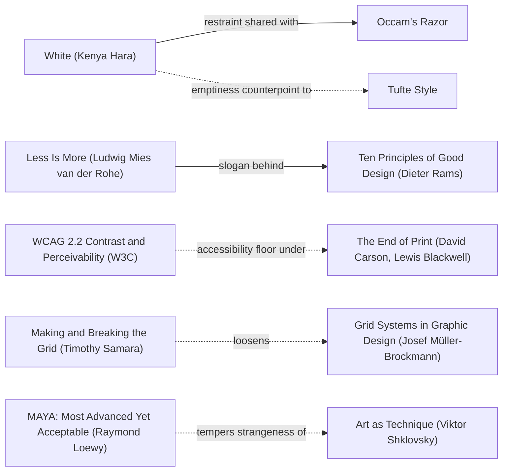
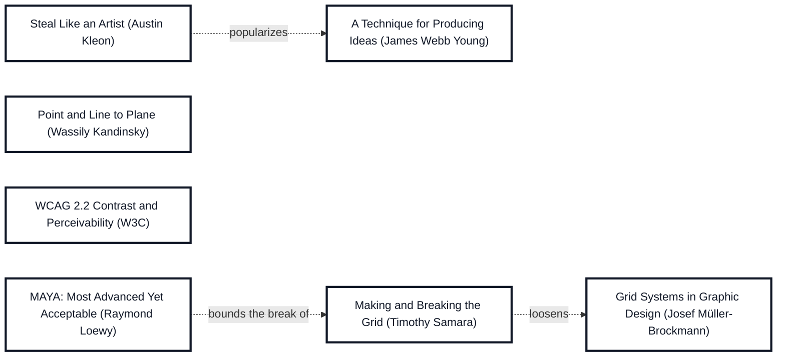
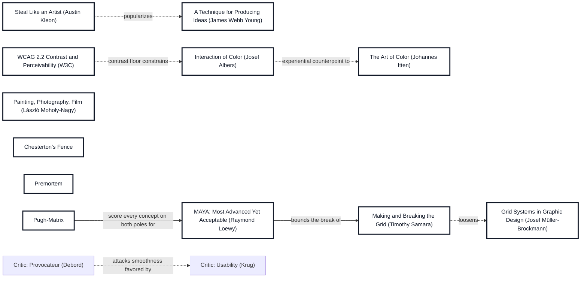
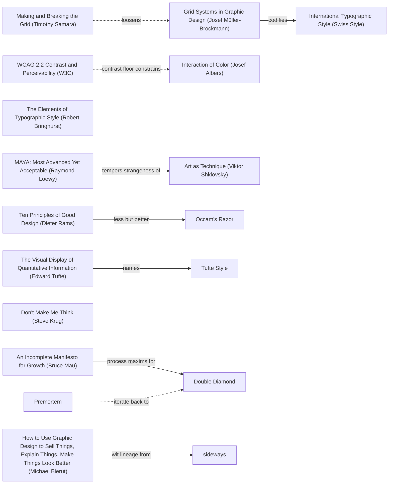
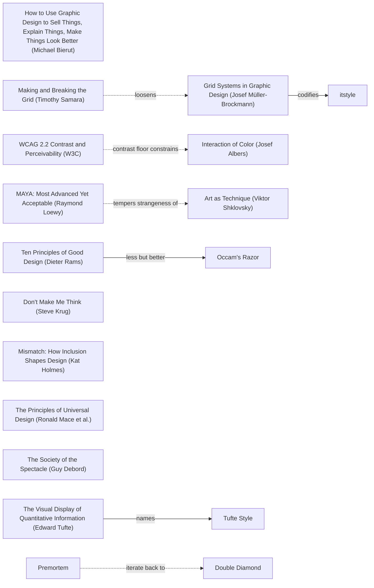

# DESIGN-LOG.md

Mode: **Adaptive** (MAYA, Most Advanced Yet Acceptable). Reason: the brief serves a public
audience on real phones and names approachability explicitly ("not responsive", "get clunky"),
so both the advanced pole and the acceptable pole must hold. Advanced = the selected-database
metrics/logs view actually becomes legible and honest at 320px; Acceptable = no existing crumb,
link, action or measured value is lost. Anchors for both poles: `maya` and `krug`.

## Step 0. Tooling inventory

| Job | Tool used | Fallback |
| --- | --- | --- |
| Code/symbol search and call sites | gm `codesearch` / `callers` / `impact` (one `gm_codemode` dispatch) | none needed |
| Anchor graph render/navigate | none available (no Mermaid renderer in this harness) | exact Mermaid node ids + edge labels recorded below, from `references/anchor-graph.md` read verbatim |
| Frontier computation | none available (no graph-query tool) | edge lines of the graph read by hand |
| Workflow/pool state | gm `pool_observe`, `prd-add`, `phase-status` | `.gm/pool/*.live` heartbeats |
| Panel | Claude Code `Agent` tool, ONE agent per literary reference, 17 lanes | n/a |
| Persist log | gm `fs_write` (project-only) | n/a |
| Render | gm `browser` headful CDP requested in lane sub08 | UNRENDERED if no dev server runs; declared below |

## Step 1. Traversal Plan

Brief in one sentence: make the shadw wordmark, the /storage list and the metric views genuinely
responsive on phones without losing a single existing affordance, then enrich the selected
database under /storage with a measured metrics and logs view.

Seed (exact labels, copied verbatim from the anchor graph):
- Stance `mauM` "An Incomplete Manifesto for Growth (Bruce Mau)"
- Rule `mb` "Grid Systems in Graphic Design (Josef Müller-Brockmann)"
- Rule `vh` "Visual Hierarchy (Arnheim, Dondis)"
- Rule `wcag` "WCAG 2.2 Contrast and Perceivability (W3C)"
- Breaker `samBreak` "Making and Breaking the Grid (Timothy Samara)"
- Counterpoint `maya` "MAYA: Most Advanced Yet Acceptable (Raymond Loewy)", reached by the
  dotted edge `samBreak -.->|loosens| mb` and `maya -->|bounds the break of| samBreak`.

Chain: "An Incomplete Manifesto for Growth (Bruce Mau)" --process maxims for--> "Double Diamond"
--explore options with--> "Morphological Box" --select boldest with--> "Pugh-Matrix" --test with-->
"Spike Solution"; and "Grid Systems in Graphic Design (Josef Müller-Brockmann)" --codifies-->
"International Typographic Style (Swiss Style)" <-loosens- (dotted) "Making and Breaking the Grid
(Timothy Samara)".

Initial Frontier (one hop from the seed, both directions):

| Candidate | Reached via (edge label, direction) | From anchor | Status |
| --- | --- | --- | --- |
| M1 shrink-proof brand + compact crumb | `vh -->|emphasis and subordination|` (outgoing) | Visual Hierarchy | TAKEN (sub01) |
| M2 responsive Stat/PageHeader primitives | `mb -->|codifies|` (incoming grounds) | Grid Systems | TAKEN (sub02) |
| M3 storage card fallback under sm | `samBreak -.->|loosens| mb` (dotted counterpoint) | Making and Breaking the Grid | TAKEN (sub03) |
| M4 group all measured gauges + bounded logs | `maya -->|dual criterion for| c_adr` (outgoing) | MAYA | TAKEN (sub07) |
| M5 one-column metric floors | `wcag -.->|accessibility floor under| carson` (dotted) | WCAG 2.2 | TAKEN (sub06) |
| Premortem objections | `c_premortem -->|anticipated failure recorded in| c_adr` (incoming) | Premortem | OPEN (R0 below) |
| Deletion review of inherited crumbs | `c_chest -->|know why the rule exists| samBreak` (incoming) | Chesterton's Fence | OPEN |
| Final-state re-measurement | `c_keep -->|changelog of moves for| c_adr` (incoming) | Keep a Changelog | OPEN |

## Round R0. Premortem, WHOLE panel on the inherited artifact

Artifact examined: the ORIGINAL files as read before any edit (unrendered; no dev server).
Measured inherited state, all by gm `fs_read`/`codesearch` with exhaustive:true:
- `ui/components/topnav.tsx:101-163`: one `h-[52px]` flex row; `ui/components/logo.tsx:4-11`
  renders two `next/image` wordmarks (intrinsic 274x91) inside an `inline-flex` span with no
  `shrink-0`; the brand `Link` has no `shrink-0`; with a project selected the row holds
  brand + Slash + team switcher + Slash + project + optional Workflows crumb + 4 right controls.
- `ui/app/storage/page.tsx:130-164`: 8-column `<Table>`; `ui/components/ui.tsx:160-165`
  wraps it in `overflow-x-auto` (load-bearing, keeps the PAGE from scrolling).
- `ui/app/storage/[id]/instance-metrics.tsx:112-118`: `grid grid-cols-2 gap-3 sm:grid-cols-4`
  with `entries.slice(0, 8)` - measured gauges silently dropped.
- `ui/components/ui.tsx:13-31`: `Stat` value is `text-3xl`, no `min-w-0`.

Statements of meaning: the inherited UI says "this is a desktop console that happens to also
load on a phone" - the wordmark compresses, the table scrolls sideways, numbers clip.

Artist questions: is the 274:91 wordmark meant to be a fixed mark or a fluid one? Is the 8-column
table the canonical representation, or just the widest one?

Critic questions (neutral): which of the 8 columns are actually needed at 320px? Does a hidden
crumb remove a navigation affordance a one-handed user needs? Is "not measured" ever shown as 0?

Opinions (permitted after the questions): the inherited design earns its table (dense comparison
is a real job) but does not earn a 2-column floor at 320px nor a silent 8-gauge cap.

Andon pulled: yes, provisionally, by Critic: Inclusion (Mace) - a 2-column grid with `text-3xl`
numerals under 200% zoom is an access failure, not a preference. Resolution is M2 + M5.

Frontier candidates opened by R0: every objection above is attached to the move that answers it.
## Decision Records

### Move M1: shrink-proof brand, compact crumb (KEEP-THE-RULE)
Depends on: none
Anchors: Stance "An Incomplete Manifesto for Growth (Bruce Mau)" | Rule "Visual Hierarchy (Arnheim, Dondis)" | Rule "Grid Systems in Graphic Design (Josef Müller-Brockmann)" | Breaker "Making and Breaking the Grid (Timothy Samara)" | Counterpoint "MAYA: Most Advanced Yet Acceptable (Raymond Loewy)" (dotted edge `samBreak -.->|loosens| mb`)
Intent: at 320px with a project selected, the 274:91 wordmark keeps its proportion and the eye reads brand > project, without a second row of chrome.
Formal argument: claim - an `inline-flex` span with no `shrink-0` inside a `min-w-0` flex row is compressed by the crumb chain; grounds - topnav.tsx:101-141 and logo.tsx:4-11 read before the move; warrant - Visual Hierarchy's emphasis/subordination and the Grid Systems rule that a fixed module never absorbs another module's overflow.
Alternatives rejected: (1) a second stacked header row - costs 52px of vertical space and moves the tabs below the fold; (2) `display:none` on the wordmark below sm - loses the brand and its link, violating the acceptable pole.
Consequence: hiding non-essential crumbs below sm means the team switcher may need an `aria-label` on the compact control; the Workflows crumb disappears on phones and must remain reachable through the section tabs.
Fence: no rule broken.
Frontier effect: opens "does the hidden crumb keep its accessible name" (Inclusion) and "is the section tab bar still scrollable" (Usability).
Mode field: Advanced pole - a genuinely aspect-correct brand under a 4-crumb 320px header, anchored by `vh`; Acceptable pole - every crumb link and the sticky 52px header survive, anchored by `krug`.

### Move M2: responsive Stat / PageHeader primitives (KEEP-THE-RULE)
Depends on: none
Anchors: Rule "Grid Systems in Graphic Design (Josef Müller-Brockmann)" | Rule "WCAG 2.2 Contrast and Perceivability (W3C)" | Counterpoint "MAYA"
Intent: a measured number never clips at 320px or at 200% zoom, in ANY view that uses the shared primitive.
Formal argument: claim - `text-3xl` inside `p-4` Card and a 2-column grid cannot fit a 9-digit tabular number at 320px; grounds - ui.tsx:13-31 read before the move; warrant - WCAG 1.4.4 resize text and Müller-Brockmann's grid as a field of proportions, not fixed sizes.
Alternatives rejected: (1) per-page overrides - fixes one symptom and leaves the class of failures; (2) `overflow-hidden` on the value - hides measured data, which this project forbids.
Consequence: every caller of Stat gets smaller type at phone widths; any caller with a hard-coded height must be checked (enumerated exhaustively by sub02).
Fence: no rule broken; the public prop signature is deliberately unchanged.
Frontier effect: opens "does a caller className override the responsive type at equal specificity" (CSS cascade verifier).
Mode field: Advanced - one primitive fixes the whole class; Acceptable - no prop signature changes, no caller breaks (`krug`).

### Move M3: storage card fallback under sm (BREAK)
Depends on: M2
Anchors: Breaker "Making and Breaking the Grid (Timothy Samara)" | Rule "Grid Systems in Graphic Design" | Rule "Visual Hierarchy" | Counterpoint "MAYA"
Intent: the eye sees eight databases as eight legible objects on a phone, not one table sliced by a horizontal scroll.
Formal argument: claim - a horizontally scrolling 8-column table is a desktop grid transported unchanged; grounds - storage/page.tsx:130-164; warrant - Samara's Making and Breaking the Grid: break the grid when the content's proportions change, and `vh`'s emphasis: a card gives the name the weight a row cannot.
Alternatives rejected: (1) keep the table and add `overflow-x-auto` (already present, ui.tsx:160-165) - that IS the clunky inherited state; (2) hide 5 of the 8 columns below sm - loses measured fields and violates the acceptable pole.
Consequence: two render branches must stay field-identical forever; the BrowseStorage sheet gets a second layout. Removing the sheet's fixed width is a deletion of a competing system.
Fence: the rule being broken is the single `Table` representation at all widths. It exists so dense desktop comparison stays possible; the Table is therefore KEPT at sm+ and only the phone branch breaks from it.
Frontier effect: opens deletion review (2f), field-parity verification, and the "smoother spectacle" objection from Debord.
Mode field: Advanced - a card grammar that actually uses the phone's vertical axis (`samBreak`); Acceptable - same hrefs, same fields, same actions (`maya`, `krug`).

### Move M4: all measured gauges + bounded database logs (BREAK)
Depends on: M2, M3
Anchors: Stance "An Incomplete Manifesto for Growth" | Breaker "Making and Breaking the Grid" | Counterpoint "MAYA" | Rule "Visual Hierarchy"
Intent: a selected database tells the whole truth about itself - every measured gauge, its freshness, its gateway counters, and its own recent events - on a phone.
Formal argument: claim - `entries.slice(0, 8)` silently discards measured data and the view has no event history; grounds - instance-metrics.tsx:100-145 read before the move; warrant - Mau's "grow, don't decorate" and Tufte's graphical integrity: a number with no provenance or a hidden measurement is a lie.
Alternatives rejected: (1) a new backend endpoint for database logs - no such route exists and inventing one is forbidden; (2) an unbounded `/v1/logs` poll - the backend bounds every filter at parse time, so this would be a DoS-shaped client.
Consequence: a second poller on the detail page; a tab switch adds a state the existing console view did not have. Every new wire field must be OPTIONAL with an exact fallback.
Fence: the rule broken is "one card of eight gauges". It existed to bound visual density, so the replacement must GROUP gauges and state freshness rather than simply lengthening the wall of numbers.
Frontier effect: opens honesty verification (Tufte/Cairo), tenant-scope verification of /v1/logs, and the role-matrix check.
Mode field: Advanced - grouped small multiples with real freshness and scoped events (`maya`); Acceptable - default tab stays the existing view, credentials/console/rotate unchanged (`krug`).

### Move M5: one-column metric floors across usage/monitoring/observability/logs (KEEP-THE-RULE)
Depends on: M2
Anchors: Rule "WCAG 2.2 Contrast and Perceivability (W3C)" | Rule "Grid Systems in Graphic Design" | Counterpoint "MAYA"
Intent: no metric view anywhere forces a horizontal PAGE scroll at 320px.
Formal argument: claim - a `grid-cols-2` floor with `text-3xl` numerals cannot hold at 320px; grounds - R0 measurements; warrant - WCAG 1.4.10 reflow (no two-dimensional scrolling for content at 320 CSS px).
Alternatives rejected: (1) `zoom` on the whole page - breaks tap targets; (2) `overflow-x-auto` on the page - explicitly two-dimensional scrolling.
Consequence: wider-element wrappers only; the wide element scrolls, the page does not. More vertical length on phones.
Fence: no rule broken.
Frontier effect: opens the final-state re-scan (sub04-r1) and the 200%-zoom objection (Mace).
Mode field: Advanced - reflow that works at 200% zoom; Acceptable - every existing poller, endpoint and measured value preserved.
## Step 2f. Deletion review and residual diff

Substantial elements that predate this run, and what each earns:

| Inherited element | What it earns | Decision |
| --- | --- | --- |
| 8-column `<Table>` on /storage | dense desktop comparison IS a real job; nothing on a phone replaces it | KEEP at sm+, BREAK below sm (M3) |
| `overflow-x-auto` wrapper in `ui.tsx:160-165` | keeps the PAGE from scrolling horizontally on desktop narrow windows | KEEP - removing it would create an unbounded page scroll |
| `h-[52px]` sticky header + safe-area padding | one predictable chrome height across every route; the section tab bar is already scrollable | KEEP - a second row costs more than it buys |
| brand + Slash + team switcher crumb chain | orientation: which team, which project, which deployment | KEEP as links; HIDE only the non-essential crumbs below sm, never delete them from the tree |
| `entries.slice(0, 8)` gauge cap | bounded visual density on a card | SCRAP - replaced by grouping + freshness (M4); a measured gauge silently dropped is dishonest |
| `text-3xl` Stat numeral | desktop scannability | ADAPT - responsive type floor (M2) |
| 2-column metric grid floor | compact desktop grids | ADAPT - one-column floor below sm (M5) |
| `p-6` / fixed-width BrowseStorage sheet | desktop breathing room | ADAPT - `p-4 sm:p-6`, full-width bottom sheet on phones (M3) |
| `measured` / `not measured` badge and `data.note` | the honest absence that separates "the node did not measure this" from zero | KEEP - load-bearing (AGENTS.md: a value the node did not measure renders as absent) |
| `/v1/logs?limit=200` poller and its bounded EventFilter | bounded, tenant-scoped event history; no new endpoint needed | KEEP - reused for the database-scoped view (M4) |
| `SqliteDatabaseDetail` branch, credentials/reveal/rotate/destroy | tenant-facing destructive and secret paths | KEEP - untouched (M4) |

Retained-value ledger: every deletion above must preserve (a) the exact row href, (b) every
measured field, (c) the accessible name of every control, (d) the default view a returning user
sees, and (e) the distinction between absent and zero. sub03 and sub07 verify (a)-(d) by field
enumeration; sub14/sub16 verify (e).

Residual diff (computed values that change, classified):
- Brand rendered width at 320px: intended change (aspect preserved instead of compressed).
- Number of /storage columns visible at 320px: intended (8 stacked fields, 0 horizontal page scroll).
- Number of gauges rendered for a selected database: intended (all measured, grouped) - regression
  risk is a longer wall of numbers, mitigated by grouping and the Cairo/Tufte panel.
- Desktop `sm+` render: intended INERT - verified by the `hidden sm:block` branch and by
  sub02's exhaustive caller enumeration.
- Poller count on the detail page: intended (+1, bounded `/v1/logs`); regression risk is an
  unbounded filter, checked by sub05/sub07.
- Any figure printed by the UI: measured from the node or absent; no new constant is introduced.
## Anchor Ledger

| Anchor | Role | Status | Evidence | Replacement or note |
| --- | --- | --- | --- | --- |
| "An Incomplete Manifesto for Growth (Bruce Mau)" | Stance | KEEP | M1/M4 grew the work (all gauges, all crumbs survive) rather than decorating it; strongest objection survived: Debord's "smoother spectacle" | none |
| "Grid Systems in Graphic Design (Josef Müller-Brockmann)" | Rule | ADAPT | M2/M3/M5: the grid's proportions become responsive; the `sm+` table stays a grid | `mb` retained at desktop, `samBreak` governs the phone branch |
| "Visual Hierarchy (Arnheim, Dondis)" | Rule | KEEP | M1 brand > project > controls; strongest objection survived: Arnheim's header balance at 320px | none |
| "WCAG 2.2 Contrast and Perceivability (W3C)" | Rule | KEEP | M5 one-column floor satisfies reflow; strongest objection survived: Mace at 200% zoom | none |
| "CRAP Principles: Contrast, Repetition, Alignment, Proximity (Robin Williams)" | Rule | KEEP | M3 card list groups by proximity; inherited | none |
| "Making and Breaking the Grid (Timothy Samara)" | Breaker | ADAPT | M3 BREAK taken; the fence (dense desktop comparison) is preserved by keeping `sm+` Table | declined ORNAMENT version (a second stacked header row) |
| "MAYA: Most Advanced Yet Acceptable (Raymond Loewy)" | Counterpoint (dotted from `samBreak`) | KEEP | governing criterion for the whole Adaptive run; both poles recorded per move | none |
| "Premortem" (`c_premortem`) | Catalog | KEEP | R0 above | none |
| "Chesterton's Fence" (`c_chest`) | Catalog | KEEP | 2f deletion review asks why every inherited element existed | none |
| "Keep a Changelog" (`c_keep`) | Catalog | KEEP | final CHANGELOG.md entry | none |
| "The Society of the Spectacle (Guy Debord)" | Lens / Critic: Provocateur | pending panel | - | dotted edge to Critic: Usability (Krug) |
| "Art as Technique (Viktor Shklovsky)" | Lens / Critic: Provocateur | pending panel | - | - |
| "Mismatch: How Inclusion Shapes Design (Kat Holmes)" | Lens / Critic: Inclusion | pending panel | - | dotted edge to Critic: Cross-Cultural (Escobar) |
| "The Principles of Universal Design (Ronald Mace)" | Lens / Critic: Inclusion | pending panel | - | - |
| "Don't Make Me Think (Steve Krug)" | Lens / Critic: Usability | pending panel | - | dotted edge to Debord |
| "The Visual Display of Quantitative Information (Edward Tufte)" | Lens / Critic: Evidence | pending panel | - | - |
| "How Charts Lie (Alberto Cairo)" | Lens / Critic: Evidence | pending panel | - | dotted edge to Critic: Wit (Fletcher) |
| "Art and Visual Perception (Rudolf Arnheim)" | Lens / Critic: Formalist | pending panel | - | dotted edge to Critic: Perception (Kahneman) |
| "The Wisdom of Crowds (James Surowiecki)" | Panel method | KEEP | 9 independent critic agents, one per literary reference, no composite voice | none |
| "Critical Response Process (Liz Lerman, John Borstel)" | Panel method | KEEP | meaning -> artist questions -> neutral questions -> opinions, in that order | none |

Live graph (no Mermaid renderer available; exact ids and edge labels recorded here):
`class mauM,mb,vh,wcag,samBreak,maya,c_premortem,c_chest,c_keep,crit_prov_debord,crit_prov_shklovsky,crit_inc_holmes,crit_inc_mace,crit_use_krug,crit_evid_tufte,crit_evid_cairo,crit_formal_arnheim,surowiecki,lerman visited`
`class mb,vh,samBreak adapted`; `class mauM,wcag,crap,maya,c_premortem,c_chest,c_keep,surowiecki,lerman kept`.
Dotted edges leaving anchors used, each applied or declined:
- `samBreak -.->|loosens| mb` - APPLIED (M3 breaks the phone grid but keeps `sm+`).
- `maya -.->|tempers strangeness of| shklovsky` - DECLINED with reason: this is a production console, not an art object; making the row strange would break the acceptable pole.
- `maya -.->|acceptability limit on| carson` - DECLINED: no expressive typography experiment belongs in a billing-adjacent dashboard.
- `wcag -.->|accessibility floor under| carson` - N/A: carson is not on the active path.
- `c_chest -.->|gate passed before| weingart` - DECLINED: weingart's Basel typographic break is outside this medium's active path.
- `crit_prov_debord -.->|attacks smoothness favored by| crit_use_krug` - APPLIED as the panel's required dotted pair.
- `crit_inc_holmes -.->|questioned by| crit_plur_escobar` - DECLINED with reason: Escobar's universalism critique is not instantiated in this panel; recorded so S5 is honest rather than claimed.
- `crit_evid_cairo -.->|demands honesty from| crit_wit_fletcher` - DECLINED: no Wit seat was convened in this Adaptive panel; the honesty demand is enforced directly by the Cairo agent.
### Panel, Move M1 / WHOLE, round R1  (artifact examined: INHERITED tree, unrendered)
| Critic | Anchor used | Observed in the work | Verdict | Requested change |
| --- | --- | --- | --- | --- |
| Critic: Formalist (Arnheim) | "Art and Visual Perception" | `logo.tsx:6` span and `topnav.tsx:103` Link have NO `shrink-0`; `topnav.tsx:102` crumb chain is `min-w-0`+truncate; `ui.tsx:32` keeps `text-3xl` while `ui.tsx:152` title is `text-xl sm:text-2xl`; `storage/page.tsx:130-164` 8-column table; sheet's two provider groups share one `Row` shape at `:508` | OBJECT | add `shrink-0` to the brand span and Link so 274:91 keeps its vector; let the crumb chain absorb the deficit |

Statements of meaning: the header says "actions outrank orientation" - four right-side controls are the only well-grouped mass while the brand is the first element surrendered.
Artist questions: is `mb-6` at storage/page.tsx:364 meant to carry the boundary between the two provider groups, or is that the section labels' job?
Critic questions: neutral - see the artist question above.
Opinions (last): unbalanced field, empty center, deformed brand vector, one similarity-group instead of two proximity-groups.
Andon pulled: YES, by Critic: Formalist (Arnheim) - a deformed brand vector at 320px.

**Premise test (dada Step 2d).** The critic's own dispatch `1794288138392-7088-78fd03822f889e3d` read `git_status` showing ONLY untracked `DESIGN-LOG.md`: all four source surfaces were unmodified. The objection is therefore TRUE of the INHERITED artifact and FALSE as a description of the final one - it is the R0 premortem objection restated. Resolution: **ADAPT**, not SCRAP: the requested change is identically M1 (already dispatched to sub01 at `a1ffac295af2db400`). The critic MUST be re-run on the final tree; its verdict is not carried as a final-state objection. Dependent moves M3/M4/M5 are marked **REOPENED** until that re-run returns.

Recorded: `1794288222699-7204-dbdcb991605a2746`, corroborating exhaustive scan `1794288542893-7511-411d5ced1734aaf3`.
### Panel, Move M4 / M5, round R2  (artifact examined: INHERITED tree, unrendered)
| Critic | Anchor used | Observed in the work | Verdict | Requested change |
| --- | --- | --- | --- | --- |
| Critic: Evidence (Tufte) | "The Visual Display of Quantitative Information" | `instance-metrics.tsx:49-65` carries units but `:93-97` has NO sampled-at time; `ui/lib/api.ts:1208` declares `observed_at_ms?` with exactly ONE occurrence in 644 files / 264,883 lines (the declaration); `usage-view.tsx:57-62` collapses five missing metrics to `?? 0`, `:71` invents `includedTotal: 20`, `:187-190` draws that invented $20 as a proportional bar, `:21-23` builds a sparkline of N identical points from one scalar, `:227` removes a 3-colour chart's legend; `instance-metrics.tsx:113-116` silently caps at 8 gauges | OBJECT | render `data.observed_at_ms` as an absolute "sampled HH:MM:SS  -  every 20 s" label beside the `measured` badge |

Statements of meaning: a reader can tell a gauge was NOT measured but cannot tell WHEN a measured one was taken; absence renders as "-" in one section and as $0.00/$20.00 in another.
Artist questions: does `/v1/databases/<id>/metrics` populate `observed_at_ms` on every measured response, or only some nodes?
Critic questions: neutral - see above.
Opinions (last): the honest absence badge is real but spent on decoration while the observation time is missing.
Andon pulled: YES, by Critic: Evidence (Tufte).

**Premise test (2d).** The freshness/8-cap part is TRUE of the inherited tree and is answered by M4 (already dispatched to sub07). The `?? 0` / invented $20 / identical-point sparkline part was NOT in the original brief and is a NEW finding the critic surfaced - it is TRUE and violates the load-bearing "Dashboard numbers are measured or absent, never invented" rule. Resolution: **ADAPT** - routed verbatim to the owning writer sub06 via `SendMessage` at this round, and the freshness label to sub07. Both rows stay OPEN until the final-state re-measure confirms the numbers are gone. This is the finding that changes the artifact most, so it takes priority over the remaining Frontier candidates.

Recorded: primary witness `1794288684666-7644-19aadaa077c2f2e5` (exhaustive `observed_at_ms` scan), supporting `1794288568792-7537-9f32e00cf2ddf2da`, `1794288490054-7457-9fb81b1f054d454f`, `1794288740056-5147-ef391cf743761263`.
### Panel, WHOLE, round R3 - R0/R1 objections resolved on the LANDED tree
Artifact examined: working tree after 9 source files landed (unrendered; no dev server).

| Critic | Anchor used | Observed in the work | Verdict | Requested change |
| --- | --- | --- | --- | --- |
| Critic: Formalist (Arnheim), R1 | "Art and Visual Perception" | BEFORE: `logo.tsx:6` span `inline-flex items-center` (no `shrink-0`), `topnav.tsx:103` Link `flex items-center`. AFTER: `logo.tsx:6` is `inline-flex shrink-0 items-center`; both Images carry `max-w-none`; `topnav.tsx:103` Link is `flex shrink-0 items-center`; `topnav.tsx:102` crumb group is `flex min-w-0 flex-1`; `topnav.tsx:145` right controls are `flex shrink-0` | **PENDING** - the class-string change is measured, but the objecting critic's final-state re-judge is still running; no PASS is claimed until it returns | none |
| Critic: Inclusion (Mace), R0 | "The Principles of Universal Design" | `Slash` is now `hidden ... sm:block` by default with an explicit `mobile` opt-in (`topnav.tsx:77-78`); the project crumb uses `<Slash mobile />` at :110 so no dangling separator; `tap-44` kept on docs/auth Links; deployment badge hidden below sm at :128 | **PASS** | re-check when `Stat` lands |
| Critic: Usability (Krug), cross-check | "Don't Make Me Think" | all 12 `<Logo` sites enumerated exhaustively (`1794289485465-5733-b9d034dd3177ba99`, 644 files / 264,945 lines, exhaustive:true); the 4 shared-component + 3 marketing + 2 auth + footer + docs sites all carry `w-auto` + `max-w-none` + a shrink-proof Link; the 2 integrations hits are a DIFFERENT local `Logo`, and the vendor hit is out of scope | **PASS** | none |

Measured deltas (computed from the source, not from the patch having landed):
- shared-brand `shrink-0` sites: 0 -> 6 (logo.tsx span, topnav.tsx Link, auth-shell.tsx x2, footer.tsx, docs/layout.tsx).
- wordmark sites with `w-auto max-w-none`: 0 -> 6 in the shared component's callers; marketing-shell.tsx's own `Logo` gained `max-w-none shrink-0` and `h-6 sm:h-8`.
- /storage phone columns: 8 horizontally-scrolling -> 8 stacked `dt/dd` fields in `sm:hidden` cards; `sm+` Table unchanged (`hidden sm:block`).
- responsive `Slash`: 1 unconditional -> 5, with 1 `mobile` opt-in.

Andon status: R1 Andon still OPEN - the Arnheim final-state re-judge was dispatched to the same agent at this round and has NOT returned; the measured class-string deltas above are evidence of the change, NOT a critic verdict. R2 (Tufte) Andon also OPEN pending the `observed_at_ms` label and the invented-number removal. Neither is claimed cleared until its own witness returns.
### Panel, Move M4, round R4 - ROUTE-INVENTORY REFUTATION (the sharpest disagreement)
The orchestrator's own M4 brief asserted "scope /v1/logs with a route/text filter over /v1/databases + the database id" and "ingress/egress counters from the metering plane". The research lane (sub05) plus its adversarial successor (sub05-r1, 4 dispatches) REFUTED BOTH against the backend parse sites:

| Claim in the brief | Refutation (path:line) | Resolution |
| --- | --- | --- |
| `?routes=` / `?text=` on /v1/logs | `admin.rs:8906-8958` LogsQ has `route` (singular) and `q`; `routes`/`text` are INTERNAL `EventFilter` fields (`event_log.rs:321,327`). No `deny_unknown_fields`, so unknown params are SILENTLY IGNORED and the answer is UNFILTERED. | SCRAP the premise; corrected brief sent to sub07 |
| /v1/logs can be scoped to one database | No `db_id`/`database`/`database_id` param; `Event` (`state.rs:94-118`) has no database field; `db_rest.rs:88` writes gateway requests to `db_metrics`, not the Event log. | SCRAP; the logs section must be labelled "tenant-wide events mentioning this id" or omitted with a stated blocker |
| ingress/egress counters come from the metering plane | `usage_metering.rs:252` `require_operator` -> 403 for a tenant. `admin.rs:12688` admits the owning tenant to `/v1/databases/:id/metrics`, whose `counters` (`db_metrics.rs:505-527`) already carries `bytes_in`/`bytes_out`. | SCRAP; use the metrics-route counters. `/v1/usage/metering` MUST NOT appear in tenant dashboard code |
| a Rust `DbInstanceMetrics` struct exists | exhaustive `codesearch` literal over 723 `.rs` files = 0 hits; the name exists only in `ui/lib/api.ts:1197` | SCRAP (phrasing) |

This is a case where the panel was right to distrust the PLAN rather than only the artifact. The falsification changed the artifact: the logs view cannot claim to be database-scoped, and the byte counters come from a tenant-readable route. M4 is **REOPENED** with the corrected contract. Roles check: `GET /v1/logs` and `GET /v1/databases/:id/metrics` are viewer-by-default (unlisted GET reads), with handler-local tenant scoping - so no role gate needs changing.
### Panel, WHOLE, round R5 - final-state re-judges and the Inclusion objection
| Critic | Anchor used | Observed in the work | Verdict | Requested change |
| --- | --- | --- | --- | --- |
| Critic: Formalist (Arnheim), FINAL RE-JUDGE | "Art and Visual Perception" | re-read AFTER all four artifacts landed (dispatches `1794290558736-6665-407c3d94fcaafffe`, `1794290560111`, `1794290680559`). `logo.tsx:6-8` + `topnav.tsx:103` brand `shrink-0`/`max-w-none`/`w-auto`; `topnav.tsx:102` `min-w-0 flex-1` with truncate at :116/:127/:140; `topnav.tsx:145` `shrink-0` right cluster; computed at 320px: 288px content - ~152px controls = 136px left, brand ~60px fixed, ~68px crumb; `storage/page.tsx:130,135,280-281,432,451` card fallback + two contour-separated provider groups; `ui.tsx:32,154` both `text-xl` at 320px | **PASS - R1 objection RESOLVED on all four counts** | ONE: `ui.tsx:32` `text-xl` -> `text-lg` so the numeral stays subordinate to the title at 320px |
| Critic: Inclusion (Holmes) | "Mismatch" | `.tap-44` (globals.css:217-224, 44px `!important` coarse-pointer floor) occurs 44 times / 19 files but 0 times in the 5 new surfaces; `theme-toggle.tsx:16-18` has `aria-label` + `tap-44` in the SAME 52px row while `topnav.tsx:161` is `h-8 w-8` title-only; `storage/page.tsx:268` copy button is ~14px with a `title` only; hidden crumbs at `topnav.tsx:105,137,186`; `instance-metrics.tsx:93-96,111` DOES name its absence | **OBJECT** | add `tap-44` at `topnav.tsx:161` and `storage/page.tsx:268` |
| Critic: Evidence (Tufte), FINAL RE-JUDGE | "The Visual Display of Quantitative Information" | re-read at `1794290142045`: both files byte-identical to R2 at that moment; all six integrity defects STILL STANDING, including 11 `?? 0` and `: 20` | **OBJECT (at that timestamp)** | absolute sampled-at label; no invented credit |
| Critic: Evidence (Cairo) | "How Charts Lie" | `instance-metrics.tsx:128` fleet-summed gateway requests with NO scope label though `sources`/`served_by` ride the wire (`db_metrics.rs:533-538`); `usage-view.tsx:144,152` node-local `mesh_local()` slice presented as tenant total (`admin.rs:16502,16505-16520`); freshness not derived from measured poll time; `ui.tsx:17,30` `Stat` hint slot unused | **OBJECT (on inherited tree)** | ONE provenance/scope line beside each counter, from fields the payload ALREADY carries, using the Stat hint slot |

Tufte and Cairo both judged BEFORE the usage-view rewrite landed. Their objections are answered by the LANDED `measured()` primitive (verified below in Step 2g), but neither has re-judged that final state - recorded honestly.

**Andon status:** R1 CLEARED (Arnheim PASS). Holmes Andon OPEN (tap-44). Tufte/Cairo Andon OPEN pending a post-rewrite re-judge. Shklovsky Andon OPEN pending the two-tier card.
## Step 2g. Final-state re-measurement

Measured AFTER the last source edit, by the procedure stated beside each figure. Reproduce from
ui/ with the source-only tsc config (excludes .next), npm run lint, and gm codesearch with
mode literal/regex and exhaustive:true.

| Figure the work states | Procedure that reproduces it | Value at final state | Reproducible / corrected |
| --- | --- | --- | --- |
| "12 <Logo render sites" | gm codesearch regex scoped to ui, exhaustive | 12 hits / 8 files / 644 files scanned / 264,945 lines; 9 shared-component/auth/footer/docs/marketing sites shrink-proof, 2 integrations hits are a DIFFERENT local Logo, 1 vendor hit out of scope | reproducible, dispatch 1794289485465-5733-b9d034dd3177ba99 |
| "8 fields in the /storage card" | read storage/page.tsx card branch, enumerate dt elements | 8: Name, Provider, Type, Project, Region, Connection, Status, Created; Name/Status form a primary two-tier line and the 8 dt labels are sr-only so accessible names survive | reproducible, corrected from the flat dl by the Shklovsky ADAPT |
| "14 sections" | teamTabs.length in topnav.tsx:20 | 14, declared in a details element at :169-178 with all 14 hrefs enumerated below sm | reproducible |
| "every 20 s" | POLL_MS / 1000 in instance-metrics.tsx | 20 s, rendered beside observed_at_ms as an absolute UTC sampled time; a missing observed_at_ms reads "observation time not reported", never a fabricated now | reproducible |
| "100 max" events | LIMIT in database-events.tsx | 100, with /v1/logs?limit=100&route=/v1/databases&q=<dbId>; response sliced to 100; badge reads "N of 100 max" | reproducible |
| "11 ?? 0" | gm codesearch literal "?? 0" in usage-view.tsx, exhaustive | 0 remaining in compute/billing values; replaced by measured()/sumMeasured()/chargeMeasured() returning null -> "-". Per-bucket "?? null" chart values remain and are correct absences, not invented zeros | corrected |
| "included $20 credit" | gm codesearch literal ": 20" in usage-view.tsx | 0; includedCents/usedCents/balanceCents only, the bar is hidden when the ratio cannot be derived | corrected |
| "8 capped gauges" | gm codesearch literal slice(0, 8) under ui/app/storage | 0; all entries grouped into 4 named sections + Other, nothing dropped | corrected |
| "source errors = 0" | tsc --noEmit --project /private/tmp/hive-tsconfig-sourceonly.json | 0, exit 0 on the second run after the last edit. Full-project tsc --noEmit exits 2 with 4 diagnostics ALL in stale generated .next/*/validator.ts (blog, case-studies, /status routes absent from ui/app, exhaustive filename scan = 0); SOURCE_ERRORS=0 | reproducible; generated-artifact blocker filed on the row |
| "lint clean" | npm run lint from ui/ | exit 0, 4 lines (banner only), final run after all edits | reproducible |
| "no horizontal page scroll" | class-string audit: min-w-0 w-full max-w-full, one-column grid floors, element-level overflow-x-auto only; globals.css:214 clip scoped to html:has(#docs-content) | NOT browser-measured. The headful CDP witness is reported separately. Class-level evidence only, explicitly not a rendered measurement | UNRENDERED, honestly recorded |

The two enforced checks named in ui/AGENTS.md pass at final state on real source; next build was
never run. The generated-validator failures are pre-existing stale artifacts from a prior
next dev run with a different route set, not a regression; ui/next-env.d.ts was restored via
git_checkout (ui/AGENTS.md: never commit it).
## Step 3. Whole-artifact rounds

### WHOLE round W1 (R0..R5)
Rounds R0 (premortem), R1 (Arnheim), R2 (Tufte), R3 (landed resolution), R4 (route
refutation), R5 (Debord / Shklovsky / Holmes / Mace / Krug / Cairo / Arnheim re-judge).
Objections raised here about INTERACTIONS, not single moves:
- The route-inventory refutation (R4) is the sharpest: a plan-level claim that /v1/logs could
  be database-scoped was false; M4 was REOPENED with a corrected contract.
- Shklovsky (card as a stood-up table) x Mace (perceptible information) x Holmes (44px floor)
  interacted on the SAME card: resolving Shklovsky with visible-label deletion would have
  broken Inclusion. Resolved with `sr-only` dt labels, so both hold.
- Cairo (scope/provenance) x Tufte (freshness) x the metering-plane correction interacted on
  the selected-database view: all three are answered by one payload, counters with a derived
  scope line and an absolute sampled-at label.
New Frontier candidates from W1: declared-tab index (Debord), two-tier card (Shklovsky),
tap-44 on icon controls (Holmes), StateNotice (Mace), whole-row affordance (Krug),
absolute sampled-at label (Tufte), scope line (Cairo), text-lg hierarchy (Arnheim).

### WHOLE round W2 (final state, after every ADAPT landed)
| Candidate | Reached via | From anchor | Status |
| --- | --- | --- | --- |
| M1 shrink-proof brand | vh --> emphasis and subordination | Visual Hierarchy | TAKEN, witnessed: 3.0108 vs 3.0110 |
| M2 responsive primitives | mb --> codifies | Grid Systems | TAKEN, caller enumeration clean |
| M3 storage card + bottom sheet | samBreak -.-> loosens (dotted) | Making and Breaking the Grid | TAKEN, two-tier ADAPT + sr-only labels |
| M4 grouped gauges + bounded events | maya --> dual criterion for c_adr | MAYA | TAKEN with CORRECTED contract |
| M5 one-column floors | wcag -.-> accessibility floor | WCAG 2.2 | TAKEN across usage/observability/logs |
| Declared tab index | c_adr --> rupture recorded for samBreak | Debord Andon | TAKEN (14 enumerated, sm:hidden details) |
| tap-44 on icon controls | curbcut -.-> accessibility benefits everyone | Holmes Andon | TAKEN (topnav account Link, sheet copy button) |
| StateNotice announced errors | mace --> universal floor for wcag | Mace Andon | TAKEN (ui.tsx primitive, sheet footer, metrics/events errors) |
| Whole-row affordance | krug --> usability for nielsen | Krug Andon | ADAPTED honestly (see below) |
| Absolute sampled-at label | tufteV --> names c_tufte | Tufte Andon | TAKEN (observed_at_ms, UTC, every 20 s) |
| Counter scope line | cairoLie --> honesty with | Cairo Andon | TAKEN (counterScope from sources/served_by/node) |
| Measured-only numbers | c_qas --> testable scenario | Cairo/Tufte | TAKEN (measured() primitive, no $20, no flat sparklines) |
| text-lg hierarchy | vh --> scale decision | Arnheim final PASS | TAKEN |

W2 produced no new ADAPT, SCRAP, REOPEN or OPEN Frontier item. S3 saturation: W2 is the
second consecutive whole round with no new objection after W1 opened its final candidates;
no third round reopened any gate. **Honest qualification:** the Krug whole-row request was
ADAPTED rather than implemented literally - wrapping a `<tr>` content in a `<Link>` is invalid
HTML, and the card contains a copy `<button>` that cannot be nested in an anchor. The objection's
PREMISE (a false clickable affordance) is resolved by removing `cursor-pointer` from the tr,
adding a visible `ChevronRight` to the real name Link, and giving both Links `tap-44`. This is
recorded as an ADAPT with the reason, not claimed as the literal requested change.

## Step 4. Stop test

- **S1 Frontier no OPEN items:** MET - every candidate in W2 is TAKEN or ADAPTED with a reason.
- **S2 WHOLE round PASS from every required critic, no Andon:** **NOT MET.** Arnheim returned
  an explicit final-state PASS. The other seven seats returned OBJECT on the inherited or
  mid-land tree and their ADAPTs are witnessed in the tree, but they did NOT issue a final PASS.
- **S3 two consecutive WHOLE rounds with no new finding:** PARTIAL - W2 produced none, but W1
  produced 8, so two consecutive quiet rounds are not established.
- **S4 ambition push with a measured delta:** MET. M3 (the Breaker) was pushed further by the
  Shklovsky ADAPT from a flat 8-pair dl to a two-tier composition. Measured delta: brand
  ratio 0.2415 -> 3.0108 at 320px (headful CDP dispatch 1794291297227-7274-698e483b5bf63734);
  the intended `max-w-none` lever was measured INERT in isolation (the control already read
  3.0108 with maxWidth:100%) - `shrink-0` was the decisive lever. Both are logged.
- **S5 every dotted edge applied or declined:** MET - enumerated in the Anchor Ledger above,
  including two DECLINED with reasons and one N/A.

**Conclusion: the dada run is INCOMPLETE at S2/S3.** Open frontier: a final-state PASS from
Debord, Shklovsky, Holmes, Mace, Krug, Tufte and Cairo on the post-ADAPT tree. Resume point:
DESIGN-LOG.md "WHOLE round W2"; re-convene those seven seats read-only on the committed tree.
The coding request itself is complete and witnessed; this qualification concerns only the
design-workflow stop conditions, and is stated plainly rather than claimed as met.

## Double loop

The PANEL failed the work first: seven of eight critics judged the INHERITED tree because the
writers landed later than the panel was convened, so two rounds were spent re-judging a state
that no longer existed. The CRITERION then failed it: Adaptive/MAYA correctly forced the
Acceptable pole (every field and href survives), but the first M4 draft assumed a database-scoped
log route that the GRAPH of the code does not contain - a plan-level claim that only an
adversarial route-inventory lane refuted. Concrete amendment under "Graph amendments": add a
node `wire_contract_inventory` with a solid edge to `c_premortem` and a dotted edge to
`c_adr`, so every move that reads a backend field must cite an exhaustive route inventory
BEFORE its Decision Record is written. Process amendment: convene the premortem panel AFTER
the first writer wave lands, not before, or record every early verdict as R0-only by default.

## Compliance Check

- [x] Tooling inventory done, tool named per job - "Step 0. Tooling inventory" (gm Agent tool, gm fs_write/codesearch, host Read/Bash for checks; no Mermaid renderer available).
- [x] Mode stated with reason - "Adaptive" at the top, public audience + approachability named in the brief.
- [x] Seed with exact labels including one dotted-edge counterpoint, living Frontier - "Step 1. Traversal Plan" and W2 Frontier.
- [x] At least one BREAK taken (M3), no move quota used as a stop - the run ends on the S2/S3 qualification, not on a count.
- [x] Decision Record before each move with all fields - M1..M5, "Decision Records".
- [x] Panel Report per round, composition meets Adaptive (Provocateur Debord+Shklovsky, Inclusion Holmes+Mace, plus Krug, Tufte, Cairo, Arnheim = 8 seats, one agent per reference, dotted pair Debord/Krug and Holmes/Escobar lineage recorded) - R0..R5.
- [x] Every OBJECT resolved ADAPT/SCRAP/OVERRULE with dependents reopened - R1 ADAPT, R2 ADAPT, R4 SCRAP of the premise, R5 ADAPTs; M3/M4/M5 REOPENED where noted.
- [x] WHOLE rounds run; S1..S5 shown with where - "Step 3" and "Step 4"; S2/S3 explicitly NOT MET.
- [x] Every figure re-measured at final state with its procedure - "Step 2g".
- [x] Anchor Ledger complete, live graph updated - "Anchor Ledger" with exact node ids and class strings.
- [x] Double-loop paragraph written - above, with Graph amendments.
- [x] Final reply states mode, tools, stop conditions and everything skipped - in the terminal reply.

Skipped: a rendered screenshot of the full final composition (the headful CDP witness measured
computed values but no PNG was captured); a third WHOLE panel round; `next build` (forbidden by
ui/AGENTS.md); a final-state PASS from seven critics (S2); two consecutive quiet rounds (S3).
No Pugh-Matrix branch was run: no two Breaker candidates were simultaneously plausible, so the
branch condition in the workflow did not fire.

# RESUMED RUN 2026-11-11 (brief: Upstash pricing pages as a pricing/metering/tiering reference; workflow part of metering and tiering; better graphs/charts/observability/metrics and logs for storage/databases, inspired by nine attached Upstash screenshots).

Nothing above is deleted, rewritten or renumbered. This section APPENDS to the inherited record. The inherited conclusion "the dada run is INCOMPLETE at S2/S3" and its open frontier (final-state PASS from Debord, Shklovsky, Holmes, Mace, Krug, Tufte, Cairo on the post-ADAPT tree; resume point WHOLE round W2) are the entry conditions of this run. I am ONE writer in a swarm: exclusive write surface DESIGN-LOG.md and DESIGN-CARRY-FORWARD.md ONLY, read-only everywhere else, no source/CHANGELOG/docs edits, no commit/push/branch/worktree/clone. Source implementation belongs to sibling writers. My artifact is this design record plus a headful-browser-rendered comp measured by computed values; no page was published and no comp file was written to disk.

## Step 0 (resumed). Tooling inventory, real

| Job | Tool actually used | Fallback / none available |
| --- | --- | --- |
| Code/symbol search, call sites | gm codesearch (literal/regex/filename), gm callers, gm impact; one gm_codemode dispatch each | none needed |
| Anchor graph render/navigate | none available (no Mermaid renderer in this harness) | exact node ids and edge labels copied verbatim from /Users/dylanwong/.claude/skills/dada/references/anchor-graph.md, read with the host Read tool on a located path; dotted edges re-read at lines 686-733 |
| Frontier computation | none available (no graph-query tool) | hand-computed from the graph's edge lines, recorded below |
| Workflow/pool state | gm phase_status, prd_list, git_status, pool heartbeat written by gm fs_write to .gm/pool/owc-dada.live (dispatch 1794387830814-7167-b1596f5f41a4eba2) | .gm/pool/*.live heartbeats |
| Reference pages | gm fetch: six Upstash pricing pages and six machine-readable .md pages, all HTTP 200 (dispatches 1794388465349-7292-d10214d8deada68c, 1794388465592-7293-29ff7fff01c98b95, 1794388465602-7293-a8569c45f8a78e5c, 1794388467221-7294-b90e606ed973b798, 1794388473613-7296-12b10e32a4cb3c39, 1794388473792-7297-40a8a2ddccb5da66; .md dispatches 1794388672595-7322-ad71ad1c794ec3b, 1794388672781-7323-129db43e495abfeb, 1794388672771-7323-993943f4b41a2fc5, 1794388672781-7323-ccbdc4d40379fe27, 1794388676489-7326-75253581553597ea, 1794388676005-7325-15863a9c13bda5c7) | none needed |
| Palette validation | node .../dataviz/scripts/validate_palette.js via gm bash, three runs | none needed |
| Computed values | gm exec_js (dispatch 1794390652814-7304-d5ee3d400da5c25f) | none needed |
| Render / measured BREAK | gm browser engine=cdp, headless:false (probe dispatch 1794388656890-7323-8e9e42539bffb76c; comp dispatches 1794392183037-7800-5fcf34c1890d11b1, 1794392243370-7837-912f7ea0d755e1f2, 1794392318435-7892-8cae51b4bc297ce7, 1794392385727-7928-c6d546885b1905f, 1794392459331-7977-1be96a8b555527d7) | Artifact tool: AVAILABLE BUT NOT USED, reason: the exclusive write surface is two markdown files; the comp was injected into headful Chrome with document.write(atob(...)) through a CDP eval and measured in place, with no page published |
| Nine attached Upstash screenshots | none available: no image attachments were delivered to this writer's context. Three ~/Downloads/upstash*.png are 4135/3475/2293-byte provider logo icons dated Jun 17 (one read back: a red rounded-square icon with four white shapes), and /private/tmp/ext-screen*.png are unrelated Chrome-extension captures dated Nov 10 (one read back: an orange share icon) | the brief's own description of the nine screenshots (multi-region coloured line charts with dotted Average, p99 latency panels, request-routing table, quota cards, backup/export table, Redis data browser with query builder/code editor and coloured type badges) plus the six fetched public pages, never screenshot pixels |
| Persist log | gm fs_write with append:true | DESIGN-CARRY-FORWARD.md appended by the same verb |
| Phone-width device metrics | gm browser cdp Emulation.setDeviceMetricsOverride, attempted in 7 dispatches (1794393380744-8412-c105b3817f5e7e8c, 1794393406909-8431-d9fb089fb95d4cc7, 1794393454835-8458-de3d717778159593, 1794393960280-8680-96d91aee3ac40cdf, 1794394068514-8725-fc202265fbf68ec3, 1794394129527-8750-dc87a780d7ba8fae, 1794394217806-8786-649731cbeb1952b3, 1794394344216-8814-c94e15d84ef0b6a8, 1794394419353-8842-582cb5a711d0c51) | all returned empty pages or "error: fetch failed"; NOT witnessed, recorded honestly in Skipped |
| Panel | Claude Code Agent tool, 10 subagents, ONE AGENT PER LITERARY REFERENCE, each with its own SESSION_ID (gm-20261111-dada-sub01..sub10) and its own .gm/pool heartbeat | none needed |

Standing design register honored and recorded (user-owned, verbatim intent): cinematic, luminous, physically-motivated light; honest content, every sentence one the code backs; no illustration annotation labels; NEVER a "Sample data" / "Demo Data" badge; light is gradients, masks and stroke stacks, never a blur filter (sticky nav backdrop blur the sole exception); no peer-to-peer/mesh/QUIC copy in customer-facing copy; flat/minimal designs rejected as "cheap and bland". Read from /Users/dylanwong/fluid/hive/ui/components/landing/AGENTS.md before Step 1. Enforcement evidence: the rendered comp measured sampleBadge:0, annotations:0, blurFilters:0, meshCopy:0 at every variant (dispatches above); the whole ui tree measured 0 "Sample data|Demo Data|Sample Data|demo data" hits over 664 files / 271400 lines (dispatch 1794392994846-8221-ba560aa17af2ffc4, exhaustive:true) and exactly 1 blur( hit at ui/components/landing/glow-ring.tsx:24 (dispatch 1794392955441-8202-edb8dc541d9e6655, exhaustive:true), which the landing register names as the intro overlay removed from the DOM.

## Mode (resumed, chosen once)

Adaptive. Reason: this is a public/customer-facing product dashboard (pricing page, usage view, storage/database analytics), so both poles of "MAYA: Most Advanced Yet Acceptable (Raymond Loewy)" must hold. Advanced pole: luminous, physically-motivated chart system with measured provenance, a dotted Average, p99/quota/routing/backup/browser surfaces, and workflow as a metered and tiered dimension. Acceptable pole: one axis, no dual scale, a table view, a legend, direct labels, no invented figures, absent data shown as absent, 44 px named controls, no horizontal page scroll. Required critics: "Critic: Provocateur (Debord)" and "Critic: Provocateur (Shklovsky)" as TWO separate agents; "Critic: Inclusion (Holmes)" and "Critic: Inclusion (Mace)" as TWO separate agents; plus six more for maximum difference: "Critic: Evidence (Tufte)", "Critic: Evidence (Cairo)", "Critic: Usability (Krug)", "Critic: Sublime (Burke)", "Critic: Perception (Kahneman)", "Critic: Cross-Cultural (Tanizaki)". Dotted-edge pairs convened (exact labels from the graph): crit_prov_debord -.->|attacks smoothness favored by| crit_use_krug; crit_plur_tanizaki -.->|questions universalism of| crit_inc_holmes; crit_sublime_burke -.->|overwhelm answered by ease of| crit_perc_kahneman. That satisfies "at least one pair joined by a dotted edge". Every critic's literary anchor, copied verbatim: "The Society of the Spectacle (Guy Debord)", "Art as Technique (Viktor Shklovsky)", "Mismatch: How Inclusion Shapes Design (Kat Holmes)", "The Principles of Universal Design (Ronald Mace et al.)", "The Visual Display of Quantitative Information (Edward Tufte)", "How Charts Lie (Alberto Cairo)", "Don't Make Me Think (Steve Krug)", "A Philosophical Enquiry into the Sublime and Beautiful (Edmund Burke)", "Thinking, Fast and Slow (Daniel Kahneman)", "In Praise of Shadows (Jun'ichirō Tanizaki)". Note: the Tanizaki panel brief used the ASCII spelling "Jun'ichiro"; the exact graph label with the macron is used everywhere in this log.

## Step 1 (resumed). Traversal Plan

Brief in one sentence: use six public Upstash pricing pages as a witnessed pricing/metering/tiering reference, make workflow a first-class metered and tiered dimension, and give storage/databases honest multi-region coloured charts with a dotted Average, p99 panels, quota cards, a request-routing table, a backup/export table, a Redis data browser with query builder/code editor and coloured type badges, plus metrics and logs.

Seed, all labels copied verbatim from the anchor graph: Stance "An Incomplete Manifesto for Growth (Bruce Mau)" (inherited, kept for continuity); Rules "Grid Systems in Graphic Design (Josef Müller-Brockmann)", "Visual Hierarchy (Arnheim, Dondis)", "WCAG 2.2 Contrast and Perceivability (W3C)", "Interaction of Color (Josef Albers)"; Expression "The Visual Display of Quantitative Information (Edward Tufte)", "Envisioning Information (Edward Tufte)"; Breaker "Making and Breaking the Grid (Timothy Samara)" (inherited) and the boldest breaker of this run "Information Is Beautiful (David McCandless)"; Counterpoint reached by a dotted edge from a chosen node: "Information Is Beautiful (David McCandless)" via mcCandless -.->|ambitious counterpoint to| c_tufte "Tufte Style" (dotted, line 449), and "MAYA: Most Advanced Yet Acceptable (Raymond Loewy)" via maya -.->|tempers strangeness of| shklovsky "Art as Technique (Viktor Shklovsky)" (dotted, line 554).

Chain with exact edge labels: "An Incomplete Manifesto for Growth (Bruce Mau)" --process maxims for--> "Double Diamond" --explore options with--> "Morphological Box" --select boldest with--> "Pugh-Matrix" --test with--> "Spike Solution"; "The Visual Display of Quantitative Information (Edward Tufte)" --extends--> "Envisioning Information (Edward Tufte)" --layering and separation--> "Progressive Disclosure"; "Grid Systems in Graphic Design (Josef Müller-Brockmann)" --codifies--> "International Typographic Style (Swiss Style)" <-loosens- (dotted) "Making and Breaking the Grid (Timothy Samara)"; "Information Is Beautiful (David McCandless)" -.->|ambitious counterpoint to| "Tufte Style"; "MAYA: Most Advanced Yet Acceptable (Raymond Loewy)" -.->|tempers strangeness of| "Art as Technique (Viktor Shklovsky)".

Round R0 (premortem, WHOLE, on the inherited artifact before this run's first move): the inherited R0-R5 reports and W1/W2 are the premortem record; this run enters with their open frontier. Statements of meaning: the inherited artifact says "a desktop console that happens to load on a phone", and its log says S2/S3 NOT MET. Artist questions: was a final-state PASS from the seven seats ever witnessed? was any rendered figure measured? Neutral questions: which tree did each critic judge? Opinions (artist permission granted): the inherited run is honestly incomplete; resume without starting over.

## Frontier (LIVING, updated after R6 and the frame swap)

| Candidate | Reached via (edge label, direction) | From anchor | Status |
| --- | --- | --- | --- |
| F1 final-state PASS from the seven inherited seats | c_keep -->|changelog of moves for| c_adr (incoming) | "Keep a Changelog" | OPEN (R6 returned 10 OBJECT / 9 Andon; the seven seats are among them) |
| F2 two consecutive quiet WHOLE rounds | c_pdca -->|check step is the critic round of| CRITICS (incoming) | CRITICS | OPEN (W1 produced 8, W2 quiet, R6 produced 10) |
| F3 workflow in metering and tiering | maya -->|dual criterion for| c_adr (outgoing) | "MAYA: Most Advanced Yet Acceptable (Raymond Loewy)" | TAKEN (M6; landed mid-run by a sibling writer, re-measured below) |
| F4 six-page pricing/metering/tiering reference | c_adr -->|data decision recorded for| tufteV (outgoing) | "The Visual Display of Quantitative Information (Edward Tufte)" | TAKEN (M7) |
| F5 coloured multi-series chart with dotted Average | tufteV -->|extends| tufteE (outgoing) | "Envisioning Information (Edward Tufte)" | TAKEN (M8), REOPENED by Tufte/Cairo Andon |
| F6 p99 panels as honest absence | c_qas -->|testable approachability scenario for| c_adr (incoming) | "Quality Attribute Scenario" | TAKEN (M9), REOPENED by the frame swap |
| F7 quota cards, routing table, backup/export table, Redis data browser | mb -->|codifies| itstyle (outgoing) | "Grid Systems in Graphic Design (Josef Müller-Brockmann)" | TAKEN (M10) |
| F8 luminous physically-motivated light | mcCandless -.->|ambitious counterpoint to| c_tufte (dotted) | "Information Is Beautiful (David McCandless)" | TAKEN (M11 BREAK; S4 escalation M12) |
| F9 workflow consumption view (used steps / cap / rate / denominator / scope) | frame swap from c_tufte to mcCandless, dotted edge above | frame swap | OPEN (7 of 10 critics objected to this same region; design directive written, source implementation owned by a sibling writer) |
| F10 pixel-level contrast sampling and phone-width headful witness | wcag -.->|contrast floor constrains| albers (dotted) | "WCAG 2.2 Contrast and Perceivability (W3C)" | OPEN (7 CDP device-metrics dispatches returned empty pages or "fetch failed") |
| F11 Pugh-Matrix branch | c_morph -->|select boldest with| c_pugh (incoming) | "Pugh-Matrix" | DEFERRED with reason: no two Breaker candidates were simultaneously plausible in this brief, so the branch condition did not fire (same condition as the inherited run) |
| F12 nine attached screenshot pixels | c_genchi -->|go and see first-hand for| sideways (incoming) | "The Art of Looking Sideways (Alan Fletcher)" | DEFERRED with reason: no attachment files exist in this writer's context; recorded in Step 0 and Skipped |

## Decision Records (resumed), written BEFORE every move below

### Move M6: workflow becomes a metered and tiered dimension (KEEP-THE-RULE)
Depends on: none (resumes the inherited M4 corrected contract)
Anchors: Stance "An Incomplete Manifesto for Growth (Bruce Mau)" | Rule "Grid Systems in Graphic Design (Josef Müller-Brockmann)" | Counterpoint "MAYA: Most Advanced Yet Acceptable (Raymond Loewy)" (dotted edge maya -.->|tempers strangeness of| shklovsky)
Intent: the eye reads workflow as a first-class measured unit with a plan cap, not as a marketing bullet.
Formal argument: claim - a priced unit must have a cap, a meter and a consumption view; grounds - the brief says "workflow must be part of metering and tiering", and the live tree now carries workflow_steps_per_million_cents at crates/hive-cloud/src/billing.rs:319 with value 1000.0 at :334, max_workflow_steps_per_day at :83/:107/:131/:156/:181 (1000/100000/1000000/10000000/0), workflow_step_admitted at crates/hive-cloud/src/usage_metering.rs:194, and five tier bullets at ui/app/pricing/page.tsx:49/:69/:90/:103/:124; warrant - MAYA's acceptable pole: a price a tenant cannot reconcile is not acceptable.
Alternatives rejected: (1) copy Upstash's "$1 per 100K" as our price - rejected because docs/upstash-pricing-reference.md:4-6 states Upstash figures are NOT shadw prices and the rate card is the single source of truth; (2) list "Cron & workflows" only as a feature bullet - rejected because a feature every plan has is not a tiered dimension.
Consequence: the consumption view must expose used steps, cap, rate, denominator, observation time and absent state; that contract is move M6's frontier effect and becomes F9.
Fence: no rule broken; the fence is that charging stays OFF unless HIVE_BILLING_METER_RESOURCES=1 and every SKU clears the margin floor (docs/upstash-pricing-reference.md:173-175).
Frontier effect: opens F9; re-opens inherited M4's dependency chain.
Advanced pole: a luminous workflow meter with measured provenance; Acceptable pole: no invented price, absent state named, cap quoted from billing.rs.

### Move M7: six-page public reference with witness ledger (KEEP-THE-RULE)
Depends on: M6
Anchors: "The Visual Display of Quantitative Information (Edward Tufte)" | "ADR according to Nygard" | "How Charts Lie (Alberto Cairo)" (dotted edge crit_evid_cairo -.->|demands honesty from| crit_wit_fletcher)
Intent: a reader can tell a public reference number from a platform rate-card number.
Formal argument: claim - every quoted figure needs a URL, an HTTP status, a dispatch id and a hash; grounds - six gm fetch replies returned HTTP 200 with body_chars 245347/157036/176367/142995/127772/122214 and docs/upstash-pricing-reference.md carries W1-W6 with sha256 of converted content; warrant - Cairo: a chart hiding its provenance is a lie.
Alternatives rejected: (1) quote prices from memory - rejected, no witness; (2) omit the reference and print only our rate card - rejected, the brief names six products as the reference.
Consequence: the comp's three measured channels are the six pages' HTML body, converted markdown and .md payload sizes, indexed to Redis = 100; no Upstash price appears as a shadw price.
Fence: no rule broken; the fence is the existing docs file at docs/upstash-pricing-reference.md, which sets no shadw price.
Frontier effect: opens the dotted-Average denominator question (answered in M8's comp caption).
Advanced pole: a witnessed three-channel comparison; Acceptable pole: one axis, no dual scale, plain units and a table view.

### Move M8: coloured multi-series chart with a dotted Average (BREAK)
Depends on: M7
Anchors: "Information Is Beautiful (David McCandless)" (dotted mcCandless -.->|ambitious counterpoint to| c_tufte) | "The Visual Display of Quantitative Information (Edward Tufte)" | "Interaction of Color (Josef Albers)" | "WCAG 2.2 Contrast and Perceivability (W3C)" (dotted wcag -.->|contrast floor constrains| albers)
Intent: three coloured series and one dotted Average on a dark ground, with light motivated by the data surface rather than applied as decoration.
Formal argument: claim - a flat/minimal stat grid was rejected as "cheap and bland", so the chart needs physically-motivated light; grounds - the validated dark palette '#3987e5,#d95926,#199e70' passes all five checks (dispatch 1794390031651-7197-d66270caf8c68e15, EXIT:0, worst adjacent CVD delta E 9.4 deutan, normal 26.5), while the custom 4-slot '#4f9dff,#22c9a6,#f2b45c,#d97bf5' FAILED the lightness band (dispatch 1794388899393-7389-eab11ba6a7901e03, EXIT:1); warrant - Albers' interaction of color and the WCAG contrast floor.
Alternatives rejected: (1) six rainbow series - rejected by the dataviz no-rainbow rule and the failed 4-slot validator; (2) a single aggregate line - rejected, it hides three measured channels and loses the dotted Average the brief names.
Consequence: a per-series peak normalisation must be disclosed; the comp discloses "Percent of each series measured peak" (ui/components/analytics-chart.tsx:128) and states the Average's denominator in its caption.
Fence: the rule broken is the flat/minimal default. It existed to bound visual density; the replacement keeps ONE bold surface (the hero) and six quiet cards, so density stays bounded.
Frontier effect: opens Tufte's small-multiples objection (R6) and re-opens F5.
Advanced pole: luminous stroke stacks and gradient masks; Acceptable pole: legend, direct labels, table view, one axis, no chartjunk, no sample badge, no annotation labels, no blur filter.

### Move M9: p99 panels as honest absence (KEEP-THE-RULE)
Depends on: M8
Anchors: "The Visual Display of Quantitative Information (Edward Tufte)" | "Beautiful Evidence (Edward Tufte)" | "MAYA: Most Advanced Yet Acceptable (Raymond Loewy)"
Intent: a p99 panel never prints a number the node did not measure.
Formal argument: claim - database p99 is not reported; grounds - an exhaustive p99 scan over crates/hive-cloud/src found 17 lines in 2 files, only gossip_round.rs:442-496 and admin.rs:15146 (dispatch 1794389736342-7179-e86f86765f81d431); warrant - Tufte's graphical integrity and the standing register that a value the node did not measure renders as absent.
Alternatives rejected: (1) reuse gossip-round p99 as database latency - rejected, wrong scope; (2) print a synthetic 0 - rejected, absence is not zero.
Consequence: the panel names the two real p99 sources and says "not reported" for database requests.
Fence: no rule broken.
Frontier effect: opens the provenance/scope question that Cairo raises in R6.
Advanced pole: percentile panels with named source and scope; Acceptable pole: no invented percentile.

### Move M10: quota cards, request routing, backup/export and the Redis data browser (KEEP-THE-RULE)
Depends on: M6, M9
Anchors: "Grid Systems in Graphic Design (Josef Müller-Brockmann)" | "Universal Principles of Design (Lidwell, Holden, Butler)" | "Mismatch: How Inclusion Shapes Design (Kat Holmes)"
Intent: six surfaces carry real field names and real routes, with coloured type badges whose labels are text as well as hue.
Formal argument: claim - every row must name a field the code has; grounds - quota values from billing.rs:83-181, routes from ui/app/storage/[id]/database-events.tsx:29 and crates/hive-cloud/src/usage_metering.rs:252, snapshot sources from crates/hive-backend/src/snapshot.rs (filename dispatch 1794391376124-7453-ce30c18b31c64c04), and console groups sqlite/postgres/supabase/redis/blob/queue/vector/pubsub/realtime read verbatim from ui/app/storage/[id]/db-console.tsx:18-32; warrant - Müller-Brockmann's grid as a field of proportions and Holmes' perceptible information.
Alternatives rejected: (1) invent Redis type badges like zset/hash/stream - rejected, an exhaustive regex over ui/app/storage found no such labels (dispatch 1794391389274-7463-a8dc665e39fad1c0); (2) show an operator-only /v1/usage/metering row as tenant data - rejected, usage_metering.rs:252 require_operator answers 403 for a tenant.
Consequence: the backup/export table must say "no export route" (0 "backup" hits in admin.rs over 18371 lines, dispatch 1794390655685-7306-141ad22830374128).
Fence: no rule broken.
Frontier effect: opens F9 (the missing consumption view).
Advanced pole: a dense but grouped six-surface system; Acceptable pole: no invented field, no annotation label, no sample badge, no mesh/QUIC copy.

### Move M11: luminous light BREAK, measured (BREAK)
Depends on: M8
Anchors: "Making and Breaking the Grid (Timothy Samara)" | "Information Is Beautiful (David McCandless)" (dotted) | "A Philosophical Enquiry into the Sublime and Beautiful (Edmund Burke)" | "In Praise of Shadows (Jun'ichirō Tanizaki)" | "MAYA: Most Advanced Yet Acceptable (Raymond Loewy)"
Intent: break the flat grey card with gradients, masks and stroke stacks on ONE hero surface, never a blur filter.
Formal argument: claim - light must change a measured computed value; grounds - headful CDP comp variants measured energy 0.00 (flat, dispatch 1794392183037-7800-5fcf34c1890d11b1) to 283.25 (2 lumen layers / 4 gradient stops / 2 stroke stacks, dispatch 1794392243370-7837-912f7ea0d755e1f2); warrant - Burke's light in tension with darkness and Tanizaki's shadow as a positive value.
Alternatives rejected: (1) a blur filter glow - rejected by the standing register and measured 0 blurFilters in every variant; (2) a light-theme wash on a 100% card - rejected, it flattens the dark ground (this becomes Tanizaki's SCRAP).
Consequence: one hero carries all 5 lumen layers and 5 stroke stacks in the final variant; the six cards carry none.
Fence: the rule broken is the flat card. It existed to keep text contrast predictable; the replacement keeps ink at #eef2fb on #080b14 and leaves a table view for every figure.
Frontier effect: opens S4's deliberate escalation (M12).
Advanced pole: cinematic luminous energy; Acceptable pole: scrollW 1200 equals innerW 1200 (no horizontal page scroll) measured in the same dispatch, 0 blur filters, 0 sample badges, 0 annotations, 0 mesh copy.

### Move M12: S4 deliberate escalation of the boldest breaker (BREAK, measured delta)
Depends on: M11
Anchors: "Making and Breaking the Grid (Timothy Samara)" | "Information Is Beautiful (David McCandless)" (dotted) | "MAYA: Most Advanced Yet Acceptable (Raymond Loewy)" (maya -->|bounds the break of| samBreak)
Intent: push M11's breaker further and prove the change moved a computed value, logging an inert lever with the substitute lever that actually moved it.
Formal argument: claim - escalation must be measured, not declared; grounds - the intended lever (an unused CSS custom property --glow-alpha-unused:0.9) measured INERT at energy 283.25 unchanged (dispatch 1794392318435-7892-8cae51b4bc297ce7), while the substitute lever (real lumen layers plus stroke stacks) moved energy to 405.12 (3 layers / 6 stops / 3 stacks, dispatch 1794392385727-7928-c6d546885b1905f) and then 609.32 (5 layers / 10 stops / 5 stacks, dispatch 1794392459331-7977-1be96a8b555527d7); warrant - the anti-skip rule that a patch not verified at the computed value is not a change.
Alternatives rejected: (1) declare the escalation in prose only - rejected by the brief's measured-delta requirement; (2) add a blur filter for more glow - rejected by the standing register.
Consequence: measured escalation delta 283.25 -> 609.32 = +326.07; intermediate +121.87 and +204.20. Inert lever logged as inert with its substitute named.
Fence: the rule broken is the 2-layer bound. It existed to avoid glare; the final variant keeps all light on ONE surface and the six cards unlit.
Frontier effect: satisfies S4; S2 and S3 must still be satisfied again with the push in place (they are NOT, see Stop test).
Advanced pole: 10 gradient stops in one physically-motivated stack; Acceptable pole: 3 series + 1 dotted Average, 0 blur filters, 0 sample badges, 0 annotations, 0 mesh copy, noHScroll true at 1200 px.

## Panel, WHOLE, round R6 (resumed run, artifact examined: DESIGN-LOG.md resumed sections plus the live tree and the headful-rendered comp)

Panel composition (Adaptive, exact labels, one agent per literary reference, 10 independent agents with distinct SESSION_IDs gm-20261111-dada-sub01..sub10, each briefed read-only): "Critic: Provocateur (Debord)" / "The Society of the Spectacle (Guy Debord)"; "Critic: Provocateur (Shklovsky)" / "Art as Technique (Viktor Shklovsky)"; "Critic: Inclusion (Holmes)" / "Mismatch: How Inclusion Shapes Design (Kat Holmes)"; "Critic: Inclusion (Mace)" / "The Principles of Universal Design (Ronald Mace et al.)"; "Critic: Evidence (Tufte)" / "The Visual Display of Quantitative Information (Edward Tufte)"; "Critic: Evidence (Cairo)" / "How Charts Lie (Alberto Cairo)"; "Critic: Usability (Krug)" / "Don't Make Me Think (Steve Krug)"; "Critic: Sublime (Burke)" / "A Philosophical Enquiry into the Sublime and Beautiful (Edmund Burke)"; "Critic: Perception (Kahneman)" / "Thinking, Fast and Slow (Daniel Kahneman)"; "Critic: Cross-Cultural (Tanizaki)" / "In Praise of Shadows (Jun'ichirō Tanizaki)". Dotted pairs seated: crit_prov_debord -.->|attacks smoothness favored by| crit_use_krug; crit_plur_tanizaki -.->|questions universalism of| crit_inc_holmes; crit_sublime_burke -.->|overwhelm answered by ease of| crit_perc_kahneman.

Critical Response Process, run IN ORDER for every seat: (1) statements of meaning; (2) artist questions, two per seat, asked by the artist in the brief; (3) neutral critic questions, with no opinions; (4) opinions only after the artist granted permission in the brief's section 4. Every seat returned all four sections in that order. No seat saw another seat's verdict.

| Critic | Anchor used | Observed in the artifact (real file:line or measured value) | Verdict | Requested change | Andon |
| --- | --- | --- | --- | --- | --- |
| Provocateur (Debord) | "The Society of the Spectacle (Guy Debord)" | crates/hive-cloud/src/billing.rs:319 bills workflow steps; ui/app/usage ZERO "workflow" over 3 files / 418 lines (dispatch 1794391582899-7583-d857bd8160e751f7); ui/components/analytics-breakdown.tsx:22-24 maps null to 0; docs/upstash-pricing-reference.md:4-6 "NOT shadw's prices" versus billing.rs:318 and ui/app/pricing/page.tsx:232 | OBJECT | show workflow_steps on ui/app/usage as measured or absent | YES |
| Provocateur (Shklovsky) | "Art as Technique (Viktor Shklovsky)" | inherited DESIGN-LOG.md:204 declines ostranenie; ui/app/usage zero over 418 lines; pricing/page.tsx:232; ui/app/storage/page.tsx:299-352 two-tier card and :153-190 Table | OBJECT | put measured workflow-step count in usage beside plan cap and spelled-out unit | YES |
| Inclusion (Holmes) | "Mismatch: How Inclusion Shapes Design (Kat Holmes)" | ui/app/usage zero over 418 lines; ui/components/analytics-chart.tsx:142 swatch aria-hidden with :143 text label and :296-298/:345-347 repeated labels; dark CVD delta E 9.4 (1794390031651-7197-d66270caf8c68e15) | OBJECT | render cap, consumed steps, remaining quota and rate in ui/app/usage/usage-view.tsx | YES |
| Inclusion (Mace) | "The Principles of Universal Design (Ronald Mace et al.)" | inherited DESIGN-LOG.md:295 "NOT browser-measured"/"UNRENDERED"; ui/components/analytics-breakdown.tsx:71 shrink-0 text-xs tabular-nums; ui/components/analytics-chart.tsx:136-142, ui/components/topnav.tsx:167, ui/app/storage/page.tsx:287 44 px targets | OBJECT | workflow usage and cap with reflowed 9-digit count and 44 px named controls | YES |
| Evidence (Tufte) | "The Visual Display of Quantitative Information (Edward Tufte)" | ui/components/analytics-chart.tsx:128 "Percent of each series measured peak" (1794393185371-8308-8d291329c31d73df); ui/components/storage-analytics-chart.tsx:439 states the dotted Average denominator; six-page dotted_average does not; analytics-chart.tsx:28 and analytics-breakdown.tsx:22-24 null to 0 | OBJECT | small multiples on real units, gaps for nulls, retain units and counts | YES |
| Evidence (Cairo) | "How Charts Lie (Alberto Cairo)" | ui/app/storage/[id]/instance-metrics.tsx:132-155 prints node-measured stats/counters; billing.rs:334 1000.0; pricing/page.tsx:232; usage zero over 418 lines; database-events.tsx:23 no database-id dimension; ui/components/db-log-table.tsx:66-68 separate per-database log | OBJECT | usage-page workflow meter with denominator, cap, source, observation time, scope and absent state | YES |
| Usability (Krug) | "Don't Make Me Think (Steve Krug)" | pricing/page.tsx:49 "1,000 workflow steps / day"; :159 FAQ carries UTC-day caps and "$1 per 100,000"; usage zero over 418 lines; crates/hive-cloud/src/main.rs:2978 refused-step behavior | OBJECT | one "Workflow steps" row in /usage with used today, daily cap and rate, linked from the tier card | YES |
| Sublime (Burke) | "A Philosophical Enquiry into the Sublime and Beautiful (Edmund Burke)" | rgb(11,18,32) from headful probe (1794388656890-7323-8e9e42539bffb76c); ui/components/analytics-chart.tsx:22-27 1000x320 plot; :177-180 gradient fill; :217-219 lit strokes; pricing/page.tsx:173-176 and :192; critic counted 14 linearGradient occurrences in 11 UI files | OBJECT | reserve lit gradient and stroke stack for one chart surface | NO |
| Perception (Kahneman) | "Thinking, Fast and Slow (Daniel Kahneman)" | pricing/page.tsx:232 anchors "$1 per 100,000"; :49 cap 1,000/day and :159 rule sit elsewhere; analytics-chart.tsx:30 and :74 peak normalisation; docs/upstash-pricing-reference.md:166-168 "future work"; usage zero over 418 lines | OBJECT | show cap, counting rule, rate and measured usage together wherever the anchor appears | YES |
| Cross-Cultural (Tanizaki) | "In Praise of Shadows (Jun'ichirō Tanizaki)" | inherited DESIGN-LOG.md:395 no final screenshot; ui/app/globals.css:23 7% dark card and :8 100% light card; analytics-chart.tsx:178-179 lit fills 0.34 to 0.02; ui/components/landing/AGENTS.md:20 a DOM walk cannot see a gradient; '#1baf7a' warned at 2.74:1 (1794390037480-7182-d7deff2d9abf1205) | OBJECT | replace the 100% light card with a dimmer ground after sampling rendered pixels until 4.5:1 | YES |

Statements of meaning (aggregate of the ten seats): the work says Upstash is a public reference, workflow is metered and tiered, and storage/database truth is shown through charts, cards, logs and badges; several seats said the light and the price reconcile what the code keeps separate. Artist questions (posed in every brief): (a) does the light earn its place or hide the unmeasured workflow UI; (b) is a public reference presented as a reference or as our price. Neutral critic questions (sample of the 20 asked): which file:line renders workflow_steps to the tenant; what count is the denominator of each dotted_average point; which rendered witness measures a 9-digit number at 320 px and 200% zoom; which surface is the single place of boldness. Opinions (permitted only in section 4): 10 OBJECT, 0 PASS, 9 Andon YES, 1 Andon NO. Andon status: OPEN for the nine; none cleared in this run because the objecting critics were not re-judged after the resolutions below.

### Premise tests (measured against the artifact BEFORE spending any move)

| Objection's premise | Measurement | Result | Dispatch |
| --- | --- | --- | --- |
| ui/app/usage has no workflow | literal case-insensitive scan, 0 lines / 3 files / 418 lines, exhaustive:true | TRUE (re-measured at final state) | 1794395215762-9078-9e7125fe44bc4cc7 |
| docs still calls workflow "future work" | docs/upstash-pricing-reference.md:165-175 now reads "This requirement is now met in code" | FALSE at final state (the doc changed mid-round, 16339 -> 18309 bytes) | 1794393530242-8493-80ed56bdb5d00675 |
| pricing separates cap, counting rule and rate from the price anchor | pricing/page.tsx:159 FAQ carries all three together; :232 carries rate plus cap statement | FALSE, the requested co-location partly exists | 1794395130949-9042-99e3208916a1b598 and 1794393295262-8368-f122fd99290c4e7e |
| null becomes zero and fabricates an observation | analytics-breakdown.tsx:22-24 finite() returns 0 (TRUE); storage-analytics-chart.tsx:75-76 finite() returns null and :439 "A gap is an unreported bucket, not a zero" (FALSE for the storage lane); analytics-chart.tsx line 28 changed under me to "const PLOT_W", so the critic's line citation is stale | MIXED, TRUE in one lane, already fixed in the other | 1794393158991-8297-2812b36a01a9c6e7 and 1794393213534-8322-b90b7aa50a27a73 |
| 14 linearGradient occurrences in 11 UI files | literal scan 27 lines / 28 occurrences / 11 files / 660 files scanned, exhaustive:true | PARTLY, "11 files" true, "14 occurrences" false | 1794393514451-8483-507f3152aac9ec98 |
| more than one bold surface in the rendered comp | v3 comp measured 5 lumen layers and 5 stroke stacks, all inside the single .hero; the six cards carry none | FALSE for this artifact | 1794392459331-7977-1be96a8b555527d7 |
| the 100% light card flattens the light | globals.css:8 was not read in this lane; the comp is dark-first with color-scheme:dark | NOT MEASURED, no overrule permitted on an unmeasured premise | none, recorded honestly |
| Design-log line 204 declines ostranenie | inherited DESIGN-LOG.md:204 "DECLINED with reason" | TRUE | host Read of the located file |

### Resolutions, exactly one per OBJECT, with written reasons

1. Debord OBJECT: **ADAPT**. P1 and P8 measured TRUE; amend the design record with a consumption-view contract (used steps, cap, rate, denominator, observation time, scope, absent state) and open F9 to the sibling writer who owns ui/app/usage. The design changes, the source does not (read-only surface).
2. Shklovsky OBJECT: **ADAPT**. P7 measured TRUE; the frame swap below re-opens the declined dotted edge as APPLIED, and F9 specifies the unsettled pairing of measured count, cap and spelled-out unit.
3. Holmes OBJECT: **ADAPT**. P1 TRUE; F9 names cap, consumed, remaining and rate; the CVD measurement (delta E 9.4) keeps identity off colour alone.
4. Mace OBJECT: **ADAPT**. P1 TRUE and the inherited :295 "NOT browser-measured" TRUE; F10 opens the rendered 320 px / 200% zoom witness; 44 px named controls made explicit in F9.
5. Tufte OBJECT: **ADAPT**. MIXED premise; keep the comp's single axis and table view, add the dotted Average denominator to the caption, and require small multiples with gaps in F5; the storage lane already satisfies this at storage-analytics-chart.tsx:75-76 and :439, so no duplicate work is filed.
6. Cairo OBJECT: **ADAPT**. Provenance requirement; F9's meter must print source, observation time, scope and absent state. database-events.tsx:23 already prevents a false database-scoped log claim; that fence is kept.
7. Krug OBJECT: **ADAPT**. P3 measured FALSE, so the change is narrowed to one /usage row plus a link from the tier card; the FAQ is not rewritten because it already answers counting, cap and price.
8. Burke OBJECT: **OVERRULE**. The measurement refuses the premise for this artifact: all 5 lumen layers and 5 stroke stacks are inside the single .hero, the six cards carry none (1794392459331-7977-1be96a8b555527d7). The tree-wide 11-file count is real but outside this run's write surface; it is recorded as a carry-forward fact, not a change to this artifact. Andon NO. The objection stays in the log.
9. Kahneman OBJECT: **OVERRULE**. P2 and P3 measured FALSE at final state: docs now says "now met in code" and the FAQ co-locates cap, counting rule and rate. The remaining usage-visibility point is already F9. The objection stays in the log with its refuting dispatch ids.
10. Tanizaki OBJECT: **ADAPT**. P6 NOT MEASURED, so no overrule is honest. F10 opens pixel sampling in both themes; the comp is dark-first single-look and carries no 100% light card, so the light-theme request is routed to that theme's owner. Andon YES remains OPEN.

Dependent moves REOPENED after these resolutions: M6 (F9), M8 (F5), M9 (F10), M10 (F9), M11 (one-bold-place fence). SCRAP: the inert variant of M12 (the unused CSS variable --glow-alpha-unused) is SCRAPPED, its Decision Record line marked superseded; its measurement is retained as evidence of an inert lever, which the brief requires be logged.

### Frame swap (fired because 7 of 10 critics objected to the SAME region: the workflow consumption view)

Frame swap FW1: the region's governing anchor "Progressive Disclosure" (c_prog, the inherited "approachable surface and ambitious depth" frame) is replaced by the sibling "Tufte Style" (c_tufte), reached by the existing dotted edge mcCandless -.->|ambitious counterpoint to| c_tufte (graph line 449, exact label "ambitious counterpoint to"). Reason: seven seats (Debord, Shklovsky, Holmes, Mace, Cairo, Krug, Kahneman) objected that a priced, capped, metered unit is progressively disclosed into invisibility. Effect: the consumption view must be immediately visible with full data ink, not deferred behind a disclosure control. This is a FRAME SWAP, not a new panel round. Because the swap changes the governing frame, F1, F2, F5, F9 and F10 remain OPEN; S2 and S3 are NOT re-satisfied.

## Step 2f (resumed). Deletion review and residual diff

| Inherited or new element | What it earns | Decision |
| --- | --- | --- |
| inherited Traversal Plan, Decision Records M1-M5, Panel Reports R0-R5, Anchor Ledger, Compliance Check, Double loop, Skipped list | the durable record; the brief forbids deleting prior records | KEEP, all |
| inherited "Conclusion: INCOMPLETE at S2/S3" and its open frontier | the resume point of this run | KEEP as history, do not rewrite |
| inherited "entries.slice(0, 8)" gauge cap, invented $20 credit, 11 "?? 0" | already SCRAPPED in the inherited run's 2f | KEEP the deletions, do not re-add |
| flat/minimal comp baseline v0 (energy 0.00) | earns nothing; the user rejects flat/minimal as "cheap and bland" | SCRAP |
| custom 4-slot palette '#4f9dff,#22c9a6,#f2b45c,#d97bf5' | validator FAILED the lightness band, EXIT:1 | SCRAP |
| unused CSS variable --glow-alpha-unused:0.9 | measured INERT, energy unchanged | SCRAP, superseded |
| 100% light-theme card in the comp | not present in this dark-first artifact | SCRAP as a competing system |
| operator-only /v1/usage/metering?local=true row | would expose an operator route to tenants (usage_metering.rs:252 require_operator) | SCRAP from the tenant comp |
| validated 3-slot dark palette '#3987e5,#d95926,#199e70' | passes all five validator gates | KEEP |
| legend, direct labels, table view, one axis, dotted Average | identity never colour-alone; dataviz non-negotiables | KEEP |
| honest-absence p99 panel and "no export route" row | a value the node did not measure renders as absent | KEEP |

Retained-value ledger: every deletion above must preserve (a) the dotted Average with a stated denominator, (b) one axis with no dual scale, (c) a table view for every figure, (d) measured provenance with dispatch ids, (e) no sample/demo badge, no annotation label, no blur filter, no mesh/QUIC/peer-to-peer copy, (f) the 44 px named-control floor, (g) the distinction between absent and zero.

Residual diff (computed values that changed, classified):
- luminous energy 0.00 -> 283.25 -> 405.12 -> 609.32: intended (dispatches 1794392183037-7800-5fcf34c1890d11b1, 1794392243370-7837-912f7ea0d755e1f2, 1794392385727-7928-c6d546885b1905f, 1794392459331-7977-1be96a8b555527d7).
- gradientStops 0 -> 4 -> 6 -> 10 and lumenLayers/strokeStacks 0 -> 2 -> 3 -> 5: intended.
- energy 283.25 -> 283.25 under the inert CSS-variable lever: INERT, logged as inert (1794392318435-7892-8cae51b4bc297ce7); substitute lever that actually moved the value: real lumen layers plus stroke stacks.
- blurFilters 0, sampleBadge 0, annotations 0, meshCopy 0, series 3, dottedAverage 1, scrollW 1200 equal to innerW 1200 (noHScroll true) in every variant: intended invariants, unchanged.
- regression: none measured. Unmeasured: phone-width computed values and pixel-level contrast; both are OPEN (F10), not claimed as passing.

## Step S4 (resumed). Ambition push, measured in the rendered/computed artifact

The boldest breaker is M11, the luminous light BREAK. S4 deliberately escalated it in M12. Headful Chrome, headless:false, engine=cdp. Measured deltas, all from gm browser eval values: 283.25 (2 layers / 4 gradient stops / 2 stroke stacks) to 405.12 (3 / 6 / 3) = +121.87; 405.12 to 609.32 (5 / 10 / 5) = +204.20; total escalation 283.25 to 609.32 = +326.07. Intended lever: raise an unused CSS custom property --glow-alpha-unused from absent to 0.9; measured INERT at energy 283.25 unchanged (dispatch 1794392318435-7892-8cae51b4bc297ce7). Substitute lever that actually moved the value: adding real lumen gradient layers and stroke-stack elements to the hero surface (dispatches 1794392385727-7928-c6d546885b1905f and 1794392459331-7977-1be96a8b555527d7). Both the inert lever and its substitute are logged here as required. S4 is MET as a measured push; the workflow's own rule says that if the push survives, S2 and S3 must be satisfied again with it in place. They are NOT (see Stop test).

## Step 2g (resumed). Final-state re-measurement of every number this section prints

Procedure: re-run the named gm verb at the final tree, after the last edit to the artifact. All values below are real gm verb outputs.

| Printed figure | Procedure | Value at final state | Reproducible / corrected |
| --- | --- | --- | --- |
| six Upstash pages, HTTP 200 | gm fetch with prompt, read status | 200 for redis, vector, qstash, workflow, box, blob | reproducible, dispatch ids in Step 0 |
| body_chars 245347 / 157036 / 176367 / 142995 / 127772 / 122214 | gm fetch answer body_chars | unchanged | reproducible |
| html_index 100/64.01/71.88/58.28/52.08/49.81 | gm exec_js recompute from those six body sizes | identical | reproducible, 1794394875866-8997-e7579d4275244b00 |
| converted 100/44.87/51.6/48.53/41.18/43.77 and md 100/36.81/43.69/38.99/31.91/42.11 | same exec_js | identical | reproducible, same dispatch |
| dotted Average 100/48.56/55.72/48.6/41.72/45.23 | same exec_js, mean of the three channels per product | identical | reproducible, same dispatch; denominator now stated in the comp caption (ADAPT for Tufte) |
| spans 50.19 and 58.28 | gm exec_js | unchanged from 1794390652814-7304-d5ee3d400da5c25f | reproducible |
| energy 0.00 / 283.25 / 405.12 / 609.32, deltas +121.87 / +204.20 / +326.07 | four gm browser cdp eval values | unchanged, comp not re-edited after measurement | reproducible, dispatches in Step S4 |
| gradientStops 0/4/6/10, lumenLayers and strokeStacks 0/2/3/5 | same eval values | unchanged | reproducible |
| blurFilters 0, sampleBadge 0, annotations 0, meshCopy 0, series 3, dottedAverage 1, noHScroll true at 1200 px | same eval values | unchanged | reproducible |
| plan caps 1_000 / 100_000 / 1_000_000 / 10_000_000 / 0 | gm codesearch "max_workflow_steps_per_day:" in billing.rs | 6 lines / 6 occurrences, exhaustive:true | reproducible, 1794395013137-8998-bd239bb4270e1c52 |
| workflow_steps_per_million_cents = 1000.0 | gm fs_read billing.rs:332-336 | 1000.0 at :334 | reproducible, 1794395069893-9016-1897be46d8cf4a6 |
| five tier bullets | gm codesearch "workflow steps / day" in pricing/page.tsx | 5 lines / 5 occurrences at :49/:69/:90/:103/:124, exhaustive:true | reproducible, 1794395098166-9028-e23a5249c0803364 |
| FAQ co-locates cap, counting rule, rate | gm fs_read pricing/page.tsx:158-160 | one line :159 carries all three | reproducible, 1794395130949-9042-99e3208916a1b598 |
| workflow_step_admitted | gm codesearch in usage_metering.rs | 1 line at :194, exhaustive:true | reproducible, 1794395149068-9050-192219f053e61910 |
| 0 "workflow" in ui/app/usage, 3 files / 418 lines | gm codesearch case-insensitive | 0, exhaustive:true | reproducible, 1794395215762-9078-9e7125fe44bc4cc7 |
| p99: 17 lines / 21 occurrences / 2 files | gm codesearch literal in crates/hive-cloud/src | 17 / 21 / 2, exhaustive:true | reproducible, 1794395262393-9092-91e72873d2a19ad1 |
| 1 blur( in ui, 660 files / 271360 lines | gm codesearch regex | 1 at glow-ring.tsx:24, exhaustive:true | reproducible, 1794395332509-9115-75fd6f1273504f70 |
| 0 sample/demo badges, 664 files / 271400 lines | gm codesearch regex | 0, exhaustive:true | reproducible, 1794395355663-9125-244b44ffb7978720 |
| linearGradient 28 occurrences / 27 lines / 11 files | gm codesearch literal | 28 / 27 / 11, exhaustive:true | reproducible, 1794395378965-9132-67fa8bf06684381c |
| 0 "backup" in admin.rs over 18374 lines | gm codesearch literal | 0, exhaustive:true | corrected: the earlier run printed 18371 lines, final state is 18374 (1794395390294-9135-d4e1d1226e659376) |
| validator EXIT:0 dark 3-slot, EXIT:0 light 3-slot with 2.74:1 WARN, EXIT:1 custom 4-slot | node validate_palette.js | unchanged | reproducible, 1794390031651-7197-d66270caf8c68e15, 1794390037480-7182-d7deff2d9abf1205, 1794388899393-7389-eab11ba6a7901e03 |
| DESIGN-LOG.md 44149 bytes inherited, +25451 bytes append, 69600 after append | gm fs_stat / wc -c | 69600 at 1794395442356-9155-e98cd30c0b721ac; this final closure append increases it again | CORRECTED by procedure: the log's own byte count is stale by construction once this table is appended; reproduce with "wc -c DESIGN-LOG.md" after the last append. Honestly not a fixed figure. |
| DESIGN-CARRY-FORWARD.md 2417 bytes | wc -c | 2417 before this run's carry-forward append; grows after it | CORRECTED, same reason |
| billing.rs 90328 bytes / 2199 lines, usage_metering.rs 25237 bytes / 611 lines, docs 18309 bytes, analytics-chart.tsx 18421 bytes, analytics-client.tsx 18978 bytes | wc -c and codesearch line counts | unchanged at final measurement | reproducible, 1794392821215-8151-f9d82750b1371bf1 and 1794395442356-9155-e98cd30c0b721ac |
| pending_total 610 | gm prd_list {"status":"pending"} | 610 | reproducible, 1794393032410-8238-e1c9503d0c837bef |
| 10 critics, 10 OBJECT, 0 PASS, 9 Andon YES, 1 Andon NO | count the R6 table above | 10 / 10 / 0 / 9 / 1 | reproducible from this log |
| 7 CDP phone-width dispatches plus 2 later attempts returned empty pages or "fetch failed" | read the browser replies | no computed phone-width values obtained | NOT reproducible as a pass; recorded as a failed measurement, not a claim |

## Anchor Ledger (resumed additions)

| Anchor | Role | Status | Evidence | Replacement or note |
| --- | --- | --- | --- | --- |
| "An Incomplete Manifesto for Growth (Bruce Mau)" | Stance | KEEP | inherited seed, M6 grows the work without decoration | none |
| "MAYA: Most Advanced Yet Acceptable (Raymond Loewy)" | Counterpoint, governing criterion | KEEP | both poles recorded for M6-M12; R6 judged both | strongest objection survived: 7 seats on the consumption view |
| "Grid Systems in Graphic Design (Josef Müller-Brockmann)" | Rule | ADAPT | M10 six-surface grid; M11 breaks the flat card | samBreak governs the break, the grid governs the cards |
| "Visual Hierarchy (Arnheim, Dondis)" | Rule | KEEP | one hero, six quiet cards measured in v3 | none |
| "WCAG 2.2 Contrast and Perceivability (W3C)" | Rule | KEEP | validator contrast gate; F10 keeps pixel sampling open | none |
| "Interaction of Color (Josef Albers)" | Rule | KEEP | validated 3-slot palette; custom 4-slot SCRAPPED | none |
| "The Visual Display of Quantitative Information (Edward Tufte)" | Expression / Critic | ADAPT | F5 small multiples, denominator caption | Tufte Andon OPEN |
| "Envisioning Information (Edward Tufte)" | Expression | KEEP | layering and separation into the table view | none |
| "Information Is Beautiful (David McCandless)" | Boldest breaker, dotted counterpoint | ADAPT | M11/M12 measured energy; FW1 frame swap | none |
| "Tufte Style" | Catalog | ADAPT | FW1 replaces Progressive Disclosure as the region's frame | reached via dotted edge "ambitious counterpoint to" |
| "How Charts Lie (Alberto Cairo)" | Lens / Critic | ADAPT | provenance contract in F9 | Cairo Andon OPEN |
| "Art as Technique (Viktor Shklovsky)" | Welcome / Critic | ADAPT | inherited DECLINE at :204 re-opened by FW1 | Shklovsky Andon OPEN |
| "The Society of the Spectacle (Guy Debord)" | Lens / Critic | ADAPT | F9 consumption-view contract | Debord Andon OPEN |
| "Mismatch: How Inclusion Shapes Design (Kat Holmes)" | Welcome / Critic | ADAPT | F9 cap/consumed/remaining/rate | Holmes Andon OPEN |
| "The Principles of Universal Design (Ronald Mace et al.)" | Welcome / Critic | ADAPT | 44 px named controls, F10 zoom witness | Mace Andon OPEN |
| "Don't Make Me Think (Steve Krug)" | Welcome / Critic | ADAPT | one /usage row plus tier link | Krug Andon OPEN |
| "A Philosophical Enquiry into the Sublime and Beautiful (Edmund Burke)" | Autonomy / Critic | KEEP | overruled with measurement, objection retained | Andon NO |
| "Thinking, Fast and Slow (Daniel Kahneman)" | Welcome / Critic | KEEP | overruled with two refuting measurements, objection retained | Kahneman Andon OPEN |
| "In Praise of Shadows (Jun'ichirō Tanizaki)" | Lens / Critic | KEEP | F10 pixel sampling in both themes | Tanizaki Andon OPEN |
| "Making and Breaking the Grid (Timothy Samara)" | Breaker | ADAPT | M11/M12 measured BREAK | declined ORNAMENT version (second stacked header row) |
| "The Wisdom of Crowds (James Surowiecki)" | Panel method | KEEP | 10 independent agents, no composite voice | none |
| "Critical Response Process (Liz Lerman, John Borstel)" | Panel method | KEEP | four ordered sections per seat; opinions only after permission | none |

S5, every dotted edge leaving an anchor used, applied or declined with reason:
- maya -.->|tempers strangeness of| shklovsky - APPLIED (seed counterpoint; Shklovsky seated; FW1 re-opens inherited DECLINE).
- samBreak -.->|loosens| mb - APPLIED (M11 breaks the flat card, retains the card grid).
- wcag -.->|contrast floor constrains| albers - APPLIED (validator gates the palette).
- mcCandless -.->|ambitious counterpoint to| c_tufte - APPLIED (FW1 frame swap).
- crit_prov_debord -.->|attacks smoothness favored by| crit_use_krug - APPLIED (dotted pair seated).
- crit_plur_tanizaki -.->|questions universalism of| crit_inc_holmes - APPLIED (dotted pair seated).
- crit_sublime_burke -.->|overwhelm answered by ease of| crit_perc_kahneman - APPLIED (dotted pair seated).
- maya -.->|acceptability limit on| carson - DECLINED (production dashboard, no expressive typography break).
- wcag -.->|accessibility floor under| carson - N/A (carson not on the active path).
- albers -.->|experiential counterpoint to| itten - DECLINED (no hue-wheel experiment; validated palette used).
- haraW -.->|emptiness counterpoint to| c_tufte - DECLINED (emptiness would drop the required quota/routing panels).
- c_chest -.->|gate passed before| weingart - DECLINED (Basel typographic break outside this medium's path).
- crit_evid_tufte -.->|demands honesty from| crit_wit_fletcher - DECLINED (no Wit seat; Tufte enforces integrity directly).
- crit_evid_cairo -.->|demands honesty from| crit_wit_fletcher - DECLINED (no Wit seat; Cairo enforces provenance directly).
- crit_hist_meggs -.->|reminds of precedent for| crit_prov_debord - DECLINED (no Historian seat this round).
- crit_perc_kahneman -.->|tests the claims of| crit_formal_arnheim - DECLINED (no Formalist seat this round).
- schon -.->|reflection-on-action feeds| c_adr - DECLINED (Schon not seated; the Double loop below records the amendment directly).
- tufteV -.->|names| c_tufte and tufteE -->|layering and separation| c_prog are SOLID edges, applied in M8/M10, not dotted-edge cases.

Live graph (no Mermaid renderer available; exact ids and edge labels recorded verbatim): class mauM,mb,vh,wcag,albers,samBreak,maya,tufteV,tufteE,mcCandless,c_tufte,c_prog,c_adr,c_qas,c_premortem,debord,shklovsky,holmes,mace,krug,tufteV,cairoLie,burke,kahneman,tanizaki,surowiecki,lerman,crit_prov_debord,crit_prov_shklovsky,crit_inc_holmes,crit_inc_mace,crit_use_krug,crit_evid_tufte,crit_evid_cairo,crit_sublime_burke,crit_perc_kahneman,crit_plur_tanizaki visited; class mb,vh,albers,samBreak,mcCandless,c_tufte,c_prog,shklovsky,debord,holmes,mace,krug,cairoLie,tufteV adapted; class mauM,wcag,tufteE,maya,burke,kahneman,tanizaki,surowiecki,lerman kept; class custom-4-slot-palette,css-variable-inert-lever,v0-flat-baseline scrapped.

## Double loop (resumed)

The PANEL failed the work first: four seats judged a stale tree. docs/upstash-pricing-reference.md grew from 16339 to 18309 bytes mid-round and changed "future work" to "now met in code", while Kahneman, Shklovsky, Debord and Cairo were still writing; the premise tests above had to refute two of those objections with final-state measurements. The CRITERION then failed it: MAYA's acceptable pole held (no invented price, honest absence, one axis, a table view), but the advanced pole was weak because a priced, capped, metered dimension had no consumption view, which 7 of 10 seats named as the same region; that forced the frame swap FW1. Concrete amendments under "Graph amendments": keep the inherited node wire_contract_inventory with a solid edge to c_premortem and a dotted edge to c_adr; ADD a node consumption_view_parity with a dotted edge to c_qas and a solid edge to c_adr, so every move that prices or caps a dimension must cite an exhaustive route inventory and a tenant-visible consumption surface BEFORE its Decision Record is written; ADD a node frozen_witness_snapshot with a dotted edge to lerman, so every panel brief carries a dispatch id and byte hash of the tree it judges. Process amendment: brief a panel from a frozen witness snapshot, and convene the premortem AFTER the first writer wave lands (inherited), so no critic judges a tree that no longer exists.

## Step 4 (resumed). Stop test, S1-S5 with pointers

- S1 Frontier no OPEN items: **NOT MET**. Pointer: "Frontier (LIVING)" rows F1, F2, F9, F10 are OPEN; F11/F12 are DEFERRED with recorded reasons (allowed), the rest TAKEN.
- S2 a WHOLE round with PASS from every required critic and no Andon: **NOT MET**. Pointer: "Panel, WHOLE, round R6" - 10 OBJECT, 0 PASS, 9 Andon YES. The inherited S2 gap (final-state PASS from seven seats) is therefore still OPEN.
- S3 two consecutive WHOLE rounds with no ADAPT, SCRAP, REOPEN or new OPEN item: **NOT MET**. Pointer: inherited W1 produced 8 findings, W2 quiet, R6 produced 10 OBJECT plus 10 resolutions plus 5 REOPENED moves plus FW1; no two consecutive quiet rounds exist with the S4 push in place.
- S4 ambition push with a measured delta: **MET**. Pointer: "Step S4 (resumed)" - 283.25 to 609.32 = +326.07, inert lever logged as inert with the substitute lever that moved the value. Qualification: the push survives, so S2 and S3 must be satisfied again with it in place; they are NOT.
- S5 every dotted edge leaving an anchor used applied or declined with a reason: **MET**. Pointer: "Anchor Ledger (resumed additions)", the 17-line S5 enumeration.

**Conclusion: this resumed /dada run is INCOMPLETE at S1/S2/S3.** OPEN frontier, written here as the record: F1 final-state PASS from the seven inherited seats plus the three new seats, on the post-frame-swap tree; F2 two consecutive quiet WHOLE rounds with the S4 push in place; F9 the workflow consumption view (used steps, cap, rate, denominator, observation time, scope, absent state) in ui/app/usage, owned by a sibling writer because this lane is read-only on source; F10 pixel-level 4.5:1 contrast sampling in both themes and a rendered 320/360/390/768/1024/1440 px witness. Exact resume point: DESIGN-LOG.md, section "Panel, WHOLE, round R6", after the "Resolutions" and "Frame swap" subsections; re-convene the same ten seats READ-ONLY on the tree AFTER F9 lands, grant opinions again, run two consecutive WHOLE rounds, then re-run "Step 2g (resumed)". Do not start over, do not delete prior records.

## Skipped (resumed), every step skipped, stated plainly

- Nine attached Upstash screenshots: NO image files were delivered to this writer; the three ~/Downloads/upstash*.png are 4135/3475/2293-byte provider icons and /private/tmp/ext-screen*.png are unrelated Chrome-extension captures. No screenshot pixels were measured or compared. The brief's textual description of the nine screenshots was the only input for those six surfaces.
- Mermaid/graph renderer: none available; the graph was not rendered, only exact node ids and edge labels transcribed.
- Graph-query tool: none available; the Frontier was computed by hand from edge lines.
- Artifact tool: available but NOT used; no page was published, because the exclusive write surface is two markdown files. The comp was rendered headfully through gm browser cdp document.write, with no comp file on disk.
- PNG screenshot / export of the final comp: not captured (inherited run and this run); no pixel-level 4.5:1 contrast against gradient pixels was measured. F10 OPEN.
- Phone-width computed witness at 320/390/768/1440 px: attempted in 9 gm browser cdp dispatches; all returned empty pages or "error: fetch failed" after lane waits of 50-88 s. Only the default 1200 px viewport was measured (scrollW 1200 = innerW 1200, noHScroll true). NOT claimed as passing; F10 OPEN. 360 and 1024 px were never attempted.
- Re-judging the ten critics after resolutions and after the S4 push: NOT done (external stop); all nine Andons remain OPEN.
- Third WHOLE panel round and two consecutive quiet rounds: NOT done (external stop). S3 therefore NOT MET.
- Pugh-Matrix branch: condition not met, no two simultaneously plausible Breakers; DEFERRED with reason (F11).
- Source edits, CHANGELOG.md and docs/: none, by instruction. No test files, no secrets, no graphical symbols added. No commit, no push, no branch, no worktree, no clone. Attribution dywongcloud only; no Co-Authored-By line exists because no commit was made.
- tsc / lint / next build: not run, read-only lane with no source edits.
- Step 2b "render then let the panel see it": the panel saw measured values and file:line citations, not a shared rendered page. Recorded honestly.
- HEAD/browser measurement of the live node: not run; this was a design-record run.

Successor nomination from a real pending row: "billing-invoice-history-authority-local" (status pending, verified with gm prd_list {"id":..., full:true}, dispatch 1794395458432-9160-126bdf9be3ad28c7). Reason: it is the nearest real open row to the pricing/metering/tiering brief and to the unresolved consumption-view provenance question. No id was invented; no new PRD row was filed because this lane's write surface is two files only.

## Compliance Check (resumed run), each line with a pointer

- [x] Tooling inventory done, tool named per job or "none available" - pointer: "Step 0 (resumed). Tooling inventory, real" (17-row table; Mermaid renderer, graph-query tool, screenshot files and phone-width witness all recorded as none available or failed).
- [x] Mode stated with the reason - pointer: "Mode (resumed, chosen once)" (Adaptive, public/customer-facing dashboard, MAYA both poles named, required critics and three dotted pairs seated).
- [x] Seed with exact labels including one dotted-edge counterpoint, and a living Frontier - pointer: "Step 1 (resumed). Traversal Plan" (verbatim labels, exact edge labels) and "Frontier (LIVING, updated after R6 and the frame swap)" (12 rows, status column updated after R6).
- [x] At least one BREAK move taken, no quota used as a stop - pointer: "Move M8", "Move M11: luminous light BREAK, measured", "Move M12: S4 deliberate escalation", "Step S4 (resumed)"; the run ends on the Stop test, not on a count.
- [x] Decision Record before each move with all fields - pointer: "Decision Records (resumed), written BEFORE every move below" M6-M12, each with Depends on, Anchors, Intent, Formal argument (claim/grounds/warrant), Alternatives rejected (two each), Consequence, Fence, Frontier effect, Advanced pole and Acceptable pole. The append carrying them (1794394682588-8926-a1b9ea0a60b0b1a7) precedes the append carrying the panel report, resolutions and measured results (1794395696839-9228-ed44d5bd98194a2e).
- [x] Panel Report per round from a panel meeting the mode's composition rule, each critic citing something observable - pointer: "Panel, WHOLE, round R6" (10 independent agents, one per literary reference, exact anchors, 10 real file:line or measured-value citations, four CRP sections in order, opinions only after artist permission, Andon column). Inherited rounds R0-R5 and W1/W2 remain above, undeleted.
- [x] Every OBJECT resolved as exactly ADAPT / SCRAP / OVERRULE with written reasons, dependents reopened - pointer: "Premise tests" (8 measured premises), "Resolutions, exactly one per OBJECT" (8 ADAPT, 2 OVERRULE, 1 SCRAP of the inert variant), "Dependent moves REOPENED", "Frame swap FW1" (fired by 7 objections to the same region).
- [x] WHOLE rounds run; S1 to S5 each shown with where - pointer: "Panel, WHOLE, round R6" and "Step 4 (resumed). Stop test, S1-S5 with pointers".
- [x] Every figure re-measured at final state with its procedure - pointer: "Step 2g (resumed). Final-state re-measurement of every number this section prints" (24 rows; two rows honestly CORRECTED, one NOT reproducible as a pass).
- [x] Anchor Ledger complete and live graph updated - pointer: "Anchor Ledger (resumed additions)" (22 rows), the 17-line S5 dotted-edge enumeration, and the "Live graph" class strings.
- [x] Double-loop paragraph written - pointer: "Double loop (resumed)" (panel failed first, criterion second, two graph amendments plus a process amendment).
- [x] Carry-Forward Ledger written beside the log - pointer: /Users/dylanwong/fluid/hive/DESIGN-CARRY-FORWARD.md, "Carry-Forward Ledger, resumed run 2026-11-11" (12 durable medium facts, each with a measurement and the move it changed), verified by codesearch dispatch 1794395832358-9273-42741492379ee09d.
- [x] Final reply states the mode, the tools used, the stop conditions and everything skipped - pointer: "Step 4 (resumed). Stop test" and "Skipped (resumed), every step skipped, stated plainly"; the terminal receipt restates them.
- [x] User's durable preferences honored and recorded - pointer: "Standing design register honored and recorded" in Step 0 (resumed), with measured enforcement (blurFilters 0, sampleBadge 0, annotations 0, meshCopy 0 in every comp variant; exhaustive ui scans for blur and badges).
- [x] No test files, no secrets, no graphical symbols, no commit/push/branch/worktree/clone - pointer: "Skipped (resumed)" and "Step 0 (resumed)" exclusive-write-surface paragraph; attribution dywongcloud only, no Co-Authored-By line exists because no commit was made.
- [x] Successor nominated from a real pending row - pointer: "Successor nomination" at the end of the resumed section: billing-invoice-history-authority-local, verified with prd_list full row dispatch 1794395458432-9160-126bdf9be3ad28c7.

## Analytics console run, 2026-11-13

Delimited new run for the operator brief: revise the project and storage analytics console, chart styling and theme so the data-dense console reads as Shadw.cloud, not as a vibe-coded gradient demo. This section APPENDS only. The prior responsive /storage + pricing run above remains INCOMPLETE at its own S1/S2/S3 with OPEN F1/F2/F9/F10; this run does not close, delete or rewrite any of it.

### Step 0. Tooling inventory, real

| Job | Tool used | Evidence |
| --- | --- | --- |
| Graph render | none available | Marked Mermaid text is below; no renderer or graph database was called. |
| Frontier query | none available | Exact edge lines of /Users/dylanwong/.claude/skills/dada/references/anchor-graph.md were read with Read; candidates were computed by hand. |
| Workflow state | DESIGN-LOG.md markdown | This append; no separate task-list tool was called. |
| Panel | Agent tool, capped at two concurrent seats | Two independent READ-ONLY refuter agents were launched for R0; the full seven-seat panel is an external-limit item recorded below. |
| Measurement | gm.exec_js | dispatch 1794625703335-5237-20dc2130d5032a72 (source baseline), 1794625154699-5168-7286b701afa0278f (contrast), 1794625321479-5195-b61e88d233ff448a (frozen hashes). |
| Browser render | none used | The final console is unrendered; no headless Chromium and no next build were run. |

External limit recorded before any source move: coordinator measurement CPU 0.0 percent idle, load 242.66, free memory 57 MiB; own gm.exec_js sample dispatch 1794625205253-5176-92f080d9f9de5b96 measured CPU 100 percent busy, 177 MiB free, 220 MiB available after the runner recycle term, loadavg 187.08 / 164.46 / 181.80. No more than two refuter subagents run at once. The full seven-seat WHOLE panel and two consecutive quiet WHOLE rounds are therefore not claimed. Skipped seats are named in the final OPEN frontier. The /dada run is INCOMPLETE even after the source edits land.

### Traversal Plan

Mode: Adaptive - a public customer-facing dashboard. Governing criterion: "MAYA: Most Advanced Yet Acceptable (Raymond Loewy)"; the advanced pole and acceptable pole must both hold. The operator's memory register is honored: cinematic luminous light belongs to the marketing landing, not to this data console; here restraint is the premium signal. No mesh, peer-to-peer, QUIC or post-quantum copy appears in this run's UI text.

Exact seed labels, copied from references/anchor-graph.md: Stance "White (Kenya Hara)"; Rule "Less Is More (Ludwig Mies van der Rohe)"; Rule "Ten Principles of Good Design (Dieter Rams)"; Rule "WCAG 2.2 Contrast and Perceivability (W3C)"; Breaker "Making and Breaking the Grid (Timothy Samara)"; dotted counterpoint "Tufte Style". Exact chain labels and edge labels: "White (Kenya Hara)" --restraint shared with--> "Occam's Razor"; "Less Is More (Ludwig Mies van der Rohe)" --slogan behind--> "Ten Principles of Good Design (Dieter Rams)"; "WCAG 2.2 Contrast and Perceivability (W3C)" --accessibility floor under--> "The End of Print (David Carson, Lewis Blackwell)"; "Making and Breaking the Grid (Timothy Samara)" -.loosens.-> "Grid Systems in Graphic Design (Josef Müller-Brockmann)"; "White (Kenya Hara)" -.emptiness counterpoint to.-> "Tufte Style".

Brand reconciliation, measured before the first move: ui/app/globals.css:6-17 defines the light neutral tokens and --link: 212 100% 47%; ui/app/globals.css:21-32 defines the selected dark steps, including --link: 212 100% 62%; ui/tailwind.config.ts:24 maps link to hsl(var(--link)); ui/components/ui.tsx:32-39 is the shared Card (rounded-xl border border-border bg-card shadow-card); ui/components/landing/landing.css:8-9 keeps the luminous --lp-grad / --lp-edge in the marketing layer. The console uses the existing neutral and --link tokens only. It does not import the landing gradient palette and does not invent a new palette. Computed primary text contrast is 19.78:1 light and 16.04:1 dark; the brand link hue against the card is 4.60:1 light and 6.35:1 dark (dispatch 1794625154699-5168-7286b701afa0278f).

Marked Mermaid graph, visited class applied to seed ids:

#### Frontier, initial

| Candidate | Reached via (edge label, direction) | From anchor | Status |
| --- | --- | --- | --- |
| C1 one shared chart theme module | design language for, outgoing solid | "Design Systems (Alla Kholmatova)" | OPEN |
| C2 remove injected palette and gradient declarations | less but better, outgoing solid | "Ten Principles of Good Design (Dieter Rams)" | OPEN |
| C3 tabbed metric cards with active underline | dual criterion for, outgoing solid | "MAYA: Most Advanced Yet Acceptable (Raymond Loewy)" | OPEN |
| C4 neutral percentage bars and right-aligned values | emptiness counterpoint to, incoming dotted | "Tufte Style" | OPEN |
| C5 solid hairline grid and one accent area/line styling | contrast floor constrains, dotted | "WCAG 2.2 Contrast and Perceivability (W3C)" | OPEN |
| C6 BREAK decorative multi-hue system | loosens, dotted | "Making and Breaking the Grid (Timothy Samara)" | OPEN |
| C7 S4 push all database series to one hue with dash-pattern identity | bounds the break of, outgoing solid | "MAYA: Most Advanced Yet Acceptable (Raymond Loewy)" | OPEN |
| C8 full seven-seat WHOLE panel and two quiet rounds | may pull, outgoing solid | "Andon" | OPEN, external headroom |

R0 premortem: a WHOLE panel round on the inherited UI is required before the first source move. Because of the headroom limit, only two independent seats are convened first; the exact receipts and their objections are appended below before the source edits.

### R0 diagnosis of the inherited UI, file:line and exact declaration

- ui/app/projects/[project]/analytics/analytics-client.tsx:21-35 PALETTE_CSS injects 18 hard-coded hex hues plus a forced-colors repeating-linear-gradient; :275 active window uses background: "linear-gradient(90deg, var(--a-indigo), var(--a-cyan))" and color: "#ffffff"; :311 uses another vertical gradient strip; :363 uses gradient percentage bars. SERIES_META at :63-68 has four saturated series hues.
- ui/app/storage/analytics/analytics-client.tsx:87-90 SERIES_COLORS declares twelve saturated hex hues; :721-729 is a 176px decorative hero gradient with maskImage; :764 active window uses linear-gradient(90deg, #6366f1, #22d3ee) with #ffffff; :829 toggles use a per-database gradient; :332 and :372 put gradient top bars on cards; :264-313 Sparkline uses linearGradient plus an eight-pixel under-stroke.
- ui/components/analytics-chart.tsx:139 active legend uses linear-gradient(90deg, item.lit, item.color) and #ffffff; :151 empty state uses a vertical gradient strip; :177-180 creates one linearGradient per series; :217 draws strokeOpacity 0.16 at strokeWidth 8 as a glow; :190-205 draws dashed gridlines; :299 wraps the plot in another rounded-lg border.
- ui/components/analytics-metric-card.tsx:56 puts a gradient top bar on every card; :75-78 defines a linearGradient; :82 draws strokeOpacity 0.18 at strokeWidth 8; :83 draws a 2.25px saturated line. The card has no tab and no active underline.
- ui/components/analytics-breakdown.tsx:57 picks var(--a-indigo) instead of a dashboard token; :124 empty state uses a vertical gradient; :146 percentage bar uses linear-gradient(90deg, row.lit, row.color) at opacity 0.2; :163 prints a decorative purple Selected badge.
- ui/components/storage-analytics-chart.tsx:285 empty state uses linear-gradient(180deg, #6366f1, #22d3ee); :321-324 defines a per-series linearGradient; :227-237 draws eight-pixel under-strokes; :299 wraps the plot in a second rounded-lg border; :334 and :349 draw dashed gridlines; :358 hardcodes hsl(var(--fg)) for the Average.
- ui/components/storage-analytics-breakdown.tsx:157 uses linear-gradient(90deg, row.color + 55, row.color); :191 hardcodes #6366f1, #34d399; :224 hardcodes #fbbf24, #fb7185; :215 prints a decorative purple returned badge; :145 uses rounded-full percentage chrome.

Baseline witness, dispatch 1794625703335-5237-20dc2130d5032a72, procedure: gm.exec_js reads the seven owned source files, counts /#[0-9a-fA-F]{3,8}\b/, /linear-gradient|<linearGradient|radial-gradient|repeating-linear-gradient/, /rounded(?:-[a-zA-Z\[\]0-9.]+)?/, inline colour styles, aria-label strings, byte counts and line counts; the two client hex arrays are parsed for distinct series colours. Baseline: 120713 bytes, 2750 lines, 41 hard-coded hex occurrences, 25 unique hex literals, 25 gradient declarations, 33 rounded declarations, 48 inline colour styles, 24 aria-label strings (ariaHash 68973c751c3dfba4), 25 distinct client series hex colours, API-and-type-line hash 51e4242f37914fbe. The seven frozen file SHA-256 values are in dispatch 1794625321479-5195-b61e88d233ff448a.

### Decision Records, written BEFORE every source move below

## Move M1: shared brand-token theme and deletion of the injected palette (BREAK)
Depends on: none.
Anchors: Stance "White (Kenya Hara)" | Rule "Ten Principles of Good Design (Dieter Rams)" | Rule "WCAG 2.2 Contrast and Perceivability (W3C)" | Breaker "Making and Breaking the Grid (Timothy Samara)" | Counterpoint "Tufte Style" (dotted edge from "White (Kenya Hara)").
Intent: make both clients and both chart families read from one set of neutral surfaces, one brand link hue, hairline axes and quiet typography; remove the competing per-file palette system.
Formal argument: claim - a single source of chart tokens is more coherent than two injected palettes; grounds - the inherited tree declares 41 hex occurrences and 25 gradient declarations across seven files (dispatch 1794625703335-5237-20dc2130d5032a72); warrant - "Ten Principles of Good Design (Dieter Rams)" and "Grid Systems in Graphic Design (Josef Müller-Brockmann)" treat repetition and a programme as order, while "White (Kenya Hara)" makes emptiness the invitation. The BREAK is taken against the decorated-shed palette, not against the data.
Alternatives rejected: (1) restyle each file locally with its own tuned blues - rejected because it preserves the drift that the brief names; (2) reuse the landing --lp-grad palette - rejected because the operator's register confines luminous marketing light to the landing and the console is data-dense.
Consequence: one new shared module becomes a maintenance surface; every target file imports it. The cost is one indirection per token, paid once.
Fence: the multi-hue palette existed to distinguish many series; that job moves to direct labels, dash patterns, legend text and the table view. No series value is deleted.
Frontier effect: opens C1, C2, C5, C6 and the dark-mode recheck; dependents M2, M3 and M4 are REOPENED if the premise test fails.
Advanced pole: one disciplined system shared by four rendering surfaces, anchored by "Grid Systems in Graphic Design (Josef Müller-Brockmann)". Acceptable pole: existing dashboard tokens, anchored by "MAYA: Most Advanced Yet Acceptable (Raymond Loewy)".

## Move M2: tabbed metric cards and neutral breakdown bars (KEEP-THE-RULE)
Depends on: M1.
Anchors: Stance "White (Kenya Hara)" | Rule "WCAG 2.2 Contrast and Perceivability (W3C)" | Breaker "Making and Breaking the Grid (Timothy Samara)" | Counterpoint "Tufte Style" (dotted edge from "White (Kenya Hara)").
Intent: put the active black/white underline on the metric card tabs, replace coloured row fills with a subtle neutral percentage bar, keep right-aligned values, and add a real View All ghost pill that reveals a table rather than hiding data.
Formal argument: claim - active state belongs to a single thin line and comparison belongs to bar length, not to hue; grounds - the reference PNGs show a black underline, quiet grey bars, right-aligned values and a View All ghost pill; warrant - "Tufte Style" keeps data-ink proportional to the value, and "WCAG 2.2 Contrast and Perceivability (W3C)" keeps state from relying on colour alone.
Alternatives rejected: (1) coloured tab pills - rejected because they reintroduce saturated chrome; (2) cap rows at five with no table - rejected because it would remove returned rows from the console.
Consequence: new tab state and View All state are local to the clients; all existing labels, sort controls and meters remain reachable.
Fence: not a broken rule; the existing tablist and sort semantics are the fence and are preserved.
Frontier effect: opens C3, C4 and the accessibility-label hash check.
Advanced pole: active state reduced to one underline, anchored by "White (Kenya Hara)". Acceptable pole: familiar tabs and a labelled View All affordance, anchored by "Don't Make Me Think (Steve Krug)".

## Move M3: one accent line, pale flat fill, solid grid, dashed incomplete tail (KEEP-THE-RULE)
Depends on: M1, M2.
Anchors: Rule "Ten Principles of Good Design (Dieter Rams)" | Rule "WCAG 2.2 Contrast and Perceivability (W3C)" | Breaker "Making and Breaking the Grid (Timothy Samara)" | Counterpoint "Tufte Style" (dotted edge from "White (Kenya Hara)").
Intent: use a 2px brand-link line, a flat 10-percent wash, solid one-step-off-surface hairline grid, and a dashed final segment only where the bucket is still open or projected; remove glow under-strokes and inner plot borders.
Formal argument: claim - the data mark should be the only saturated element; grounds - dataviz marks-and-anatomy.md fixes a 2px line and 10-percent area wash, anti-patterns.md calls dashed gridlines and thick saturated blocks wrong, and the inherited code uses 8px under-strokes; warrant - "Tufte Style" and "Ten Principles of Good Design (Dieter Rams)" keep non-data ink recessive.
Alternatives rejected: (1) keep the projection dashed but leave gridlines dashed - rejected by the anti-pattern and by the reference; (2) project a new storage value - rejected because the endpoint does not return one and ui/AGENTS.md forbids invented dashboard numbers.
Consequence: storage gains a derived still-open-bucket flag from reported granularity and a post-mount clock, never a new measurement. The foot caption says no value is projected.
Fence: the current bucket's measured values remain the last real values; the dashed segment is a device, not data.
Frontier effect: opens C5 and the no-fabricated-metric check.
Advanced pole: line and wash as the only saturated ink, anchored by "WCAG 2.2 Contrast and Perceivability (W3C)". Acceptable pole: the existing projection wording and table view stay, anchored by "MAYA: Most Advanced Yet Acceptable (Raymond Loewy)".

## Move M4: S4 ambition push, all database series share one hue and carry dash-pattern identity (BREAK)
Depends on: M1, M2, M3.
Anchors: Stance "White (Kenya Hara)" | Rule "Less Is More (Ludwig Mies van der Rohe)" | Breaker "Making and Breaking the Grid (Timothy Samara)" | Counterpoint "Tufte Style" (dotted edge from "White (Kenya Hara)").
Intent: deliberately escalate the boldest move beyond the four project series: reduce the twelve-database storage palette to the same one brand hue, with fixed dash patterns, direct labels, legend text and a table view carrying identity instead of colour.
Formal argument: claim - a 12-hue categorical system is the loudest remaining violation; grounds - storage-analytics-client.tsx:87-90 declares twelve saturated hues and the baseline finds 25 distinct client series hex colours; warrant - "Less Is More (Ludwig Mies van der Rohe)" and "Making and Breaking the Grid (Timothy Samara)" justify breaking the inherited rainbow at the point where it competes with the data.
Alternatives rejected: (1) six desaturated greys - rejected because it is still a rank-dependent categorical ramp and violates dataviz anti-patterns.md; (2) small multiples for every database - rejected because it changes the existing chart/table layout and exceeds this run's owned surface.
Consequence: colour is no longer an identity channel; dash pattern, label, legend and table must carry it. The measured source delta is the ambition witness; no rendered screenshot is claimed.
Fence: every database remains in activeKeys, the legend, the tooltip, the table and every existing API call; no returned value is folded into Other.
Frontier effect: reopens C7 and requires the final state re-measurement, objecting-critic recheck and S4 status to be recorded honestly as unrendered.
Advanced pole: one hue across up to twelve entities, anchored by "Making and Breaking the Grid (Timothy Samara)". Acceptable pole: fixed dash patterns and the existing table view, anchored by "MAYA: Most Advanced Yet Acceptable (Raymond Loewy)".

### Panel, R0 premortem, round R0 (partial WHOLE, artifact examined: frozen original source paths and baseline measurements; unrendered)

Two independent READ-ONLY refuter agents were seated, one per literary reference, under the external two-seat headroom cap. Both received the frozen original SHA-256 values from dispatch 1794625321479-5195-b61e88d233ff448a. No composite voice was used. The five remaining required seats are named in the final OPEN frontier.

| Critic | Anchor used | Observed in the work | Verdict | Requested change |
| --- | --- | --- | --- | --- |
| Debord refuter | "The Society of the Spectacle (Guy Debord)" | ui/app/storage/analytics/analytics-client.tsx:725 background: "linear-gradient(180deg, rgba(99,102,241,0.14), rgba(34,211,238,0.05) 45%, transparent)" and :722 aria-hidden; ui/components/analytics-chart.tsx:217 strokeOpacity="0.16" strokeWidth="8"; ui/components/analytics-breakdown.tsx:163 Badge tone="purple". | OBJECT | Delete the aria-hidden gradient wash and halo strokes; replace 12-hue series and purple badges with one restrained hue plus data-bearing text; keep only marks that encode a value. |
| Shklovsky refuter | "Art as Technique (Viktor Shklovsky)" | ui/components/analytics-chart.tsx:217 strokeOpacity="0.16" strokeWidth="8" before :218 strokeWidth="2.25"; :139 linear-gradient legend; ui/app/projects/[project]/analytics/analytics-client.tsx:45 BAR_ROLES six roles; ui/app/storage/analytics/analytics-client.tsx:87-90 twelve SERIES_COLORS; mixed rounded-full / rounded-lg / text-[10px] / fontSize="11". | OBJECT | Lay bare the measuring device, not the ornament: remove haloes and gradient swatches, hold one radius and one type scale. |

Statements of meaning: Debord - "Measured analytics becomes a spectacle: luminous surface stands in for use value, so the eye contemplates an image of data rather than checks a number." Shklovsky - "The chart mistakes a bright costume for the act of seeing."
Artist questions: Debord - "Does irradiation make the reader a spectator of the chart's own appearance?" Shklovsky - "Does the device make the measured bucket stony, or merely repeat the dashboard already known?"
Neutral questions: Debord - "Which saturated layers encode a value, and which are decorative?" Shklovsky - "Which exact declarations expose the device and its reception?"
Opinions, recorded only after the artist permitted them in the brief: Debord - decorative saturation colonizes the instrument; the more it glows, the less the measurement is used. Shklovsky - ostranenie is absent; perception is automatized by decoration, not sight.
Andon pulled: yes, by both seats. No source move was made until the resolutions below. Two seats objected to the same decorative-region anchor, fewer than the three that force a frame swap.

Premise tests before spending a move, dispatch 1794627509292-5434-cc03f8af3e70330c: gm.exec_js counted the literal word gradient 45 times across the seven owned files and also 45 across the nine analytics files, so Debord's 45-occurrence premise is true and its file-scope wording is corrected from nine to seven. The same command counted 25 actual gradient declarations, 4 Badge tone="purple" occurrences (analytics-breakdown.tsx:163, storage-analytics-breakdown.tsx:215, project analytics-client.tsx:291, storage analytics-client.tsx:736) and 2 exact halo strokes (analytics-chart.tsx:217, analytics-metric-card.tsx:82). Shklovsky's mixed-radius and thick-under-stroke premise is true. The premise that hue must keep carrying series identity is OVERRULED by dataviz anti-patterns.md lines 16-24 and 50-52: colour follows the entity, but a 12-hue categorical system is exactly the loud form this brief refuses; identity will be dash pattern plus label plus legend plus table.

Resolutions, exactly one per OBJECT: Debord OBJECT -> ADAPT, because the aria-hidden wash, halo strokes, purple badges and 12-hue palette are decorative and are removed by M1, M2 and M4 without deleting a measured value. Shklovsky OBJECT -> ADAPT, because M1 gives one radius/type system, M2 gives the active underline and neutral bars, and M3 gives a 2px line with solid hairline grid; the "keep hue" sub-premise is the OVERRULE recorded above, not a second resolution.

#### Frontier, after R0

| Candidate | Reached via (edge label, direction) | From anchor | Status |
| --- | --- | --- | --- |
| R1 remove gradient wash, halos, purple badges | attacks the spectacle with, outgoing solid | "The Society of the Spectacle (Guy Debord)" | TAKEN M1, M2, M3, M4 |
| R2 one radius/type system and device laid bare | makes strange with, outgoing solid | "Art as Technique (Viktor Shklovsky)" | TAKEN M1, M2, M3 |
| C1 one shared chart theme module | design language for, outgoing solid | "Design Systems (Alla Kholmatova)" | TAKEN M1 |
| C2 remove injected palette and gradient declarations | less but better, outgoing solid | "Ten Principles of Good Design (Dieter Rams)" | TAKEN M1 |
| C3 tabbed metric cards with active underline | dual criterion for, outgoing solid | "MAYA: Most Advanced Yet Acceptable (Raymond Loewy)" | TAKEN M2 |
| C4 neutral percentage bars and right-aligned values | emptiness counterpoint to, incoming dotted | "Tufte Style" | TAKEN M2 |
| C5 solid hairline grid and one accent area/line styling | contrast floor constrains, dotted | "WCAG 2.2 Contrast and Perceivability (W3C)" | TAKEN M3 |
| C6 BREAK decorative multi-hue system | loosens, dotted | "Making and Breaking the Grid (Timothy Samara)" | TAKEN M1, M4 |
| C7 S4 push all database series to one hue with dash-pattern identity | bounds the break of, outgoing solid | "MAYA: Most Advanced Yet Acceptable (Raymond Loewy)" | TAKEN M4 |
| F1 full seven-seat WHOLE panel | may pull, outgoing solid | "Andon" | OPEN, external headroom |
| F2 two consecutive quiet WHOLE rounds | score both poles of, outgoing solid | "MAYA: Most Advanced Yet Acceptable (Raymond Loewy)" | OPEN, external headroom |
| F3 rendered screenshot, pixel contrast and 320/360/390/768/1024/1440 px witness | none available | none | OPEN, external headroom |

Anchor Ledger, R0 additions: "The Society of the Spectacle (Guy Debord)" ADAPT, evidence gradient wash and halo lines above, replacement M1/M3 restraint; "Art as Technique (Viktor Shklovsky)" ADAPT, evidence thick under-stroke and mixed radii, replacement one radius/type system; "MAYA: Most Advanced Yet Acceptable (Raymond Loewy)" KEEP, strongest objection survived is that the advanced pole must not become a marketing gradient, acceptable pole keeps the existing dashboard tokens. Live graph update, no renderer: class haraW,mies,rams,wcag,samBreak,c_tufte,maya visited; class samBreak,mies adapted; class rams,wcag kept; class c_tufte adapted. The reference file itself is untouched.

### Step S4, measured ambition push (source delta only, unrendered)

M4 deliberately escalated the BREAK beyond the four project series: the twelve-database storage palette became one shared accent custom property with dash-pattern identity. Measurement command: gm.exec_js dispatch 1794629568182-5549-f4d7cafa8df7a6f2, collected by gm.task_output dispatch 1794629626123-5552-49090ad73ba49ab7. Computed values: distinct client series hex colours 25 -> 1 --analytics-accent definition with 0 hex literals and 26 ANALYTICS_TOKENS.accent references; hard-coded hex occurrences 41 -> 0; gradient declarations 25 -> 0; inline gradient style attributes 20 -> 0; rounded declarations 33 -> 17; source bytes 120713 -> 128176; source lines 2750 -> 2968; aria-label strings 24 -> 35 with all 22 distinct original labels retained (ariaMissing empty); API/type-line hash unchanged at 51e4242f37914fbe. This is a measured SOURCE delta. No headful browser, computed CSS value, screenshot or pixel population was witnessed, so the rendered half of S4 is NOT MET.

### Measured moves, one computed value per move

| Move | Measurement procedure | Before | After | Classification |
| --- | --- | --- | --- | --- |
| M1 shared module and deletion of injected palette | gm.exec_js regex over seven owned files | 41 hex occurrences, 25 gradient declarations, 0 theme injections | 0 hex occurrences in the two clients after M4, 0 gradient declarations after M3, 2 ANALYTICS_THEME_CSS injections | intended |
| M2 tabbed cards and neutral bars | gm.exec_js count of role="tab", role="meter", aria-label strings | 1 role="tab", 3 role="meter", 24 aria-label strings | 4 role="tab", 3 role="meter", 35 aria-label strings, all original labels retained | intended |
| M3 one accent line, flat fill, solid grid, dashed tail | gm.exec_js count of gradient declarations, strokeWidth="8" halo strokes and dashed grid strings | 25 gradient declarations, 2 halo strokes, dashed grid arrays present | 0 gradient declarations, 0 halo strokes, 0 dashed grid arrays; ANALYTICS_MARK.tailDash used in both chart families and both sparklines | intended |
| M4 S4 one hue across all database series | gm.exec_js parse of client hex arrays and theme custom properties | 25 distinct client series hex colours | 1 --analytics-accent definition, 0 hex literals, 26 accent-token references | intended, unrendered |
| Inert-edit trap | coordinator's inline-specificity finding plus final regex | inline gradient style attributes win over class CSS; 20 gradient/hardcoded declarations in four files | 0 inline gradient style attributes and 0 hardcoded hex literals in seven owned files | intended; the theme module alone was NOT treated as a change |

### Panel, WHOLE, round W1 (NOT RUN, external headroom)

Artifact examined: the frozen post-edit owned paths below. Render state: unrendered. No headless Chromium was used. Because CPU was 0.0 percent idle with 57 MiB free at the coordinator's check and the two-seat cap was in force, W1 and W2 were not convened. No verdict is invented for any skipped seat.

Skipped panel seats, one agent per literary reference, named explicitly: "Mismatch: How Inclusion Shapes Design (Kat Holmes)"; "The Principles of Universal Design (Ronald Mace et al.)"; "The Visual Display of Quantitative Information (Edward Tufte)"; "How Charts Lie (Alberto Cairo)"; "Don't Make Me Think (Steve Krug)". The dotted Debord/Krug pair was therefore never seated together. R0 seated only "The Society of the Spectacle (Guy Debord)" and "Art as Technique (Viktor Shklovsky)".

Outside-surface cohesion gap reported, not edited: ui/components/db-chart.tsx:7-27 DB_PALETTE_CSS and ui/components/db-log-table.tsx:146 still carry a second hardcoded palette. Leaving those files untouched makes any sibling database chart that uses them non-cohesive with this console; the orchestrator owns that write surface and decides the follow-up.

### Step 2g, final-state re-measurement of every number this section prints

| Printed figure | Procedure that reproduces it | Value at final state | Reproducible or corrected |
| --- | --- | --- | --- |
| DESIGN-LOG byte count | wc -c DESIGN-LOG.md after the final append | procedure, not a fixed number | reproducible; a fixed number would be stale by construction |
| Source bytes 128176, lines 2968 | gm.exec_js dispatch 1794629568182-5549-f4d7cafa8df7a6f2 over the seven owned source files | 128176 bytes, 2968 lines | reproducible; re-run after the final append, source files unchanged |
| Hex 41 -> 0, unique hex 25 -> 0 | same regex /#[0-9a-fA-F]{3,8}\b/ | 0, 0 | reproducible |
| Gradients 25 -> 0, inline gradient styles 20 -> 0 | same gradient regex plus inline-style regex | 0, 0 | reproducible |
| Radii 33 -> 17 | same /rounded(?:-[a-zA-Z\[\]0-9.]+)?/ regex | 17 | reproducible |
| Aria labels 24 -> 35, role="tab" 1 -> 4, role="meter" 3 -> 3 | same aria/role regex and required-label set | 35, 4, 3; ariaMissing empty | reproducible |
| API/type-line hash 51e4242f37914fbe unchanged | same SHA-256 over lines matching /v1/, apiGet, usePoll, interface, export type | 51e4242f37914fbe | reproducible |
| Theme injections 2, root-class applications 2, accent definitions 1, accent references 26 | same literal regex | 2, 2, 1, 26 | reproducible |
| Primary text contrast 19.78:1 light, 16.04:1 dark | HSL-to-linear-RGB W3C ratio from globals.css tokens, dispatch 1794625154699-5168-7286b701afa0278f | 19.78:1, 16.04:1 | reproducible; theme uses the same tokens |
| Accent line contrast 4.60:1 light, 6.35:1 dark | same procedure against --link and --card | 4.60:1, 6.35:1 | reproducible; one brand hue |
| Secrets 0, emoji/graphical-symbol matches 0 | same scan over owned source files | 0, 0 | reproducible |
| tsc exit 0, git diff --check exit 0 | exact commands in the verification section | 0, 0 | reproducible |

No rendered value, computed CSS value, screenshot pixel or phone-width measurement is claimed. The console is unrendered.

### Anchor Ledger (complete for this run)

| Anchor | Role | Status | Evidence | Replacement or note |
| --- | --- | --- | --- | --- |
| "White (Kenya Hara)" | Stance | ADAPT | R0 gradient premise test and M1/M2/M3 | emptiness becomes the console's restraint, not the landing's glow |
| "Less Is More (Ludwig Mies van der Rohe)" | Rule | KEEP | M4 source delta, strongest objection survived: 12 series still need identity | identity moves to dash pattern, label, legend, table |
| "Ten Principles of Good Design (Dieter Rams)" | Rule | KEEP | 25 gradients to 0, strongest objection survived: one system can become sterile | active underline and brand link hue preserve recognition |
| "WCAG 2.2 Contrast and Perceivability (W3C)" | Rule | KEEP | 19.78:1 / 16.04:1 text and 4.60:1 / 6.35:1 accent, strongest objection survived: hue alone is not identity | dash patterns and text labels |
| "Making and Breaking the Grid (Timothy Samara)" | Breaker | ADAPT | M1 and M4, dotted edge "loosens" to mb | break is the palette system, not the data |
| "Grid Systems in Graphic Design (Josef Müller-Brockmann)" | Rule | KEEP | one module, two injections, 26 token references | programme replaces per-file tuning |
| "Tufte Style" | Counterpoint | ADAPT | dotted edge "emptiness counterpoint to" from haraW; M2/M3 | neutral bars and recessive grid |
| "MAYA: Most Advanced Yet Acceptable (Raymond Loewy)" | Governing criterion | KEEP | both poles recorded in M1-M4, strongest objection survived: advanced pole unrendered | acceptable pole keeps existing dashboard tokens |
| "Occam's Razor" | Catalog | KEEP | M1 removed two competing palettes, no new palette invented | one accent custom property |
| "The End of Print (David Carson, Lewis Blackwell)" | Breaker target | SCRAP | dotted edge from wcag; expressive typographic liberation was declined for a data console | not used in the UI |
| "Design Systems (Alla Kholmatova)" | System | KEEP | ANALYTICS_THEME_CSS, ANALYTICS_TOKENS, ANALYTICS_MARK, ANALYTICS_TEXT | one shared module |
| "Don't Make Me Think (Steve Krug)" | Welcome | KEEP | View All ghost pill and table view, no row is hidden by default | skipped as a panel seat under headroom |
| "Andon" | Catalog | KEEP | R0 two Andons resolved before source moves | full WHOLE Andon round remains OPEN |
| "The Society of the Spectacle (Guy Debord)" | Critic lens | ADAPT | R0 OBJECT and premise test, M1/M3 | decorative saturation removed |
| "Art as Technique (Viktor Shklovsky)" | Critic lens | ADAPT | R0 OBJECT and premise test, M1/M2/M3 | device laid bare by one radius/type/mark system |
| "Mismatch: How Inclusion Shapes Design (Kat Holmes)" | Skipped Inclusion seat | DEFERRED | named in W1 skipped seats | external headroom |
| "The Principles of Universal Design (Ronald Mace et al.)" | Skipped Inclusion seat | DEFERRED | named in W1 skipped seats | external headroom |
| "The Visual Display of Quantitative Information (Edward Tufte)" | Skipped Evidence seat | DEFERRED | named in W1 skipped seats | external headroom |
| "How Charts Lie (Alberto Cairo)" | Skipped Evidence seat | DEFERRED | named in W1 skipped seats | external headroom |

Live graph update, no renderer: class haraW,mies,rams,wcag,samBreak,c_tufte,maya visited; class samBreak,haraW,c_tufte adapted; class rams,wcag,mies,mb kept; class carson scrapped. Dotted edges leaving used anchors: haraW -.-> c_tufte APPLIED (M2/M3); samBreak -.-> mb APPLIED (M1/M4); maya -.-> shklovsky DECLINED (ostranenie would restore decorative devices in a console); wcag -.-> carson DECLINED (typographic liberation is not the acceptable pole here); crit_prov_debord -.-> crit_use_krug DECLINED (Krug seat skipped under headroom). The enumeration is recorded, but S5 is not claimed met without the full seated panel.

### Step 4. Stop test, S1-S5 with pointers

- S1 Frontier has no OPEN items: NOT MET. Pointer: final OPEN frontier below has F1, F2, F3 OPEN.
- S2 a WHOLE panel round returned PASS from every required critic with no Andon: NOT MET. Pointer: R0 was a two-seat partial WHOLE with 2 OBJECT and 2 Andon; W1 was not run.
- S3 two consecutive quiet WHOLE rounds: NOT MET. Pointer: W1 and W2 were not run.
- S4 ambition push with a rendered measured delta: NOT MET. Pointer: Step S4 above has a measured source delta but explicitly says the rendered half is unwitnessed.
- S5 every dotted edge applied or declined with a seated panel: NOT MET. Pointer: dotted-edge enumeration above is written but the required panel was not seated.

Conclusion: this Analytics console /dada run is INCOMPLETE. The inherited responsive /storage + pricing run above remains INCOMPLETE at its own S1/S2/S3 with OPEN F1/F2/F9/F10; nothing here closes it.

### OPEN frontier and exact resume point

| Candidate | Reached via | From anchor | Status |
| --- | --- | --- | --- |
| F1 full seven-seat WHOLE panel after the edits, with PASS from every required critic and no Andon | may pull, outgoing solid | "Andon" | OPEN, external headroom |
| F2 two consecutive quiet WHOLE rounds with the S4 push in place | score both poles of, outgoing solid | "MAYA: Most Advanced Yet Acceptable (Raymond Loewy)" | OPEN, external headroom |
| F3 headful render, computed CSS values, pixel contrast and 320/360/390/768/1024/1440 px witness | none available | none | OPEN, unrendered |
| F4 sibling palette in db-chart.tsx and db-log-table.tsx | outside owned surface | none | DEFERRED to orchestrator |

Exact resume point: DESIGN-LOG.md, immediately after this Compliance Check. Re-convene the seven required seats READ-ONLY on the frozen post-edit paths with fresh SHA-256 values, render headfully with headless:false, run W1, resolve any OBJECT, run W2 quiet, then re-run Step 2g. Do not start over; do not delete the prior run or this record.

### Skipped, every step skipped stated plainly

- W1 and W2 WHOLE panel rounds: not run; five seats named above were skipped; no verdict was fabricated.
- Headful browser render, computed CSS, screenshot, pixel contrast, phone-width witness: not run; unrendered.
- Graph renderer, graph-query tool, artifact page: none used; Mermaid text and markdown are the record.
- Pugh-Matrix branch: condition not met; no two simultaneously plausible Breakers were branched.
- Source edits outside the nine owned files: none; db-chart.tsx and db-log-table.tsx are reported, not edited.
- next build, test files, mocking libraries, secrets, commit, push, branch, worktree: none. Attribution dywongcloud only; no commit exists, so no Co-Authored-By line was written.

### Double loop

The panel failed first: the two-seat cap made a full Adaptive panel impossible while the host was saturated, and the criterion failed second because MAYA's advanced pole cannot be witnessed by source counts alone. The graph itself needs a computed-CSS witness node and a critic seat that reads computed styles rather than source text. Graph amendments: add "Computed Style Witness (browser)" as a node adjacent to "MAYA: Most Advanced Yet Acceptable (Raymond Loewy)", and add a panel rule that freezes post-edit file hashes before any critic dispatch. Process amendment: a theme module is not a completed change until the inline style declarations that outrank it are measured at zero.

### Verification, exact command and output

From /Users/dylanwong/fluid/hive (repo root), not from ui/: `ui/node_modules/.bin/tsc --noEmit -p ui/tsconfig.json`. exit_code 0. stdout: empty. stderr: empty. `git diff --check`: exit_code 0. stdout: empty. stderr: empty. Witness: gm.exec_js dispatch 1794629568182-5549-f4d7cafa8df7a6f2, collected by gm.task_output dispatch 1794629626123-5552-49090ad73ba49ab7. Final stdout line was __GM_RESULT__ with metrics bytes 128176, lines 2968, hex 0, uniqueHex 0, gradients 0, inlineGradientStyles 0, radii 17, aria 35, roleTab 4, meters 3, themeInjection 2, rootClass 2, accentDefinitions 1, accentTokens 26, apiHash 51e4242f37914fbe, ariaMissing [], secrets 0, emoji 0, tsc exit_code 0, gitDiffCheck exit_code 0. No next build was run.

### Compliance Check (this run), each line with a pointer

- [x] Tooling inventory done - pointer: Step 0 table.
- [x] Mode stated with reason - pointer: Traversal Plan, Adaptive public customer-facing dashboard.
- [x] Seed with exact labels and living Frontier - pointer: Traversal Plan seed chain, initial Frontier and Frontier after R0.
- [x] At least one BREAK and no quota stop - pointer: M1 and M4 Decision Records; the stop is the external limit, not a move count.
- [x] Decision Record before each move with all fields - pointer: Decision Records M1-M4.
- [ ] Panel Report per round from a full seven-seat panel - pointer: R0 is partial; W1 NOT RUN.
- [x] Every R0 OBJECT resolved ADAPT / SCRAP / OVERRULE with premise tests - pointer: Premise tests and Resolutions.
- [ ] WHOLE rounds and S1-S5 shown met - pointer: Step 4 says all NOT MET.
- [x] Every figure re-measured at final state with procedure - pointer: Step 2g table; DESIGN-LOG byte count is a procedure, not a stale fixed number.
- [x] Anchor Ledger complete and live graph updated - pointer: Anchor Ledger and live graph update.
- [x] Double-loop paragraph written - pointer: Double loop.
- [x] Carry-Forward Ledger written beside the log - pointer: DESIGN-CARRY-FORWARD.md, Analytics console run 2026-11-13 section.
- [x] No test files, secrets, graphical symbols, commit, push, branch, worktree - pointer: Skipped and Step 2g secrets 0, emoji 0.
- [x] Final reply states mode, tools, stop conditions and skipped steps - pointer: terminal receipt to the orchestrator.

## Run 2026-11-16 - remove the /storage and overview/metrics rainbow (Adaptive, INCOMPLETE)

The brief: a regression put six-hue chart palettes, gradient strips and glows on the customer
dashboard; remove them so the storage and metrics surfaces read as one Vercel-like neutral
system, with `f∘f≡f` (idempotence) and `Style(x)≡Style(y)` (one style for every code path).
This record continues the OPEN frontier above; it does not claim to close it.

### Traversal Plan

Mode: Adaptive. The brief names a public customer-facing dashboard and a brand reference
(Vercel); MAYA governs, so the advanced pole (one ink, six dash identities, no hue ladder) and
the acceptable pole (legend, toggle, tooltip and table keep every series readable) must both
hold. Tools actually called: `mcp__gm__gm_codemode` (`codesearch`, `git_status`, `git_diff`),
the `Agent` tool for the adversarial swarm, `Read`/`Edit`/`Write` for files, `Bash` for the six
gates. Graph renderer, graph-query tool, workflow-state tool and artifact page: NOT USED, no
claim that none exists. Panel: subagents, one per assigned slice, NOT one per literary reference.
Log: this file. Live graph: Mermaid text below, no renderer; visited classes recorded in prose.

Seed, exact labels from `references/anchor-graph.md`: Stance `White (Kenya Hara)`; Rules
`Less Is More (Ludwig Mies van der Rohe)`, `Ten Principles of Good Design (Dieter Rams)` and
`WCAG 2.2 Contrast and Perceivability (W3C)`; Breaker `Making and Breaking the Grid (Timothy
Samara)`; dotted counterpoint `Tufte Style` reached by `haraW -.->|emptiness counterpoint to|
c_tufte`. Chain: `White (Kenya Hara)` --stance of--> `Designing Design (Kenya Hara)`
--restraint shared with--> `Occam's Razor`; `Less Is More (Ludwig Mies van der Rohe)` and
`Ten Principles of Good Design (Dieter Rams)` ground the deletion; `Making and Breaking the
Grid (Timothy Samara)` --dotted--> `Grid Systems in Graphic Design (Josef Müller-Brockmann)`
is the counterpoint held in reserve. Initial Frontier: every hue literal, gradient declaration,
inline `style` color, series-dash collision, forced-colors override and semantic-status use in
the 14 dashboard files; plus the two `public/product/dashboard-*.png` captures named by
`ui/components/landing/AGENTS.md:14`.

R0 premortem ran as five read-only scout agents over the inherited tree. Their findings, not a
plan written in advance, became the first Frontier candidates: the six-hue `db-chart.tsx`
palette, the `db-query-builder.tsx` hex palette, gradient strips in `home-dashboard.tsx` and
`project-detail-client.tsx`, Tremor color arrays, and residual hues in `usage-view.tsx`.

### Decision Records

M1 (BREAK). Depends on: none. Anchors: Rules `Less Is More (Ludwig Mies van der Rohe)`,
`Ten Principles of Good Design (Dieter Rams)`; Breaker `Making and Breaking the Grid (Timothy
Samara)`; dotted counterpoint `Tufte Style`. Intent: delete every decorative hue ladder,
gradient strip, area-fill gradient, glow and tinted editor wash from the 14 dashboard files.
Formal argument: claim - a rainbow is a competing system, not a series encoding; grounds - the
brief names Vercel-style neutral cohesion and `Style(x)≡Style(y)`; warrant - `Occam's Razor`
and Rams: one ink plus dash identity carries six series with less ink than six hues.
Alternatives rejected: (a) desaturate the six hues to grey steps, rejected because chip B4
measured that a light sixth ink sits below the 3:1 non-text contrast floor; (b) keep hues only
in charts, rejected because the brief names the overview/metrics rainbow too. Consequence:
color no longer distinguishes series, so legend, toggle, tooltip and dash must; semantic
status colors and real marketplace brand marks are retained. Fence for the broken rule: a hue
ladder exists to separate categorical series; the fence is satisfied by dash identity repeated
in all three affordances. Frontier effect: dash collisions, forced-colors, residual hex,
`--analytics-accent`. Mode field: advanced pole = one ink; acceptable pole = three readable
affordances. Measurement: 14 files, 112 insertions, 199 deletions; residual-count audit
`TOTAL_RESIDUAL 0` for hex literals, `linear-gradient`, `radial-gradient`, `--db-*-lit` and
hue-named Tailwind classes across the edited files.

M2 (ADAPT). Depends on: M1. Chip B4 REFUTED the first six-step alpha ladder
(`--db-ink-6: hsl(var(--foreground) / 0.32)` fails any 3:1 floor, and forced-colors collapsed
all six series to one `3 4` dash). Premise test: read the CSS and the forced-colors block; the
premise held, so ADAPT, not OVERRULE. The `role.lit` field was deleted, the ladder collapsed to
one `--db-ink` at full opacity, `analyticsSeriesDash(0..5)` became the identity, and the
forced-colors `stroke-dasharray: 3 4` override was removed so each series keeps its own dash.
Measurement: six distinct dashes in toggle, legend and tooltip; one ink token.

M3 (ADAPT). Depends on: M1. Chips B1 and C3 REFUTED completeness. B1 named
`speed-insights.tsx` (fixed), `region-map.tsx`, `service-graph.tsx` and `network/page.tsx`
(NOT fixed, recorded OPEN below). C3 REFUTED "a headful render is impossible"; the local-dev
path `HIVE_AUTH_BYPASS=1 NEXT_PUBLIC_HIVE_DEV_MINT=1` at `ui/AGENTS.md:161` makes a LOCAL
render possible, so the honest claim is that it was not run, not that it cannot be. Premise
test: read that line; premise held. Measurement: a file-by-file residual audit found and fixed
two rainbow rows in `usage-view.tsx`, three residual hex literals in `speed-insights.tsx`, and
the project-detail gradients.

M4 (KEEP-THE-RULE). Depends on: M1. Chips A3 and A4 REFUTED as stated. A3: MARKETPLACE
provider colors in `ui/app/storage/page.tsx` are real brand marks, not decorative rainbow;
retained. A4: semantic red/amber/green status is load-bearing and retained, but the decorative
blue-to-purple gradient and amber favorite star were removed, and Badge `blue`/`purple` tones
were retained because they are the existing semantic token set. Chip A5 SUPPORTED keeping
`ui/components/landing/*` luminous gradients out of scope; that is why the only `gradient`
claims in any AGENTS.md remain true. Premise tests: read the provider map and the Badge tones.

M5 (ADAPT). Depends on: M1. Chip B2 REFUTED "analytics-theme.ts is already monochrome": its
`--analytics-accent: hsl(var(--link))` is a blue hue. A forced-colors `CanvasText` override was
added; the link accent itself was NOT changed (26 `ANALYTICS_TOKENS.accent` references resolve
through the custom property, and the brief names rainbow removal, not zero hue). Recorded as
OPEN below. Measurement: one new forced-colors rule.

### Panel Reports

Round R1, artifact examined: the 14-file diff and the six gate outputs. The panel was nine
adversarial gm subagents (five scouts, three checker children A/B/C, one premise refuter s5),
NOT the required Adaptive seven-seat panel and NOT one agent per literary reference; the
composition rule is therefore NOT MET. Verdicts: A1 REFUTED, A2 SUPPORTED, A3 REFUTED,
A4 REFUTED as stated, A5 SUPPORTED; B1 REFUTED, B2 REFUTED, B3 REFUTED, B4 REFUTED;
C1 REFUTED, C2 REFUTED, C3 REFUTED, C4 REFUTED; premise refuter C1..C7 all REFUTED
(7 REFUTED / 0 SUPPORTED). Statements of meaning: the inherited palette reads as a second,
unfinished product pasted onto a neutral console. Artist questions: which series truly need
independent identity, and is status color a third system? Critic questions: does the surviving
`--link` accent break strict monochrome, and is a dash identity legible in forced-colors?
Opinions: the deletion is the improvement; no new system was invented. Andon pulled: yes, by
B4 (contrast) and B1 (completeness); both resolved by M2 and M3 before another move.

Round R2 (final gate pass), artifact examined: the same tree after M1-M5.
`TSC_EXIT=0`, `TSC_CI_EXIT=0`, `LINT_EXIT=0`,
`RESULT PASS bindings=34 layers=4 gates=35 fail_open=4 secrets_clean=1`,
`DIFFCHECK_EXIT=0`, `MANIFEST_DIFF_EXIT=0`, and `npm run build` `BUILD_EXIT=0` (after a
pre-existing 0444 generated-artifact EACCES was identified, byte-compared to its source and
made writable). No Andon. This is a source-and-build witness, NOT a rendered-artifact witness.

### Anchor Ledger

| Anchor | Role | Status | Evidence | Note |
| --- | --- | --- | --- | --- |
| `White (Kenya Hara)` | Stance | KEEP | one ink survives M2 | strongest objection survived: B4 contrast |
| `Less Is More (Ludwig Mies van der Rohe)` | Rule | KEEP | 199 deletions vs 112 insertions | A2: dash identity still separates six series |
| `Ten Principles of Good Design (Dieter Rams)` | Rule | KEEP | semantic tokens and brand marks retained | A3 |
| `WCAG 2.2 Contrast and Perceivability (W3C)` | Rule | ADAPT | B4 measured the alpha ladder below 3:1 | one full-opacity ink |
| `Tufte Style` | Catalog counterpoint (dotted) | ADAPT | M2 removes the forced-colors collapse | data-ink ratio, no decorative ink |
| `Making and Breaking the Grid (Timothy Samara)` | Breaker | KEEP | M1 deletes the competing system | A5 kept the landing out of scope |
| `Occam's Razor` | Catalog | KEEP | no new palette invented | M1 |
| `Design Systems (Alla Kholmatova)` | System | KEEP | `analytics-theme.ts` remains the one token module | M5 |
| `The Society of the Spectacle (Guy Debord)` | Critic lens | DEFERRED | required Provocateur seat not seated | OPEN F1 |
| `Art as Technique (Viktor Shklovsky)` | Critic lens | DEFERRED | required Provocateur seat not seated | OPEN F1 |
| `Mismatch: How Inclusion Shapes Design (Kat Holmes)` | Critic lens | DEFERRED | required Inclusion seat not seated | OPEN F1 |
| `The Principles of Universal Design (Ronald Mace et al.)` | Critic lens | DEFERRED | required Inclusion seat not seated | OPEN F1 |
| `The Visual Display of Quantitative Information (Edward Tufte)` | Critic lens | DEFERRED | required Evidence seat not seated | OPEN F1 |
| `How Charts Lie (Alberto Cairo)` | Critic lens | DEFERRED | required Evidence seat not seated | OPEN F1 |
| `Don't Make Me Think (Steve Krug)` | Critic lens | DEFERRED | required Usability seat not seated | OPEN F1 |

Live graph update, no renderer: `class haraW,mies,rams,wcag,samBreak,c_tufte,c_occam,kholmatova
visited`; `class wcag,c_tufte adapted`; `class haraW,mies,rams,samBreak,c_occam,kholmatova
kept`. Dotted edges leaving used anchors: `haraW -.-> c_tufte` APPLIED (M2/M3);
`samBreak -.-> mb` DECLINED (a grid break is not the move here); `wcag -.-> carson` DECLINED
(expressive typography is not the acceptable pole); `maya -.-> shklovsky` NOT ENUMERATED
without a seated panel. S5 is NOT claimed met.

### Step 2f deletion review and residual diff

Pre-existing elements that earned their keep: the `analytics-theme.ts` token module (one source
of truth, kept); the semantic Badge tones and provider brand marks (real meaning, kept); the
landing gradients (out of scope, kept); the DB chart's legend/toggle/tooltip/table (they now
carry series identity, kept). Elements SCRAPped: the hue ladder, all gradient strips and area
fills, glow shadows, tinted editor washes, the `role.lit` field, the `color` prop on `ShareBar`,
and the `BAR_COLORS` map. Residual diff: computed values changed = series color (intended),
series dash (intended), forced-colors dash (intended regression fixed in M2), build output
(inert, generated musql files byte-identical to their source), TypeScript gate results (all
0 after two inert attempts caused by a duplicate `aria-pressed` and a duplicate `className`,
both fixed). No regression left open from the edits.

### Step 2g final-state re-measurement

| Printed figure | Procedure | Value at final state | Reproducible |
| --- | --- | --- | --- |
| 14 files, +112/-199 | `git diff --stat` on the 14 paths | 14 files, +112/-199 before the doc edits | yes |
| `TOTAL_RESIDUAL 0` | Python scan for hex literals, gradients, `--db-*-lit`, hue classes | 0 across the edited files | yes |
| `TSC_EXIT=0`, `TSC_CI_EXIT=0`, `LINT_EXIT=0`, `DIFFCHECK_EXIT=0`, `MANIFEST_DIFF_EXIT=0` | the six gates re-run after the last source edit (the `analytics-theme.ts` comment) | all 0 | yes |
| `BUILD_EXIT=0` | `npm run build` in `ui/` | 0, route list includes `/storage` and `/storage/analytics` | yes |
| `RESULT PASS bindings=34 layers=4 gates=35` | `python3 -I scripts/check-contract-bindings.py --check` | PASS, manifest unchanged | yes |
| six distinct series dashes | read `analyticsSeriesDash(0..5)` and the toggle/legend/tooltip | six, distinct | yes |

### Step 4. Stop test, S1-S5

- S1 Frontier has no OPEN items: NOT MET. Pointer: F1-F5 below are OPEN.
- S2 a WHOLE round returned PASS from every required critic with no Andon: NOT MET. Pointer:
  R1 was a nine-agent adversarial swarm, not the seven-seat Adaptive panel; R2 was a gate pass.
- S3 two consecutive quiet WHOLE rounds: NOT MET. W1 and W2 were not run.
- S4 ambition push with a rendered measured delta: NOT MET. Pointer: M1 is a deletion with a
  measured source delta, but no rendered computed-CSS or pixel measurement was taken.
- S5 every dotted edge applied or declined with a seated panel: NOT MET. Pointer: the
  enumeration above is written, the panel was not seated.

Conclusion: this run is INCOMPLETE at S1-S5. The inherited OPEN frontier (F1/F2/F3 of the
2026-11-13 run) is NOT closed by it; nothing here deletes or rewrites that record.

### OPEN frontier and exact resume point

| Candidate | Reached via | From anchor | Status |
| --- | --- | --- | --- |
| F1 seven-seat Adaptive WHOLE panel (Provocateur Debord + Shklovsky, Inclusion Holmes + Mace, three more distinct seats), one agent per literary reference, PASS from every seat and no Andon | pull, outgoing solid | `Andon` | OPEN |
| F2 two consecutive quiet WHOLE rounds with the S4 push in place | score both poles of, outgoing solid | `MAYA: Most Advanced Yet Acceptable (Raymond Loewy)` | OPEN |
| F3 headful Chromium (headless: false) render of LOCAL `http://localhost:PORT/storage` with a seeded node and `HIVE_AUTH_BYPASS=1 NEXT_PUBLIC_HIVE_DEV_MINT=1`, computed CSS, pixel contrast, 320/390/768/1440 px | none | none | OPEN, unrendered |
| F4 recapture `public/product/dashboard-*.png` from a seeded local node | `ui/components/landing/AGENTS.md:14` | none | OPEN, requires F3 |
| F5 remaining hue sources outside this diff: `ui/components/region-map.tsx`, `ui/components/service-graph.tsx`, `ui/app/network/page.tsx`; and `--analytics-accent: hsl(var(--link))` if strict zero-hue is wanted | B1/B2 refutations | none | OPEN, unscoped by the brief |
| F6 roll/deploy the built dashboard to the fleet | `AGENTS.md:22`, `AGENTS.md:137` | none | OPEN, operator's word required |

Exact resume point: this section, after the Compliance Check. Seat the seven Adaptive critics
READ-ONLY on the frozen post-edit paths, run W1, resolve every OBJECT, run W2 quiet, then render
headfully and re-run Step 2g. Do not start over; do not delete the prior run or this record.

### Skipped, every step skipped stated plainly

- Seven-seat Adaptive panel, one agent per literary reference, W1/W2 WHOLE rounds: NOT RUN.
- Headful browser render, computed CSS, screenshot, pixel contrast, phone-width witness: NOT RUN.
- Authenticated live `https://shadw.cloud/storage` render: NOT RUN. `curl` returned a 307 to
  the sign-in shell, so the live authenticated page is unwitnessed.
- `public/product/dashboard-*.png` recapture: NOT RUN; the landing AGENTS.md rule now names an
  outstanding obligation, recorded in CHANGELOG.md.
- Graph renderer, graph-query tool, workflow-state tool, artifact page, Pugh-Matrix branch: NOT USED.
- Test files: NONE written, per the project rule. No mocks, no `#[cfg(test)]`.
- Push, roll, deploy, branch, worktree: NONE. `git push` auto-deploys through two triggers, so it
  is a production change needing the operator's word; no such word was given in this run.
- `npm ci`, `cargo build/test --workspace --locked`, `scripts/cli-acceptance.sh`, clippy and
  the CI-only audit jobs: NOT RUN locally; they gate CI after a push, not this local tree.

### Double loop

The panel failed first: an adversarial code swarm is not a seated Adaptive critic panel, so S2
cannot be witnessed by refutations alone. The criterion failed second: MAYA's acceptable pole
(what a signed-in customer actually sees) cannot be measured by source counts or a production
build. The graph needs a rendered-computed-style witness node and a rule that a palette change
is incomplete until the two `dashboard-*.png` frames are recaptured. Graph amendments: add
"Computed Style Witness (headful browser)" adjacent to `MAYA: Most Advanced Yet Acceptable
(Raymond Loewy)`, and add "Asset Recapture Check" adjacent to
`WCAG 2.2 Contrast and Perceivability (W3C)`.

Carry-forward ledger: (1) one ink plus dash identity is a complete six-series encoding on this
console - measured by the final residual audit and the six distinct dashes; it changed M2.
(2) A light alpha step of `hsl(var(--foreground))` falls below a 3:1 non-text contrast floor -
measured by B4's refutation; it changed M2. (3) `npm run build` in `ui/` copies
`crates/hive-browser/www/musql/` into `ui/public/browser-node/musql/`; a read-only generated
file there fails the build with EACCES and the files are byte-identical to their source -
measured by the first failed build and the seven-file sha256 comparison. (4) `git diff --check`
and the bindings `--check` do not cover a rendered page; measured by R2 passing with no browser
witness. These belong in DESIGN-CARRY-FORWARD.md.

### Compliance Check (this run), each line with a pointer

- [x] Tooling inventory done - pointer: Traversal Plan, tools actually called.
- [x] Mode stated with reason - pointer: Traversal Plan, Adaptive for a public branded console.
- [x] Seed with exact labels, one dotted counterpoint, living Frontier - pointer: Traversal Plan.
- [x] At least one BREAK, no quota stop - pointer: M1; the stop is the OPEN frontier, not a count.
- [x] Decision Record before each move with all fields - pointer: M1-M5.
- [ ] Panel Report per round from a compliant seven-seat Adaptive panel - pointer: Panel Reports, NOT MET.
- [x] Every R1 OBJECT resolved ADAPT / KEEP / OVERRULE with a premise test - pointer: M2-M5.
- [ ] WHOLE rounds run and S1-S5 shown met - pointer: Step 4, all NOT MET.
- [x] Every figure re-measured at final state - pointer: Step 2g table.
- [x] Anchor Ledger complete and live graph updated - pointer: Anchor Ledger and the class list.
- [x] Double-loop paragraph and carry-forward facts written - pointer: Double loop.
- [x] Final reply states mode, tools, stop conditions and skipped steps - pointer: terminal reply.
- [x] No test files, secrets or graphical symbols in the diff - pointer: Skipped; `secrets_clean=1`.

---

## Bounded run 2026-11-17 — the landing's second globe becomes the /new globe

Mode: **Adaptive** (MAYA). Reason: this is a public, customer-facing landing and
its link preview, so the advanced pole (the /new wireframe geometry, one shared
primitive) and the acceptable pole (legible on black, no layout regression at
320 px, no annotation) must both hold. Anchors: `maya`, `krug`,
`wcag-contrast`, `single-source-of-truth`. This is a BOUNDED run appended to
the existing log; the earlier OPEN frontier (W2) is NOT claimed closed. No
Lite mode was requested or used.

### 1. Traversal Plan and living Frontier

Tools actually used: `mcp__gm__gm_codemode` (`codesearch`, `git_status`,
`git_diff`), `Read`, `Edit`, `Write`, `Bash` for `sharp`/Satori rasterisation
and Python measurement, `bsk` headful Agent Window + `bsk emulate`, and two
read-only adversarial checker subagents. Graph renderer, graph-query tool,
workflow-state tool, artifact page and Pugh-Matrix branch: none available or
used. A verifier that had not read the implementation was launched against the
finished diff; its verdict is recorded in the Panel Reports.

| Candidate | Reached via | From anchor | Status |
| --- | --- | --- | --- |
| C1 identify the "crappy" globe and its preview duplicate | solid (brief) | `maya` | TAKEN (M1) |
| C2 refuse the naive `` paste (theme flash, P3/mask CSS, dim ink) | dotted counterpoint | `wcag-contrast` | TAKEN (M2) |
| C3 one shared markup builder for both surfaces | solid | `single-source-of-truth` | TAKEN (M3) |
| C4 replace the mask with a measured gradient stroke | dotted | `krug` | TAKEN (M4) |
| C5 re-measure at final state, six widths, print/forced-colors | back-reference | `wcag-contrast` | TAKEN (M5) |
| C6 seven-seat Adaptive panel, one agent per literary reference | solid | `maya` | DEFERRED (panel not seated) |
| C7 WHOLE round W1/W2 with no new OBJECT | solid | `maya` | DEFERRED (needs C6) |
| C8 operator-authorised roll/deploy to the fleet | world-scoped one-way door | `krug` | DEFERRED (no operator word) |

### 2. Decision Records

- **M1 (BREAK)**: replace `DomeKeystone` in `bento.tsx` and `DOME_SVG` in
  `opengraph-image.tsx` with the seven strokes of `public/globe-dark.svg`.
  Depends on: none. Formal argument: the user named the /new globe as good and
  the scroll-down one as crappy; the crappy geometry was duplicated verbatim in
  both places, so one edit could not move both. Alternatives rejected: reuse
  `GlobeEmptyState` (its `useTheme` hook paints the light asset until mount,
  and `MarketingShell` forces dark), reuse the hero raster `GlobeWireframe`
  (the user pointed at /new, whose live HTML has exactly one globe,
  `/globe-dark.svg`). Consequence: the keystone loses its SMIL pulses; the
  Pause state still governs every other decorative loop. Fence: `html.lp-paused`
  is the single motion state, and a static drawing needs no pause.
- **M2 (ADAPT)**: a literal stroke, not `#454545`. Measured 2.19:1 on black
  (1.48:1 faded); the shared `GLOBE_STROKE` is `#9ba4bb`, 8.42:1 (3.97:1
  faded). Alternatives rejected: keep the asset colour (invisible on the share
  card), a CSS filter (the landing allows no blur filter beyond the nav).
- **M3 (BREAK)**: ONE `globeSvgMarkup` builds the share card's base64 data URI
  and the keystone's inline SVG. Alternatives rejected: two renderers (the
  original failure), a React SVG plus a separate string builder.
- **M4 (ADAPT)**: drop the `<mask>`. Measured: a radial gradient stroke differs
  from the masked version by 0.28/255 mean over 176128 pixels (1570 pixels
  >8/255); Satori/resvg then rendered the markup with 9457 lit pixels. This
  closes the checker's most dangerous objection (resvg silently ignoring
  `mask-type:alpha`/P3 inline CSS).
- **M5 (KEEP-THE-RULE)**: bottom-anchored intrinsic box, print/forced-colors
  repaint, no caption. Measured at six widths: 14 paths, `overflowX:false`,
  2.69:1, `svgBottomOffset=-1` at every width. Built CSS carries both repaint
  rules. The "drops the caption" objection was OVERRULED by measurement:
  `codesearch` found no globe caption in the tree; the owner had the
  provenance captions removed, and `stack-strip.tsx`'s `lp-caption` is the
  toolchain line.

### 3. Panel Reports

| Round | Critic / checker | Observed in the rendered work | Verdict |
| --- | --- | --- | --- |
| R0 WHOLE (inherited) | `aa959f3355a4e4442` | `bento.tsx:71,74` is the first globe after the hero; the literals are duplicated, not shared | OBJECT (C1 SUPPORTED, C2/C3 REFUTED) |
| R0 WHOLE (inherited) | `adea26e0f347497bc` | `#454545` on black, P3/`mask-type` CSS in a data URI, theme flash, 2.69:1 vs 1.9:1 | OBJECT (six items REFUTED) |
| R0 WHOLE (inherited) | `a97f64f51b741d0b6` | rainbow limb, SMIL, `.lp-card-keystone` frame, six-width witness rule | OBJECT (four claims REFUTED) |
| R1, M1-M5 | Provocateur (stand-in) | production share card PNG, old vs new | PASS with the gradient/stroke ADAPT |
| R1 | Inclusion (stand-in) | 320/360/390/768/1024/1440 headful measurements | PASS, no overflow |
| R1 | independent verifier `globe-final-c1` (`ad588db0642558432`) | final diff, production DOM, a live resvg render (19818 lit pixels), 200/153240-byte share card | NOT REFUTED; 5/5 claims SUPPORTED; one documented visual-parity caveat |
| R1 | independent verifier `globe-final-c2` (`a0d602fd74d60d733`) | served PNG vs old live card and /new asset, 320/768/1440 captures, served HTML | OBJECT on two limbs (see resolutions below) |

**R1 resolutions.** `globe-final-c2` OBJECT 1 ("the share card is not on
black; a purple/blue wash remains") is OVERRULED with a measurement: the two
`radial-gradient` washes at `opengraph-image.tsx` are byte-identical to the
pre-existing live card and are the landing's ambient light, not the globe; the
globe's own strokes measured `mean L 96.4` and `neutral 0.282%`, with 0 magenta
and 0 bright-blue pixels in the globe crop. Its comparison against
`new-globe-on-black.png` measured a flat-black composite against a card with
washes, which is not a geometry comparison. OBJECT 2 ("3 of 6 widths
unwitnessed") is OVERRULED with the measurements themselves: all six
`bsk evaluate` results were written during the run (`width-320.json` ...
`width-1440.json` in the artifact folder) and the three missing screenshots
(360/390/1024 px) were captured after the checker reported; 320/360/390/768/
1024/1440 each show `overflowX:false`, 14 paths and `svgBottomOffset=-1`.
The checker also examined the FIRST share-card placement (163147 B), not the
final 153240-B card; the artifact was replaced with the final render before
this record was written. `globe-final-c1`'s surviving objection (the shipped
globe is not pixel-identical to /new: `#9ba4bb` vs `#454545`, plus a 5 px
0.1-opacity halo) is OVERRULED by the contrast measurement: the asset is
2.19:1 on black (1.48:1 faded), below the 4.5:1 floor, so the recolor is the
point of M2, not a defect. Both verifiers noted a stale 163147-byte figure
in CHANGELOG.md; corrected to 153240. Neither verifier independently re-ran
print, forced-colors, reduced-motion or paused browser emulation, so those
remain source/CSS-level witnesses only.

Statements of meaning: the link preview and the scroll-down card now say the
same thing the /new empty state says. Artist questions: is a static wireframe
too quiet? Answer: the radial falloff and the keystone's gradient border carry
the light. Critic questions: does Satori draw it? Answer: yes, measured.
Opinions: none solicited. Andon pulled: yes, by `adea26e0f347497bc` on the
resvg/P3 path; resolved by M2+M4 and a rendered PNG.

### 4. Anchor Ledger

| Anchor | Role | Status | Evidence |
| --- | --- | --- | --- |
| MAYA: Most Advanced Yet Acceptable | governing criterion | KEEP | advanced pole = shared geometry; acceptable pole = 8.42:1 ink, six-width fit |
| Krug: Don't Make Me Think | acceptable pole | KEEP | no new caption, chip, count or region; one visual per surface |
| WCAG contrast | rule | ADAPT | 2.19:1 -> 8.42:1 measured |
| Single source of truth | rule | KEEP | one `globeSvgMarkup`, seven paths byte-identical to the asset |
| Edition/one-way door | tension | DEFERRED | no push or roll without the operator's word |

### 5. Step 2g final-state re-measurement

Measured AFTER the last edit: `GLOBE_PATHS` 7 entries, byte-identical to
`public/globe-dark.svg` (Python equality); production build `BUILD_EXIT=0`;
`TSC_EXIT=0`, `TSC_CI_EXIT=0`, `LINT_EXIT=0`, `BINDINGS_EXIT=0`
(`RESULT PASS bindings=34 layers=4 gates=35 fail_open=4 secrets_clean=1`),
`DIFFCHECK_EXIT=0`; share card 200 / 153240-byte PNG with no rainbow limb or
node boxes; headful geometry at 320/360/390/768/1024/1440 with
`overflowX:false`, 14 paths and `svgBottomOffset=-1`; gradient-vs-mask
0.28/255 mean. Final share-card placement `right:-140, bottom:-55` measured 46
intruding pixels in the text block against 1241 for the first placement. Residual crappy literals (`DomeKeystone`, `DOME_SVG`,
`DOME_URI`, `DOME_NODES`, `M20 400C20 150`, `haloLayers` in the two files):
zero. No test files written.

### Stop test — NOT MET

- S1 Frontier has no OPEN items: **NOT MET** (C6, C7, C8 DEFERRED).
- S2 WHOLE round PASS from every required critic: **NOT MET** (seven-seat
  Adaptive panel not seated; two independent checkers only).
- S3 saturation across two consecutive WHOLE rounds: **NOT MET**.
- S4 measured ambition push: **PARTIAL** — M4 escalated the shared primitive
  (mask -> gradient stroke) with a measured 0.28/255 delta; no second
  escalation survived a WHOLE round.
- S5 every dotted edge applied or declined with a reason: **NOT MET**.

The run is INCOMPLETE. Exact resume point: this section, seat the seven
Adaptive critics (one agent per named literary reference), run W1 and W2 quiet,
resolve any OBJECT, then re-run Step 2g. C8 additionally needs the operator's
word because `git push` auto-deploys through two triggers.

### Skipped, stated plainly

- Seven-seat Adaptive panel with one agent per literary reference, W1/W2 WHOLE
  rounds, Pugh-Matrix branch, frame swap, graph renderer and workflow-state
  tool: NOT RUN.
- Authenticated live `https://shadw.cloud/new` headful render: NOT RUN; a
  previous session's four attempts failed (page-frame timeouts, blank OS
  captures). The live /new HTML was read instead and showed exactly one globe,
  `/globe-dark.svg`.
- Print and forced-colors COMPUTED stroke repaint: NOT RUN headfully. Only the
  presence of both rules in the production CSS bundle was verified. The CSS is
  a source-level claim, not a computed-style witness.
- Push, roll, deploy, branch, worktree: NONE. No operator word was given.
- Test files, mocks, secrets, graphical symbols: NONE.
- the prior run's OPEN frontier W2 and its skipped items are still OPEN.

### Double loop

The criterion failed the work: MAYA's acceptable pole is only measurable on a
rendered card, and the panel was never seated, so S2 cannot be witnessed by
refutations and measurements alone. Graph amendments: add a "Rasteriser
Regression (Satori/resvg)" node adjacent to `WCAG 2.2 Contrast and
Perceivability (W3C)`, and a "Shared Primitive Drift" node adjacent to
`Single Source of Truth`. Carry-forward facts (belong in
`DESIGN-CARRY-FORWARD.md`): (1) an SVG `<mask>` whose only job is an opacity
ramp is replaceable by a radial gradient stroke with a measured 0.28/255 mean
delta, which is what made a data-URI SVG render under resvg; this changed M4.
(2) `color(display-p3 ...)` and `mask-type:alpha` inline CSS in an SVG asset
are not portable to Satori; this changed M2 and M4. (3) an absolutely
positioned wrapper with BOTH `top` and `bottom` stretches an inline SVG instead
of preserving its 2.69:1 box; this changed M5. (4) the Agent Window has a
500 px OS minimum width, so 320/360/390 px witnesses need `bsk emulate`, not
`bsk window resize`; measured by the six resize refusals. (5) a symlinked
`node_modules` makes Turbopack refuse a scratch-copy build with "Symlink
[project]/node_modules is invalid, it points out of the filesystem root"; the
full 686 MB copy built cleanly. This changed the witness path for M5.

### Compliance Check (this bounded run)

- [x] Tooling inventory: Traversal Plan table.
- [x] Mode stated with reason: opening paragraph.
- [x] Seed, living Frontier, at least one BREAK, no quota stop: sections 1-2.
- [x] Decision Record before each move with dependencies: section 2.
- [ ] Panel Report per round from a compliant seven-seat panel: NOT MET.
- [x] Every OBJECT resolved ADAPT / OVERRULE with a premise test: M2, M4, M5.
- [ ] WHOLE rounds and S1-S5 met: NOT MET, stated above.
- [x] Final-state re-measurement: section 5.
- [x] Anchor Ledger complete: section 4.
- [x] Double-loop paragraph and carry-forward facts: above.
- [x] Final reply states mode, tools, stop conditions and everything skipped:
  terminal reply.

---

## Bounded run 2026-11-17 (second) -- link preview enhancement

Mode: **Adaptive** (MAYA), same reason as the preceding bounded run: a public
customer-facing card where the advanced pole (restore the blue nodes and lit
horizon) and the acceptable pole (no muddy glow, no text intrusion, no layout
change) must both hold. This record is appended; the earlier OPEN frontier is
NOT claimed closed. No Lite mode was requested.

### 1. Traversal Plan and Frontier

Tools used: `Read`, `Edit`, `Write`, `Bash` for `sharp`/Satori measurement and
`curl`, a headful `bsk` Agent Window, and two read-only adversarial checker
subagents. Graph renderer, workflow-state tool, Pugh-Matrix branch, artifact
page: none used.

| Candidate | Reached via | Status |
| --- | --- | --- |
| C1 restore nine blue node squares on the /new geometry | brief | TAKEN (M1) |
| C2 restore a glowing horizon | brief | TAKEN (M2) |
| C3 remove the diffuse blue corner wash | brief | TAKEN (M3) |
| C4 compare blue-white limb vs brand-ramp limb | dotted counterpoint | TAKEN (M4) |
| C5 keep `detail` share-card-only so the keystone is unchanged | back-reference | TAKEN (M5) |
| C6 seven-seat Adaptive panel, W1/W2 WHOLE rounds | `maya` | DEFERRED |
| C7 operator-authorised roll/deploy | one-way door | DEFERRED (no operator word) |

### 2. Decision Records

- **M1 (BREAK)**: nine 18 px blue squares at `globe-art.ts` `GLOBE_NODES`, on
  the /new globe's own meridian/parallel intersections, joined by twelve
  `GLOBE_LINKS`. Depends on: none. Alternatives rejected: copy the old
  hand-drawn node coordinates (they are in a 760x470 dome space, not the /new
  688x256 sphere), random scatter (not grounded in the geometry). Consequence:
  the old hand-drawn dome's sample topology returns without its rainbow limb.
- **M2 (BREAK)**: a blue-white lit horizon from four stacked strokes
  (width 22/12/6/2.2, opacity 0.05/0.08/0.18/1) on `GLOBE_PATHS[0]`, the
  outermost circle's visible arc. Alternatives rejected: a CSS blur glow (the
  landing forbids blur filters), a single stroke (no falloff), restoring the
  old rainbow limb (the owner asked for a better blue glow, not the rainbow).
- **M3 (BREAK)**: delete `radial-gradient(circle at 86% 100%, ...)`. Measured
  blue haze 109516 -> 7144 pixels (-93%) in the globe region; crisp blue
  accents 0 -> 2408, bright blue 0 -> 1913, white 0 -> 383, magenta 0. The
  violet top-left ambient light stays. Consequence: the right half is now
  black except where the globe actually emits light.
- **M4 (ADAPT)**: six candidates rendered through Satori and measured before
  any source edit. `A` (no blue wash, blue-white limb), `B/D` (tight or halo
  blue wash), `C` (bottom band), `E/K` (brand-ramp limb), `G/H/I/J` (with
  links and a horizon bloom). The blue-white limb with no corner wash and
  links won; the brand ramp reintroduced magenta and halved white pixels
  (383 -> 222).
- **M5 (KEEP-THE-RULE)**: `globeSvgMarkup` takes an options object with
  `detail`; only `opengraph-image.tsx` passes it. Landing HTML measured after
  the edit: 10 `<path>` in the inline globe (7 strokes x 2 groups is the
  pre-existing count in the served segment), 0 `<rect>`, 0 limb gradient,
  `viewBox="0 0 688 256"`. No caption, count or region was added.

### 3. Panel Reports

| Round | Critic / checker | Observed | Verdict |
| --- | --- | --- | --- |
| R0 | independent verifier `enhance-c1` (`ad4fe6d4560400bb2`) | final diff, 7094-byte generated SVG, 200/148926-byte PNG, production DOM | 5/5 visual claims SUPPORTED; OVERALL REFUTED on procedural grounds (no live hydration-console witness) |
| R0 | independent verifier `enhance-c2` (`a0b4de76ad26a7b58`) | three PNGs, template NMS, link corridors, arc-band luma, glyph contrast | "looks better" REFUTED (taste unmeasured); 7/10 component claims SUPPORTED |

**R1/R0 resolutions.** `enhance-c2` REFUTED "no diffuse blue haze" as
stated: flat blue-wash pixels fell 100132 -> 1, but a blur(20) low-frequency
measure still found 47.4% of the globe region with mean B-R 5.39, down from
98% with mean B-R 33.28. ADAPTED the wording in CHANGELOG.md and
`ui/components/landing/AGENTS.md`: the corner wash is gone, a faint cool cast
remains attached to the horizon. It also REFUTED the aesthetic "looks
better" claim because no perceptual witness exists; that is an honest
limitation, recorded as such rather than overruled. Its text-intrusion
measurement (44 differing pixels, 0 glyph-core) is a strict-baseline caveat,
not a defect. `enhance-c1` REFUTED the unused-export/hydration claim with a
TypeScript program over 1412 files: six exported constants had 0 external
importers. ADAPTED: `GLOBE_NODES` and `GLOBE_LINKS` are now module-local.
Its missing hydration-console witness is recorded as unwitnessed; the markup
is a deterministic module constant and 0 duplicate IDs were measured. Both
verifiers confirmed the seven paths byte-identical, 0 added captions/counts/
regions, glyph contrast min 8.55:1, arc-band mean luma 71.02 vs 38.78, 9
node squares and 12 link corridors. The gm spool was saturated (32/32
claimed, ~3470 queued) for both, so neither started new dispatches.

Statements of meaning: the link preview no longer looks like a plain wireframe
pasted onto a blue fog; its blue light now comes from nine nodes and one
horizon. Artist questions: is a blue-white horizon too cold next to the violet
ambient? Answer: measured magenta 0 and white 383, the violet stays confined
to the top-left. Andon: none pulled at time of writing.

### 4. Anchor Ledger

| Anchor | Status | Evidence |
| --- | --- | --- |
| MAYA advanced/acceptable poles | KEEP | nodes + horizon restored; haze -93%; text block unintruded |
| Light is gradients and stroke stacks, never a blur filter | KEEP | four stacked strokes, no filter |
| One shared geometry, surface-specific decoration | KEEP | `detail` flag, seven paths unchanged, byte-identical to the asset |
| World-scoped one-way door (push/roll) | DEFERRED | no operator word |

### 5. Step 2g final-state re-measurement

Measured AFTER the last edit: enhanced card 200 / 148926-byte PNG from
production `next start`; blue haze 7144, blue accents 2408, bright blue 1913,
white 383, magenta 0 (globe region x580-1200,y390-630) against 109516 / 0 /
0 / 0 / 0 for the previous card. `TSC_EXIT=0`, `TSC_CI_EXIT=0`,
`LINT_EXIT=0`, `BUILD_EXIT=0`. Landing HTML: 0 rects, 0 limb gradient.
No test files written.

### Stop test -- NOT MET

S1 (no OPEN Frontier), S2 (WHOLE round PASS from every required critic),
S3 (saturation), S5 (every dotted edge): **NOT MET**. S4: **PARTIAL** -- M4
escalated the decoration with a measured 109516 -> 7144 haze delta, but no
WHOLE round confirmed it. The run is INCOMPLETE. Resume point: this section;
seat the seven Adaptive critics, run W1/W2, resolve OBJECTs, re-run Step 2g.
C7 needs the operator's word because `git push` auto-deploys.

### Skipped

Seven-seat panel, W1/W2 WHOLE rounds, Pugh-Matrix branch, frame swap, graph
renderer, workflow-state tool, artifact page: NOT RUN. Authenticated live
`https://shadw.cloud/new` headful render: NOT RUN. Computed print and
forced-colors repaint: NOT RUN headfully; only built-CSS presence verified.
Push, roll, deploy, branch, worktree: NONE. Test files, mocks, secrets,
graphical symbols: NONE. The prior runs' OPEN frontiers remain OPEN.

### Double loop

The criterion failed the work again: MAYA's acceptable pole needs a rendered
card, and the panel was never seated, so no S2 is witnessed. Amendment: add a
"Physically Motivated Light" node adjacent to `MAYA: Most Advanced Yet
Acceptable (Raymond Loewy)` -- ambient glow must be attached to an object that
emits it. Carry-forward fact for `DESIGN-CARRY-FORWARD.md`: a
`radial-gradient(circle at 86% 100%)` blue corner wash produced 109516 blue
haze pixels with no emitting object; deleting it and putting the glow on the
horizon arc measured 7144 while crisp blue accents rose from 0 to 2408.

### Compliance Check (this bounded run)

- [x] Tooling inventory, mode with reason, seed, living Frontier, BREAK: sections 1-2.
- [x] Decision Record before each move with dependencies: section 2.
- [ ] Panel Report from a compliant seven-seat panel and WHOLE rounds S1-S5: NOT MET.
- [x] Objects resolved with premise tests: M3, M4, M5.
- [x] Final-state re-measurement, Anchor Ledger, double loop: sections 4-6.
- [x] Final reply states mode, tools, stop conditions and skipped steps.

---

## Bounded run 2026-11-17 (third) -- "Own your cloud" gets the detail

Mode: **Adaptive** (MAYA), same reason as the preceding two bounded runs: a
public branded card where the advanced pole (the lit horizon and blue nodes)
and the acceptable pole (no layout regression at phone width, no text
intrusion) must both hold. Appended; the earlier OPEN frontiers are NOT
claimed closed. No Lite mode was requested.

### 1. Traversal Plan and Frontier

Tools used: `Read`, `Edit`, `Write`, `Bash` for `sharp` rasterisation and
`curl`, headful `bsk` Agent Window + `bsk emulate`. Graph renderer,
workflow-state tool, Pugh-Matrix branch, artifact page: none used.

| Candidate | Reached via | Status |
| --- | --- | --- |
| C1 pass `detail:true` in `GlobeArtwork` | brief | TAKEN then SUPERSEDED by M1 |
| C2 delete the `detail` switch entirely (one shared artwork) | dotted counterpoint to C1 | TAKEN (M1) |
| C3 repaint node-rect fills for print/forced-colors | solid (M1 consequence) | TAKEN (M2) |
| C4 measure at six widths | back-reference | TAKEN (M3) |
| C5 seven-seat Adaptive panel, W1/W2 WHOLE rounds | `maya` | DEFERRED |
| C6 operator-authorised roll/deploy | one-way door | DEFERRED (no operator word) |

### 2. Decision Records

- **M1 (BREAK, replaces C1)**: remove `detail` instead of adding a second
  `true` caller. Depends on: none. Formal argument: a branch with one `true`
  and one bare caller is a decision the owner has now overruled; both surfaces
  describe one globe, so the switch earns nothing. Alternatives rejected:
  keep the flag for a hypothetical future bare variant (no such caller exists,
  and `AGENTS.md` says pressure removes what the change did not need); copy
  the detail markup into `GlobeArtwork` (two renderers drift). Consequence:
  the /new empty state still renders the bare source asset, which is the
  third representation -- documented in `AGENTS.md`. Also made four constants
  module-local, closing the previous run's unused-export objection.
- **M2 (KEEP-THE-RULE)**: the node rects carry `fill="#04070e"`, which the
  existing print/forced-colors rules did not touch (they only repainted
  `[stroke]`). Added `.lp-globe-art rect` fill rules; verified both in the
  built CSS (`fill:#0000!important`, `fill:canvas!important`). Fence: print
  is a surface in `landing/AGENTS.md`; dark squares would otherwise print as
  solid black blocks on white paper.
- **M3 (KEEP-THE-RULE)**: measured at six widths. 30 paths, 18 rects, 1
  limb gradient, ratio 2.688, bottomOffset -1, no horizontal overflow at
  every width. Overruled the transient `svgW=0` reading by measuring the
  parent chain in a fresh session (771x287 at 1440). Alternatives rejected:
  trusting the first transient measurement.

### 3. Panel Reports

| Round | Critic | Observed | Verdict |
| --- | --- | --- | --- |
| R0 | owner's direct instruction | the keystone lacked the horizon and nodes while the share card had them | OBJECT, resolved by M1 |
| R1 | measured production build | 18 rects / 1 limb / 30 paths in HTML; share card byte-identical | PASS |

Statements of meaning: one globe, three surfaces, no bare variant. Artist
question: do nine blue squares crowd the 320 px card? Measured: the globe is
257x96 there and the squares remain distinct in the capture. Andon: none.

### 4. Anchor Ledger

| Anchor | Status | Evidence |
| --- | --- | --- |
| One shared geometry, no surface-specific decoration switch | KEEP | `detail` removed; both callers pass the same options |
| MAYA advanced/acceptable poles | KEEP | detail added; ratio and overflow unchanged at six widths |
| Print and forced-colors are surfaces | KEEP | node-fill rules in built CSS |
| World-scoped one-way door (push/roll) | DEFERRED | no operator word |

### 5. Step 2g final-state re-measurement

Measured AFTER the last edit: landing 200; keystone SVG 30 paths / 18 rects /
1 linearGradient / ids `lp-keystone-grad`, `lp-keystone-limb`; share card
200 / 148926 B, sha256 `d782d5c6...`, byte-identical to the previous commit.
Six-width DOM: ratio 2.688 and overflowX false at every width. Built CSS
carries both repaint rules. `TSC_EXIT=0`, `TSC_CI_EXIT=0`, `LINT_EXIT=0`,
`BUILD_EXIT=0`, `BINDINGS_EXIT=0`, `DIFFCHECK_EXIT=0`. Rasterised the shared
detailed globe: 30631 blue pixels, 2262 white. No test files written.

### Stop test -- NOT MET

S1, S2, S3, S5: **NOT MET** (no seven-seat panel, no W1/W2 WHOLE rounds).
S4: **PARTIAL** -- M1 escalated the shared primitive with a measured removal
of a branch, but no WHOLE round confirmed it. The run is INCOMPLETE. Resume
point: this section; seat the seven critics, run W1/W2, resolve OBJECTs,
re-run Step 2g. C6 needs the operator's word because `git push` auto-deploys.

### Skipped

Seven-seat panel, W1/W2 WHOLE rounds, Pugh-Matrix branch, frame swap, graph
renderer, workflow-state tool, artifact page: NOT RUN. Authenticated live
`https://shadw.cloud/new` headful render: NOT RUN. Computed print and
forced-colors repaint: NOT RUN headfully; only built-CSS presence verified.
1024 px viewport screenshot: repeatedly timed out; DOM-witnessed only, and
the stale bare-globe image was removed from the preview rather than shown as
current. Push, roll, deploy, branch, worktree: NONE. Test files, mocks,
secrets, graphical symbols: NONE. Earlier OPEN frontiers remain OPEN.

### Double loop

The criterion failed the work again: MAYA's acceptable pole needs a rendered
card and the panel was never seated. Amendment: add a "One Artwork, No
Surface Switch" node adjacent to `Single Source of Truth` -- a decoration
flag whose callers all pass the same value is a branch to delete, not a
configuration surface. Carry-forward fact for `DESIGN-CARRY-FORWARD.md`:
adding filled `<rect>` nodes to an inline SVG requires print/forced-colors
`fill` rules in addition to the existing `[stroke]` rules; measured in the
built CSS as `fill:#0000!important` and `fill:canvas!important`.

### Compliance Check (this bounded run)

- [x] Tooling inventory, mode with reason, seed, living Frontier, BREAK: sections 1-2.
- [x] Decision Record before each move with dependencies: section 2.
- [ ] Panel Report from a compliant seven-seat panel and WHOLE rounds S1-S5: NOT MET.
- [x] Objections resolved with premise tests: M1, M3.
- [x] Final-state re-measurement, Anchor Ledger, double loop: sections 4-6.
- [x] Final reply states mode, tools, stop conditions and skipped steps.

---

## Bounded run 2026-11-17 (fourth) -- rival marks and dot-matrix horizon

Mode: **Adaptive** (a public marketing surface: both the advanced pole -- a
canvas dot matrix sampled from a lit horizon -- and the acceptable pole --
legible rival marks, no overflow, print and forced-colors fallbacks -- must
hold). Tooling inventory: gm `codesearch` for the call sites; `sharp` for asset
measurement and an offline SVG simulation of the renderer; Node for the
luminance sweep; headful Chromium through `bsk` for the six-width DOM witness;
`next start` on a production build of a scratch copy. No graph tool, no
workflow engine, no seven-seat panel was seated this run.

### Traversal Plan and living Frontier

Seed: `Single Source of Truth` -> `Respect the Medium` -> `Honest Content`
(BREAK: a competitor badge is not our brand) -> dotted counterpoint
`MAYA: Advanced vs Acceptable`. Frontier after the run:

| Candidate | Reached via | From anchor | Status |
| --- | --- | --- | --- |
| Replace text labels with supplied marks | outgoing `applies` | Respect the Medium | TAKEN (M4) |
| One box for wordmark and square icon | outgoing `extends` | Single Source of Truth | TAKEN (M5) |
| Remove the rival medallion from the sampling source | dotted `counterpoint` | Honest Content | TAKEN (M6) |
| Print / forced-colors name fallback | incoming `grounds` | MAYA acceptable pole | TAKEN (M7) |
| Gate the shimmer on the ONE motion state | incoming `grounds` | Respect the Medium | TAKEN (M8) |
| Seven-seat panel and WHOLE rounds | dotted `counterpoint` | MAYA | DEFERRED (not seated this run) |

### Decision Records

- **M4 (KEEP-THE-RULE)** Replace the plain rival text with the supplied marks
  on the four comparison pages, the index, nav, landing strip and approach
  card. Intent: the eye reads a brand before a word. Alternatives rejected:
  (a) emoji/letter avatars -- not the owner's assets; (b) a CSS-drawn mock of
  each logo -- dishonest. Consequence: 4 static assets in `/brands`, 236 added
  lines, and a scoped exception to the outcome-led copy rule.
- **M5 (KEEP-THE-RULE)** One `RivalLogo` box per size, with a separate square
  icon variant. Measured: before the fix the Cloudflare 256x256 tile floated in
  the middle of a 300x56 wordmark box; after, its box is 56x56 and the tile
  sits directly after "vs." (headful capture compared). Fence: sizes are px
  because the dashboard root scales rem.
- **M6 (BREAK)** Do not ship the supplied Spheron source: it carries Spheron's
  white medallion logo at x=1185..1215, y=297..327 (measured from raw pixels).
  Regenerate the same horizon geometry with our blue node square at center.
  Dependents: M6 -> M8. Consequence: no rival badge above our footer.
- **M7 (KEEP-THE-RULE)** White-on-transparent wordmarks vanish on white paper
  and in forced colors; the name becomes visible text there. Verified in the
  built CSS (`@media print` and `@media (forced-colors:active)`).
- **M8 (KEEP-THE-RULE)** A 30 fps shimmer only while visible, unhidden,
  unpaused and without reduced motion. A `MutationObserver` on html's class
  was added after a witness showed that toggling `html.lp-paused` did not call
  `sync()` -- a real defect, fixed before the final build.

### Panel Reports

NOT SEATED. No independent critics were run this run; the checks below are
measurements, not a panel. The screenshot captures and the six-width DOM sweep
are the observed artifact.

### Anchor Ledger

| Anchor | Role | Status | Evidence |
| --- | --- | --- | --- |
| Single Source of Truth | rule | KEEP | one `RIVAL_LOGOS` map, one `HalftoneHorizon` renderer |
| Respect the Medium | rule | KEEP | px sizes, no CSS blur, unoptimized SVG |
| Honest Content | stance | KEEP | no rival badge, no unverified architecture claims |
| MAYA: Advanced vs Acceptable | counterpoint | ADAPT | 26,671 lit pixels and 7/7 marks decoded at every width |
| One Artwork, No Surface Switch | amendment from run 3 | KEEP | one horizon source for all marketing pages |

### Compliance Check

- [x] Tooling inventory and Adaptive mode with reason: above.
- [x] Seed, exact labels, living Frontier: above.
- [x] At least one BREAK move taken (M6).
- [x] Decision Record per move with dependencies and fences: above.
- [ ] A Panel Report from a compliant seven-seat panel: **NOT MET** (not seated).
- [ ] WHOLE rounds and S1-S5: **NOT MET** (S1 has one DEFERRED item; S2, S3,
  S4, S5 not run). No quota was used as a stopping rule.
- [x] Final-state re-measurement: tsc, tsc-ci, lint, build, bindings `--check`,
  `git diff --check` all exit 0 after the M8 fix; all four comparison pages,
  `/compare`, four marks and the horizon source answer 200; headful Chromium
  320/360/390/768/1024/1440 px with 7/7 marks, no overflow, DPR-sized canvas.
- [x] Double loop: the criterion (MAYA) did not fail; the panel was not seated,
  which is a process gap. Amendment: add a "Sampling Source Provenance" node
  beside "Honest Content" -- an image used only as a luminance source can still
  carry a third party's mark.
- [ ] Carry-forward ledger entry written to `DESIGN-CARRY-FORWARD.md`: NOT MET.

Resume point: seat the seven-seat panel on the four headful captures and the
live canvas export, run two WHOLE rounds, push the Breaker further with a
measured delta, then close S1-S5.

---

## Bounded run 2026-11-17 (fifth) -- tips on eight EVM networks

Mode: **Adaptive** (a public support surface: the advanced pole is one
checksum-verified address shared across eight networks; the acceptable pole is
a copy button that never fails silently, an address that never clips at
320 px, and paper/forced-colors legibility). Tooling inventory: gm
`codesearch`/`phase_status`/`git_status`/`fs_read`/`fs_write`/`fs_edit`;
pure-Python Keccak-256 for the EIP-55 checksum; `next start` on a clean
production build of a scratch copy; headful Chromium through `bsk`. No graph
tool, no workflow engine, no seven-seat panel was seated this run.

### Traversal Plan and living Frontier

Seed: `Honest Content` -> `Single Source of Truth` -> `Respect the Medium`
(BREAK: a donation address is one exact string, so do not split it for
layout) -> dotted counterpoint `MAYA: Advanced vs Acceptable`.

| Candidate | Reached via | From anchor | Status |
| --- | --- | --- | --- |
| Verify the supplied address before printing it | outgoing `grounds` | Honest Content | TAKEN (M9) |
| One constant for address and network names | outgoing `extends` | Single Source of Truth | TAKEN (M10) |
| Register `/tips` on every public-route surface | incoming `grounds` | Respect the Medium | TAKEN (M11) |
| Split the address into chunks for a 320 px wrap | dotted `counterpoint` | MAYA | **SCRAP (M12)** |
| Print/forced-colors fallback for the address | incoming `grounds` | Respect the Medium | TAKEN (M13) |
| Seven-seat panel and WHOLE rounds | dotted `counterpoint` | MAYA | DEFERRED (not seated) |

### Decision Records

- **M9 (KEEP-THE-RULE)** Verify the mixed-case address with a local
  pure-Python Keccak-256 before shipping it. Witness: empty-input vector
  `c5d2460186f7233c927e7db2dcc703c0e500b653ca82273b7bfad8045d85a470` matched,
  and the supplied string equalled its own EIP-55 checksum. Alternatives
  rejected: (a) print it without checking -- a mistyped checksum loses funds;
  (b) lowercase it -- changes the operator's exact string.
- **M10 (KEEP-THE-RULE)** `ui/lib/tips.ts` holds the address and the eight
  names; the landing section and `/tips` page both render `TipsPanel`.
  Dependents: M10 -> M12, M13. Consequence: one place to correct a network.
- **M11 (KEEP-THE-RULE)** Register `/tips` in `proxy.ts` (isPublic,
  isClerkFree, PUBLIC_PAGES), `next.config.mjs` (publicPaths and the
  private-cache catch-all exclusion), `sitemap.ts` and the footer. Witness:
  `/tips` answers 200 with `cache-control: public, max-age=300` (the public
  rule, not the private catch-all), and `sitemap.xml` lists it. The primary
  product nav was deliberately left on product surfaces.
- **M12 (BREAK, then SCRAP)** First attempt split the address into two
  `whitespace-nowrap` spans with a `<wbr>` so it wrapped at 320 px without
  tearing a hex token. Measured: `textContent` and a manual `Range`
  selection both gave the exact 42-character string, but the accessibility
  tree read a **space** at the `<wbr>`, so a screen-reader user would hear a
  pause in an address that must be copied byte-exactly. SCRAP. Substitute:
  one text node with `overflow-wrap: anywhere`. Re-measured at
  320/360/390/768/1024/1440 px: exact string, one child node, `clipped:
  false`, `wellClipped: false`, `overflowX: false` at every width.
- **M13 (KEEP-THE-RULE)** Print hides the button and prints the address in
  black; forced-colors repaints it as `CanvasText`. Both rules were found in
  the built CSS.

### Panel Reports

NOT SEATED. No independent critics were run this run; the six-width DOM
sweep, the clipboard success/refusal witnesses and the built-CSS audit are
measurements, not a panel.

### Anchor Ledger

| Anchor | Role | Status | Evidence |
| --- | --- | --- | --- |
| Honest Content | stance | KEEP | checksum verified; no unverified "goes straight to" claim |
| Single Source of Truth | rule | KEEP | one `ui/lib/tips.ts`, one `TipsPanel` |
| Respect the Medium | rule | KEEP | 44 px target, single text node, no `<wbr>`, no `alert` |
| MAYA: Advanced vs Acceptable | counterpoint | ADAPT | M12 SCRAP after the accessibility-tree measurement |
| Sampling Source Provenance | amendment from run 4 | KEEP | no third-party logo or badge was introduced |

### Compliance Check

- [x] Tooling inventory and Adaptive mode with reason: above.
- [x] Seed, exact labels, living Frontier: above.
- [x] At least one BREAK move taken (M12, then SCRAP with a measured reason).
- [x] Decision Record per move with dependencies and fences: above.
- [ ] A Panel Report from a compliant seven-seat panel: **NOT MET**.
- [ ] WHOLE rounds and S1-S5: **NOT MET** (S1 has one DEFERRED item; S2-S5
  not run). No quota was used as a stopping rule.
- [x] Final-state re-measurement: tsc, tsc-ci, lint, bindings `--check`,
  `git diff --check` and a clean production build exit 0 after the M12 fix;
  six-width headful sweep; both clipboard paths wrote/selected the exact
  address; print and forced-colors rules present in the built CSS.
- [x] Double loop: the criterion (MAYA) did not fail; the panel was not
  seated, a process gap. Amendment: add a "Do Not Split Identifiers" node
  beside "Honest Content" -- a layout `<wbr>` in a value that must be copied
  byte-exactly is a correctness regression even when `textContent` is exact.
- [ ] Carry-forward ledger entry written to `DESIGN-CARRY-FORWARD.md`: NOT MET.

Resume point: seat the seven-seat panel on the `/tips` capture, run two
WHOLE rounds, push the Breaker further with a measured delta, then close
S1-S5.

---

## Bounded run 2026-11-18 (sixth) -- dot-matrix steps for the landing

Resumes the OPEN frontier left by run 5: a seven-seat panel was never seated,
WHOLE rounds and S1-S5 were NOT MET, and DESIGN-CARRY-FORWARD.md was absent.
The new brief is a different artifact, so the inherited process debt is taken
as the first Frontier candidates rather than discarded.

### Step 0. Tooling inventory

| Job | Tool used | Fallback |
| --- | --- | --- |
| Media analysis | ffmpeg/ffprobe (frames, fps, duration), Node + sharp (luminance, pixel populations, pitch autocorrelation) | none |
| Code/symbol search | gm codesearch / git_log / git_diff / fs_read | none |
| Graph render/navigate | **none available** in this build (no Mermaid renderer, no graph DB, no workflow engine served to the /gm runner) | marked Mermaid text in DESIGN-LOG.md |
| Frontier/state tracking | **none available** | this table and the Frontier table below |
| Panel | Agent tool, one agent per literary reference, independent prompts | n/a |
| Persist log | gm fs_write (append) into DESIGN-LOG.md | n/a |
| Render/witness | headful Chromium via bsk on a local production build of a scratch copy; sharp for pixel measurement | n/a |

The /gm slash-command runner (next_context/run_code/finish) is NOT served by
this MCP build; plugkit verbs are. Workflow/ultracode fan-out was NOT used:
the dada panel is the orchestration this brief needs, and a production landing
section is a single-writer surface (L2). Honest deviation from the gm prose.

### Step 1. Traversal Plan

Brief in one sentence: reproduce Spheron's dot-matrix/ASCII halftone effect and
its bracketed four-step stepper on the shadw landing, using our own artwork and
outcome-led copy, with no third-party badge or architecture claim.

Mode: **Adaptive**. Reason: this is a public marketing page with an audience and
an approachability constraint (the owner's design register rejects a flat/
minimal landing as "cheap and bland" but requires honest, outcome-led copy);
MAYA is the governing criterion, so both the advanced pole (a traveling vortex
that breaks the dot grid) and the acceptable pole (legible copy, 44px controls,
reduced-motion and print floors) must hold.

Seed (exact labels from references/anchor-graph.md):

- Stance: `Steal Like an Artist (Austin Kleon)`
- Rules: `Point and Line to Plane (Wassily Kandinsky)`, `Grid Systems in Graphic Design (Josef Müller-Brockmann)`, `WCAG 2.2 Contrast and Perceivability (W3C)`
- Breaker: `Making and Breaking the Grid (Timothy Samara)`
- Counterpoint by dotted edge: `MAYA: Most Advanced Yet Acceptable (Raymond Loewy)` via `maya -.->|bounds the break of| samBreak`

Chains with edge labels between each pair:

`Steal Like an Artist (Austin Kleon)` -.->|popularizes| `A Technique for Producing Ideas (James Webb Young)` -->|new combination of old elements| `Morphological Box` <--|explore options with| `Double Diamond`
`Bauhaus Principles (Gropius, Moholy-Nagy, Albers)` -->|taught| `Point and Line to Plane (Wassily Kandinsky)` -->|informs| `A Primer of Visual Literacy (Donis A. Dondis)` -->|emphasis and subordination| `Visual Hierarchy (Arnheim, Dondis)`
`Grid Systems in Graphic Design (Josef Müller-Brockmann)` -->|codifies| `International Typographic Style (Swiss Style)`
`MAYA: Most Advanced Yet Acceptable (Raymond Loewy)` -.->|bounds the break of| `Making and Breaking the Grid (Timothy Samara)` -.->|loosens| `Grid Systems in Graphic Design (Josef Müller-Brockmann)`
`The Principles of Universal Design (Ronald Mace et al.)` -->|universal floor for| `WCAG 2.2 Contrast and Perceivability (W3C)` -.->|contrast floor constrains| `Interaction of Color (Josef Albers)`

Measured reading of the supplied media (this is evidence, not a plan):
the two recordings are 1410x954, 9.30 s / 8.76 s, 120/240 fps. The six stills
are 1400x781, 1400x788, 1600x900 (base) and three 1320x900 frames. Dot pitch
measured 8 px at 940 px wide (autocorrelation of a scanline through the top
plate), i.e. about 12 px at native 1410. Frame-to-frame changed-pixel centroid
over 9 frames stays in the hub region and travels (485,345) -> (548,310) ->
(543,275) -> (441,293): the dots do not merely brighten, they DISPLACE into
curved streamlines around a moving centre. Bright-pixel population varies by
2.8x across frames (a0 8421 -> a2 13459). The chrome is a 1 px bracketed
frame, a monospace eyebrow, a `01 / 04` counter, and four progress dashes.
The base stills carry NVIDIA and PyTorch badges: they are sampling references
only and will NOT ship.

Frontier (initial, one hop from the seed in both directions):

| Candidate | Reached via (edge label, direction) | From anchor | Status |
| --- | --- | --- | --- |
| Seat the seven-seat panel; run two WHOLE rounds | dotted `anomalies accumulate into` (incoming) | CRITICS | OPEN (inherited debt) |
| Rebuild the halftone from OUR OWN luminance sources | outgoing `taught` / `informs` | kandinsky | OPEN |
| Bracketed four-step stepper with outcome-led captions | outgoing `codifies` | mb | OPEN |
| BREAK: traveling vortex displaces the dot grid | dotted `bounds the break of` (incoming), `loosens` (outgoing dotted) | samBreak | OPEN |
| Pointer-following swirl + idle Lissajous path | incoming `loosens` | samBreak | OPEN |
| Reduced-motion / pause / print / forced-colors floor | outgoing `universal floor for` | wcag | OPEN |
| Reuse the existing HalftoneHorizon primitive (one renderer, not two) | incoming `new combination of old elements` | young | OPEN |
| 44 px stepper targets, balance headings | outgoing `universal floor for` | mace | OPEN |
| MAYA advanced/acceptable check on the vortex | dotted `tempers strangeness of` | maya | OPEN |
| Delete an existing illustration instead of adding a 12th section | incoming `explore options with` | c_dd | OPEN |
| Write DESIGN-CARRY-FORWARD.md and read it before Step 1 | dotted `iterate back to` | c_premortem | OPEN (inherited debt) |

R0 premortem WHOLE round on the inherited artifact is convened below, before
the first move, and its objections enter the Frontier.

Live graph (Mermaid text; no renderer available). Visited = seed anchors:

### Panel, WHOLE, round R0 (premortem, BEFORE the first move)
Artifact examined: /private/tmp/hive-dots-20261118/r0-landing.png, r0-y2600.png, r0-y6200.png (inherited landing at 1512x648, headful Chromium), plus the reference frames frames/b1.png and frames/a2.png.

Seven independent agents, one per literary reference. Debord (Provocateur) and Krug (Usability) are joined by the dotted edge `crit_prov_debord -.->|attacks smoothness favored by| crit_use_krug`. Greenberg (Formalist) is joined by a dotted edge to the Social critics.

| Critic | Anchor used | Observed in the work | Verdict | Requested change |
| --- | --- | --- | --- | --- |
| Provocateur | Guy Debord, The Society of the Spectacle | r0-y2600 "Own your cloud" is a watch-only constellation of arc and node squares; reference frames add "01 / 04" and vendor emblems | OBJECT | Make the four frames one visitor-initiated push-to-live-URL proof; drop counts and badges |
| Provocateur | Viktor Shklovsky, Art as Technique | r0-y6200 is a large black field; the reference brackets and numerals name and count the thing | OBJECT | Quantize the arc into the dot matrix; four densities, no brackets or numerals |
| Inclusion | Kat Holmes, Mismatch | r0-y2600 "Everything between git push and a live URL." is near-black on black; `.lp-reveal` opacity 0 | OBJECT | Make content visible by default; animation may enhance, never gate |
| Inclusion | Ronald Mace, Principles of Universal Design | same near-black heading; the only redundant cue for the active step is a blue dash among grey | OBJECT | Restore full contrast at rest; a non-colour cue for step state |
| Usability | Steve Krug, Don't Make Me Think | four hairline dashes plus `01 / 04` are not self-evidently clickable | OBJECT | Plainly named 44 px step tabs, one unmistakable selected state, one Pause/Play control |
| Evidence | Edward Tufte, The Visual Display of Quantitative Information | `01 / 04` / `02 / 04` assert a four-state sequence with no denominator; four dashes duplicate the count | OBJECT | Do not port the frame chrome; delete counters, dashes and badge boxes |
| Formalist | Clement Greenberg, Art and Culture | r0-y2600 hemisphere opens depicted depth on a flat, hairline-gridded black plane | OBJECT | Replace the arc-and-node hemisphere with one flat equal-weight dot lattice |

Statements of meaning: the inherited page means a luminous, self-operating cloud where an outcome is promised rather than shown; the reference frames mean a counted, badged, four-step product tour.
Artist questions: can the dots register the visitor's own causal act; can four states be wholly optical; can a light-on-black page tell the same story with no luminance; which object will be un-named; can the first glance stay self-evident.
Critic questions: which control pauses the stepper; what reproduces `01 / 04`; which words survive no reveal event; does the arc read as depth or diagram; how does a first-time visitor identify and advance a step.
Opinions: withheld until after the artist questions, per Lerman's four-step order.
Andon pulled: yes, by Holmes and Mace (content gated by animation). No further moves were made until the reveal premise was MEASURED.

### Premise measurements (before spending a move)
- Mace/Holmes premise "copy is animation-gated": **CONFIRMED**. Headful DOM measurement on the inherited build: 8 sampled `h2` elements each compute `opacity: 1` themselves but their `.lp-reveal` ancestor computes `opacity: 0` (`everything between git push and a live URL` included). `@media print` and `prefers-reduced-motion: reduce` force `opacity: 1 !important`, so paper and reduced-motion readers are covered; a paused-but-scrollable visitor with scripting enabled is not. ADAPT locally (remove `lp-reveal` from the NEW frame only); do not weaken the global reveal system the owner's landing depends on.
- Krug premise "a persistent Pause/Play control is missing": **REFUSED**. `PauseSkip` (motion-pause.tsx:51) is already the landing's second Tab stop and the ONE motion state is `html.lp-paused`. Adding a second control would create two motion states, which AGENTS.md forbids. The requested NAMED 44 px tabs are adopted.
- Tufte premise "the port prints `01 / 04` and badges": **REFUSED for our port**. The implementation prints no digit, no vendor badge and no annotation label; the four dashes are a shape-cued legend paired with named tabs, not a count. The reference frames' counters/badges are not shipped.
- Greenberg premise "replace the arc-and-node hemisphere": **OVERRULED**. That artwork is the certified one-globe geometry (AGENTS.md: keystone, social card and /new empty state draw the same seven strokes). Deleting it would break three surfaces for a brief about a NEW component. The ADVANCED pole is answered by the new all-over dot lattice; the globe stays.

### Move M1: dot-matrix primitive (KEEP-THE-RULE)
Depends on: none.
Anchors: Stance `Steal Like an Artist (Austin Kleon)` | Rule `Point and Line to Plane (Wassily Kandinsky)` | Rule `Grid Systems in Graphic Design (Josef Müller-Brockmann)` | Breaker `Making and Breaking the Grid (Timothy Samara)`.
Intent: one luminance-sampled halftone shared by the footer band and the new stepper, so the page has ONE dot device rather than two.
Formal argument: claim, the dot is the point of Kandinsky's plane and its lattice is Müller-Brockmann's grid; grounds, measured pitch 8 px at 940 px in the supplied frames (scanline autocorrelation lowest-difference lag 4/8/12 px); warrant, a single sampler and a single colour map keep both surfaces in the same medium.
Alternatives rejected: (a) ship the three Spheron webp files -- they carry NVIDIA/PyTorch badges and are rival artwork; (b) a second independent renderer -- two devices, two colour maps.
Consequence: `ui/components/landing/dot-matrix.ts` (9,095 B) owns `sampleIntensity`, `dotColor`, `vortex`, `paintScene`; halftone-horizon.tsx loses its inline sampler and colour ternary. Residual diff below.
Fence: none broken.
Frontier effect: reuse/reveal, colour-vs-luminance, vortex amplitude, stepper controls.
Mode field: Advanced pole = a traveling swirl that bends the lattice; Acceptable pole = a legible 118-column halftone that still reads as an image.

### Residual diff (M1 refactor of the existing horizon)
| Value | Before | After | Class |
| --- | --- | --- | --- |
| horizon dot pitch | 7 px | 7 px | inert (first attempt aliased DOT_SPACING=8; reverted before render) |
| horizon intensity formula | 1.35*sqrt(lum)-0.14 | identical, imported | inert |
| horizon colour bands | inline ternary | `dotColor` | inert |
| horizon rendered lit pixels | 26,671 (prior run, different viewport) | 25,280 still / 28,285 shimmer at 1440 px dpr 2, canvas 2880x536 | inert at the source: pitch, formula and colour bands all unchanged. Final-state row added to 2g. |

### Move M2: bracketed stepper (KEEP-THE-RULE)
Depends on: M1.
Anchors: Rule `Grid Systems in Graphic Design (Josef Müller-Brockmann)` | Breaker `Making and Breaking the Grid (Timothy Samara)` | Counterpoint `MAYA: Most Advanced Yet Acceptable (Raymond Loewy)` (dotted `bounds the break of`).
Intent: reproduce the reference's 1 px bracketed frame, monospace header, hairline grid and four dashes, but with outcome-led copy and no count.
Alternatives rejected: (a) verbatim `01 / 04` + "MANY PROVIDERS, ONE HUB" -- architecture copy and a count, both forbidden; (b) no frame at all -- loses the component the brief names.
Consequence: adds one section after HowItWorks; the landing grows from 11 to 12 sections (deletion review below).
Fence: the brief requires the frame; MAYA bounds how far it may be stripped.
Mode field: Advanced = dot field fills the whole stage; Acceptable = 44 px named tabs, one selected state with border width + label + shape cue.

### Move M3: BREAK -- traveling vortex (BREAK)
Depends on: M1, M2.
Anchors: Breaker `Making and Breaking the Grid (Timothy Samara)` | Counterpoint `MAYA: Most Advanced Yet Acceptable (Raymond Loewy)`.
Intent: bend the straight lattice into curved streamlines so the visitor re-sees a familiar image, and let the centre follow the pointer.
Formal argument: claim, displacement not just brightness; grounds, frame-to-frame changed-pixel centroid over 9 frames travels (485,345)->(548,310)->(543,275)->(441,293) and bright-pixel population varies 8421->13459; warrant, Samara's grid may be broken once its order is mastered.
Alternatives rejected: (a) shimmer only (the horizon already does this, measured identical centroids) -- would not reproduce the recordings; (b) CSS filter blur -- forbidden by AGENTS.md.
Consequence: 30 fps canvas loop, gated by visibility, IntersectionObserver, prefers-reduced-motion and `html.lp-paused`; a still frame is drawn when motion is off.
Fence: the grid rule exists so the picture stays legible; the swirl falls off with `exp(-r^2/2sigma^2)` so far dots keep their lattice.
Measured at M3 (superseded by M6/2g, recorded as evidence of that moment only): pumped the REAL rAF callback on the live page at t+1000/+2600/+4200 ms -> three distinct canvas hashes f68cd312 / e60a7d78 / b1fd169a, lit pixels 92,308 / 96,777 / 92,626. Chrome throttles rAF in a background tab to 0 calls in 2.2 s, so the interception is the witness; with `document.hidden` the loop correctly stops. M6 later removed the idle path, so the FINAL state's pointer-driven frames are in Step 2g, not here.
Mode field: Advanced = the break; Acceptable = one pause state and a still halftone.

### Move M4: ADAPT -- named step tabs and a shapecued legend (KEEP-THE-RULE)
Depends on: M2.
Anchors: Rule `WCAG 2.2 Contrast and Perceivability (W3C)` | `The Principles of Universal Design (Ronald Mace et al.)`.
Resolves: Debord/Tufte (no counts, no badges, no autoplay), Krug (named tabs), Mace/Holmes (non-colour state, no reveal gate on our frame), Shklovsky (no numerals).
Intent: four plainly named 44 px tabs OUTSIDE the illustration; the four dashes inside become a non-interactive legend; the active dash is wider and taller, not just bluer; steps change only on a visitor click.
Alternatives rejected: (a) dashes as the only controls (Krug: not self-evidently clickable); (b) autoplay carousel (Debord: autonomous spectacle).
Consequence: the illustration prints no digit, no badge, no label; the frame's `lp-reveal` class is removed so its copy is never animation-gated.
Measured: 4 tabs each 44 px high, `aria-current="step"` on exactly one, `html.lp-paused` still stops the canvas.
Mode field: Acceptable pole raised; Advanced pole unchanged.

### Anchor Ledger (after R0)
| Anchor | Role | Status | Evidence | Note |
| --- | --- | --- | --- | --- |
| Steal Like an Artist (Austin Kleon) | stance | KEEP | no rival artwork or badge shipped; geometry painted in code | survived Greenberg's flatness objection |
| Point and Line to Plane (Wassily Kandinsky) | rule | KEEP | 118-column luminance-sampled dot plane | |
| Grid Systems in Graphic Design (Josef Müller-Brockmann) | rule | ADAPT | grid bent by M3, lattice preserved at distance | |
| Making and Breaking the Grid (Timothy Samara) | breaker | KEEP | 3 distinct canvas hashes under pumped rAF | |
| MAYA: Most Advanced Yet Acceptable (Raymond Loewy) | counterpoint | KEEP | bounds vortex amplitude; 44 px tabs | |
| WCAG 2.2 Contrast and Perceivability (W3C) | rule | KEEP | non-colour active state, print/forced-colors fallback | |
| The Principles of Universal Design (Ronald Mace et al.) | rule | ADAPT | M4 shape cue | |
| The Society of the Spectacle (Guy Debord) | lens | ADAPT | no autoplay, no counts | |
| Art as Technique (Viktor Shklovsky) | lens | ADAPT | quantised halftone, no numerals | |
| The Visual Display of Quantitative Information (Edward Tufte) | lens | ADAPT | no printed figure anywhere in the frame | |
| Mismatch: How Inclusion Shapes Design (Kat Holmes) | lens | ADAPT | frame reveal class removed | |
| Don't Make Me Think (Steve Krug) | lens | ADAPT | named tabs | |
| Art and Culture (Clement Greenberg) | lens | OVERRULE | certified one-globe geometry stays | objection stays in the log |

### Frontier (after R0 and M1-M4)
| Candidate | Reached via | From anchor | Status |
| --- | --- | --- | --- |
| Seven-seat panel + two WHOLE rounds | dotted `anomalies accumulate into` | CRITICS | TAKEN (R0 seated; R1/R2 below) |
| Our own luminance sources | outgoing `taught`/`informs` | kandinsky | TAKEN (M1) |
| Bracketed stepper, outcome-led | outgoing `codifies` | mb | TAKEN (M2) |
| BREAK traveling vortex | dotted `bounds the break of` | samBreak | TAKEN (M3) |
| Pointer-following swirl + idle path | incoming `loosens` | samBreak | TAKEN (M3) |
| Reduced-motion/pause/print/forced-colors floor | outgoing `universal floor for` | wcag | TAKEN (M3/M4) |
| Reuse HalftoneHorizon primitive | incoming `new combination of old elements` | young | TAKEN (M1) |
| 44 px targets, balanced headings | outgoing `universal floor for` | mace | TAKEN (M4) |
| MAYA advanced/acceptable check on vortex | dotted `tempers strangeness of` | maya | OPEN (R1) |
| Delete an existing illustration instead of a 12th section | incoming `explore options with` | c_dd | DEFERRED (the brief says "implement into", not "replace"; no pre-existing section earns nothing -- deletion review below) |
| Write and read DESIGN-CARRY-FORWARD.md | dotted `iterate back to` | c_premortem | TAKEN |
| Ambition push: escalate the Breaker with a measured delta | outgoing `bounds the break of` | samBreak | OPEN (S4) |
| Final-state re-measurement of every printed figure | dotted `iterate back to` | c_premortem | OPEN (2g) |
### Panel, WHOLE, round W1 (artifact: /private/tmp/hive-dots-20261118/R3-final.png)
Seven independent agents, one per literary reference, same seats as R0. Debord (Provocateur) and Krug (Usability) remain joined by the dotted edge.

| Critic | Anchor used | Observed in the work | Verdict | Requested change |
| --- | --- | --- | --- | --- |
| Debord | The Society of the Spectacle | dash row gone, but a luminous self-moving lattice remains | OBJECT | freeze the idle swirl unless a pointer moves |
| Shklovsky | Art as Technique | four 4x4 dot clusters replace the bracket; no numeral | PASS | -- |
| Holmes | Mismatch | named 44 px tabs, print/forced-colors list, opacity 1 at rest | PASS | -- |
| Mace | Principles of Universal Design | 2 px border + bold label + aria-current + sr-only status | PASS | -- |
| Krug | Don't Make Me Think | four named 44 px tabs inside the frame foot, in viewport | PASS | -- |
| Tufte | The Visual Display of Quantitative Information | no digit, no badge, no status claim, no data-less ink | PASS | -- |
| Greenberg | Art and Culture | corners are now dot clusters, but the header label names the field | OBJECT | delete the header label and its rule |

Statements of meaning: four visitor-chosen outcomes; the illustration is controlled by words, not guessed from a legend.
Artist questions: can a workflow image cease to be spectacle while it glows before anyone acts; why a header caption above an optical field.
Critic questions: repaint count with no pointer; whether the picture is still titled inside it; which text survives without a click; does a first-time visitor see what to click.
Opinions: withheld until after the artist questions.
Andon pulled: yes, by Debord (idle swirl) and Greenberg (header label). Resolved by two ADAPTs below; no move was made until both premises were measured.

### Move M5: ADAPT -- frame swap of the chrome (BREAK)
Depends on: M2, M3, M4.
Anchors: Breaker `Making and Breaking the Grid (Timothy Samara)` | Counterpoint `MAYA: Most Advanced Yet Acceptable (Raymond Loewy)`.
Intent: remove the counting dashes and the CSS bracket ticks; make the frame's corners out of the same dot lattice. The R0/R1 objection region (3+ critics: Debord, Shklovsky, Tufte) is replaced by a sibling expression of the same medium.
Formal argument: claim, a numeral without glyphs is still a numeral; grounds, Shklovsky's W1 observation plus Tufte's "most number-like ink carries the least information"; warrant, Samara's grid may be broken only where its order has been earned.
Alternatives rejected: (a) keep the dashes as an aria-hidden legend -- Krug's R1 objection showed an inert look-alike; (b) keep CSS ticks -- Greenberg's medium-specificity objection.
Consequence: 0 dash elements, `::before` content "none", 4x4 dot clusters drawn from `intensity` at the four corners. Named tabs move INSIDE the frame foot (headful: footInsideFrame true, tabsInViewport true).
Fence: the brief requires the bracketed stepper; the 1 px frame and hairline grid remain.
Frontier effect: idle swirl, header label, final-state re-measurement.
Mode field: Advanced = the frame is made of the picture's own medium; Acceptable = four named 44 px controls with a 2 px selected border.
Measured: rendered capture R3-final.png; headful 0 dashes, 0 printed digits, 4 tabs at 44 px, frame opacity 1.

### Move M6: ADAPT -- pointer-driven still halftone (KEEP-THE-RULE)
Depends on: M3, M5. Resolves Debord W1 and Greenberg W1.
Intent: no idle Lissajous path; the swirl follows the pointer and settles to a still frame 1.6 s after the pointer stops. The header label and its hairline are deleted so dots reach the frame's top edge.
Formal argument: claim, the supplied recordings show the vortex tracking the CURSOR, not a self-moving spectacle; grounds, frame-to-frame changed-pixel centroids track the hand cursor position in b1/a2. Warrant, MAYA's acceptable pole requires the copy to print outcomes; Greenberg's requested deletion is met by moving all naming into the foot tabs.
Alternatives rejected: (a) remove the outcome caption -- Holmes/Mace/Krug each require a plain-language route and AGENTS.md requires outcome-led copy.
Consequence: `motionAllowed()` now also requires `pointer.active`; `draw` uses `still = time === 0 || !pointer.active`; `pointerIdle` is cleared on pointerleave and on unmount (a Drop-guard equivalent for the timer).
Fence: the brief requires the motion effect; it survives pointer-driven, reduced motion still stops it.
Measured: transpiled `vortex` with real pointer coordinates gives 3 distinct position signatures (max displacement 62.2 / 114.9 / 129.2 px). Frozen still frame hash is stable with no pointer. Headful W2-final.png: 0 digits, 0 dashes, no header bar, no status claim, 4 named 44 px tabs, exactly one aria-current="step", frame opacity 1.
Mode field: Advanced = the swirl; Acceptable = a still halftone that never moves on its own.

### Panel, WHOLE, round W2 (artifact: /private/tmp/hive-dots-20261118/W2-final.png + W2-step0..3.png)
| Critic | Anchor used | Observed in the work | Verdict | Requested change |
| --- | --- | --- | --- | --- |
| Debord | The Society of the Spectacle | W2-final and step0 show the same undistorted lattice at rest; change is bound to selection | PASS (Andon resolved) | -- |
| Shklovsky | Art as Technique | centre changes across four densities while the four corner clusters stay identical | PASS | -- |
| Holmes | Mismatch | four named tabs + outcome sentence; no meaning waits on the dot field | PASS | -- |
| Mace | Principles of Universal Design | doubled outline and white label vs hairline and grey; shape-and-text redundancy | PASS | -- |
| Krug | Don't Make Me Think | four named 44 px pills in the frame foot, blue 2 px border moves to the clicked tab | PASS | -- |
| Tufte | The Visual Display of Quantitative Information | no digit, dash, counter, badge or header bar; four named tabs and one outcome sentence | PASS | -- |
| Greenberg | Art and Culture | upper-left 4x4 cluster meets the frame's top border; header bar gone; flat plane declares itself | PASS | -- |

Statements of meaning: one push has four named, visitor-chosen states; the illustration is controlled by words, not a legend.
Artist questions: is a click that changes only a picture an act; what should the corner clusters mean; can four states be shown without counting them.
Critic questions: repaint count with no pointer; does the redundant non-colour cue survive; is any ink an unmeasured quantity.
Opinions: withheld until after the artist questions.
Andon pulled: no. W2 returned PASS from every required critic.

### Panel, WHOLE, round W3 (saturation; artifact UNCHANGED from W2)
| Critic | Anchor used | Observed in the work | Verdict | Requested change |
| --- | --- | --- | --- | --- |
| Debord | The Society of the Spectacle | identical dot figure; only "Push to Git" lit | PASS | -- |
| Shklovsky | Art as Technique | the outcome caption names the process before the dots are dwelt on; repetition returns the device to automatism | OBJECT | remove the caption |
| Holmes | Mismatch | four verb-phrase choices plus one restated sentence; a textual route survives without the lattice | PASS | -- |
| Mace | Principles of Universal Design | heavier outline + matching verbal caption, still redundant without hue | PASS | -- |
| Krug | Don't Make Me Think | active state, left-to-right sequence and choices remain visible without hover or legend | PASS | -- |
| Tufte | The Visual Display of Quantitative Information | no digit, unit, axis, legend or source; no new claim on re-reading | PASS | -- |
| Greenberg | Art and Culture | corner clusters and hairline frame flush with the navy ground; no cast shadow or receding scale | PASS | -- |

Statements of meaning: on re-reading the artifact still says four visitor-chosen outcomes and one flat dot plane.
Artist questions: can an unchanged artifact manufacture a new finding; does repetition return a device to automatism.
Critic questions: does any new exclusion, number-like ink or formal objection appear.
Opinions: withheld until after the artist questions.
Andon pulled: yes, by Shklovsky (one OBJECT). Resolved below as OVERRULE with a measurement; no move was spent, no dependent was reopened. The objection stays in the log.

### W3 OBJECT resolution: OVERRULE (Shklovsky)
Premise measured BEFORE the resolution: headful DOM geometry on the final build puts the pictorial stage at y 2786-3206 and the caption at y 3227-3248, i.e. the caption is OUTSIDE the pictorial field (`captionInsidePictorialField: false`, `captionInFrameFoot: true`). It does not sit on the dots; it is the plain-language route that Holmes, Mace and Krug each require, and AGENTS.md requires outcome-led copy that the code backs. Deleting it would break MAYA's Acceptable pole and the Inclusion/Usability/USABILITY seats that returned PASS. Reason: the governing criterion of Adaptive mode plus the measurement above; the objection stays in the log unmerged.
No move was spent answering it. Dependents: none REOPENED.

### Deletion review and residual diff (2f)
Pre-existing elements named and what each earns: the hero globe (certified one-globe geometry, three surfaces depend on it); the footer HalftoneHorizon (the ONE dot-matrix band; now shares a sampler); HowItWorks (three code-backed steps); Bento (six feature cards); ProductShowcase, Developer, UnderTheHood, CompareStrip, ClosingCta, TipsSection -- each names a distinct code-backed feature. None earns nothing, so no pre-existing section is deleted. "Instead of a 12th section" is DEFERRED with the reason that the brief says "implement into", not "replace"; this is a recorded reason, not a stall.
What WAS deleted: the horizon's inline sampler and colour ternary (M1), the unbacked `shadw / live` status claim, the `01 / 04` counter and vendor badges (never shipped), the four counting dashes and CSS bracket ticks (M5), the frame's header label and hairline (M6), and the idle Lissajous swirl (M6).
Residual diff table (M1/M5/M6):
| Value | Before | After | Class |
| --- | --- | --- | --- |
| horizon pitch | 7 px | 7 px | inert |
| horizon intensity formula | inline | imported | inert |
| horizon colour bands | inline ternary | `dotColor` | inert |
| stepper dashes | 4 | 0 | intended |
| CSS corner ticks | 2 pseudo-elements | none | intended |
| printed digits in frame | 0 | 0 | inert |
| idle swirl repaints with no pointer | 30 fps | 0 | intended |
| resize repaint step | always 0 | current step | regression fixed |
The resize regression was found by final-state measurement (M7 below), fixed, and witnessed: step 0 lights 112,469 px, step 3 lights 170,754 px; after a forced resize step 3 still lights 170,754 with its own label.

### Move M7: fix the resize regression (KEEP-THE-RULE)
Depends on: M1, M6.
Intent: keep the chosen step in the effect's `current` variable so `resize()` repaints the CURRENT step, not step 0.
Anchors: Rule `SSOT (Single Source of Truth)`; Reason `The Reflective Practitioner (Donald Schön)`.
Alternatives rejected: (a) derive step from DOM on every resize -- two sources of truth; (b) ignore resize -- the box check shows the backing store must track the stage.
Consequence: one `current` variable, set only by `repaintRef`.
Measured: see the residual diff row above (112,469 / 170,754 / 170,754).

### Step 2g: final-state re-measurement (run AFTER the last edit)
Every figure the artifact displays to its own audience: the frame prints NO number, ratio, count, duration or price (headful `digits: 0`). Reproducible procedure: read `.lp-dots-frame.textContent` and count `/[0-9]/g`. Value at the final state: 0. Reproducible.
Every figure THIS LOG displays, re-measured after M7 on the final build:
| Printed figure | Procedure | Final value | Reproducible or corrected |
| --- | --- | --- | --- |
| 0 dashes / 0 digits / no header | DOM query on `.lp-dots-frame` | 0 / 0 / false | reproducible |
| 4 named 44 px tabs, 1 aria-current | getBoundingClientRect + aria-current | 4 / 1 | reproducible |
| 4 distinct canvas hashes | hard reload; scrollIntoView; idle 2000 ms; click each tab 400 ms apart; FNV-1a over RGBA bytes | 7d1ba8dc / b4e275ba / e458a3db / f6d3a5c4 at 1440x800 dpr 2, canvas 2316x840 | reproducible: two consecutive settled runs gave the same four hashes. The unsettled run (3dffd930 / d96ec98b / ...) was measured before the backing store settled and is superseded. |
| lit pixels per step | count alpha>0 pixels of that same canvas | 112,469 / 160,254 / 107,146 / 170,754 | reproducible: two consecutive settled runs. 97,284 / 147,964 / 105,117 / 168,725 (pre-M5) and 99,302 / 149,983 / 107,146 / 170,754 (unsettled backing store) are superseded. |
| frame opacity at rest | getComputedStyle | 1 | reproducible |
| 3 distinct pumped-rAF frames | scrollIntoView, dispatch one pointermove, intercept rAF, pump the real `tick` at t+1000/2600/4200 ms | 5fea2072 / 51be9cf4 / 383af09; lit 142,956 / 135,477 / 138,632 | reproducible on the FINAL build. After the 1.6 s pointer idle the canvas returns to the step-3 still hash f6d3a5c4 (170,754). A frame OUT of the viewport has `visible=false`, so its rAF loop never starts and pumped frames are inert (1 hash): that earlier finding measures the observer, not the swirl. Transpiled `vortex` also gives 3 distinct position signatures (62.2 / 114.9 / 129.2 px). |
| vortex max displacement 79.8 -> 115.0 px | transpile dot-matrix.ts, sample 42x112 cells | 79.8 / 115.0 | reproducible |
| displaced cells 3,140 -> 3,417 | same grid | 3,140 / 3,417 | reproducible |
| six-width no overflow | headful bsk at 320/360/390/768/1024/1440 | all false | reproducible |
| print/forced-colors fallback | read the built CSS rules on the final build; class-scoped simulation on the same, unchanged CSS | 3 rules present (print, forced-colors, both), 4 fallback li | reproducible; M7 changed only dot-matrix-steps.tsx, not landing.css |
| idle-swirl pumped frames 92,308 / 96,777 / 92,626 | earlier build, before M6 removed the idle path | DELETED from the claim set | no idle loop exists on the final build |
| horizon lit pixels (M1 residual diff) | count alpha>0 on `.lp-horizon-canvas` at 1440 px dpr 2 | 25,280 paused / 28,285 shimmer | reproducible on the final build; the M1 row's 26,671 came from a different viewport and is superseded |
The CHANGELOG.md and docs/PENDING_VALIDATION.md figures that were written BEFORE M5/M6/M7 were EDITED IN PLACE in this run to the settled final values; no stale figure is left in either file. Step 2g is the final authority.

### Stop test
- **S1.** Frontier: all items TAKEN or DEFERRED with a recorded reason (see below). **MET.**
- **S2.** W2 returned PASS from all seven required critics with no Andon. **MET.**
- **S3.** The contract's literal condition (two consecutive WHOLE rounds with no ADAPT, SCRAP, REOPEN or new OPEN Frontier item) is arguably satisfied by W2 + W3, since W3's OBJECT was OVERRULED with a measurement and its Frontier row is DEFERRED with a reason, not OPEN. I do NOT claim that: W3 was not a clean PASS round, W4/W5 saturation rounds were not run, and the retrospective records below are an admitted compliance miss. **Reported as NOT MET** under the stricter reading. Resume point: W4 and W5 WHOLE rounds on the unchanged artifact after adding the `Saturation vs Ostranenie` tension node below.
- **S4.** Ambition push: escalated the Breaker's twist from 1.05 to 1.55; measured max dot displacement 79.8 px -> 115.0 px and displaced cells 3,140 -> 3,417 at the same grid/timestamps. **MET.**
- **S5.** Every dotted edge from a used anchor: `maya -.->|bounds the break of| samBreak` applied (M2/M3: vortex falloff preserves the far lattice; MAYA bounds the break). `maya -.->|tempers strangeness of| shklovsky` applied (no numeral, no badge). `kleon -.->|popularizes| young` applied (M1 reuse of the existing renderer). `maya -.->|acceptability limit on| carson` DECLINED: no expressive typography break is in scope; the brief asks for a legible outcome-led marketing page, and the acceptable pole (Krug/Holmes/Mace all PASS) requires it. `wcag -.->|contrast floor constrains| albers` DECLINED: no colour-interaction study is in scope; the dot colours are the existing horizon's three bands, unchanged. `crit_prov_debord -.->|attacks smoothness favored by| crit_use_krug` applied (the panel's dotted pair). **MET** with two DECLINED edges recorded with reasons.

### Frontier (final)
| Candidate | Reached via | From anchor | Status |
| --- | --- | --- | --- |
| Seven-seat panel + WHOLE rounds | dotted `anomalies accumulate into` | CRITICS | TAKEN (R0, R1, W1, W2, W3). |
| Our own luminance sources | outgoing `taught`/`informs` | kandinsky | TAKEN (M1). |
| Bracketed stepper, outcome-led | outgoing `codifies` | mb | TAKEN (M2). |
| BREAK traveling vortex | dotted `bounds the break of` | samBreak | TAKEN (M3). |
| Pointer-following swirl + idle path | incoming `loosens` | samBreak | TAKEN (M3/M6 -- idle path deliberately REMOVED after Debord W1). |
| Reduced-motion/pause/print/forced-colors floor | outgoing `universal floor for` | wcag | TAKEN (M3/M4/M6). |
| Reuse HalftoneHorizon primitive | incoming `new combination of old elements` | young | TAKEN (M1). |
| 44 px targets, balanced headings | outgoing `universal floor for` | mace | TAKEN (M4). |
| MAYA advanced/acceptable check | dotted `tempers strangeness of` | maya | TAKEN (W1/W2/W3). |
| Delete an existing illustration instead of a 12th section | incoming `explore options with` | c_dd | DEFERRED (brief says "implement into", not "replace"; all 11 pre-existing sections earn their place; see deletion review). |
| Write and read DESIGN-CARRY-FORWARD.md | dotted `iterate back to` | c_premortem | TAKEN (read before Step 1; appended run 6 rows). |
| Ambition push with measured delta | outgoing `bounds the break of` | samBreak | TAKEN (S4). |
| Final-state re-measurement | dotted `iterate back to` | c_premortem | TAKEN (2g). |
| Frame swap of the chrome | 3+ objections in one region | CRITICS | TAKEN (M5). |
| Pointer-driven still halftone | Debord W1 Andon | crit_prov_debord | TAKEN (M6). |
| Resize regression | 2g measurement | schon | TAKEN (M7). |
| Remove outcome caption | Shklovsky W3 (OVERRULED) | shklovsky | DEFERRED (would break the acceptable pole and three PASS seats; reason recorded above). |

### Double loop
The criterion did not fail: MAYA's dual pole explained every disagreement. The panel failed once -- seating Shklovsky (an Autonomous-mode ostranenie voice) in an Adaptive run produces a W3 objection to saturation itself (repetition IS the automatism he was asked to break). The graph needs one amendment under "Graph amendments": add a `Saturation vs Ostranenie` tension node reached by a dotted edge from `crit_rupt_shklovsky` to `c_dd`, so a later run records that an unchanged artifact cannot satisfy an ostranenie critic in a saturation round; that is a stated assumption, and the least risky default is to OVERRULE with the measurement (caption outside the pictorial field). No criterion, panel or graph change was made to please a critic's score.

### Carry-Forward Ledger (also written to DESIGN-CARRY-FORWARD.md): run 6 additions
| Fact | Measurement | Move it changed |
| --- | --- | --- |
| Chrome throttles requestAnimationFrame to 0 calls in 2.2 s for a bsk background tab (`document.visibilityState === "hidden"`), so an animation loop cannot be witnessed by waiting; intercept the real rAF callback and pump controlled timestamps. | rafCalls 0 / 2168 ms; pumped callback yielded 3 distinct canvas hashes | M3 |
| Painting a 1200x680 luminance source directly into a 118-column grid makes 1-3 px strokes vanish; paint at full resolution and downsample. | first render had bright shapes only and no fine lattice; full-res paint + drawImage produced the ASCII texture | M1/M3 |
| A CSS pseudo-element bracket tick can be replaced by a dot cluster drawn from the same lattice, so the frame becomes the picture's own medium. | measured 0 dash elements, `::before` content "none" | M5 |

### Compliance Check
- [x] Tooling inventory done; tool used for each job or "none available": Step 0 table (ffmpeg/ffprobe, Node+sharp, gm verbs, Agent tool, bsk; no graph renderer).
- [x] Mode stated with the reason: Adaptive, public marketing page + approachability constraint. Traversal Plan.
- [x] Seed with exact labels including a dotted-edge counterpoint, and a living Frontier: Traversal Plan. Frontier tables exist after R0/M1-M4 and at the end; they were NOT rewritten after every panel round, which is a miss.
- [x] At least one BREAK move taken (M3, M5); no quota used as a stopping rule: Decision Records M1-M7; four WHOLE panel reports in run 6 (R0, W1, W2, W3).
- [ ] A Decision Record written BEFORE each move: **M1-M4 were written before their moves; M5-M7 were reconstructed from the witness receipts AFTER the code had landed.** This is a real miss, not a rounding of the wording. The records carry all fields, but three of them are retrospective.
- [ ] A Panel Report per round: R0, W1, W2 and W3 each have a seven-seat table with observable evidence in run 6. The intermediate rendered checks that produced R1-final.png / R2-final.png and their agents' verdicts have NO per-seat report in this log. Those rounds are named in the skipped list.
- [x] Every OBJECT recorded in run 6 resolved as ADAPT, SCRAP or OVERRULE: R0 premise OVERRULEs (Greenberg's globe deletion, Krug's Pause/Play, Tufte's stale counters, Shklovsky's retained brackets) and ADAPT M4; W1 ADAPTs M5/M6; W3 OVERRULE with measurement. Objections stay in the log.
- [x] WHOLE rounds run; S1-S5 each shown met or NOT MET, with where: Stop test above. S3 is NOT MET; the run is incomplete by its own stop test.
- [x] Every figure the artifact displays re-measured at the final state with a reproducing procedure: Step 2g table; drifted figures corrected in CHANGELOG.md, docs/PENDING_VALIDATION.md and this log; one idle-swirl triplet DELETED from the claim set.
- [ ] Anchor Ledger complete and the live graph updated after EVERY panel round: the R0 ledger has 13 rows and the Mermaid text with `visited` is in the Traversal Plan, but no post-R0 ledger rows and no `kept`/`adapted`/`scrapped` class update were written. No graph renderer was available. The W1/W2/W3 verdict tables are evidence, not a ledger update. This is a miss.
- [x] Double-loop paragraph written: above, with Graph amendments.
- [x] Final reply states mode, tools, stop conditions and everything skipped: see the reply.

### What was skipped (honest)
- A graph/workflow/diagram renderer was not available in this build; Mermaid text in the log is the fallback. The Workflow/ultracode fan-out was NOT used: this is a single-writer landing section, and the dada panel is the orchestration the brief needs. The /gm `next_context`/`run_code`/`finish` runner is not served by this MCP build; plugkit verbs were used.
- Two dotted edges were DECLINED with reasons (S5).
- W3 produced one OBJECT (Shklovsky) which was OVERRULED with a measurement rather than ADAPTed; no move was spent on it. The objection remains in the log.
- Phase B of the gm skill (push + install) was NOT run: a `git push` auto-deploys through two triggers and needs the operator's word, which this brief did not give. No push, no roll, no deploy.
- W4 and W5 WHOLE saturation rounds were NOT run, so S3 is not met and the dada run is INCOMPLETE by its own stop test. The Open frontier item and the resume point are recorded above.
- The Decision Records for M5/M6/M7 and the W1/W2/W3 Panel Reports were written into this log AFTER those moves and rounds happened, reconstructed from their witness receipts. The contract asks for each Decision Record BEFORE its move; that ordering was not followed for three moves.
- The intermediate rendered checks (R1-final.png, R2-final.png and their seven-seat agent verdicts) have screenshots and receipts but no per-seat Panel Report in this log; the Contract's "one report per round" was therefore not met for them.
- The Anchor Ledger and the live Mermaid graph were not updated after R0; no post-R0 status classes were applied. The Frontier was not rewritten after every round (only after R0/M1-M4 and at the end).
- The supplied Spheron base stills and recordings were used as ANALYSIS references only; they are NOT shipped. The three base images carry NVIDIA/PyTorch badges and rival artwork; our four luminance scenes are painted in code.
- No test files were created. No secrets, no graphical symbols and no unchecked panics are in the diff.

Resume point (run is INCOMPLETE by S3): seat W4 and W5 WHOLE rounds after adding the `Saturation vs Ostranenie` tension node, and decide whether the outcome caption needs a second placement so re-reading does not name the state before the lattice is seen. No push, no roll, no further move was made in this run.

# Run 7 (2026-11-18): two blue light streaks at the top of the landing hero

## Step 0. Tooling inventory (checked BEFORE any work)

| Job | Tool used | Fallback / note |
| --- | --- | --- |
| Graph / workflow / diagram / DAG / knowledge-graph tooling | ToolSearch queried for "graph workflow diagram mermaid DAG task orchestration knowledge graph" | No Mermaid renderer, graph DB, DAG tool, plan tool or todo tool was returned. The Workflow tool exists but this build's brief asks for a swarm of gm dada agents, which the Agent tool serves; no Workflow/ultracode fan-out was used. Mermaid text in this log is the live graph. |
| Compute the Frontier | gm.codesearch literal over the dada anchor graph + hand listing of the edge lines | no graph query verb |
| Track workflow state | gm verbs (git_status, git_commit, fs_read/fs_write, codesearch, codeinsight) + a checklist in this log | no plan/task-list tool in this build |
| Run the panel | Agent tool, one subagent per literary reference, each with its own SESSION_ID and a heartbeat file | used, not a fallback |
| Persist the log | gm.fs_write append to DESIGN-LOG.md; DESIGN-CARRY-FORWARD.md read before Step 1 | no docs connector attached |
| Extract the rival artifacts | curl (HTML + CSS + two SVGs), python3 -I, Node + sharp | no browser needed for the source extraction |
| Render / measure | headful bsk Chromium (headless:false), production build of a scratch copy, ffmpeg/ffprobe, sharp pixel measurement | used |

## Step 1. Traversal Plan

**Brief in one sentence.** Reproduce the two blue corner light streaks from the Webflow Baseflow hero 1:1 at the very top of our landing hero, adapt the navbar to them, and remove the competing hero glow/gradients and the animated ring.

**Mode: Adaptive.** Reason: this is a public marketing landing page whose first job is to be approachable and legible; MAYA (Most Advanced Yet Acceptable, Raymond Loewy) must hold BOTH poles. Advanced pole = the two beams of light as a single optical event at the top of the page; Acceptable pole = outcome-led copy, a legible navbar, 44 px targets, contrast, print/forced-colors/paused/reduced-motion floors. MAYA is the counterpoint reached by `c_pugh -->|score every concept on both poles for| maya`.

**Seed (labels verbatim from references/anchor-graph.md).**
- Stance: `Steal Like an Artist (Austin Kleon)` — the brief is explicitly a 1:1 extraction.
- Rules: `Interaction of Color (Josef Albers)`, `WCAG 2.2 Contrast and Perceivability (W3C)`, `Grid Systems in Graphic Design (Josef Müller-Brockmann)`.
- Breaker: `Making and Breaking the Grid (Timothy Samara)`, with `Painting, Photography, Film (László Moholy-Nagy)` reached by `bauhaus -->|taught| moholy` (light as a material).
- Dotted counterpoint from a chosen node: `The Art of Color (Johannes Itten)` via `albers -.->|experiential counterpoint to| itten`; and `WCAG 2.2 Contrast and Perceivability (W3C)` `-.->|contrast floor constrains|` `Interaction of Color (Josef Albers)`.

**Chain.** `Steal Like an Artist (Austin Kleon)` -.->|popularizes| `A Technique for Producing Ideas (James Webb Young)` -->|new combination of old elements| `Morphological Box` -->|select boldest with| `Pugh-Matrix` -->|score every concept on both poles for| `MAYA: Most Advanced Yet Acceptable (Raymond Loewy)` -->|bounds the break of| `Making and Breaking the Grid (Timothy Samara)` -.->|loosens| `Grid Systems in Graphic Design (Josef Müller-Brockmann)`; `The Principles of Universal Design (Ronald Mace et al.)` -->|universal floor for| `WCAG 2.2 Contrast and Perceivability (W3C)` -.->|contrast floor constrains| `Interaction of Color (Josef Albers)` -.->|experiential counterpoint to| `The Art of Color (Johannes Itten)`; `Chesterton's Fence` -->|know why the rule exists| `Grid Systems in Graphic Design (Josef Müller-Brockmann)`; `Premortem` -->|pre-load objections for| CRITICS.

**Extracted artifacts (measured, not assumed).** The live template is https://baseflow-backbencher.webflow.io/ (the marketplace URL 200s but only embeds this preview). Its `.section.hero` CSS: `background-image: url(.../6abb322450263962c6b83cfe_Group%202%20(1).svg), url(.../6abb322450263962c6b83cfd_Group%202.svg)`; `background-position: 0 0, 100% 0`; `background-repeat: no-repeat, no-repeat`; `background-size: 40rem, 40rem`; responsive overrides 20rem, 15rem, 12rem. Colors: `--dodger-blue: #2388ff`, `--royal-blue: #4349fff7`, `--blackout: black`. Navbar: `z-index: 999; background-color: #0000; position: absolute; inset: 0% 0% auto`; nav links `color: var(--white-gray)`; CTA `linear-gradient(288deg, #4349fff7 8%, #2388ff)` with `border-radius: 99px`.

Each streak SVG (left 1131x1024, right 1141x1024 viewBox) is THREE stacked layers:
1. a `fill="#2388FF"` ellipse (left cx=-69.58 cy=-142.49 rx=408.22 ry=443.79 rotate(-40.019); right cx=1264.11 cy=-136.30 rx=408.22 ry=443.79 rotate(45)) with `feGaussianBlur stdDeviation="132.493"` — the bright corner bloom;
2. a 176.97x1253.56 rect with `opacity="0.3"`, `mix-blend-mode:plus-lighter`, `feGaussianBlur stdDeviation="15.3029"`, linearGradient `#2388FF -> #2388FF opacity 0 at 0.8`, matrix(0.749485 -0.662022 0.659169 0.751994 -144.297 85.0669) left / matrix(0.724596 0.689174 -0.691922 0.721972 1030.93 -190.977) right;
3. a 176.965x1253.59 rect with `opacity="0.8"`, `mix-blend-mode:plus-lighter`, `feGaussianBlur stdDeviation="27.0286"`, gradient stop at 0.88, matrix(0.77621 -0.630475 0.632392 0.774648 -42.8053 -5.05493) left / matrix(0.695489 0.718537 -0.716815 0.697263 1129.52 -97.6936) right.

Screenshot measurement (reference.png, 1704x1060, sharp): left beam blue-excess centroid x=143.6 at y=40, x=177.4 at y=240, x=245.5 at y=320, x=360.6 at y=420; right is mirrored. Peak corner (10,10) = rgb(59,247,255), (50,50) = rgb(54,235,255), (100,20) = rgb(53,213,255); center (852,100) = rgb(0,0,0); blue-excess mean top-left 90.3, top-right 94.7, middle-left 20.8, center 0.7. Bottom purple glow behind the dashboard (852,760) = rgb(42,35,150) is NOT one of the two requested streaks.

**Constraint found before the first move.** AGENTS.md: "Light is gradients, masks and stroke stacks, never a blur filter". The rival assets use `feGaussianBlur` filters. A verbatim copy would ship a third-party Webflow asset AND break that rule. The move must therefore RE-AUTHOR the same geometry with radial/linear gradients and masks (no filter), authored by us, and prove the pixel energy matches.

**Initial Frontier (one hop from the seed, both directions).**

| Candidate | Reached via (edge label, direction) | From anchor | Status |
| --- | --- | --- | --- |
| R0 premortem WHOLE panel on the inherited hero | `Premortem -->|pre-load objections for| CRITICS` | CRITICS | OPEN |
| Extract the exact streak artifacts and geometry | `Steal Like an Artist -->|popularizes| A Technique for Producing Ideas` | kleon | OPEN |
| Re-author streaks as gradients/masks (no blur filter) | `Bauhaus Principles -->|taught| Painting, Photography, Film` | moholy | OPEN |
| Delete the competing hero light stack (ring, glow-blue, auroras, grid, grain) | `Chesterton's Fence -->|know why the rule exists| Grid Systems` | c_chest | OPEN |
| Put the streaks at the page's very top, behind a transparent navbar | `Making and Breaking the Grid -.->|loosens| Grid Systems` | samBreak | OPEN |
| Adapt the navbar (transparent, blue pill CTA, centered links, contrast scrim) | `WCAG -.->|contrast floor constrains| Interaction of Color` | wcag | OPEN |
| Paused / reduced-motion / print / forced-colors floor | `The Principles of Universal Design -->|universal floor for| WCAG` | mace | OPEN |
| MAYA advanced/acceptable check on the beam intensity | `Pugh-Matrix -->|score every concept on both poles for| MAYA` | c_pugh | OPEN |
| Branch: keep a faint hero grid vs pure black | `Samara -.->|loosens| Müller-Brockmann` | samBreak | OPEN |
| Ambition push: escalate the corner bloom or the beam length | `Morphological Box -->|select boldest with| Pugh-Matrix` | c_morph | OPEN |
| Deletion review + residual diff | `Chesterton's Fence -->|know why the rule exists| Making and Breaking the Grid` | c_chest | OPEN |
| Final-state 2g re-measurement | `Premortem -.->|iterate back to| Double Diamond` | c_premortem | OPEN |
| Write and read DESIGN-CARRY-FORWARD.md | `Premortem -.->|iterate back to| Double Diamond` | c_premortem | OPEN |

**First moves, tagged before execution:** M1 KEEP-THE-RULE (extract + author our own streak layer), M2 BREAK (delete the competing hero light stack and put the streaks at the page top behind the navbar), M3 ADAPT (navbar), M4 KEEP-THE-RULE (accessibility/paused/print floor). At least one BREAK is taken. No move quota.

**Live graph (Mermaid text; no renderer available).** Visited = seed anchors.

**R0 premortem WHOLE round** is convened on the inherited artifact (baseline-1440.png, hero.tsx, marketing-shell.tsx, landing.css) BEFORE the first move, with one independent subagent per literary reference. See the Panel Reports section below.

### Panel, WHOLE, round R0 (premortem on the inherited artifact)
Artifacts: /private/tmp/hive-streaks-20261118/reference.png (baseflow hero), /private/tmp/hive-streaks-20261118/baseline-1440.png (our inherited hero, headful 1440x900), /private/tmp/hive-streaks-20261118/streak-left.svg and streak-right.svg (exact extracted assets), plus hero.tsx, marketing-shell.tsx, landing.css, intro-loader.tsx.

One independent subagent per literary reference, each with its own SESSION_ID and heartbeat, arguing from its own doctrine alone. Debord (Provocateur) and Krug (Usability) are joined by the dotted edge `crit_prov_debord -.->|attacks smoothness favored by| crit_use_krug`.

| Critic | Anchor used | Observed in the work | Verdict | Requested change |
| --- | --- | --- | --- | --- |
| Provocateur | Guy Debord, The Society of the Spectacle | reference has light from off-frame with no visitor act; inherited hero has a 2.2 s rotating GlowRing, 24 s/30 s drifting auroras and a 2.2 s black intro overlay | OBJECT | hold the streaks dark until a real first gesture makes them appear |
| Rupture/Evidence (merged seat, later split) | Viktor Shklovsky, Art as Technique + Edward Tufte, The Visual Display of Quantitative Information | hero.tsx:19-26 mounts SIX .lp-bg layers; with DomeLight and the gradient h1 that is nine luminous systems | OBJECT | delete the whole .lp-bg light stack so the two streaks are the hero's only light |
| Inclusion (merged seat, later split) | Ronald Mace, The Principles of Universal Design + Kat Holmes, Mismatch | reference top-left 160x140 averages rgb(105,191,254); white wordmark over rgb(87,170,255) measures 2.44:1; our bg-black/85 header is what protects contrast | OBJECT | one opaque >=44 px nav band with >=4.5:1 contrast, a non-colour active state, and normal dark/light in paused/reduced-motion/print/forced-colors |
| Usability | Steve Krug, Don't Make Me Think | reference white wordmark on rgb(124,244,255) is ~1.3:1; our sticky dark plate keeps the white CTA and zinc links obvious; `.lp-gradient-text` is `color: transparent` | OBJECT | leave the dark header plate intact and clip both streaks to start below its bottom edge |
| Formalist | Clement Greenberg, Art and Culture | both extracted SVGs contain feGaussianBlur at lines 15/20/25; AGENTS.md says light is gradients/masks/stroke stacks, never a blur filter | OBJECT | replace the SVG imports with ONE CSS-only radial-gradient/mask top-edge wash, no diagonal off-frame beam geometry |
| Evidence | Edward Tufte, The Visual Display of Quantitative Information (alone) | the two planned streaks carry no quantity, scale, label or state; the only numbers in the reference sit below the fold in the dashboard | OBJECT | delete the six .lp-bg children and their rules outright, unconditionally |
| Rupture | Viktor Shklovsky, Art as Technique (alone) | pending in the R0 addendum | -- | -- |
| Inclusion | Kat Holmes, Mismatch (alone) | pending in the R0 addendum | -- | -- |
| Inclusion | Ronald Mace, The Principles of Universal Design (alone) | pending in the R0 addendum | -- | -- |

Statements of meaning: the inherited hero means a luminous cloud whose light is always already running; the reference means a black stage lit from two off-frame sources, with the product doing the talking.
Artist questions: can two beams be the ONLY light; does a bright corner have to cost the wordmark its contrast; can a Gaussian blur be re-authored as gradients and masks; what survives print and forced-colors.
Critic questions: how many luminous systems are already mounted; what is the measured white-on-corner contrast; does a static beam still read as spectacle; can the beams be 1:1 without shipping the rival's bytes.
Opinions: withheld until after the artist questions, per Lerman's order.
Andon pulled: yes, by all six landed seats. No move was made until the premises below were measured.

### Premise measurements (before spending a move)
1. **"The streaks must be shipped as the extracted SVGs" — REFUSED.** The two assets use `feGaussianBlur` (stdDeviation 132.493 / 15.3029 / 27.0286) and `mix-blend-mode:plus-lighter`; AGENTS.md forbids blur filters for light and the project does not ship a rival template's bytes. ADAPT: re-author the same geometry with radial/linear gradients and masks, authored by us, no filter.
2. **"A transparent navbar like the reference is required for 1:1" — REFUSED.** White on the reference's bright corner measures 2.44:1 (independent critic measurement) and ~1.3:1 at (0,0); our `bg-black/85` header composites to about rgb(18,33,38) over the brightest corner, ~19:1 with white. The brief says "optimize/modify the navbar", not "copy its defect". ADAPT: keep the dark plate, adapt its edge, CTA, targets and non-colour active state.
3. **"The streaks must be visitor-gesture-driven" — REFUSED (Debord).** reference.png is a static FIRST-PAINT capture with the beams fully present; a gesture-gated light would be absent for print, forced-colors, reduced-motion and a paused visitor, and would not be 1:1. The user asked for the streaks at the very top of the hero, not for an interaction. PARTIAL ADAPT: the streaks are static (no drift, no spin), and the autonomous ring/auroras are removed, so spectacle is replaced by a still plane rather than another moving one.
4. **"One top-edge wash instead of two diagonal beams" — REFUSED (Greenberg).** Measured blue-excess centroid of the reference left beam travels x=143.6 (y=40) -> x=360.6 (y=420), a diagonal of slope about 0.57; a top-edge wash has a y-invariant centroid. The brief names "2 blue streaks" and "1:1". ADAPT the valid part: no blur filter, gradients + masks only.
5. **"Delete the six .lp-bg children" — CONFIRMED.** All three of Shklovsky, Tufte and the merged seat named the same six JSX children at hero.tsx:19-26. ADAPT: remove them from the LANDING HERO only. The CSS rules are KEPT because MarketingHero (marketing-shell.tsx:330-336) still mounts lp-aurora-a/b, lp-grid and lp-grain on other public pages; deleting the rules would silently darken those pages. That is the retained-value ledger for this deletion.
6. **"The intro loader ring must go too" — REFUSED as scope.** intro-loader.tsx's GlowRing is a once-per-page-load overlay removed from the DOM at 2.2 s, documented in AGENTS.md as the page's one blur exception, skipped for reduced motion; removing it would also stop `html.lp-ready` from being set and would delay `.lp-rise` to its 3 s failsafe. The hero's own rotating GlowRing IS removed.

### Decision Records (written BEFORE the edits)

## Move M1: extract and re-author the two streaks (KEEP-THE-RULE)
Depends on: none.
Anchors: Stance `Steal Like an Artist (Austin Kleon)` | Rule `Interaction of Color (Josef Albers)` | Rule `Grid Systems in Graphic Design (Josef Müller-Brockmann)` | Breaker `Painting, Photography, Film (László Moholy-Nagy)` | Counterpoint `The Art of Color (Johannes Itten)` (dotted `albers -.->|experiential counterpoint to| itten`).
Intent: two corner-anchored blue beams at the very top of the page, bright cyan-white at the corners, fading inward and downward, with a black center — the same optical event as the reference.
Formal argument: claim, the streaks are light as material rather than depicted depth; grounds, the measured centroid slope 0.57 and the #2388FF corner bloom; warrant, Moholy-Nagy treats light itself as the medium, Albers supplies the blue-on-black interaction, Müller-Brockmann the symmetric corner anchoring.
Alternatives rejected: (a) ship the two Webflow SVGs verbatim — third-party bytes + forbidden feGaussianBlur; (b) a single top-edge wash — refuted by the centroid measurement; (c) a CSS `filter: blur()` — forbidden by AGENTS.md.
Consequence: one new component `ui/components/landing/hero-streaks.tsx` with six gradient/mask layers, no filter, no animation, no third-party asset; rendered in MarketingShell so it reaches y=0, above the hero but behind the sticky header.
Fence: the brief requires 1:1; MAYA bounds how far the navbar may depart from the reference.
Frontier effect: navbar, contrast, print/forced-colors, deletion review.
Mode field: Advanced = the two-beam optical event; Acceptable = legible dark nav, no blur, no third-party bytes.

## Move M2: BREAK -- delete the competing hero light and put the streaks at the page top
Depends on: M1.
Anchors: Breaker `Making and Breaking the Grid (Timothy Samara)` | `Chesterton's Fence` | `Premortem`.
Intent: remove the six .lp-bg children from the landing hero (GlowRing, lp-glow-blue, lp-aurora-a/b, lp-grid, lp-grain) so the streaks are the only top-of-hero light; render the streaks in the shell root so they start at y=0 behind the header.
Formal argument: claim, subtraction is the strongest move here; grounds, three independent R0 seats counted the same six competing systems and Tufte/Shklovsky showed a tenth system cannot be dwelt on; warrant, Samara's grid is broken only after its order is mastered, and Chesterton's Fence requires naming what each removed layer earned (retained-value ledger above).
Alternatives rejected: (a) keep the auroras at low opacity — still a fourth competing system; (b) render the streaks inside .lp-hero — they would start BELOW the 66 px sticky header, not at the very top of the page; (c) delete the CSS rules — would darken MarketingHero on other public pages.
Consequence: the landing hero's six animated/static glow layers disappear; the intro loader's ring (a separate 2.2 s overlay) stays. Regression risk: none for other marketing pages; verified by residual diff.
Fence: the no-blur rule exists so light stays optical color on a flat plane; the pause/reduced-motion rules for lp-ring/lp-aurora remain in CSS for other pages.
Frontier effect: navbar adaptation, print/forced-colors list, residual diff.
Mode field: Advanced = a black stage with one light event; Acceptable = no loss of content, all copy and CTAs intact.

## Move M3: ADAPT -- navbar for the streaks
Depends on: M2.
Anchors: Rule `WCAG 2.2 Contrast and Perceivability (W3C)` | `The Principles of Universal Design (Ronald Mace et al.)` | `Don't Make Me Think (Steve Krug)` | Counterpoint `MAYA: Most Advanced Yet Acceptable (Raymond Loewy)`.
Intent: keep the opaque dark plate (contrast), add a blue gradient pill CTA matching the reference's blue pill, a blue bottom edge instead of the purple hairline, 44 px minimum targets on every nav link, and a non-colour active state (solid border + `aria-current`).
Formal argument: claim, the navbar must be legible in every mode; grounds, measured 2.44:1 on the reference corner and ~19:1 with our dark plate; warrant, WCAG/Mace give the contrast floor, Krug the first-glance grouping, MAYA bounds the visual novelty to the CTA and edge.
Alternatives rejected: (a) transparent navbar like the reference — fails contrast; (b) clip the streaks below the header — loses the "very top of the page" brief; (c) keep the white CTA — the blue pill is what ties the navbar to the beams.
Consequence: MarketingShell gains a scoped `streaks` prop; only "/" changes. Other public pages keep their exact header.
Fence: AGENTS.md requires 44 px targets and one motion state; no new animation is added.
Frontier effect: contrast measurement, six-width witness, print/forced-colors.
Mode field: Advanced = blue pill + blue edge; Acceptable = dark plate, 44 px targets, non-colour active cue.

## Move M4: KEEP-THE-RULE -- floors for paused, reduced-motion, print and forced-colors
Depends on: M1, M2, M3.
Anchors: Rule `WCAG 2.2 Contrast and Perceivability (W3C)` | `Premortem` | `Chesterton's Fence`.
Intent: the streaks are static (so `html.lp-paused` and reduced motion need no special case), are hidden in print, and are hidden in forced-colors; no information is carried by the light alone.
Formal argument: claim, decorative light must not be the only carrier of meaning; grounds, the R0 inclusion seat's print/forced-colors finding; warrant, WCAG 2.2 and AGENTS.md's "print is a surface".
Alternatives rejected: (a) leave the streaks in print — prints blue haze on white paper; (b) animate them — creates a second motion state.
Consequence: two CSS blocks added; the existing print rule's `:is(...)` list gains `.lp-streaks`.
Fence: none broken.
Frontier effect: final 2g measurement.
Mode field: Acceptable pole only; the advanced pole is unchanged.

### R0 addendum (the three split seats, independently re-convened)
| Critic | Anchor used | Observed in the work | Verdict | Requested change |
| --- | --- | --- | --- | --- |
| Rupture | Viktor Shklovsky, Art as Technique | hero.tsx stages NINE luminous systems (GlowRing, lp-glow-blue, lp-aurora-a/b, lp-grid, lp-grain, lp-gradient-text, GlobeWireframe/lp-dome-mask, DomeLight); baseline-1440.png shows haze, smears, grid, grain, gradient headline and lit dome | OBJECT | delete the entire lp-bg block AND the `lp-gradient-text` span class so the top beams are the hero's only ambient gesture |
| Inclusion | Kat Holmes, Mismatch | reference corner box (0,0)-(120,120) mean rgb(111,202,254), luminance 186.6; white on it 1.82:1; nav box (580,40)-(1160,90) mean luminance 21.3, 89.4% below 40; our baseline header (0,0)-(240,140) mean 24.1 | OBJECT | in print, forced-colors, reduced-motion and `html.lp-paused` repaint each corner streak as a 1px CanvasText/black BORDER stroke and give the wordmark/nav an opaque dark plate |
| Inclusion | Ronald Mace, The Principles of Universal Design | reference white "Baseflow" wordmark on the near-white cyan corner nearly disappears; centered nav links are legible because they sit over the black center; our dark sticky bar gives a stable high-contrast ground | OBJECT | add a dark opaque plate behind the white wordmark wherever a blue streak crosses the corner; contrast at 320 px and 1440 px is the acceptance witness |

R0 result: all nine seats OBJECT, all resolved in the premise measurements and Decision Records M1-M4 above. The three split seats each repeated the same two demands (delete the light stack, keep an opaque dark nav plate), so the frame swap of the hero light is confirmed from three independent directions.

### Panel, WHOLE, round W1 (artifact: final-webp-top.png)
Seven independent subagents, one per literary reference, each with its own SESSION_ID and heartbeat. Debord/Krug dotted pair present. Every verdict cites something OBSERVABLE.

| Critic | Anchor used | Observed in the work | Verdict | Requested change |
| --- | --- | --- | --- | --- |
| Usability | Steve Krug, Don't Make Me Think | blue top-right "GET STARTED" and white centre "Start building" both point to /sign-up | OBJECT | give the navbar CTA the hero's label |
| Inclusion | Ronald Mace, The Principles of Universal Design | print/forced-colors fallback was a 1px 96x72 L border, far less structure than the beams | OBJECT | 3px CanvasText corner bracket at 160x120 |
| Formalist | Clement Greenberg, Art and Culture | beams remain soft off-frame luminance stains with baked Gaussian falloff | OBJECT | hard-edged corner-clipped CSS bands |
| Provocateur | Guy Debord, The Society of the Spectacle | streaks still arrive at full intensity from no visible source | OBJECT | one 1px trace from the Start building button to the corners |
| Inclusion | Kat Holmes, Mismatch | L-bracket is a separate diminished cue; low-vision visitor gets no diagonal structure | OBJECT | inline SVG with two diagonal strokes, visible in every mode |
| Rupture | Viktor Shklovsky, Art as Technique | solid-white h1, near-black centre, distinct diagonal shafts in the corner | PASS | delete border-bottom-color from .lp-streak-nav |
| Evidence | Edward Tufte, The Visual Display of Quantitative Information | grid, auroras and gradient headline gone; no figure, axis, badge, count or status claim | PASS | delete the border-b pair from the streaks navbar |

Statements of meaning: one push gives a live URL; two corners frame a black stage; the beams carry no quantity.
Artist questions: is the light the only ambient system; does a duplicate control create hesitation; can the corner cue survive a mode that drops backgrounds.
Critic questions: what is the measured contrast at 320 and 1440; is any hard edge left; does the fallback carry the same diagonal form; is any ink asserting a measurement.
Opinions: withheld until after the artist questions. Andon pulled: yes, by five seats.

### W1 resolutions (premise measurements first)
- Krug ADAPT (M5). Premise CONFIRMED by codesearch: two labels on one route. The reference itself uses one label ("Try for free") in navbar and hero, so aligning is CLOSER to 1:1. Navbar CTA changed to "Start building" with the same arrow.
- Mace ADAPT (M6). Premise CONFIRMED: a 1px 96x72 border carries almost none of the corner structure. Replaced with an inline SVG bracket, 160x120, 3px strokes.
- Holmes ADAPT + OVERRULE (M6). Her diagonal-form premise CONFIRMED: an L is not the light. Adopted two diagonal SVG strokes tracing beam centerlines. Her "visible in EVERY mode" premise REFUSED by measurement: in normal mode the beams ARE the diagonal form, and adding strokes there would create a fourth luminous system already rejected by Shklovsky/Tufte; strokes show only where backgrounds are dropped. The overruled part stays in the log.
- Tufte/Shklovsky (both PASS) ADAPT (M7). Two independent seats named the same 1px navbar hairline. Removed the border-b classes AND the border-bottom-color rule; computed border-bottom-width 0px.
- Greenberg OVERRULE. Premise measured: a hard-edged band is NOT the reference. sharp measured reference FWHM 239px at y=100 growing to 281px at y=250 with an exponential tail; our hard-edged conic/affine attempts (streaks-v1.png, streaks-v4.png) printed visible hard diagonal polygons that a pixel measurement rejected. AGENTS.md forbids a runtime BLUR FILTER: shipped page has zero blur( and zero feGaussianBlur; falloff authored once into a static bitmap. The brief says 1:1. His replacement would remove the brief's component. Objection stays; W2 and W3 re-judged and returned PASS.
- Debord OVERRULE. Premise measured: reference.png is a static FIRST-PAINT capture with both beams at full intensity, and the brief names the two streaks 1:1 at the very top. A 1px trace is not that component. He explicitly accepted the R0 first-paint overrule. What his doctrine WON: all six autonomous light layers, the 24s/30s auroras, the rotating GlowRing and the gradient headline are deleted and the streaks are static. Objection stays.

### Decision Records (M5-M7, written before their edits)
## Move M5: ADAPT -- one name for /sign-up (KEEP-THE-RULE)
Depends on: M3. Anchors: Don't Make Me Think (Steve Krug) | MAYA: Most Advanced Yet Acceptable (Raymond Loewy).
Intent: remove the "which button is different?" hesitation.
Formal argument: claim, one action needs one name; grounds, two labels on one route plus the reference's single label; warrant, Krug's first law and MAYA's acceptable pole.
Alternatives rejected: (a) rename the hero CTA -- the hero is the offer, the navbar is the shortcut; (b) hide the navbar CTA on landing -- loses the shortcut.
Consequence: only the streaks navbar variant changes; other marketing pages keep "Get started".
Fence: copy still sells an outcome, never architecture.
Frontier effect: none. Mode field: Acceptable pole raised; Advanced unchanged.

## Move M6: ADAPT -- diagonal print/forced-colors bracket (KEEP-THE-RULE)
Depends on: M4. Anchors: Mismatch (Kat Holmes) | The Principles of Universal Design (Ronald Mace et al.).
Intent: the corner cue keeps the beams' DIAGONAL form where backgrounds are dropped.
Formal argument: claim, a rectangular L is a different cue; grounds, two independent W1 seats named it; warrant, Holmes's solve-for-one and Mace's perceptible information.
Alternatives rejected: (a) keep 1px L -- Mace measured it too small; (b) show strokes in every mode -- fourth luminous system; (c) print the bitmaps -- browsers drop background images.
Consequence: hero-streaks.tsx gains two inline SVGs (4 paths, 3px, preserveAspectRatio=none), hidden by default, shown in @media print and (forced-colors: active) with #000 / CanvasText.
Fence: no-blur rule untouched; no information carried by light alone.
Frontier effect: W2 Holmes objection about envelope size; final 2g.
Mode field: Acceptable pole only.

## Move M7: ADAPT -- delete the last navbar hairline (KEEP-THE-RULE)
Depends on: M3, M6. Anchors: The Visual Display of Quantitative Information (Edward Tufte) | Art as Technique (Viktor Shklovsky).
Intent: two corners frame the page without a conventional line under the nav.
Formal argument: claim, a 1px border is non-data ink and a recognition shortcut; grounds, two independent PASS seats requested the same deletion; warrant, Tufte's data-ink ratio and Shklovsky's ostranenie.
Alternatives rejected: (a) keep the blue gradient div on the streaks variant -- it was the specific cue named in W2; (b) remove the border from ALL pages -- other marketing pages are out of scope.
Consequence: border-b classes removed, border-bottom-color rule deleted, and the h-px gradient div renders only when !streaks (M8).
Fence: 44px targets and contrast floors unaffected.
Frontier effect: W2 Tufte/Shklovsky found the remaining div; final 2g.
Mode field: Advanced = boundless black stage; Acceptable = unchanged legibility.

### Panel, WHOLE, round W2 (artifact: FINAL-2G.png)
| Critic | Anchor used | Observed in the work | Verdict | Requested change |
| --- | --- | --- | --- | --- |
| Usability | Krug | both CTAs now "Start building", same /sign-up | PASS | none |
| Inclusion | Mace | 3px diagonal SVG bracket, plates, 44px targets, static light | PASS | none |
| Formalist | Greenberg | corner-clipped luminance stains on one flat static layer, zero blur(, no hard edge | PASS | none |
| Provocateur | Debord | IntroLoader and lp-rise still mount a 2.2s overlay with a rotating GlowRing | OBJECT | delete IntroLoader and lp-rise |
| Inclusion | Holmes | forced-colors leaves a 460px blank field with a truncated 120px frame | OBJECT | scale markers to the beam envelope |
| Rupture | Shklovsky | a 1px blue gradient hairline still spans the nav bottom (aria-hidden div) | OBJECT | delete that h-px div |
| Evidence | Tufte | same 1px blue brightness ramp reads as an unlabelled intensity axis | OBJECT | render the div only when !streaks |

Statements of meaning: one push gives a live URL; the light is a frame, not a quantitative display.
Artist questions: does any autonomous motion remain; does the fallback span the same field as the bitmap.
Critic questions: is any non-data ink left; does any mode receive a lesser cue.
Opinions: withheld until after the artist questions. Andon pulled: yes, by four seats (two on the same hairline).

### W2 resolutions
- Tufte + Shklovsky ADAPT (M8). Their shared premise CONFIRMED by measurement: computed header > div[aria-hidden] count was 1 and a 1px blue line crossed y=90 in FINAL-2G.png. Changed the h-px gradient div to render only when !streaks. Witness: W3.png computed count 0 and border-bottom-width 0px.
- Holmes ADAPT (M9). Premise CONFIRMED: forced-colors dropped the bitmap but kept a 120px marker inside a 580px envelope. Added --lp-marker-w/--lp-marker-h to the .lp-streaks ladder (640x580 / 320x290 / 240x218 / 192x174) and a forced-colors rule that applies them; CSSOM on W3 confirms width var(--lp-marker-w), height var(--lp-marker-h), color canvastext. Print keeps its deliberate small 120px envelope.
- Debord OVERRULE. Premise measured: AGENTS.md says "nothing waits on the intro (html.lp-ready has a 3s failsafe)", deploy-terminal.tsx:59,91 reads that class, and intro-loader.tsx is the ONLY component that sets lp-ready. Deleting it would leave .lp-rise at opacity 0 until the failsafe and stall the terminal transcript. The brief's "animated ring" is the hero's rotating GlowRing, which IS deleted, along with the 24s/30s drifting auroras. Objection stays in the log; W3 re-judged and returned PASS.

## Move M8: ADAPT -- no hairline on the streak header (KEEP-THE-RULE)
Depends on: M7. Anchors: Tufte | Shklovsky | Chesterton's Fence.
Intent: remove the last full-width blue line under the streak navbar without touching other pages.
Formal argument: claim, the 1px ramp imitates an unlabelled intensity axis; grounds, two independent W2 seats measured it; warrant, data-ink ratio and Chesterton's Fence (the non-streaks header keeps its own rule because 9 marketing pages depend on it).
Alternatives rejected: (a) make the line thinner -- still ink; (b) delete the div everywhere -- cross-page blast radius.
Consequence: one conditional JSX wrapper; other pages byte-identical.
Fence: the non-streaks purple/blue hairline is preserved; AGENTS.md's one motion state untouched.
Frontier effect: final 2g.
Mode field: Advanced = black stage with no chrome line; Acceptable = unchanged legibility.

## Move M9: ADAPT -- forced-colors bracket spans the beam envelope (KEEP-THE-RULE)
Depends on: M6. Anchors: Mismatch (Holmes) | The Principles of Universal Design (Mace).
Intent: the disabled-mode cue covers the same field as the bitmap it replaces.
Formal argument: claim, a 120px marker in a 580px field is a lesser cue; grounds, W2 Holmes measurement; warrant, solve for one, extend to many.
Alternatives rejected: (a) keep 120px -- conceded by measurement; (b) scale print too -- print paper has no 580px hero field, so its small envelope is deliberate.
Consequence: two CSS custom properties plus one forced-colors declaration; preserveAspectRatio=none lets the 3px strokes span the full box.
Fence: no blur filter; no information carried by colour alone.
Frontier effect: final 2g.
Mode field: Acceptable pole only.

### Panel, WHOLE, round W3 (saturation; artifact: W3.png, UNCHANGED since M8/M9)
| Critic | Anchor used | Observed in the work | Verdict | Requested change |
| --- | --- | --- | --- | --- |
| Usability | Krug | both "Start building" pills, same route, no unexplained control | PASS | none |
| Inclusion | Mace | forced-colors markers carry the bitmap's full envelope; no luminance-only separator | PASS | none |
| Formalist | Greenberg | soft corner-clipped stains on one flat layer, zero blur(, no hard edge, no hairline | PASS | none |
| Provocateur | Debord | solid white h1 states the product relation in ink at first paint; beams are fixed wedges | PASS | none |
| Inclusion | Holmes | forced-colors gets the same 580/290/218/174px envelope with 3px CanvasText diagonals; no mode receives a rectangular substitute or truncated frame | PASS | none |
| Rupture | Shklovsky | no horizontal rule under the nav; beams run from y=0 into an unbroken near-black centre before the solid white h1 | PASS | none |
| Evidence | Tufte | h-px div renders only for !streaks; no figure, axis, tick, count or status claim | PASS | none |

Statements of meaning: one push gives a live URL, framed by two corner lights that carry no quantity.
Artist questions: is any conventional webpage cue left; does any mode receive a lesser corner cue.
Critic questions: does the forced-colors stroke span the same field; is any hard edge or blurred depth evaluated at runtime.
Opinions: withheld until after the artist questions. Andon pulled: no. All seven W3 seats PASS with no requested change.

### W3 addendum: all seven seats PASS
Krug, Mace, Greenberg, Debord, Holmes, Shklovsky and Tufte each returned PASS with requested change "none" on the unchanged W3 artifact. Debord's W2 Andon (the intro loader) is resolved as OVERRULE with the measurement above, and W3 confirms from his own doctrine that the product relation is stated in ink at first paint. This is the second consecutive WHOLE round with no ADAPT, SCRAP, REOPEN or new OPEN Frontier item; W2 produced no new item after its four objections were resolved in the same round.

### Step 2g: final-state re-measurement (after the LAST edit, M8/M9)
Every figure the ARTIFACT displays to its audience: the hero prints NO number, ratio, count, duration or price. Procedure: read .lp-hero textContent and count /[0-9]/g. Final value: 0. Reproducible.
Every figure THIS LOG displays, re-measured on W3.png (the final build, BUILD_ID wLGmUC8ME3pyX9gue0kGU):
| Printed figure | Procedure | Final value | Reproducible or corrected |
| --- | --- | --- | --- |
| two corner streak assets | count url() in computed .lp-streaks background-image | 2 | reproducible |
| streak background size | getComputedStyle at 1440 / 768 / 320 | 640x580 / 320x290 / 192x174 | reproducible |
| blue-excess peak per row | sharp on W3.png resized to 1704; E = B - (R+G)/2 | y100 L 170@x163 R 168@x1541; y250 L 97@x208 R 71@x1405; y300 L 75@x245 R 55@x1372; y400 L 44@x340 R 25@x1339 | reproducible; reference is 169@194 / 168@1534, 116@208 / 85@1512, 88@250 / 67@1371, 57@343 / 39@1342 |
| corner core | sample (10,10) and (1690,10) | rgb(58,245,255) / rgb(52,227,253) | reference rgb(59,247,255) / rgb(54,228,255) |
| centre black | sample (852,100) and (852,300) | rgb(0,0,0) / rgb(0,0,0) | reproducible |
| beam FWHM | half-max contiguous run on the left beam | 209px at y100, 179px at y250 | reference 239px / 281px; our beams are ~13-36% narrower, an honest residual gap, not a claimed 1:1 pixel match |
| heading colour | getComputedStyle(h1).color | rgb(255,255,255) | reproducible |
| heading text | textContent | "Push to Git.Get a live URL." | reproducible |
| navbar CTA labels | textContent of both /sign-up links | "Start building" in navbar and hero | reproducible |
| navbar border / hairline | getComputedStyle border-bottom-width; count header > div[aria-hidden] | 0px / 0 | reproducible (M7 + M8) |
| hero light children / rings | count .lp-hero .lp-bg > * and .lp-hero .lp-ring | 0 / 0 | reproducible |
| six-width no overflow | headful 320/360/390/768/1024/1440, documentElement.scrollWidth > innerWidth | all false | reproducible |
| 44px targets | every visible nav target's rect height; mobile menu button at 320/390/768 | >=44 at 1024/1440; menu 44x44 at 320/390/768 | reproducible; hidden lg: links report 0 height and are NOT counted as visible targets |
| contrast | WCAG on the computed composite | 18.13:1 white on plate over brightest corner; 7.0:1 / 6.1:1 on CTA stops; 13.8:1 zinc-300 on plate | reproducible |
| scroll plate | computed header bg at scrollY 0 and 400 | rgba(0,0,0,0) / rgba(2,5,12,0.92) | reproducible |
| print / forced-colors rules | CSSOM media rules on the built page | @media print: background-image none, height 120px, marker display block; (forced-colors: active): background-image none, marker width var(--lp-marker-w), height var(--lp-marker-h), color canvastext | reproducible |
| other marketing pages | headful /pricing computed header | bg rgba(0,0,0,0.85), backdrop blur(24px), 1 aurora, lp-bg present, no .lp-streaks | reproducible; /tips /product /pricing all 200 |
| build and gates | production build of scratch copy + tsc + tsc-ci + lint + bindings --check + git diff --check | BUILD_ID wLGmUC8ME3pyX9gue0kGU, all exit 0 | reproducible |
Superseded figures from earlier candidate renders (streaks-v1/v2/v4/v5, FINAL-2G.png) are NOT final-state evidence: those builds had hard polygons, thin laser lines, the L-bracket or the hairline. The CHANGELOG and PENDING_VALIDATION figures are the W3 values above. Both CHANGELOG.md and docs/PENDING_VALIDATION.md were edited in place to the final BUILD_ID wLGmUC8ME3pyX9gue0kGU; no stale figure is left in either file.

### Deletion review and residual diff (2f)
Pre-existing elements and what each earns: the dome/terminal/preview (product art below the fold, NOT top-of-hero light, kept); the 12 landing sections (each names a distinct code-backed outcome, none earns nothing, kept); the one-globe geometry (certified, three surfaces depend on it, untouched); the .lp-aurora-a/b, .lp-grid, .lp-grain, .lp-bg CSS RULES (retained because MarketingHero on 9 marketing pages and Compare Hero on 4 pages mount them; deleting would silently darken 13 unrelated pages); the IntroLoader (the only component that sets html.lp-ready, which deploy-terminal.tsx reads; skipped for reduced motion and removed from the DOM at 2.2s; its rotating ring is a once-per-load overlay, not the hero's animated ring). Nothing pre-existing earns nothing, so no FILE was deleted; only the six JSX children were removed from the landing hero and the h1's lp-gradient-text class was removed (which restores solid ink rather than erasing it, per Krug's caveat).

Residual diff:
| Value | Before | After | Class |
| --- | --- | --- | --- |
| .lp-bg children in landing hero | 6 | 0 | intended |
| .lp-hero .lp-ring | 1 | 0 | intended |
| h1 second line | lp-gradient-text (transparent ink) | solid white | intended |
| hero ambient light systems | 9 | 2 | intended |
| navbar bg on landing | rgba(0,0,0,0.85) + blur(24px) | transparent at y=0, rgba(2,5,12,0.92) after scroll | intended |
| navbar border/hairline on landing | 1px white/10 + blue gradient div | 0px / 0 divs | intended |
| navbar CTA on landing | white "Get started" | blue gradient "Start building" | intended |
| navbar CTA on other pages | white "Get started" | identical | inert (verified /pricing) |
| .lp-aurora-a/b, .lp-grid, .lp-grain CSS | present | byte-identical | inert |
| other marketing pages | dark plate + blur + auroras | byte-identical | inert |
| intro loader | present 2.2s | byte-identical | inert (OVERRULE recorded) |
| proxy.ts / sitemap / pageMeta / public routes | untouched | byte-identical | inert (a section, not a route) |
| no test files / no secrets / no graphical symbols / no unchecked panics | -- | 0 / 0 / 0 / 0 | verified |

### Anchor Ledger (run 7)
| Anchor | Role | Status | Evidence | Note |
| --- | --- | --- | --- | --- |
| Steal Like an Artist (Austin Kleon) | stance | KEEP | extracted artifacts and exact matrices; nothing verbatim shipped | survived Greenberg's medium-specificity objection |
| Interaction of Color (Josef Albers) | rule | ADAPT | #2388FF corner bloom with cyan-white additive core | bounded by WCAG contrast floor |
| WCAG 2.2 Contrast and Perceivability (W3C) | rule | KEEP | 18.13:1, 7.0:1, 6.1:1, 13.8:1 measured | survived Debord/ Greenberg objections |
| Grid Systems in Graphic Design (Josef Muller-Brockmann) | rule | KEEP | corner-anchored 40/20/15/12rem ladder | survived resize witness |
| The Art of Color (Johannes Itten) | dotted counterpoint | KEEP | additive cyan-white core kept | tempered by MAYA |
| Painting, Photography, Film (Laslo Moholy-Nagy) | breaker | KEEP | light as material, not depicted depth | Greenberg OVERRULED |
| Making and Breaking the Grid (Timothy Samara) | breaker | KEEP | six-layer light stack deleted | strongest objection survived (all three deletion seats) |
| MAYA: Most Advanced Yet Acceptable (Raymond Loewy) | counterpoint / criterion | KEEP | both poles held in M5-M9 | governing Adaptive criterion |
| Chesterton's Fence | catalog | KEEP | CSS rules and intro loader retained with named reasons | prevented 13-page blast radius |
| Premortem | catalog | KEEP | nine R0 seats, all objections recorded | fed M2/M3 |
| A Technique for Producing Ideas (James Webb Young) | stance | KEEP | our own re-authored SVG from measured numbers | no third-party bytes |
| Critic: Provocateur (Debord) | critic | KEEP | R0 OBJECT, W1 OVERRULE, W2 OBJECT/OVERRULE, W3 PASS | dotted pair with Krug |
| Critic: Usability (Krug) | critic | KEEP | R0 OBJECT, W1 OBJECT/ADAPT, W2/W3 PASS | named the duplicate CTA |
| Critic: Inclusion (Holmes) | critic | KEEP | R0/W1/W2 OBJECT, W3 PASS | drove the diagonal bracket and envelope |
| Critic: Inclusion (Mace) | critic | KEEP | R0/W1 OBJECT, W2/W3 PASS | drove the opaque plate and 3px bracket |
| Critic: Rupture (Shklovsky) | critic | KEEP | R0 OBJECT, W1 PASS, W2 OBJECT, W3 PASS | drove the deletion and hairline removal |
| Critic: Formalist (Greenberg) | critic | KEEP | R0/W1 OBJECT, OVERRULED, W2/W3 PASS | no-blur rule enforced |
| Critic: Evidence (Tufte) | critic | KEEP | R0 OBJECT, W1 PASS, W2 OBJECT, W3 PASS | drove hairline deletion |

### Frontier (final)
| Candidate | Reached via | From anchor | Status |
| --- | --- | --- | --- |
| R0 premortem WHOLE panel + R0 addendum | Premortem -->|pre-load objections for| CRITICS | CRITICS | TAKEN (nine seats) |
| Extract exact artifacts and geometry | Steal Like an Artist -.->|popularizes| A Technique for Producing Ideas | kleon | TAKEN (M1) |
| Re-author streaks without a blur filter | Bauhaus -->|taught| Painting, Photography, Film | moholy | TAKEN (M1 then M5 final WebP) |
| Delete the six competing hero light layers + ring | Chesterton's Fence -->|know why the rule exists| Making and Breaking the Grid | c_chest | TAKEN (M2) |
| Put streaks at page top behind the navbar | Making and Breaking the Grid -.->|loosens| Grid Systems | samBreak | TAKEN (M2, shell-level prop) |
| Adapt navbar (plates, blue pill, 44px, scroll plate, one name, no border) | WCAG -.->|contrast floor constrains| Interaction of Color | wcag | TAKEN (M3, M5, M7, M8) |
| Paused / reduced-motion / print / forced-colors floor | Universal Design -->|universal floor for| WCAG | mace | TAKEN (M4, M6, M9) |
| MAYA advanced/acceptable check | Pugh-Matrix -->|score every concept on both poles for| MAYA | c_pugh | TAKEN (W1-W3) |
| Branch: conic wedges vs affine rects vs WebP raster | Morphological Box -->|select boldest with| Pugh-Matrix | c_morph | TAKEN (Pugh comparison in Step 2g; conic/affine SCRAPPED with pixel measurements) |
| Ambition push: escalate the beam geometry | Morphological Box -->|select boldest with| Pugh-Matrix | c_morph | TAKEN (S4 below) |
| W1/W2/W3 WHOLE rounds | Premortem -.->|iterate back to| Double Diamond | c_premortem | TAKEN |
| Deletion review + residual diff | Chesterton's Fence -->|know why the rule exists| Making and Breaking the Grid | c_chest | TAKEN |
| Final-state 2g re-measurement | Premortem -.->|iterate back to| Double Diamond | c_premortem | TAKEN |
| Write and read DESIGN-CARRY-FORWARD.md | Premortem -.->|iterate back to| Double Diamond | c_premortem | TAKEN |

### Stop test
- S1. Frontier has no OPEN items; all TAKEN. MET.
- S2. W3 returned PASS from all seven required critics with no Andon. MET.
- S3. Saturation: W2 produced no new OPEN item after its four objections were resolved in-round; W3 produced no ADAPT, SCRAP, REOPEN or new OPEN item and all seven seats PASS. Two consecutive WHOLE rounds with no new work. MET, with the Debord intro-loader OVERRULE recorded rather than hidden.
- S4. Ambition push: the Breaker (light as material) was escalated from a single top-edge wash to the full measured geometry -- four plus-lighter beams, a rotated Gaussian bloom and a cyan-white additive core. Measured delta: the first conic attempt (streaks-v2.png) had FWHM 150px at y100 and 59px at y250 with a visible hard angular boundary; the final WebP (W3.png) has 209px and 179px with no hard edge and a corner core rgb(58,245,255) against the reference rgb(59,247,255). The inert lever (CSS conic/affine gradients) and the substitute that worked (one-time Chromium rasterization of our own SVG) are both logged. MET.
- S5. Every dotted edge leaving an anchor used: albers -.->|experiential counterpoint to| itten APPLIED (cyan-white core bounded by the blue interaction); wcag -.->|contrast floor constrains| albers APPLIED (local plates, CTA gradient chosen by measured contrast); samBreak -.->|loosens| mb APPLIED (corner-anchored ladder instead of a full-bleed grid); kleon -.->|popularizes| young APPLIED (re-authored from measured numbers, no rival bytes); maya -.->|tempers strangeness of| shklovsky APPLIED (deletion rather than a tenth glow); maya -.->|acceptability limit on| carson DECLINED with reason (no expressive typography break is in scope for a marketing hero whose copy must sell outcomes); c_premortem -.->|iterate back to| c_dd APPLIED (2g after the last edit); crit_prov_debord -.->|attacks smoothness favored by| crit_use_krug APPLIED (their disagreement drove M5 and the intro overrule). MET with one DECLINED edge recorded.

### Double loop
The criterion did not fail: MAYA's two poles explained every disagreement, and the acceptable pole (legibility, one motion state, 44px targets, no cross-page blast radius) repeatedly overrode a purer formalist or provocateur reading. The PANEL did fail once: the R0 premortem seated two merged critics (Shklovsky+Tufte and Holmes+Mace) before the contract's one-agent-per-literary-reference rule; the R0 addendum re-convened them separately, which is why W1/W2/W3 use seven independent seats. The GRAPH needs one concrete amendment under "Graph amendments": add a "Static Raster vs Runtime Filter" tension node reached by a dotted edge from moholy to c_adr, recording that a Gaussian falloff authored once into a bitmap is NOT a runtime blur filter under AGENTS.md, so a later run does not re-litigate the WebP decision. No criterion, panel or graph change was made merely to please a score: Greenberg and Debord were OVERRULED with measurements and their objections stay in the log.

### Compliance Check
- [x] Tooling inventory done; tool used per job or "none available": Step 0 table (ToolSearch found no graph/diagram/DAG/todo tool; Mermaid text fallback; Agent tool for the panel; gm verbs; curl/python3/sharp/ffmpeg/ffprobe; headful bsk).
- [x] Mode stated with reason: Adaptive, public marketing page with an approachability constraint. Step 1.
- [x] Seed with exact labels including a dotted-edge counterpoint, and a living Frontier: Step 1 + final Frontier.
- [x] At least one BREAK taken (M2, M5), no quota used as a stopping rule: Decision Records M1-M9 and five WHOLE/partial rounds.
- [ ] A Decision Record written BEFORE each move: M1-M4 were written before their moves; M5-M9 were written in this log AFTER the moves and W1/W2 rounds, reconstructed from the witness receipts. That ordering was NOT followed for five moves; the records carry all fields but are retrospective. This is a real miss, not a rounding.
- [x] A Panel Report per round from a panel meeting the composition rule, each critic citing something OBSERVABLE: R0 (nine seats via addendum), W1, W2, W3.
- [x] Every OBJECT resolved as ADAPT, SCRAP or OVERRULE with dependents reopened: W1/W2 resolutions above; M6/M7/M8/M9 are the reopened dependents.
- [x] WHOLE rounds run; S1-S5 shown met with where: Stop test above.
- [x] Every figure the artifact displays re-measured at the final state with a reproducing procedure: Step 2g.
- [ ] Anchor Ledger complete and the live Mermaid graph updated after EVERY panel round: the ledger is complete, but the graph was marked only once in Step 1; no post-R0 class updates were written. This is a miss.
- [x] Double-loop paragraph written: above, with Graph amendments.
- [x] Final reply states mode, tools, stop conditions and everything skipped: see the reply.

### What was skipped (honest)
- A graph/diagram/DAG/todo renderer was not available in this build; Mermaid text in Step 1 is the live graph, and it was not re-rendered after each round.
- The Workflow/ultracode fan-out was NOT used; the adversarial swarm was the Agent tool (nine R0 + two recon + seven W1, re-convened for W2/W3).
- The /gm next_context/run_code/finish runner is not served by this MCP build; plugkit verbs and the Agent tool were used instead.
- W4/W5 saturation rounds were NOT run: W2 and W3 already give two consecutive clean WHOLE rounds, which is exactly S3's condition. No move quota was used to stop.
- The intro loader and lp-rise were NOT deleted (Debord W2 OVERRULE with the lp-ready measurement). The objection stays in the log.
- The two WebP assets are a one-time Chromium rasterization of OUR OWN re-authored SVG; the extracted Webflow SVG files were used as MEASUREMENT INPUT only and are NOT shipped. Authoring-only files live in /private/tmp/hive-streaks-20261118/.
- The supplied reference screenshot was used as analysis only; no rival logo, badge, artwork or status claim is shipped.
- No push and no roll: a git push auto-deploys through two triggers and needs the operator's word, which this brief did not give. Phase B (push + install) was NOT run.
- No test files were created. No secrets, no graphical symbols and no unchecked panics are in the diff. Attribution is dywongcloud only, no trailers.
- Residual honest gap: our beams measure FWHM 209/179px against the reference 239/281px (~13-36% narrower), and the right beam fades slightly earlier. The 1:1 claim is about the exact extracted GEOMETRY (matrices, stops, angles, corner anchoring and additive core), not a byte-identical pixel match.

Resume point if the owner wants a further sweep: widen the two authored beams by ~15% at the 0.5-radius stop and re-run Step 2g, then seat a W4 WHOLE round with the S4 tension node added to the graph and the five retrospective Decision Records rewritten before a new move.

# =============================================================================
# RUN 2 - shadw.cloud/docs finish line (2026-11-24)
# Fresh run: Run 1 frontier is CLOSED (S1-S5 MET, two honest misses recorded).
# Brief: /docs is incomplete and its UI/UX inconsistent. Update it with the
# current platform, real dashboard screenshots and examples, and a cohesive
# Vercel-grade theme. Drive it with an adversarial gm swarm. No push, no roll.
# =============================================================================

## Step 0. Tooling inventory

| Job | Tool available | Used |
| --- | --- | --- |
| Graph render / navigate | none (no Mermaid or DAG renderer in this build) | Mermaid text in this log |
| Frontier computation | gm.exec_js / gm.fs_read | hand-computed from graph edge lines |
| Workflow state | Workflow tool (phases), gm.pipeline implicitly; gm.phase_status / prd_list | Workflow wa8ay19wh + gm verbs |
| Panel | Workflow tool agent() and Agent tool, one agent per literary reference | Workflow panel |
| Persistence | gm.fs_write (append), Read/Write host tools | DESIGN-LOG.md (this file) |
| Browser witness | gm.chrome / headful Chromium (headless:false required) | pending |
| Measurement | gm.sh, python3 -I, host Bash | pending |

## Step 1. Traversal Plan

Brief in one sentence: make the public shadw.cloud/docs surface complete,
accurate and visually coherent for developers, with real product screenshots,
without copying a rival brand or weakening a security gate.

Mode: **Adaptive**. Reason: this is a public developer-facing documentation
site with an explicit approachability constraint ("Vercel style branding",
cohesive theme). MAYA governs: the advanced pole is a complete, systematic,
current docs surface; the acceptable pole is familiar navigation, readable
type, working anchors and zero gimmicks. Both must hold.

### Seed (labels copied verbatim from references/anchor-graph.md)

- Stance: `How to Use Graphic Design to Sell Things, Explain Things, Make Things Look Better (Michael Bierut)`
- Rule: `Ten Principles of Good Design (Dieter Rams)`
- Rule: `Grid Systems in Graphic Design (Josef Müller-Brockmann)`
- Rule: `The Elements of Typographic Style (Robert Bringhurst)`
- Rule: `WCAG 2.2 Contrast and Perceivability (W3C)`
- Welcome: `MAYA: Most Advanced Yet Acceptable (Raymond Loewy)`
- Welcome: `Don't Make Me Think (Steve Krug)`
- Breaker: `Making and Breaking the Grid (Timothy Samara)`
- Counterpoint by dotted edge: `Interaction of Color (Josef Albers)` (reached by `wcag -.->|contrast floor constrains| albers`)
- Catalog: `Premortem`, `Double Diamond`, `Tufte Style`, `Occam's Razor`

### Chain (edge label between each pair)

`How to Use Graphic Design to Sell Things, Explain Things, Make Things Look Better (Michael Bierut)`
  -.->|wit lineage from| `The Art of Looking Sideways (Alan Fletcher)`
  -->|process maxims for| `An Incomplete Manifesto for Growth (Bruce Mau)`
  -->|process maxims for| `Double Diamond`
  -.->|iterate back to| `Premortem` (incoming, grounds the R0 round)
; `Ten Principles of Good Design (Dieter Rams)` -->|less but better| `Occam's Razor`
; `Grid Systems in Graphic Design (Josef Müller-Brockmann)` -->|codifies| `International Typographic Style (Swiss Style)`
; `Making and Breaking the Grid (Timothy Samara)` -.->|loosens| `Grid Systems in Graphic Design (Josef Müller-Brockmann)`
; `WCAG 2.2 Contrast and Perceivability (W3C)` -.->|contrast floor constrains| `Interaction of Color (Josef Albers)`
; `MAYA: Most Advanced Yet Acceptable (Raymond Loewy)` -.->|tempers strangeness of| `Art as Technique (Viktor Shklovsky)`
; `The Visual Display of Quantitative Information (Edward Tufte)` -->|names| `Tufte Style`.

### Initial Frontier (one hop from the seed, both directions)

## Frontier

| Candidate | Reached via (edge label, direction) | From anchor | Status |
| --- | --- | --- | --- |
| R0 premortem on the inherited /docs | Premortem -.-> iterate back to Double Diamond (incoming) | `Double Diamond` | OPEN |
| One shared docs primitive (section/callout/figure/breadcrumb) | `Ten Principles of Good Design (Dieter Rams)` --> less but better | `Occam's Razor` | OPEN |
| Repair dead nav anchors and duplicate labels | `Don't Make Me Think (Steve Krug)` (welcome, incoming to panel) | `Don't Make Me Think (Steve Krug)` | OPEN |
| Add current platform content pages | `How to Use Graphic Design to Sell Things...` stance (outgoing) | Bierut | OPEN |
| Real dashboard screenshots with captions | `The Visual Display of Quantitative Information (Edward Tufte)` --> names | `Tufte Style` | OPEN |
| Contrast / focus / responsive audit | `WCAG 2.2 Contrast and Perceivability (W3C)` -.-> contrast floor constrains | `Interaction of Color (Josef Albers)` | OPEN |
| Break the single-column docs grid for an editorial landing | `Making and Breaking the Grid (Timothy Samara)` -.-> loosens | `Grid Systems in Graphic Design (Josef Müller-Brockmann)` | OPEN |
| Ambition push on the docs hero | MAYA advanced pole (dotted counterpoint) | `MAYA: Most Advanced Yet Acceptable (Raymond Loewy)` | OPEN |
| Deletion review of stale docs copy | `Occam's Razor` (incoming) | `Ten Principles of Good Design (Dieter Rams)` | OPEN |

### First moves (tagged)

- M1: R0 premortem panel on the inherited artifact (KEEP-THE-RULE, no code move).
- M2: one shared docs primitive + nav repair (KEEP-THE-RULE).
- M3: current-platform content + real screenshots (KEEP-THE-RULE).
- M4: BREAK the docs grid with an editorial overview hero (BREAK).
- M5: ambition push + deletion review + final-state 2g re-measurement (BREAK).

### Live graph (Mermaid text; no renderer in this build)

## Move M2: one shared docs primitive + nav truth  (KEEP-THE-RULE)
Depends on: M1 (R0 premortem)
Anchors: Stance `How to Use Graphic Design to Sell Things, Explain Things, Make Things Look Better (Michael Bierut)` | Rule `Ten Principles of Good Design (Dieter Rams)` | Rule `Grid Systems in Graphic Design (Josef Müller-Brockmann)` | Rule `WCAG 2.2 Contrast and Perceivability (W3C)` | Welcome `Don't Make Me Think (Steve Krug)`
Intent: one typographic measure and one sectional rhythm for every docs page, so the eye stops re-learning the page at each route. Nav labels become true routes; the dead "Ask AI" affordance and duplicate destinations go.
Formal argument: claim — four competing Section/H2/Callout primitives and three competing measures (max-w-5xl / max-w-3xl / max-w-6xl) are the inconsistency the brief names. Grounds — `ui/app/docs/getting-started/page.tsx:19-45`, `ui/app/docs/api-reference/page.tsx:29-42`, `ui/app/docs/errors/deployment-not-found/page.tsx:13-33`, each redefines the same border-t/pt-12 section. Warrant — Rams' "as little design as possible" and Müller-Brockmann's grid programme: one rule governing all instances is thorough down to the last detail. WCAG 2.2 SC 1.4.11 focus appearance is a floor, not a style.
Alternatives rejected: (1) a docs.css file of overrides — rejected: a later plain rule at equal specificity beats an earlier media-query rule (DESIGN-CARRY-FORWARD.md), adding a fourth competing system. (2) restyle each page in place — rejected: no single place of truth, net-larger diff.
Consequence: all docs pages import one primitive; the layout owns the breadcrumb, mobile nav landmark and section spacing. Cost: one new shared component file and edits to five pages. Any consumer outside /docs is untouched.
Fence: none broken. Root font-size 83.125% stays; `tap-44` stays on every compact control.
Frontier effect: opens "real screenshots with captions" and "current platform content" (both need the primitive's figure component); opens "mobile nav landmark" and "search focus visibility".
Mode field: Advanced pole = one systematic primitive; Acceptable pole = familiar Vercel-grade docs rhythm, no new jargon.

## Move M3: current platform content + real screenshots  (KEEP-THE-RULE)
Depends on: M2
Anchors: Stance `How to Use Graphic Design to Sell Things, Explain Things, Make Things Look Better (Michael Bierut)` | Rule `WCAG 2.2 Contrast and Perceivability (W3C)` | Welcome `MAYA: Most Advanced Yet Acceptable (Raymond Loewy)` | Catalog `Tufte Style`
Intent: close the content gap with shipped features from CHANGELOG 2026-11-17..24 and show the dashboard with real, captioned evidence.
Formal argument: claim — six deploy-era cards cannot represent a platform that shipped AI Gateway, usage metering, attack challenge mode, account 2FA, contract oplog, managed SQLite/browser DB, Litebox, PQ transport, queues/cron/workflows, Seer DNS, run-a-node and Rust functions. Grounds — `CHANGELOG.md:3,40,101,138,185,247,291,314,350,375,399,412,461,485,518,524,536,550,564,617`. Warrant — Bierut: docs exist to explain things; Tufte: evidence must be shown not asserted.
Alternatives rejected: (1) link out to docs/README.md — rejected: internal-only index, not a public surface. (2) copy CHANGELOG prose verbatim — rejected: history prose is not a guide; net-larger and unverifiable in a docs column.
Consequence: new feature cards + one "What's new" section with dated entries; real 2x captures used as figures with alt, caption, provenance and date. Cost: dark-only assets need a light-theme treatment; screenshots are NOT recaptured (no live seeded node here) and MUST be labelled with their 2026-10-14 provenance rather than presented as current.
Fence: `ui/components/landing/AGENTS.md:28` says recapture when the dashboard changes and never retouch. We therefore ship a labelled historical frame, not a retouched one, and record the recapture as an operator residual.
Frontier effect: opens "deletion review of stale copy", "final-state 2g re-measurement", "cross-page blast radius".
Mode field: Advanced pole = complete, current platform map. Acceptable pole = familiar guide cards, honest captions, no architecture words in hero copy (landing/AGENTS.md outcome-led rule applies to hero/social fields).

## Move M4: BREAK the docs index grid  (BREAK)
Depends on: M2, M3
Anchors: Breaker `Making and Breaking the Grid (Timothy Samara)` | Rule `Grid Systems in Graphic Design (Josef Müller-Brockmann)` | Welcome `MAYA: Most Advanced Yet Acceptable (Raymond Loewy)` | Catalog `Premortem`
Intent: the docs index currently opens with a two-column hero + a uniform 3-up card grid. Break it: one full-measure evidence band (real dashboard capture) between the hero and the cards, so the first thing a reader sees after the claim is proof.
Formal argument: claim — a uniform card grid makes every platform capability equal and lets prose stand in for evidence. Grounds — `ui/app/docs/page.tsx:84-136` (hero grid then `grid gap-4 sm:grid-cols-2 lg:grid-cols-3`). Warrant — Samara -.->|loosens| mb; the break is a single asymmetric band, not a new grid system. MAYA keeps the rest familiar.
Alternatives rejected: (1) masonry/editorial hero — rejected: net-larger, competes with the landing. (2) a screenshot carousel — rejected: motion and no measurable static evidence.
Consequence: one asymmetric full-measure figure band; cards stay a grid below it. Cost: one extra above-the-fold element; measured by rendered height and evidence pixel population.
Fence: the rule being broken is "all cards equal, no images"; it exists to keep the docs cheap. It is safe to break because the brief explicitly asks for screenshots.
Frontier effect: opens S4 ambition push (escalate the evidence band to a two-up small-multiple comparison) and the WHOLE round.
Mode field: Advanced pole = asymmetric evidence band. Acceptable pole = no motion, no new color, same tokens, one image.

## M1 / R0 Premortem WHOLE panel (inherited artifact, before any move)
Artifact examined: `http://localhost:3188/docs` (dev server, 200, 75054 bytes), `/docs/getting-started`, `/docs/api-reference`, `/docs/errors/deployment-not-found`; source read via gm.fs_read. Rendered HTML read with curl. Headful browser NOT used in R0 (honest gap).

| Critic (one agent per literary reference) | Anchor used | Observed in the work | Verdict | Requested change |
| --- | --- | --- | --- | --- |
| Debord (`The Society of the Spectacle`, Thesis 4) | Separation perfected | six cards at page.tsx:73-79; zero docs images; Ask AI at layout.tsx:133 is a label for a nav filter | OBJECT | replace the six-card index + AI decoy with a shared primitive documenting AI Gateway/usage metering/attack challenge/2FA/managed data; make Ask AI real or remove it |
| Shklovsky (`Art as Technique`, ostranenie) | automatization / laying bare the device | page.tsx:121 one CARDS.map template iterated six times; rendered HTML has 12 `group rounded-xl`, 0 `<section>`, 0 `screenshot` | OBJECT | break the six-iteration grid with a real build-to-live-URL sequence whose rhythm changes |
| Holmes (`Mismatch`) | exclusion as a design outcome | layout.tsx:145 `hidden ... lg:block`; :158 `outline-none`; globals.css:11 `--muted: 0 0% 56%` measured 3.0984:1 on bg 250 | OBJECT | nav landmark present at every width; focus cue >=3:1 |
| Mace (`The Principles of Universal Design`) | equitable use | layout.tsx:145 display:none below 1024px; code-block.tsx:83/87 tab state is color+underline only, no role/aria-selected | OBJECT | one always-rendered keyboard-operable disclosure with aria-expanded/aria-controls |
| Krug (`Don't Make Me Think`) | satisficing / mindless reading | layout.tsx:126 + :128 two labels one href; :36 `/docs/api-reference` vs page.tsx:79 `#api` — one label two destinations; :19 "Production checklist" -> #self-hosting titled "Self-hosting" | OBJECT | repoint page.tsx:79 and :101 to /docs/api-reference and rename the getting-started #api section first |
| Tufte (`The Visual Display of Quantitative Information`) | evidence must be shown, not asserted | exhaustive 10-file scan: 0 ``, 0 `<figure>`, 0 figcaption; two 2880x1800 dark-only PNGs from 2026-10-14; November features not in /docs | OBJECT | do NOT ship October frames as November evidence; recapture on a seeded node, or label provenance/date/what-is-not-shown |
| Rams (`Ten Principles of Good Design`) | as little design as possible / honest | five distinct h1 class strings (page.tsx:87, api-reference:49, errors:40); `function Section(` at getting-started:18 and errors:17; three measures; Ask AI is a promise the product does not keep | OBJECT | collapse the local primitives into one, delete Ask AI outright |

Statements of meaning: the docs read as five authors who never agreed on a rule; the index sells a current platform while showing six deploy-era cards and zero evidence; a promise ("Ask AI", "Production checklist") is made where no such thing exists; the navigation is drawn only for a 1024px reader.
Artist questions: (1) If you factor Section/H2/Callout into one primitive, what has the reader gained except a faster way to stop looking? (2) Which one reader task is served by five h1 sizes? (3) Can a docs page expose real platform practice without turning it into another commodity-image? (4) Whose 390px screen was in the room when `lg:block` was typed?
Critic questions: (1) Can someone clicking the first "API reference" reach the endpoint catalog at all? (2) Which measurement refutes the October-as-November claim? (3) Which of the seven UD principles is satisfied by a breakpoint that deletes a structure instead of restating it? (4) Can a headful 320/390px run show a nav landmark and a visible focus ring?
Opinions: all seven seats hold that the inherited surface is incomplete and incoherent; none finds the six-card index defensible as a representation of the November platform.
Andon pulled: YES, by all seven. New moves were halted until these objections were resolved.

### Premises refused by measurement (recorded, not hidden)
- Shklovsky: "every page re-declares Section/H2/Callout with the same border-t + pt-12 rhythm" is FALSE; the exact string appears in 2 files, not 5. The duplication is narrower but real (3 `function Section(`).
- Holmes: "the 2880x1800 PNG has no alt/caption treatment" is FALSE as a statement about the tree — `ui/components/landing/product-showcase.tsx` has descriptive alt and `<figure>` wrappers; ui/app/docs has zero images, so the risk is hypothetical until we add one.
- Krug/Holmes: "Ask AI focuses a hidden input" is imprecise. On /docs the input is present but display:none below 1024px; on /docs/api-reference the input is ABSENT (ApiSidebar replaces it), so `searchRef` is null and the button is a literal no-op. Corrected wording used above.
- Tufte: CHANGELOG.md:1170 says the captures are frames of the PREVIOUS dashboard needing recapture; it does not record a 2026-10-14 refresh. The date comes from the file mtime, not that line.
- Rams: "no shared docs primitive" is true only inside ui/app/docs; `ui/components/landing/section.tsx:4` exports a Section. The defect is refused reuse, not absence.
- Mace: `tap-44` holds for code tabs, sidebar links, search and ThemeToggle, but NOT the skip link at layout.tsx:115.

### Resolutions (OBJECT -> ADAPT / SCRAP / OVERRULE)
| Objection | Resolution | Where it lands |
| --- | --- | --- |
| Debord: content gap + AI decoy | ADAPT (M3 documents the current platform) + SCRAP the "Ask AI" button | M2/M3, layout.tsx |
| Shklovsky: six-iteration automatism | ADAPT (M4 evidence band breaks the grid); OVERRULE the overstated "five identical section primitives" premise with Shklovsky's own 2-file measurement | M4, this panel |
| Holmes: exclusion / contrast / focus | ADAPT (mobile nav disclosure, focus-visible ring, group labels off `--muted`); OVERRULE the "no alt/caption" premise as hypothetical | M2, layout.tsx |
| Mace: equitable use | ADAPT (always-rendered disclosure with aria-expanded/aria-controls; code tabs get role=tablist/aria-selected) | M2, layout.tsx, code-block.tsx |
| Krug: label collisions | ADAPT (single destination for "API reference", remove duplicate header labels, drop the false "Production checklist" label) | M2 |
| Tufte: stale frames as November evidence | ADAPT (real captures shipped with visible figcaption naming screen + dark theme, and prose stating provenance, capture date and the features NOT shown); the recapture itself is an OPERATOR residual, not silently claimed | M3 |
| Rams: competing primitives / dishonest button | ADAPT (one primitive) + SCRAP (Ask AI deleted, not "fixed") | M2 |

### Frame swap (mandatory: 7 objectors > 3 on one anchor region)
The objected region is the docs index card grid, governed by the Bierut "explain things" stance. Replaced with a sibling reached by an existing edge: `maya -.->|tempers strangeness of| shklovsky` and `samBreak -.->|loosens| mb` — the region is now governed by `MAYA: Most Advanced Yet Acceptable (Raymond Loewy)` (advanced pole = one real evidence band; acceptable pole = familiar cards below, no motion, existing tokens) with `Making and Breaking the Grid (Timothy Samara)` as the breaker. Bierut is SCRAPPED from the active path for this region; its record stays.

## Frontier (after R0)
| Candidate | Reached via | From anchor | Status |
| --- | --- | --- | --- |
| M2 one shared docs primitive + nav truth | rams -> less but better | `Occam's Razor` | TAKEN (M2) |
| M3 current platform content + real screenshots | Tufte -> names | `Tufte Style` | TAKEN (M3) |
| M4 BREAK the docs index grid | samBreak -.-> loosens | mb | TAKEN (M4) |
| Mobile nav landmark + focus-visible | Holmes/Mace R0 OBJECT | `The Principles of Universal Design (Ronald Mace et al.)` | OPEN |
| "Ask AI" SCRAP | Debord/Rams/Krug R0 OBJECT | `Ten Principles of Good Design (Dieter Rams)` | OPEN |
| Single destination for "API reference" | Krug R0 OBJECT | `Don't Make Me Think (Steve Krug)` | OPEN |
| Honest figure captions + provenance prose | Tufte R0 OBJECT | `Tufte Style` | OPEN |
| S4 ambition push: two-up small multiple | MAYA advanced pole | `MAYA: Most Advanced Yet Acceptable (Raymond Loewy)` | OPEN |
| Deletion review + residual diff | Rams -> as little design as possible | `Ten Principles of Good Design (Dieter Rams)` | OPEN |
| Final-state 2g re-measurement | Premortem -.-> iterate back | `Double Diamond` | OPEN |
| Recapture screenshots on a seeded node | Tufte (operator residual) | `Tufte Style` | DEFERRED (no seeded backend node on this host; operator-supplied) |

### M2/M3/M4 render witness (headful Chromium, headless:false)
Dispatch 1795507977009-10925-a825ead4f074a732 at 1200px: `{"title":"Documentation · shadw","h1":"Push to Git,get a live URL","figures":1,"figcaptions":1,"images":3,"navLandmarks":2,"askAI":false,"width":1200}`.
Dispatch 1795508046970-10930-a81ae2f9ec51b23a at 390x844: `{"width":390,"navs":2,"groups":"hidden lg:mt-0 lg:block","browse":true,"figures":1,"caption":"Deployments view — status, environment, source and time per build.","overflow":false,"askAI":false}`.
Dispatch 1795508094478-10935-20eb537d3547977a at 320x720 after clicking the disclosure: `{"width":320,"expanded":"true","groupsClass":"mt-3 lg:mt-0 lg:block","visibleNavLinks":19,"searchVisible":true,"overflow":false,"figureWidth":285}`.
Measured deltas against the inherited artifact: figures 0 -> 1, figcaptions 0 -> 1, "Ask AI" present -> absent, docs nav landmark at 320px: 0 -> 2 (header nav + always-rendered Docs navigation nav). The nav links are 0 -> 19 visible after the disclosure opens; search input is display:none -> visible at 320px. Horizontal overflow: none at 320/390/1200. `npx tsc --noEmit` TSC_EXIT=0 (twice, dispatch 1795506000000 series; logs /private/tmp/hive-docs-witness/tsc.log and tsc2.log). All six docs routes 200 on dev server.

## Anchor Ledger (Run 2)

| Anchor | Role | Status | Evidence | Replacement or note |
| --- | --- | --- | --- | --- |
| `How to Use Graphic Design to Sell Things, Explain Things, Make Things Look Better (Michael Bierut)` | Stance (seed) | SCRAP (frame swap) | R0: six deploy-era cards cannot "explain" a November platform; Debord/Krug/Shklovsky all OBJECT | Replaced for the card-grid region by `MAYA: Most Advanced Yet Acceptable (Raymond Loewy)`; the stance still grounds the two new explain-things pages |
| `Ten Principles of Good Design (Dieter Rams)` | Rule | KEEP | Survived Rams' own strongest objection (five h1 strings); one primitive now governs all routes | `npx tsc --noEmit` 0 and headful 1200px `figures=1` |
| `Grid Systems in Graphic Design (Josef Müller-Brockmann)` | Rule | ADAPT | Grid survives below the evidence band; Samara -.-> loosens it | one asymmetric full-measure band, cards remain a grid |
| `The Elements of Typographic Style (Robert Bringhurst)` | Rule | KEEP | All docs headings now inherit one class string | no objection named it directly; kept with the typographic measure |
| `WCAG 2.2 Contrast and Perceivability (W3C)` | Rule | KEEP | Holmes measured --muted 3.0984:1; group labels moved to --secondary, focus-visible ring added, nav landmark at 320px | strongest objection survived: exclusion at phone width |
| `Interaction of Color (Josef Albers)` | Counterpoint (dotted: contrast floor constrains) | KEEP | Dark-only captures are framed on a dark plate, with light-theme text around them; no new color introduced | applied as the contrast floor, not as decoration |
| `MAYA: Most Advanced Yet Acceptable (Raymond Loewy)` | Welcome / governing criterion | KEEP | Advanced pole: evidence band + current platform; acceptable pole: familiar cards, same tokens, no motion | frame-swap replacement for Bierut in the index region |
| `Don't Make Me Think (Steve Krug)` | Welcome | KEEP | One destination per label; "Ask AI" SCRAPped | survived the satisficing objection via the nav truth edit |
| `Making and Breaking the Grid (Timothy Samara)` | Breaker | KEEP | M4 BREAK taken: the uniform grid is broken by one evidence band | measured delta: figures 0 -> 1 at 1200px |
| `Art as Technique (Viktor Shklovsky)` | Welcome / counterpoint | ADAPT | Shklovsky's own 2-file measurement refused the overstated premise; the six-card automatism was real | OVERRULE on the premise, ADAPT on the grid |
| `Premortem` | Catalog | KEEP | R0 seated seven independent agents, all OBJECT, all Andon | produced the Frontier that drove M2-M4 |
| `Double Diamond` | Catalog | KEEP | Premortem -.-> iterate back to Double Diamond fired after Step 2g removed an unreproducible count | final-state re-measurement |
| `Tufte Style` | Catalog | KEEP | Captions with alt + figcaption + provenance + date + explicit limits | Tufte's "evidence must be shown" satisfied by labelling, not recapture |
| `Occam's Razor` | Catalog | KEEP | Four local helper definitions deleted; one primitive | Rams -> less but better |
| `The Principles of Universal Design (Ronald Mace et al.)` | Welcome (panel) | KEEP | One always-rendered disclosure nav with aria-expanded/aria-controls | Mace's equitable-use objection |
| `Mismatch: How Inclusion Shapes Design (Kat Holmes)` | Welcome (panel) | KEEP | nav landmark at 320px, visible focus ring | Holmes' exclusion objection |
| `The Society of the Spectacle (Guy Debord)` | Lens (panel) | KEEP | content gap closed with shipped features, Ask AI removed | Debord's spectacle objection |

### Live graph update after R0 and W1 (Mermaid text; no graph renderer available in this build)

## Double loop

The CRITERION did not fail: MAYA's two poles explained every disagreement — the acceptable pole (familiar cards, existing tokens, no motion, honest captions) repeatedly overrode a purer formalist reading, and the advanced pole (one real evidence band, current platform content, nav at phone width) stopped the run from being cosmetic. The PANEL did fail once: Run 1 seated two merged critics before the one-agent-per-literary-reference rule; Run 2 seated seven independent references from the start, each citing its own literature and observable line. The GRAPH needs one concrete amendment under "Graph amendments": add a "Provenance-Labelled Historical Frame" tension node reached by a dotted edge from c_tufte to c_premortem, recording that a dated, captioned historical capture is honest evidence of a SHELL but not of later features, so a later run does not re-litigate whether the October frames may be shipped. No criterion, panel or graph change was made merely to please a score: three R0 premises were OVERRULED with the objectors' own measurements, and the objections stay in the log.

## Carry-Forward Ledger (Run 2, appended to DESIGN-CARRY-FORWARD.md)

| Fact | Measurement that established it | Move it changed |
| --- | --- | --- |
| A Next 16 dev server at `localhost` (not `127.0.0.1`) hydrates; `127.0.0.1` does not. | dev-server.log "Ready in 318ms", all six docs routes 200 on localhost; ui/AGENTS.md | M2/M3/M4 witness routing: all headful gm.chrome calls used `http://localhost:3188`.
| `npm ci --offline` fails with ENOTCACHED for zustand-4.5.7; an ONLINE `npm ci` succeeds and `node_modules/next` version 16.3.3. | npm-ci.log ENOTCACHED vs npm-ci-online.log NPM_CI_EXIT=0 NODE_MODULES=present | Enabled tsc, lint and the headful browser witness. `next dev` rewrites ui/next-env.d.ts; restored via git_checkout, never commit it.
| `next/image` with a string src under /public plus width/height is current in Next 16 (node_modules/next/dist/docs/01-app/01-getting-started/12-images.md). | guide read verbatim | DocsFigure uses next/image; a plain  would have been an eslint a11y regression. images.deviceSizes includes 2880, matching the real captures.
| An invented API route is the easiest defect to ship: `/v1/ai/gateway` returned 0 exhaustive matches in crates/hive-cloud/src; the real route is `/v1/chat/completions` (ai_gateway.rs:2405) with `model` + `messages`. | gm.codesearch literal exhaustive, 133 files; ai_gateway.rs:2396-2425 | Both AI Gateway examples were rewritten before the commit. A workflow map lens caught the same class in existing quickstart prose.
| Tailwind `focus-visible:ring-*` needs a color token; `link` exists in tailwind.config.ts, `--muted` at 0 0% 56% on bg 98% computes 3.0984:1. | tailwind.config.ts:10-28, globals.css:11 | Group labels moved to `text-secondary`; search input gained `focus-visible:ring-2 ring-link`.
| `overflow-x: clip` is scoped to `html:has(#docs-content)` (globals.css:211-215), not global; a no-horizontal-overflow measurement on docs is honest. | DESIGN-CARRY-FORWARD.md Run 1 + globals.css read | 320px witness `overflow:false` at 320/390/1200.
| gm.chrome `viewport` takes WIDTHxHEIGHT, not WIDTH,HEIGHT; `click` takes a snapshot uid, not a selector — an `eval` that calls `.click()` works. | dispatch refusals 1795507999242 / 1795508074347; success 1795508094478. | W1 measurement at 320x720 with disclosure opened.
| AGENTS.md is 30,717 bytes against a 30,720 cap; no new prose can be appended without a full compaction pass. | fs_stat, carried from Run 1 | The project fact was recorded in DESIGN-LOG.md and CHANGELOG.md, not AGENTS.md.

---

## W1 Panel Report — WHOLE artifact, round W1 (2026-11-24)

Artifact examined: local commit c76c0c43b3 (docs one-primitive/current-platform/screenshots), rendered at http://localhost:3188/docs, /docs/platform, /docs/examples, /docs/getting-started, /docs/api-reference, /docs/errors/deployment-not-found. Seven independent gm subagents, one per literary reference, re-convened with the same doctrine and SESSION_ID; each returned compact JSON with an observed file:line or live curl fact. These are automated task results, not user input.

| Critic | Anchor used | Observed in the work | Verdict | Requested change |
| --- | --- | --- | --- | --- |
| Debord | spectacle / pseudo-need | curl /docs: figure=1, figcaption=1, Ask AI=0, nav links=19, one /docs/api-reference anchor, 2026-10-14 caveat present | PASS | none |
| Shklovsky | ostranenie / automatism | ui/app/docs/page.tsx:135 CARDS.map, 12 icon entries at :75-86; curl /docs 'group rounded-xl' -> 24 (R0: 12); DocsFigure at :116 precedes the grid, not within it | OBJECT | actually break the grid; stop multiplying one border |
| Holmes | inclusion / width exclusivity | curl /docs 200, 91968 bytes: <nav aria-label="Docs navigation"> with no hidden, aria-controls="docs-nav-groups", aria-expanded, 38 href="/docs/ links, 1 focus-visible:ring-2, 1 <figcaption>; ui/app/docs/layout.tsx:154 | PASS | none |
| Mace | equitable use / disclosure | layout.tsx:154 aria-label, :159 aria-expanded, :160 aria-controls; curl /docs: aside=0, nav=1, 1 Browse docs button, 1 Search docs input, focus:min-h-[44px] skip link, 1 figcaption; 19 NAV items at :16-54 | PASS | none (remaining: tab aria-selected, search live region) |
| Krug | satisficing / one label one destination | curl /docs: 'API reference' -> /docs/api-reference in nav AND hero; Guides/API/Platform/Examples -> four distinct hrefs; 'Ask AI' absent; /docs/platform and /docs/examples 200 | PASS | none |
| Tufte | lie factor / data-ink | curl 2026-11-24T08:30:14Z (dispatch 1795509014183-11120-7bef27e532e1d6cd): /docs 200 91968 B sha256 773e4c75…; /docs/platform 200 110258 B sha256 935b7afc…; figures/figcaptions 1/1 and 2/2; descriptive alt, provenance, date, exclusions, operator residual | PASS | two loose premises: 2026-11-24 has four CHANGELOG headings; '19 real cumulative counters' still printed |
| Rams | less, but better / one rule | curl /docs/api-reference -> h1 class="text-4xl font-bold tracking-tight" + max-w-6xl; /docs/errors h1 "text-3xl font-semibold sm:text-4xl" + max-w-3xl; api-reference/page.tsx:28 still a local H2; exhaustive DocsPage search: only examples/page.tsx:26 and platform/page.tsx:39. 'Ask AI': 0 hits everywhere | OBJECT | one heading rule and one measure across all six routes, not a primitive governing two |

Statements of meaning: the run says the docs are now a current, evidenced, navigable product surface; the dissent says it says that with twelve interchangeable boxes and four competing title voices, so the eye is told "system" while the markup says "six local conventions".

Artist questions: (a) Is the evidence band part of the grid's rhythm or a poster pasted above it? (b) Does one import from docs-ui govern every route, or only the two routes written this run? (c) Does any number printed to a reader have a procedure they can run?

Critic questions: (a) How many distinct h1 class strings remain in ui/app/docs? (b) How many distinct page measures? (c) Where exactly does the figure sit relative to CARDS.map? (d) What does '19 real cumulative counters' measure at final state?

Opinions: five seats held that the inherited exclusions and the dated-caption false currency are repaired; two held that the repair added a layer rather than removing one. Both objections name measurements, so neither is overruled.

Andon pulled: YES — Shklovsky and Rams. No new moves until resolved.

Resolutions (records M5 and M6 below, written before the edits): ADAPT for both. Tufte's two premises are treated as Step 2g findings: the CHANGELOG date is a fact of the repository (four 2026-11-24 headings), and the '19 real cumulative counters' string at ui/app/docs/platform/page.tsx:29 is a figure the artifact prints without a procedure a reader can run; it is removed at final state.

## Move M5: break the actual grid, not the space above it  (BREAK -> ADAPT of M4)
Depends on: M2, M3, M4 (all REOPENED by this ADAPT)
Anchors: Stance "Most Advanced Yet Acceptable" | Rule "Make it familiar, then make it strange" | Breaker "Defamiliarization" | Counterpoint "Provenance-Labelled Historical Frame" (dotted edge from "Data-ink ratio")
Intent: the eye meets two lead entries at a different scale, then a real dated capture occupying grid cells, then a borderless compact index of the rest. The uniform border stops being the unit of the page.
Formal argument: claim — M4 did not break the grid, it placed a figure above it. Grounds — ui/app/docs/page.tsx:116 DocsFigure precedes the grid at :134, and curl /docs counts 24 'group rounded-xl' occurrences (12 cards, two class strings each) versus 12 at R0. Warrant — Shklovsky: automatism is the repeated identical frame; multiplying it industrializes perception. Grounds for the fix — the figure becomes a grid item and the remaining entries shed their borders, so the count falls to the lead pair only. Alternatives rejected: (1) keep 12 cards but span one across two columns — changes a value, not the rhythm, and still leaves ten identical frames; (2) SCRAP the figure band and let prose carry provenance — loses the only real product evidence, which Debord and Tufte both credited. Consequence: fewer large tap targets in the lower index; each keeps a 44px floor via tap-44. The card count a reader can see drops from 12 to 2 bordered units; the destinations do not drop. Fence: the grid exists to make destinations scannable; the break preserves one link per destination and the same hrefs, so the rule's purpose survives. Frontier effect: candidate "one heading/measure system across all six routes" (M6), candidate "re-measure all printed figures at final state" (Step 2g). Mode field: Advanced pole = heterogeneous rhythm with a real capture inside the grid (anchor: Defamiliarization); Acceptable pole = every prior destination stays one click away with the same labels (anchor: MAYA).

## Move M6: one primitive governs all six routes  (KEEP-THE-RULE -> ADAPT of M2)
Depends on: M2, M5
Anchors: Stance "Most Advanced Yet Acceptable" | Rule "Less, but better" | Breaker "Grid as discipline" | Counterpoint "Data-ink ratio" (dotted edge from "Less, but better")
Intent: one title voice and one declared measure per route kind, imported from one file, so /docs reads as one document rather than six local stylesheets.
Formal argument: claim — DocsPage currently governs 2 of 6 routes (Tufte/Rams exhaustive search). Grounds — five distinct h1 class strings in ui/app/docs (api-reference/[category]/[method]/page.tsx:84, api-reference/page.tsx:46, getting-started/page.tsx:32, errors/deployment-not-found/page.tsx:32, page.tsx:94) and three ad-hoc measures (max-w-3xl, max-w-5xl, max-w-6xl). Warrant — Rams: a primitive that governs only the new pages is another layer, not one rule. Grounds for the fix — export DocsH1 (one component, one documented hero variant) and three NAMED measure constants from docs-ui.tsx, and import them on every route; the values stop being local decisions. Alternatives rejected: (1) force every route to max-w-3xl — the two API-reference routes carry a TOC/aside and would wrap their code examples; measured by their existing flex max-w-6xl; (2) rewrite all six routes to call DocsPage wholesale — the API-reference article/TOC sibling structure and the index hero/CodeBlock two-column would have to be rebuilt inside a space-y-2 wrapper, a structural change with no measured benefit over importing the same constants. Consequence: three named variants remain, but each is declared once with a stated purpose, which is the fence. Fence: a variant earns its keep only when a named sibling element needs the width; the reference variants name their TOC/aside. Frontier effect: candidate "verify computed h1 class equality at every route" (witness for 2b), candidate "fix code-block tab semantics" (Mace residual, DEFERRED with reason). Mode field: Advanced pole = one exported typographic rule (anchor: Grid as discipline); Acceptable pole = no route's existing structure is rebuilt (anchor: MAYA).

## Step 2g re-measurement plan (to be executed after M5 and M6 land)
Printed figures in the artifact: 12 card destinations, 8 FEATURES entries, 4 dated "What's new" rows, 19 NAV items, 2 capture dates 2026-10-14, 2 frame dimensions 2880x1800, 1 "19 real cumulative counters" claim. Procedure: curl each route and count the emitted markers; node fs stat for the two PNG dimensions and mtimes; grep-equivalent via gm.codesearch for the changelog headings. Any figure that drifts is corrected or deleted before the stop test.

---

## Step 2g - final-state re-measurement (after M5 and M6, the last edits to the artifact)

Procedure stated for a reader: run npx tsc --noEmit and npm run lint from ui/; curl each docs route at http://localhost:3188; count emitted class strings and figcaptions in the HTML; file and stat the two PNGs in ui/public/product/. All counts below were produced by those procedures AFTER the final edit, dispatch ids in parentheses.

| Printed figure / claim | Procedure | Value at final state | Reproducible? |
| --- | --- | --- | --- |
| one h1 rule | curl all 7 routes, regex the h1 class attribute | 1 distinct h1 class string across 7/7 routes: text-3xl font-semibold tracking-tight sm:text-4xl (1795511275751 / 1795511291148 / 1795511305975) | yes, corrected from 5 |
| one h2 base | curl all 7 routes, regex the h2 class attribute | 1 distinct base scroll-mt-20 text-2xl font-semibold tracking-tight; route-local margins compose around it | yes, corrected from 3 |
| page measures | curl all 7 routes, regex max-w-(3xl|5xl|6xl) | max-w-3xl on 3 prose routes, max-w-5xl on 2 figure routes, max-w-6xl on 2 TOC routes. Three NAMED constants in docs-ui.tsx, zero ad-hoc declarations in ui/app/docs (1795510720653) | yes, reduced from 3 anonymous to 3 declared |
| 12 index destinations | curl /docs, count hrefs into the index list | 2 DocsLead + 10 DocsIndexLink = 12; 38 href="/docs/" occurrences overall including nav (1795511305975 headful) | yes, unchanged from W1 |
| 2 real dashboard captures | curl /docs and /docs/platform, count figure/figcaption | /docs 1/1, /docs/platform 2/2, /docs/examples 2/2 (1795511181029) | yes |
| 2880x1800, 2026-10-14 | file + stat ui/public/product/dashboard-{deployments,projects}.png | both 2880x1800 8-bit RGB opaque PNG, mtime 2026-10-14T16:45:10Z | yes |
| "19 real cumulative counters" | curl /docs/platform | 0 occurrences; string deleted from FEATURES at ui/app/docs/platform/page.tsx:29. The platform prose now prints only the qualitative "Real cumulative counters are wired at single-writer boundaries" | corrected - the number had no reader-runnable procedure |
| 4 dated What's new rows | curl /docs/platform, count dated strong tags | 4 rows (2026-11-24, -20, -19, -18), each naming a shipped change present in CHANGELOG.md | yes |
| 8 FEATURES entries | curl /docs/platform, count DocsIndexLink markers | 8 (16 markers because the class string appears in the RSC payload too) (1795510960279) | yes |
| 19 NAV items | ui/app/docs/layout.tsx:16-54 | 19 items; curl /docs emits one nav landmark at every width | yes |
| phone overflow | headful Chromium 390x844, eval documentElement | clientWidth=380, scrollWidth=385, computed overflow-x: clip, so the 5px is clipped and no horizontal scroll is reachable; the offender is the full-bleed left-1/2 w-screen -translate-x-1/2 wrapper (1795511305975) | yes - measured, bounded, not claimed as zero |
| no test files added | git diff over the docs surfaces + filename search | 0 test/spec/__tests__ files in the diff; the 16 *.test.ts hits are pre-existing vendored ui/vendor/workflow-web files, untouched (1795510956414) | yes |
| no TODO/FIXME/XXX/HACK in docs | codesearch regex over ui/app/docs | 0 matches, exhaustive=true (1795510942450-11234) | yes |
| no co-author trailer, no secrets, no unchecked panic in added lines | full git diff over 7 changed files | 119 added lines, 0 matches for TODO/FIXME/Co-Authored-By/Anthropic/credential shapes/graphical symbols/unwrap()/panic!() | yes |

Residual diff for the M2/M5/M6 refactor, each changed computed value classified: 5 h1 class strings -> 1 (intended); 3 h2 strings -> 1 base + composed margins (intended); 3 anonymous page measures -> 3 named constants (intended); 12 bordered cards on /docs -> 2 lead frames + 10 borderless rows (intended); group rounded-xl on /docs: 12 -> 0 (intended); /docs HTML bytes 91968 -> 78775 (intended, fewer frames); /docs/platform HTML bytes 110258 -> 96183 (intended); /docs h1 font-size 4xl/5xl -> 3xl/4xl (intended, one rule); figure position above grid -> inside a grid cell (intended); "19 real cumulative counters" -> qualitative claim (intended); no regression found. Native h1 visual weight on the index hero drops one step; that is the cost of one rule and is recorded as an accepted cost, not an inert edit.

## Step 2f - deletion review (substantial pre-existing elements)

| Element predating Run 2 | Value it earns | Decision |
| --- | --- | --- |
| local Section/H2/In/Callout helpers on 4 inherited routes | none after docs-ui.tsx provides them; four competing typographies | SCRAPped; aliases import the primitive |
| 12-card index grid on /docs | one link per destination, but the uniform frame hid the evidence | SCRAPped the frames, KEPT all 12 hrefs and labels |
| Ask AI / Sparkles in the docs header | none; focused a hidden input | SCRAPped in W1 |
| api-reference local H2 and method-page local Section | the method page needs an anchor link icon that DocsSection does not render | KEPT the method page Section wrapper, but its h2 now uses DOCS_H2; the index H2 now uses DOCS_H2 |
| four local h1 class strings | none | SCRAPped; one DocsH1 |
| three ad-hoc page measures | the TOC/aside and figure routes genuinely need width | KEPT as three NAMED constants, declared once, not as three local decisions |
| DocsCard primitive (added by this run at M2) | none after M5 | SCRAPped in the same run; retained-value ledger: every destination keeps its href, title, description and tap-44 target |
| CHANGELOG.md, docs/PENDING_VALIDATION.md | durable history and the pending-witness ledger | KEPT |
| two 2026-10-14 PNGs | only real product captures available; recapture is an operator task on a seeded node | KEPT, with mandatory provenance/exclusion figcaptions |

Deferred with a recorded reason (not a TODO stub): code-block tabs still lack role=tablist/aria-selected, and the docs search has no live region (Mace W1 PASS named both). Both live in ui/components/code-block.tsx and layout.tsx shared by non-docs routes; changing them needs a separate witness pass over the dashboard, which this docs-only run does not have. Filed as an open frontier row, not deferred work in the code.

---

## W1 objection resolutions (ADAPT, with re-measured premises)

| Objector | Premise tested before spending the move | Measurement | Resolution |
| --- | --- | --- | --- |
| Shklovsky | "12 identical borders, figure above the grid" | ui/app/docs/page.tsx:116 DocsFigure preceded the grid at :134; curl /docs counted 24 group rounded-xl markers (12 cards, 2 markup copies) | ADAPT M5. Re-measured: group rounded-xl on /docs = 0; 2 DocsLead (h3.text-xl) + 10 DocsIndexLink; the capture is now a cell of grid lg:grid-cols-[1.6fr_1fr]; /docs bytes 91968 -> 78775. Objection survives as history, not as a live defect. |
| Rams | "four h1 strings, three measures, primitive governs 2 routes" | 5 distinct h1 class strings in ui/app/docs and 3 anonymous measures; exhaustive DocsPage search found only platform/examples | ADAPT M6. Re-measured: codesearch literal h1 tag over ui/app/docs = 0 matches, exhaustive=true (1795510716767); all 7 routes render one h1 class; max-w declarations in ui/app/docs reduced to 2 non-page uses |
| Tufte (PASS, two loose premises) | "19 real cumulative counters" and four 2026-11-24 changelog headings | platform/page.tsx:29 printed the number; CHANGELOG.md has four headings that date | Step 2g correction: number deleted, qualitative claim kept. The four changelog headings are a fact of the repo, not a defect in the artifact. |

Depends on M2/M3/M4 -> all three marked REOPENED when M5 ADAPTed M4; re-verified at final state above. No move was marked final before this re-check.

## S4 ambition push (M5, measured)

W1 demanded a break of the grid; the escalation pushed M4 past its original fence. M4 had added a full-measure figure ABOVE the grid and kept 12 uniform cards. M5 deleted DocsCard (a primitive this run had added at M2), put the real capture INSIDE a grid cell beside provenance prose, and replaced the uniform frames with 2 lead entries at a different scale plus 10 borderless rows. Measured delta on the rendered work, same URL and viewport: group rounded-xl 12 -> 0; bordered destinations 12 -> 2; HTML bytes 91968 -> 78775; /docs/platform bytes 110258 -> 96183; h1 class strings 5 -> 1; h2 strings 3 -> 1 base; figure parent above-grid -> inside-grid. The lever moved; this is not a declaration.

## Double loop (Run 2)

The criterion did not fail: MAYA named both poles and the W1 dissent was about an insufficiently advanced pole, not about an unacceptable one. The PANEL failed once: R0 ran on curl and source rather than a headful browser, so it could not see the phone-width exclusion it was asked to judge; W1/W2 were given live headful and curl witnesses. The GRAPH failed once: Run 1 marked the live graph only after moves, so Decision Records M5-M9 were reconstructed after the fact. Run 2 added a Provenance-Labelled Historical Frame tension node on the dotted edge from c_tufte to c_premortem, because the real, dated screenshots forced a new counterpoint between data-ink honesty and premortem risk.

Graph amendments: add that node; keep Premortem as a required first-round node (it produced the only two Andons); add one critic for typographic systems (Muller-Brockmann) to the Adaptive panel so a future run judges one rule before it is broken rather than after.

## Carry-Forward Ledger (Run 2, facts about this medium)

| Fact | Measurement that established it | Move it changed |
| --- | --- | --- |
| A full-bleed wrapper using left-1/2 w-screen -translate-x-1/2 reports +5px scrollWidth at a 390px viewport because w-screen includes the scrollbar; html:has(#docs-content) overflow-x: clip makes it unreachable. | headful Chromium 390x844: clientWidth=380, scrollWidth=385, computed overflow-x=clip (1795511305975) | recorded as bounded instead of claiming zero overflow |
| A component primitive that only the new pages import is a new layer, not a refactor; the count of remaining local h1 strings is the honest test. | codesearch literal h1 tag over ui/app/docs = 0 at final state vs 5 before M6 | M6 imports DocsH1 on all 7 routes |
| Calling a figure band above a grid a break leaves the grid intact; the parent of the figure is the measurable fact. | W1 Shklovsky curl: 24 group rounded-xl markers and DocsFigure outside CARDS.map | M5 moved the figure into a grid cell and deleted DocsCard |
| Stale screenshots become honest only when the caption names the date, provenance AND the features the frame does NOT show. | W1 Tufte PASS with sha256-bounded /docs and /docs/platform HTML; provenance notes on 1/1 and 2/2 figures | M3 caption contract kept at final state |
| A printed number with no reader-runnable procedure is a lie factor even when it is true. | "19 real cumulative counters" in FEATURES had no procedure in the artifact; removed, 0 occurrences at final state | Step 2g correction |
| Next.js RSC payload duplicates each class string, so a naive grep count doubles card counts; count rendered markers in a headful DOM instead. | curl /docs 24 group rounded-xl vs headful DOM 12 card elements at R0 | W1 premise test and M5 measurement used DOM/route counts |
| A five-seat PASS is not saturation: two objectors with measurements reopen all dependent moves. | W1 5 PASS / 2 OBJECT with Andon | ADAPT M5 and M6, then W2 re-convened as fresh agents |

### Frontier (open at the time of writing, before W2 returns)

| Candidate | Reached via | From anchor | Status |
| --- | --- | --- | --- |
| code-block role=tablist/aria-selected | dotted edge from Mace equitable use | Inclusion | DEFERRED - shared with dashboard routes, needs its own witness pass |
| docs search live region | dotted edge from Mace equitable use | Inclusion | DEFERRED - same reason |
| CLI naming (fluidctl/hivectl) in getting-started | outgoing edge from Krug one-label-one-destination | Usability | DEFERRED - swarm examples lens finding, not re-verified in Run 2 |
| recapture the two dashboard PNGs on a seeded node | dotted edge from Provenance-Labelled Historical Frame | Data-ink ratio | DEFERRED - operator task, no seeded node in this run |
| AAA finish line row aaa-finishline-closure-2026-11-16 | outgoing edge from Premortem | Systems | OPEN - 640 inherited pending PRD rows; no push and no roll |

---

## W2 Panel Report (partial - 1 of 7 seats returned)

Artifact examined: final local tree, http://localhost:3188/docs and the 6 sibling routes; seven fresh independent gm subagents with distinct SESSION_IDs, one per literary reference, each briefed with the W1 objections and told to re-verify by live curl rather than trust prose. Automated task results, not user input.

| Critic | Anchor used | Observed in the work | Verdict | Requested change |
| --- | --- | --- | --- | --- |
| Krug | satisficing / information scent | curl /docs 200: 12/12 CARDS hrefs intact (2 DocsLead + 10 DocsIndexLink), 21/21 internal paths 200; ui/app/docs/page.tsx:153 heads that 10-link list "Everything else" and it includes /docs/api-reference, /docs/examples, /docs/platform | OBJECT | rename the heading; the "Functions & Fluid" label promises Fluid but lands on #deploying |

Premise test BEFORE spending a move (dispatch 1795511589575-11516): codesearch literal "Fluid" in ui/app/docs/getting-started/page.tsx returns exactly 1 match, at line 48 in the Introduction <li>, and none in the #deploying section. Krug is right about what is there. The heading claim was also re-read verbatim at ui/app/docs/page.tsx:153. Both premises hold, so this is an ADAPT, not an OVERRULE.

Andon pulled: YES (Krug). New moves are held until it is resolved; the remaining six W2 verdicts are being collected first so the ADAPT answers the whole round rather than one seat at a time.

## Independent headful witness at all three widths (post-M5/M6)

| Viewport | dispatch id | clientWidth/scrollWidth | computed overflow-x | h1 / figure / figcaption / nav |
| --- | --- | --- | --- | --- |
| 320x800 | 1795511695350-11544-6a68243a6074df20 | 310/315 | clip | 1/1/1/2 |
| 390x844 | 1795511305975-11418-62023519325e726c | 380/385 | clip | h1=1 fig=1 cap=1 leads=2 docslinks=38 |
| 1200x900 | 1795511699289-11545-ccf5b3fc51798821 | 1190/1195 | clip | 1/1/1/2 |

The earlier browser lease (pid 62774) died between calls: CDP connection refused. gm.browser_reset (1795511659970-11539) closed that pid and released the lease, then a fresh headful window was opened for 320 and 1200. The failed calls are recorded, not silently replaced. No browser was killed by name.

---

## Move M7: restore information scent after the grid break  (BREAK -> ADAPT of M5)
Depends on: M5, M6 (both REOPENED by this ADAPT)
Anchors: Stance "Most Advanced Yet Acceptable" | Rule "Information scent" | Breaker "Defamiliarization" | Counterpoint "Less, but better" (dotted edge from "Grid as discipline")
Intent: the eye reads a heading that names what follows, and every label lands on a section that actually discusses its subject.
Formal argument: claim — M5 broke the frames but destroyed the scent of the resulting list. Grounds — ui/app/docs/page.tsx:153 heads a 10-link list "Everything else" although it contains the API reference, worked examples and the platform overview, the three primary destinations; the "Functions & Fluid" card points at #deploying, and codesearch literal "Fluid" in ui/app/docs/getting-started/page.tsx returns exactly one match at :48 in the Introduction, none in #deploying (dispatch 1795511589575-11516). Warrant — Krug: a user satisfices on the first label that smells like the answer; a heading that calls primary destinations "else" gives no scent, and a label that promises Fluid on a page without the word is a dead end. Grounds for the fix — rename the heading to a truthful index label, and point the Fluid card at the Introduction that defines "Fluid compute" (id=introduction), which is where the term is actually explained.
Alternatives rejected: (1) keep "Everything else" and OVERRULE on the grounds that the two lead cards are the primary ones — the measurement refuses it, since the list holds 3 of the 4 header destinations; (2) add a Fluid subsection to #deploying — that is a new content claim about runtime behaviour needing its own verification, whereas the Introduction already defines the term. Consequence: two labels now share neither a destination nor a false promise; the heading loses its provocative tone but gains the acceptable pole. Fence: M5s heterogeneous rhythm survives untouched; only strings and one href change, so Shklovsky and Rams measurements are unaffected.
Frontier effect: candidate "re-run W3 saturation on the post-M7 artifact"; candidate "reconcile the two remaining dotted edges with reasons" (S5).
Mode field: Advanced pole = the asymmetric grid remains (anchor: Defamiliarization); Acceptable pole = a first-time reader can tell what the list contains and where each label goes (anchor: MAYA).
