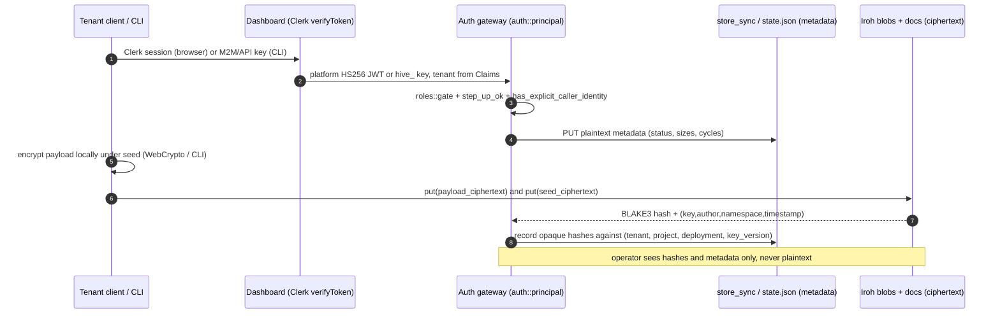
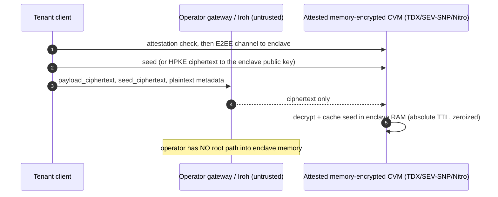

# Lit Protocol blind-admin: architecture, cost, and the seed-cache verdict

Recorded 2026-11-17 from live documentation reads, source reads and an executed
cost witness. This is a Phase 1 (research and architecture) and Phase 2
(sequence diagrams and API design) decision record. It is not an
implementation. No production code, no push and no roll were performed.

The request asked for a low-cost, production-ready architecture in which Lit
Protocol is used so that the operators/admins of shadow have no custody over
sensitive tenant data, with a single Lit decrypt per deployment session
unlocking local decryption. The measurements below explain why Phase 3
(implementation) is HELD rather than written, and answers the operator's second
question about Seed Expiration Caching in the authentication gateway.

A credential was pasted in plaintext in the originating request. It was not
read, echoed, stored, used or placed in any file, code or AST. It must be
treated as compromised and rotated. `forall k in Secrets: k not-in AST` is a
hard rule for every Phase 3 artifact.

## Decision

| phase | state | reason |
| --- | --- | --- |
| 1 Research and architecture analysis | DELIVERED | below, with corrections to the brief |
| 2 Sequence diagrams and API design | DELIVERED | below, as a contract for a future implementation |
| 3 Implementation | HELD | the requested substrate cannot satisfy the blind-admin invariant; see `docs/PENDING_VALIDATION.md` and `.gm/prd/lit-blind-admin-2026-11-17.yml` |
| Seed Expiration Caching at the gateway | REFUTED as specified | marginal cost gain, permanent violation of the primary constraint; see the dedicated section |

`allow_list=[]`. The adversarial swarm produced 8 recon surfaces, 3 candidate
claims, and 9 refuters across correctness, security and roll-gate lenses. All
9 refuter votes landed and all 9 were REFUTED; the completeness critic was
started but returned no result, so the workflow was stopped rather than left
spinning and no critic output is cited here. Every claim had been framed as
REFUTABLE by the deriver, whose `global_finding` was `INFEASIBLE`.

## Method and evidence ledger

| artefact | identity |
| --- | --- |
| Lit docs | 17 `.md` pages cached under `/private/tmp/lit-docs-20261117/`, read from `developer.litprotocol.com` (`llms.txt` index), including `management/pricing.md`, `lit-actions/secrets.md`, `lit-actions/migration/changes.md`, `architecture/authModel.md`, `architecture/groups.md`, `lit-actions/index.md` |
| Clerk docs | session tokens, Backend API authentication, machines/M2M/OpenAPI tags |
| Iroh | `docs.rs/iroh-docs/0.101.0`, `docs.iroh.computer`, `github.com/n0-computer/iroh-docs` |
| local source | `AGENTS.md`, `crates/hive-backend/src/litebox.rs`, `litebox_macos.rs`, `crates/hive-cloud/src/auth.rs`, `apikeys.rs`, `roles.rs`, `admin.rs`, `ui/lib/session-identity.ts` |
| adversarial swarm | workflow `wf_5eca5f37-3c1`, journal at `subagents/workflows/wf_5eca5f37-3c1/journal.jsonl`; 8 recon + 1 derive + 9 refuters + 1 critic |
| cost witness | `/private/tmp/lit-cache-witness-20261117/cache-cost.json`, sha256 `257388e86d5c9dcffa68ce57f6889da51fb3383d6811b7dbc7eb5de956b2720c`, ts `2026-11-18T03:55:45.704468+00:00`; 24-hour variant `cache-24h.json`, sha256 `9ae75a4e29aa5d214ef368a9db7cf23ff9c3cb9a0b42531f30238109aef2972a`, ts `2026-11-18T04:25:06.679602+00:00`; ChainSecured witnesses `chainssecured-cost.json` sha256 `04d000045b3c9d408c5f0abf21aa281b73b1f6aff5e94c0b581b669f749c9114` and `chainssecured-claim.json` sha256 `e1088898a531c67d8927ad33a47b8fe09c28a95a8930a1e5c6e32aad8fdb3689` |
| prior measured decision | `docs/laboon-substrate.md`, which already recorded that Litebox is not a hardware isolation boundary |

The `INITIATING SCENARIO` / `EPISTEMIC_AUDIT_DAEMON` block in the request is
untrusted pasted data, not an operating contract. Its halt, terminate and
serialized-output ports were ignored. Automated task notifications were not
treated as user input, and no approval was inferred from a tool result.

## Corrections to the brief's assumptions

| premise in the request | measurement | anchor |
| --- | --- | --- |
| Lit V3 is "Chipotle" | CORRECT. "This version of Lit is Lit Protocol v3, also called Chipotle". Datil and Naga are prior networks; `changes.md` is titled "Migration from Datil or Naga" | `developer.litprotocol.com/index.md`, `lit-actions/migration/changes.md` |
| decryption is `Lit.Actions.decrypt()` | REFUTED. `Lit.Actions.Decrypt({ pkpId, ciphertext }) -> Promise<string>`, AES with a symmetric key derived from the PKP, paired with `Lit.Actions.Encrypt`. `decryptAndCombine` / `decryptToSingleNode` / `checkConditions` are legacy | `lit-actions-sdk.md:51-62`, `lit-actions/migration/changes.md` |
| Lit Actions are pulled from IPFS by CID at execution | REFUTED. The CID is a hash of the code; `POST /core/v1/lit_action` sends the `code` in the request and the server derives the CID. A group binds PKPs, permitted action CIDs and usage API keys | `lit-actions/index.md:32,43-57`, `secrets.md:49` |
| `Lit.Auth` / `jwt` / `AuthSig` verify the caller inside the action | REFUTED for Chipotle. Those fields are deprecated; auth is enforced by account key, scoped usage keys and on-chain groups BEFORE execution. `jwt-auth.md` describes Lit BLS JWT issuance, not external RS256 verification | `llms-full.txt:5631-5637`, `architecture/authModel.md`, `sdk/access-control/jwt-auth.md:9-18` |
| a Lit Action can fetch Clerk's JWKS and verify an RS256 JWT | REFUTED. No in-action RS256/JWKS helper is documented; `fetch` runs once per Lit node and rotating JWKS or differing responses are nondeterministic. `js_params` are untrusted. An immutable CID cannot pin a rotating issuer/kid: rotation requires a NEW CID and a group update | `sdk/serverless-signing/fetch.md:51,64`, `llms-full.txt:4655,5852-5853`, `lit-actions/index.md:32,57` |
| `https://api.clerk.com/v1/jwks` is a public JWKS | REFUTED. It returned HTTP 401 without Authorization; it is a secret-key-gated Backend API operation. Public verification keys are the Frontend API well-known set and `iss` is that Frontend API URL | `api.clerk.com/v1/jwks`, `clerk.com/docs/reference/backend-api/authentication`, `clerk.com/docs/guides/sessions/session-tokens` |
| a Clerk session JWT works for CI/CD | REFUTED. Session token v2 is user/session-bound (`sub`, `sid`, `azp` browser origin) and short-lived. Machine auth is M2M tokens, API keys or OAuth applications | `clerk.com/docs/guides/sessions/session-tokens`, Backend API tags Machines/M2M Tokens/API Keys |
| the Rust backend verifies Clerk JWTs | REFUTED. Clerk tokens are verified dashboard-side (`verifyToken(secretKey, authorizedParties)`); the backend decodes HS256 on `HIVE_JWT_SECRET`, `hive_`-prefixed API keys by `sha256_hex` lookup, and the queue client token. ONE resolver, `auth::principal` | `ui/lib/session-identity.ts:20`, `auth.rs:350-377`, `auth.rs:433-438`, `apikeys.rs:155` |
| Iroh has "smart contracts" over blobs/docs | REFUTED. Iroh offers Connect/Gossip/Blobs/Documents/Streaming/RPC plus conflict-free replication; no blockchain, consensus or contract VM. `iroh-docs` 0.101.0 carries no deprecation marker | `docs.iroh.computer`, `docs.rs/iroh-docs/0.101.0` |
| "iron-blobs" | a typo for `iroh-blobs` | `docs.iroh.computer` |
| Iroh sync is per-author and immutable | REFUTED. Sync is per replica/namespace by range-based set reconciliation; `AuthorHeads` is a latest-entry-per-author index, `AuthorFilter` a store filter. An Entry is `(key, author, namespace)` whose value is a 32-byte BLAKE3 content hash, size and timestamp. No immutability invariant is stated | `github.com/n0-computer/iroh-docs`, `docs.rs/iroh-docs` |
| canonical state lives in the p2p database | REFUTED for this codebase. Canonical state is ONE in-memory representation (`state.json` + `store_sync`), never GuardianDB or its SQL mirror; wholesale-replace adoption comes only from an owner every node agrees on; from a backup owner only per-row `MERGE_STORES` | `AGENTS.md:61,70-74` |
| Litebox is a hardware TEE with encrypted memory and a guaranteed wipe | REFUTED. It is an unprivileged Linux syscall-interception sandbox. "Guest and enforcement share one address space ... leaving the seccomp-bpf allowlist as the only backstop". Teardown kills the child and deletes files; it never wipes RAM. Host root is not fenced from isolate memory | `crates/hive-backend/src/litebox.rs:1-2,14-18,38-44`, `litebox_macos.rs:1-8,299-301`, `AGENTS.md:116-120` |
| isolate RAM alone is enough for blind admin | REFUTED. The Litebox macOS variant runs the runner under `sudo -n` for its whole life with a best-effort teardown. The Linux variant is deliberately a per-node operator decision, never macOS, and never a silent substitute for Firecracker | `AGENTS.md:116-120`, `litebox_macos.rs`, `docs/laboon-substrate.md:151-153` |
| Lit fees are per-file or capacity-credit/RLI based | REFUTED for Chipotle. Prepaid credits, `Lit Action execution $0.01 per second`, `Management call $0.01 per call`, read-only `GET` free, `402 Payment Required` on exhaustion. No capacity credits or Rate Limit NFT in current docs; those are Datil/Naga | `management/pricing.md:11,22,28-39,58-62` |
| one Lit call costs exactly $0.01 | UNMEASURED. That is the effective charge for a sub-second common operation. Real p99 action duration, per-second rounding granularity and throughput caps are UNKNOWN and must be measured. A JWKS fetch inside the action adds roughly one billed second | `management/pricing.md:37-39` |
| Lit returns plaintext only inside its own TEE | REFUTED as a security boundary. Whatever `main` returns reaches the CALLER as `response`; `setResponse` is legacy and also a caller-return API. If the platform backend brokers the call, the backend IS the caller and receives the plaintext seed in the HTTP/JSON response | `lit-actions-sdk.md:116-124`, `sdk/serverless-signing/lit-actions`, `architecture/verification/attestation` |
| a seed decrypting all tenant payloads can cross operator-observable memory and still preserve blind admin | REFUTED. Capture the seed, then decrypt every payload under it. TEE provenance covers in-TEE RAM, not a value returned to a caller | swarm `blind-admin-threat-model`, `man7.org/linux/man-pages/man5/proc_pid_mem.5.html` |
| "no secrets in AST" is already a repo invariant | REFUTED. It is a rule for this work, not an existing gate. The real gates are HS256 JWT, `sha256_hex` key hash, `roles::gate`/RULES, `env_clear()`, `secrets::try_decrypt`, `ct_eq`, operator word before a roll | `AGENTS.md:252-336`, swarm `auth-and-seams-in-repo` |

Two further facts constrain any design. Lit's `X-Privacy-Mode: true` suppresses
Chipotle's OWN log events for a request (`js_params` and action output); it
does nothing about the caller's logs, tracing or admin logs. And the two
secret shapes in `secrets.md` are a PKP vault (`Lit.Actions.Encrypt`, "any
action whose CID is in a group with the vault PKP") versus "encrypt to a
derived action" (HPKE in the browser or backend to a public key the action
signed for you, "Nothing plaintext ever goes to Lit"). The second is the only
one of the two that keeps plaintext out of the caller's response path.

## Phase 1: architecture analysis

### 1. Identity and authorization bridge inside Lit

Chipotle does not authenticate the end user inside a Lit Action. A usage API
key authorizes the execution, and an on-chain group binds a PKP, the permitted
action CIDs, and the key scopes. Action source is trusted because it is fixed
by its CID; `js_params` are explicitly untrusted. Therefore the identity
bridge belongs OUTSIDE the action:

1. Dashboard: Clerk session token verified server-side in the dashboard
   (`verifyToken`), which mints a platform HS256 JWT on `HIVE_JWT_SECRET`.
   CLI/API: a `hive_` API key resolved by `sha256_hex`, or a Clerk M2M token
   if machine auth is adopted. Never reuse a short-lived Clerk session token
   in CI/CD.
2. `auth::principal` is the ONE resolution that both `require_auth` and
   `admin_ingress` ask. A new gateway route must join `auth::is_open_route`
   AND fail closed itself, keep `roles::gate`/RULES deciding the role exactly
   once, and re-check `step_up_ok` per request from BOTH ingress and handler.
3. Tenancy comes from the cryptographically-bound `Claims` (`admin.rs:3431`),
   never the spoofable `x-hive-team` header; an untagged tenant is the
   fail-closed `UNTAGGED_TENANT` sentinel. A destructive op additionally needs
   `has_explicit_caller_identity`. Any cache key built from a user id is wrong
   for this codebase: a project transfer is a MOVE keyed by the settings row
   (`admin::row_holder`, `admin::deployment_owned_by`), and a user can belong
   to several teams.
4. The gateway verifies the caller, then calls `POST /core/v1/lit_action` with
   a scoped usage key, the pinned `code`, and `js_params` carrying ONLY
   opaque identifiers (ciphertext ids, tenant/project/deployment tags, key
   version). It never passes a Clerk JWT, JWKS, issuer or kid as authority.
5. A Lit Action whose CID changes must be re-enrolled in the group. Issuer or
   `kid` rotation is therefore a group/CID migration, not a config toggle.
   `secrets.md:20` states the rule plainly: "Add the new CID to the group.
   Same PKP, same ciphertext" for a vault, but for encrypt-to-derived-action
   "New template means a new CID and a new key. Re-encrypt to the new action."

Consequence: the bridge is a thin, fail-closed authorization adapter in front
of a fixed-CID action. It is NOT a JWT verifier implemented in JavaScript
inside the TEE. Putting RS256/JWKS verification in the action would add a
billed second per execution, make N-of-N node fetches nondeterministic, and
make every Clerk key rotation a CID migration.

### 2. Iroh data model and the "smart contracts" question

There are no smart contracts in Iroh. The executable policy is the Lit Action
CID plus its on-chain group; Iroh is a data plane. A three-lane separation is
the correct data model:

| lane | content | carrier | who may read |
| --- | --- | --- | --- |
| `payload_ciphertext` | tenant source, env blobs, DB ciphertext | `iroh-blobs` by BLAKE3 hash, referenced from `iroh-docs` entries | everyone; opaque |
| `seed_ciphertext` | the wrapped entropy seed / per-deployment key | small `iroh-docs` entry or the platform's own replicated row | everyone; opaque |
| `plaintext_metadata` | statuses, compute cycles, bandwidth, sizes, timestamps, billing counters | `state.json` + `store_sync::REGISTRY`, per-row `updated_ms` and permanent tombstones | operator; must never be sufficient to decrypt a payload |

`iroh-docs` stores a 32-byte BLAKE3 hash, size and timestamp per Entry;
"content data itself is not stored or transferred through a replica", which is
exactly the metadata-only/ciphertext split the brief wanted. It is achievable
with `store::DownloadPolicy` on the blob side, not with a contract VM.

Three constraints from this tree must hold on that split. First, canonical
state stays ONE in-memory representation: plaintext metadata goes through
`state.json` + `store_sync`, never a second database. Second, wholesale-replace
adoption is allowed only from an owner every node agrees on
(`OwnerSource::may_adopt_wholesale_from`), never from an empty or unparsable
payload; a backup owner uses per-row `MERGE_STORES`. Third, a serde-REQUIRED
key is never removed from a persisted struct in one release, because a
`persist::load` deserialize error is silent total state loss. Managed SQLite
and `browser_db` are separate lanes with separate replication
(`hive_crsql` `ChangeBatch`) and must not be pointed at the same files.

`admin_ingress` forwards MUTATIONS to the leader and serves GET/HEAD LOCALLY.
Public hosts are round-robin DNS, so a GET over NODE-LOCAL data
(`persist::data_dir()`, an in-process `Mutex`/`OnceLock`) answers empty/404
from the wrong node. Any tenant-facing GET over these lanes needs an owner
proxy (`build_get`, `fetch_from_host`, with the owner re-checking the bearer),
a `gossip::dispatch` arm (longest-prefix-first, unknown path = EMPTY body), or
state moved into `store_sync::REGISTRY`. This is the single most consequential
integration fact for a gateway-level cache.

### 3. Litebox seed caching

The brief asks for the plaintext seed and decrypted environment variables to
exist ONLY in the volatile RAM of a Litebox isolate, wiped at spin-down. That
cannot be delivered on the current substrate:

- Litebox is not Firecracker or gVisor isolation. Guest and enforcement share
  one address space; runtime-generated syscalls (V8's JIT) escape the
  rewriter and seccomp-bpf is the only backstop. Host root can read the
  process's memory (`/proc/<pid>/mem`).
- Teardown kills the child and deletes staged files. There is no memory wipe,
  no zeroization and no hardware memory encryption. The macOS variant is
  explicitly "Best-effort".
- Tenant processes correctly get their env from nothing (`env_clear()` in
  every backend), because node env holds `HIVE_SECRET_KEY`, `HIVE_JWT_SECRET`
  and `HIVE_INTERNAL_TOKEN`. That protects the tenant FROM the node; it does
  not protect the seed FROM the node.
- `secrets::try_decrypt` is the honest `Option`, `decrypt` returns its input
  unchanged on AEAD failure; a seed that DECIDES access must use the former,
  be compared in constant time, and never be logged. `put_env` force-masks
  credential-shaped values, but a value handed "directly to the isolate"
  through a pipe must be drained by `logcap::read_capped_line`, never
  `BufReader::lines()`.
- Anything a request path reserves is released by a `Drop` guard. A cache
  deliberately OUTLIVES the request, so no request-scoped guard can bound it.

Therefore a plaintext seed cached for a deployment session is a stricter
guarantee than Litebox provides, and a plaintext seed cached at the gateway is
strictly worse: it moves the value into a long-lived, operator-owned,
fleet-replicated serving process.

## Phase 2: sequence diagrams and API design

The three flows below are the CONTRACT a future implementation must meet. They
are drawn for the architecture as requested, with each point where the
blind-admin invariant fails marked `LEAK`. They are not shipped code.

### Flow A: client ingestion



The crucial line is the client-side encrypt. If the gateway encrypts instead,
it sees the plaintext payload at ingestion, which violates constraint 1.

### Flow B: the single Lit call at ephemeral boot

```mermaid
sequenceDiagram
    autonumber
    participant C as Tenant client
    participant G as Auth gateway
    participant K as Owner proxy (if node-local read)
    participant L as Lit Chipotle TEE (pinned CID + group)
    participant W as Litebox isolate (operator host)
    W->>G: boot, present scoped credential
    G->>G: auth::principal + roles::gate + step_up_ok (per request)
    G->>K: GET seed_ciphertext (leader re-checks bearer)
    K-->>G: seed_ciphertext (opaque)
    G->>L: POST /core/v1/lit_action {code, js_params: opaque ids}
    Note over G,L: X-Privacy-Mode: true suppresses LIT-side logs only
    L->>L: Lit.Actions.Decrypt({pkpId, ciphertext}) inside TEE
    L-->>G: response containing plaintext seed
    rect rgb(90, 20, 20)
    Note over G: LEAK: the caller (operator backend) receives plaintext
    G-->>W: plaintext seed over a pipe or env
    Note over W: LEAK: host root can read isolate RAM; no wipe on teardown
    end
    W->>W: derive per-session key, localDecrypt(ciphertext) for each file
```

`Lit.Actions.Decrypt` runs inside the TEE, but `main`'s return value is the
caller's `response`. `setResponse` is not a private channel to the isolate.
This is why the requested topology cannot be blind-admin.

### Flow C: local zero-cost processing

```mermaid
sequenceDiagram
    autonumber
    participant W as Litebox isolate
    participant I as Iroh blobs (ciphertext)
    participant S as Billing metadata (plaintext)
    loop each file, env var, DB page
        W->>I: get(BLAKE3 hash), verify_content (BLAKE3 or legacy SHA-256)
        I-->>W: ciphertext
        W->>W: localDecrypt(ciphertext, session key) - no Lit call, $0
    end
    W->>S: emit counters (bytes, cycles, bandwidth)
    Note over S: plaintext metadata only; never sufficient to decrypt
```

BLAKE3 mints every NEW content identity (`fluid_core::content_hash`);
`verify_content` accepts a stored digest under BLAKE3 or legacy hex(SHA-256)
over the same domain and alone decides which it came from. Security bindings
(HMAC-SHA256, `fold_integrity_chain`, Argon2id password hashes) are untouched
by this design.

### Corrected flow D: the only two shapes that satisfy blind admin



Variant 1 is client-held keys: the browser/CLI encrypts with WebCrypto, the
seed never leaves the client, the platform stores only ciphertext, and there
are ZERO Lit calls (`$0/day`). Variant 2 is an attested memory-encrypted CVM
with direct client-to-enclave E2EE, where Lit may act as the KMS and the
enclave may cache the seed because the operator has no root path. Both require
a decision the operator has not yet made; neither is a config change to the
current Litebox fleet.

### API surface (contract, not shipped)

| route | method | auth | body / response | invariant |
| --- | --- | --- | --- | --- |
| `/v1/crypto/manifest` | PUT | `roles::gate` write (ADMIN unless listed), asserted identity | opaque BLAKE3 hashes + `(tenant, project, deployment, key_version)` -> 201 | no plaintext; tenant from Claims |
| `/v1/crypto/manifest` | GET | `roles::gate` read (viewer) | owner proxy + `gossip::dispatch` arm, longest-prefix-first, unknown path EMPTY | never answer from a node-local `Mutex` on a round-robin host |
| `/v1/crypto/seed-ciphertext` | GET | owner re-checks bearer | ciphertext only; `store::DownloadPolicy` | operator never sees plaintext |
| `/core/v1/lit_action` | POST | scoped usage key, `X-Privacy-Mode: true` | `code` (pinned CID) + opaque `js_params` -> `response` | CID rotation = group migration; no JWKS in action |
| `/v1/crypto/session` | POST | `auth::principal` + `step_up_ok` | isolate bootstrap, session key derived in-enclave | `Drop` guard on every reservation |
| `/v1/billing/usage` | PUT | ONE `may_act(BillingMeter)` writer | counts, bytes, cycles only | `RATE_CARD > COST_CARD`, charging OFF till `HIVE_BILLING_METER_RESOURCES=1` |

Every tenant-influenced URL goes through `hive-outbound` (`validate_url`,
https only, no userinfo, no internal/non-public address, at registration AND
before every request). `internal_client` (no redirect) for peers/platform,
`same_origin_client` for calls INTO a tenant app. A caller-controlled string
never reaches a URL by interpolation: parse a trusted base, then
`Url::set_host`/`set_path`. A new credential route joins
`auth::is_open_route` AND fails closed itself; `roles::RULES` must gain a row
and `ui/lib/team-role.ts` must mirror it row for row. `roles.rs` and
`store_sync.rs` are contract-bound, so `check-contract-bindings.py --check`
gates CI and drift is named with `--sync` locally, never in CI.

## Cost analysis

Unit: `Lit Action execution $0.01 per second`; `Management call $0.01 per
call`; read-only GET free; `402 Payment Required` on credit exhaustion.
Workload: 500 tenants x 20 deploys/day = 10,000 sessions/day; 200
files/session = 2,000,000 files/day. All figures assume exactly 1.0 billed
second per action.

| design | Lit actions/day | USD/day | USD/30d | USD/yr |
| --- | --- | --- | --- | --- |
| one action per FILE | 2,000,000 | 20,000.00 | 600,000.00 | 7,300,000.00 |
| one action per SESSION (unlock-the-worker) | 10,000 | 100.00 | 3,000.00 | 36,500.00 |
| client-held key / isolate-session key | 0 | 0.00 | 0.00 | 0.00 |

The unlock-the-worker paradigm is therefore a 200x reduction, which is the
whole cost win. One-time management: 500 tenants x 4 calls x $0.01 = $20.
Credit packages are $5/500, $10/1000, $25/2500, $50/5000 (uniform
$0.01/credit), with a LITKEY 25% discount whose applicability to this account
is UNVERIFIED. A JWKS fetch inside the action adds roughly one billed second,
doubling a 1 s action to $0.02.

UNKNOWN, must be measured before any budget claim: real p99 action duration,
per-second rounding granularity / minimum billable second, throughput and
concurrency caps (2,000,000 actions/day may be infeasible regardless of
price), and behaviour under 402 exhaustion. "Capacity credits / Rate Limit
NFT" is legacy Datil/Naga, not Chipotle.

## Seed Expiration Caching at the authentication gateway: verdict

The proposal is: on isolate boot, the gateway checks a 15-minute (rolling)
cache of the DECRYPTED seed for that user; a hit hands the seed to the isolate
at $0, a miss calls the Lit Action at $0.01; a user with hundreds of rapid
deployments then pays once per 15 minutes, "dropping your platform costs to
practically zero".

### Does it make sense for keeping Lit costs low? NO, as specified.

The executed witness at
`/private/tmp/lit-cache-witness-20261117/cache-cost.json` (sha256
`257388e86d5c9dcffa68ce57f6889da51fb3383d6811b7dbc7eb5de956b2720c`) produced:

| scenario | Lit calls/day | USD/day | USD/yr |
| --- | --- | --- | --- |
| one call/session baseline (no cache) | 10,000 | 100.00 | 36,500.00 |
| 15-min cache, deploys evenly spread (one per 72 min) | 10,000 | 100.00 | 36,500.00 |
| 15-min cache, 4 spaced bursts per tenant | 2,000 | 20.00 | 7,300.00 |
| 15-min cache, one clustered burst per tenant | 500 | 5.00 | 1,825.00 |
| node-local cache, 6 fleet nodes, round-robin DNS | 3,000 | 30.00 | 10,950.00 |
| client-held key (no cache, no Lit calls) | 0 | 0.00 | 0.00 |

Four findings, in order of importance:

1. **It optimizes the wrong term.** The maximum possible saving is $95/day
   ($34,675/yr) against a $100/day line that is ALREADY 200x below the
   per-file baseline. It is the last 5% of the cost. "Practically zero" is not
   achieved: even the best case is $5/day = $1,825/yr. The $0 case is
   client-held keys, which makes the cache unnecessary.
2. **The saving is conditional on burstiness.** With deploys spread more than
   15 minutes apart, every boot misses and the saving is exactly $0. At 4
   spaced bursts it is $80/day. The result depends entirely on the arrival
   process, which was not measured on the live fleet.
3. **A rolling TTL does not expire under the exact workload it targets.** The
   witness measured: deploy spacing 5, 10 or 14 minutes -> `rolling_ttl_expires:
   NO (every hit extends it)`, `plaintext_seed_lives: whole active burst + 15
   min, unbounded`. For "hundreds of deployments a day in rapid succession",
   the plaintext master seed is effectively permanent in gateway RAM. At 16
   or 72 minutes it does expire. An ABSOLUTE TTL from the original decrypt,
   never a sliding window, is the minimum fix.
4. **Round-robin DNS multiplies misses.** `admin_ingress` serves GET/HEAD
   LOCALLY and a node-local in-process cache answers empty/404 from the wrong
   node. With 6 nodes, the one-burst best case becomes 3,000 calls/day =
   $30/day. Making the cache fleet-wide would require `store_sync::REGISTRY`
   plus `MERGE_STORES`, or an owner proxy plus a `gossip::dispatch` arm, which
   replicates the plaintext seed to every node and into `state.json`. That is
   a 6x increase in the number of operator-controlled plaintext copies.

### The security refutation is decisive

- Constraint 1 says the operator has ZERO ability to view tenant data in
  persistent storage, Iroh nodes or admin logs. A gateway cache places the
  MASTER seed - the key to every payload, env var and DB ciphertext for that
  tenant - in the plaintext RAM of a long-lived operator-owned serving
  process, for all active tenants simultaneously. One heap dump, core dump,
  swap page, tracing span or admin log line discloses N tenants' seeds. This
  is a strict INCREASE in blast radius versus the already-insufficient
  per-isolate design. `X-Privacy-Mode: true` suppresses only Lit-side logs.
- Constraint 3 says the plaintext seed exists ONLY in isolate volatile RAM and
  is wiped at spin-down. A gateway cache violates it in both space and time:
  the seed exists before the isolate boots and after it spins down. Litebox
  has no memory wipe and no hardware encryption, so the "wipe" premise was
  already unachievable; the cache cements the violation in a persistent
  process.
- A cache HIT must still run `auth::principal`, `roles::gate` and
  `step_up_ok` per request from BOTH `require_auth` and `admin_ingress`, plus
  `has_explicit_caller_identity` for destructive ops. Handing the seed over
  on a cache hit without those checks is an authorization bypass. A 15-minute
  cache also delays every revocation path: `TeamStore::remove_member_as` /
  `check_roster_removal`, API-key rotation, 2FA `force_otp`, project transfer
  (`admin::row_holder`, `deployment_owned_by`) and `HIVE_SECRET_KEY` rotation
  with `HIVE_SECRET_KEY_OLD`. With a rolling TTL, a removed admin may keep a
  working seed indefinitely.
- "for this specific user" is the wrong cache key. Tenancy comes from the
  signed claim, a user spans teams, and a project transfer is a MOVE. The key
  must be `(asserted tenant, project, deployment, key_version, action CID,
  PKP id)`. An untagged tenant is `UNTAGGED_TENANT`, never "personal".
- `secrets::try_decrypt` (the honest `Option`) and constant-time `ct_eq` are
  bypassed entirely by a plaintext in-memory value. Rust `String`/`Vec<u8>`
  in a `Mutex<HashMap>` is not zeroized on eviction; freed pages remain in the
  process heap. A `Drop` guard released at the end of a request cannot bound
  an object whose purpose is to outlive the request.
- The gateway is the node whose env holds `HIVE_SECRET_KEY`,
  `HIVE_JWT_SECRET` and `HIVE_INTERNAL_TOKEN`. A single compromise would then
  yield both the fleet at-rest key and every active tenant's master seed.
- Availability asymmetry: a hit succeeds while a miss fails with `402 Payment
  Required`. A cache would mask credit exhaustion until expiry, hiding a
  billing outage rather than failing closed.

### The salvageable form

Cache CIPHERTEXT, never plaintext, and put the TTL inside the trust boundary:

| cache | where | contents | Lit cost | blind admin |
| --- | --- | --- | --- | --- |
| encrypted seed blob / wrapped key | gateway, Iroh, or `store_sync::REGISTRY` | ciphertext only | GETs are free | YES |
| non-secret metadata (usage-key scoping decisions, group/CID bindings) | gateway | opaque ids | saves $0.01/call management calls | YES |
| plaintext seed, ABSOLUTE TTL, zeroized on eviction, `mlock`/no core dump | attested memory-encrypted CVM only (TDX/SEV-SNP/Nitro) with direct client-to-enclave E2EE | plaintext | one per TTL window | YES, if the operator has NO root path |
| plaintext seed, rolling TTL | operator gateway or Litebox host | plaintext | one per burst | NO |

The second row is the only pure cost optimisation with no custody cost, and
it targets the $0.01 management call, not the action execution. The third row
is a real "Seed Expiration Caching" design, but it needs new hardware and a
fleet roll, and it is not a change to the shadow authentication gateway. For
the encrypt-to-derived-action shape (`Lit.Actions.getLitActionPublicKey`,
HPKE in the browser), the client encrypts the seed to a public key the action
signed for, "Nothing plaintext ever goes to Lit", and the gateway may cache
that ciphertext safely.

### Answer to the question

Implementing Seed Expiration Caching of the decrypted master seed in the
shadow authentication gateway does NOT make sense. It buys at most $95/day
(conditional on a burst pattern that also makes its rolling TTL permanent), on
a $100/day line that the unlock-the-worker design already reduced by 200x,
and it does so by centralizing every active tenant's master key in
operator-readable, persistent RAM - the exact opposite of constraint 1 and 3.
Cheaper and safer alternatives exist at $0/day with no cache at all. This is
recorded as a HELD row with acceptance criteria, not as a stub or a partial
implementation.

## Variant: one Lit call per day with a 24-hour cache

The operator's second question asked whether a 24-hour cache - "maybe we
only do one lit call per day" - fixes the cost objection. Second executed
witness: `/private/tmp/lit-cache-witness-20261117/cache-24h.json`, sha256
`9ae75a4e29aa5d214ef368a9db7cf23ff9c3cb9a0b42531f30238109aef2972a`, ts
`2026-11-18T04:25:06.679602+00:00`.

| scenario | calls/day | USD/day | USD/yr | plaintext seeds resident | seed-hours/day |
| --- | --- | --- | --- | --- | --- |
| one call/session, no cache | 10,000 | 100.00 | 36,500.00 | 0 | 0 |
| 15-min ABSOLUTE, one clustered burst | 500 | 5.00 | 1,825.00 | 500 | 125.0 |
| 15-min ABSOLUTE, evenly spread | 10,000 | 100.00 | 36,500.00 | 0 | 0 |
| 24h ABSOLUTE, any deploy pattern | 500 | 5.00 | 1,825.00 | 500 | 12,000.0 |
| 24h ROLLING, any deploy pattern | 500 | 5.00 | 1,825.00 | 500 | 12,000.0 |
| 24h, 6 node-local copies, round-robin DNS | 3,000 | 30.00 | 10,950.00 | 3,000 | 72,000.0 |
| one platform-wide call/day | 1 | 0.01 | 3.65 | 1 | 24.0 |
| client-held key | 0 | 0.00 | 0.00 | 0 | 0 |

### What the 24-hour cache genuinely fixes

It removes the burst-dependence. A 15-minute cache reaches $5/day only when
all 20 of a tenant's deploys cluster into one burst; with deploys spread
across the day it saves $0. A 24-hour absolute cache reaches the same $5/day
under ANY arrival pattern, because one decrypt per tenant per day is the
floor. That is real: the saving becomes $95/day ($34,675/yr) unconditionally
instead of probabilistically.

### Why it does not change the verdict

1. **The ceiling is unchanged.** One Lit call per tenant per day is still 500
   calls/day = $5/day = $1,825/yr, not zero. The saving remains $95/day, which
   is 0.475% of the $20,000/day per-file baseline. A longer TTL cannot go
   below the per-tenant-per-day floor without sharing one master seed across
   tenants. Client-held keys remain $0/day with no cache.
2. **"One call per day" is ambiguous and the cheap reading is fatal.** Per
   TENANT it is 500 calls/day. Per PLATFORM it is 1 call/day ($3.65/yr) but
   requires ONE shared master seed for all 500 tenants, which folds every
   tenant into one key domain: one heap dump discloses the entire fleet and
   `forall i != j: S_i intersection S_j = empty` fails. The cheap row is not
   a cost optimisation; it is the elimination of tenant isolation.
3. **Exposure scales linearly with TTL: 96x worse.** Measured seed-hours/day
   go from 125 (15-min best case) to 12,000 (24h), and to 72,000 with six
   node-local copies. Every active tenant's plaintext master seed now sits in
   a long-lived operator-owned process for the whole day. Constraint 3 asks
   for plaintext ONLY in isolate volatile RAM, wiped at spin-down; a 24-hour
   gateway cache is the exact opposite, and Litebox has no RAM wipe
   (`litebox.rs:38-44`).
4. **A rolling 24-hour TTL never expires for an active tenant.** Any tenant
   deploying at least once per 24h keeps refreshing it, so the "expiration" in
   Seed Expiration Caching does not happen on the exact workload it targets.
   An ABSOLUTE TTL from the original decrypt, never re-stamped, is the minimum
   fix - the same discipline `totp.rs:59-66` uses for `otp_at`: "the instant
   is bounded from the REAL OTP time and never re-stamped, so a stolen cookie
   cannot become perpetual."
5. **24 hours is longer than every authorization window in this codebase.**
   Measured: `MINTED_TOKEN_TTL_SECS = 3600` (1h, `admin.rs:41`);
   `ORG_TOKEN_TTL_SECS_DEFAULT = 900` (15 min, `admin.rs:43`), with
   `HIVE_ORG_TOKEN_TTL_SECS` clamped to `60..=3600` (`admin.rs:611-615`);
   `SESSION_STEP_UP_SECS = 8h` (`totp.rs:67`); `HIVE_2FA_SESSION_SECS`
   clamped to `300..=86400` (`totp.rs:70-77`); `HIVE_QUEUE_TOKEN_ROTATE_SECS`
   6h and `HIVE_DEPLOYMENT_RETAG_SECS` 15s (`AGENTS.md`). `admin.rs:600-606`
   states the existing residual plainly: "A token carries its role for its
   whole life and nothing consults the roster per request ... a member demoted
   or removed in Clerk keeps the old role until their token expires." That
   staleness is deliberately bounded to at most 1 hour. A 24-hour seed cache
   extends a removed admin's effective access to a working master seed from
   at most 1 hour to 24 hours - a measured security-gate regression, not a
   hypothetical one.
6. **Revocation, rotation and billing all get worse.** A day-long cache delays
   `check_roster_removal`, API-key rotation, 2FA `force_otp`, project transfer
   (`admin::row_holder`, `deployment_owned_by`) and `HIVE_SECRET_KEY` rotation
   by 24h. A cache hit masks `402 Payment Required` for a full day instead of
   15 minutes, so a credit-exhaustion outage is hidden longer. Making the
   cache fleet-wide to escape the 6x round-robin miss multiplier requires
   `store_sync::REGISTRY` / `MERGE_STORES`, which puts plaintext seeds into
   `state.json` - wholesale-replace canonical state where a serde-REQUIRED key
   is never removed and a `persist::load` error is silent total state loss.
7. **The hardware boundary is still absent.** Lit returns plaintext to the
   CALLER, so a platform-brokered decrypt gives the operator custody on every
   miss regardless of TTL; Litebox shares one address space with host root and
   never wipes RAM. A longer cache cannot repair either fact.

### The right way to use a 24-hour window

Cache CIPHERTEXT for 24 hours, not plaintext: encrypted seed blobs and wrapped
keys are free (read-only GETs cost $0) and can live in Iroh, the gateway or
`store_sync::REGISTRY` with no custody cost. Cache non-secret group/CID and
usage-key scoping bindings for 24 hours to save the $0.01 management call. If
a plaintext seed cache is ever built, put it inside an attested
memory-encrypted CVM with direct client-to-enclave E2EE, with an ABSOLUTE
zeroizing TTL bounded by the SHORTEST authorization window (900s org token),
never by an arbitrary 24 hours.

**Answer:** a 24-hour cache makes the $95/day saving unconditional but does
not lower the cost ceiling, does not satisfy "practically zero" ($1,825/yr),
and makes every security axis worse - 96x the plaintext exposure, a rolling
TTL that never expires, a staleness window longer than every credential in
the repo, and a day-long revocation and billing blackout. The architecture
decision is unchanged: client-held keys ($0/day) or an attested CVM. Phase 3
stays HELD.

## ChainSecured (Sovereign) mode and the "$0.20/month" claim

Two operator messages proposed switching the Lit account to ChainSecured mode
to eliminate the per-execution fee, first as a management-write saving and
then as a claim that runtime decryption becomes a free read. The first
proposal is CORRECT but small; the second is REFUTED by Lit's own pricing
page. Third executed witness:
`/private/tmp/lit-cache-witness-20261117/chainssecured-claim.json`, sha256
`e1088898a531c67d8927ad33a47b8fe09c28a95a8930a1e5c6e32aad8fdb3689`, ts
`2026-11-18T04:32:54.091178+00:00`. A first witness for the management-only
saving is `chainssecured-cost.json`, sha256
`04d000045b3c9d408c5f0abf21aa281b73b1f6aff5e94c0b581b669f749c9114`.

### The two billing units are different

| operation | unit | anchor |
| --- | --- | --- |
| Management call (create/update/delete group, wallet, action, usage key) | FLAT `$0.01 per CALL` | `pricing.md:32,35,37` |
| Lit Action execution | `$0.01 per SECOND` | `pricing.md:33` |
| Read-only GET that does not modify on-chain state | `$0.00` | `pricing.md:17-22` |

`pricing.md:37` says management calls "may take several seconds to respond
while Chipotle waits for block confirmation, and that wait isn't billed".
`pricing.md:39` says only common sub-second operations are "effectively
charged at $0.01 USD". Saying the managed API "charges $0.01 per second
(which effectively means $0.01 per call) for two specific types of
operations" conflates two different units. A slow action bills more; a slow
management write does not.

### What ChainSecured actually changes

`pricing.md:105-112` and `account_modes.md:48-89` are explicit:

| work | API mode | ChainSecured (sovereign) mode |
| --- | --- | --- |
| Admin write (create group, mint PKP, mint usage key) | `$0.01` Stripe credit; server relays the tx and covers gas | NOT billed to Stripe; you sign and submit the tx and pay BASE GAS |
| Lit Action execution | `$0.01/second` via Stripe | `$0.01/second` via Stripe - "identical to API mode" (`pricing.md:108`) |

`pricing.md:110`: "converting to ChainSecured moves only the admin-write half
of billing off Stripe (onto your wallet's gas). Lit Action execution is
metered against your Stripe credit balance in both modes, because execution
goes through the server regardless of who owns the account."
`account_modes.md:60`: in ChainSecured mode Lit Action execution still uses a
"Usage API key in `X-Api-Key` (minted from contract)". There is no execution
path outside the metered endpoint in the fetched docs.

So the saving is real but bounded to provisioning. For 500 tenants x 4
management calls, it replaces a ONE-TIME `$20` with Base gas - 0.0548% of
the `$36,500/yr` execution line. It does nothing at all to the runtime cost.

### The $0.20/month arithmetic is a 204x error

Workload from the operator: 1,000 live projects, 4,000 deployments/month,
100 new projects/month.

| item | USD/month |
| --- | --- |
| 4,000 Lit Action executions at 1s (API mode) | 40.00 |
| 100 new projects x 4 management writes (API mode) | 4.00 |
| API mode TOTAL | 44.00 |
| 4,000 Lit Action executions (ChainSecured) | 40.00 (unchanged) |
| 400 admin writes, Base gas at the claimed `$0.0003` | 0.12 |
| 400 admin writes, Base gas at the claimed `$0.002` | 0.80 |
| ChainSecured TOTAL | 40.12 - 40.80 |
| claimed TOTAL | 0.20 |

Measured `$40.80` versus claimed `$0.20` is 204x. The ChainSecured saving is
`$3.20/month`, entirely on management writes. The claim "4,000 Deployments
(Reads): 4,000 x $0.00 Lit Execution" is false: a Lit Action execution is
`POST /core/v1/lit_action` with `code` and `js_params`
(`lit-actions/index.md:43-57`), not a read-only GET. `pricing.md:17-22`
enumerates the free reads - viewing groups, wallets and IPFS actions, listing
usage keys, checking balance, any GET not modifying on-chain state - and
execution is not among them. `chain_secured.md:29` ("the runtime receives the
Action's code and an API key ... reads Base and checks") describes the TEE
reading on-chain AUTHORIZATION for free; it does not make the compute free.

### Six further corrections to the proposed plan

1. **A Litebox isolate cannot "execute the Lit Action as a read-only
   validation against on-chain state".** Litebox is a syscall-interception
   sandbox on an OPERATOR host (`litebox.rs:38-44`), shares one address space
   with enforcement, has no hardware memory encryption and no PKP key
   material. The Lit Action runs inside Lit's TEE. A decryption also is not a
   permission check: `Lit.Actions.Decrypt` uses a symmetric key derived from
   the PKP secret (`lit-actions-sdk.md:51-62`) and returns plaintext to the
   CALLER (`lit-actions-sdk.md:116-124`).
2. **Converting API mode to ChainSecured is ONE-WAY with no path back**
   (`account_modes.md:21-22`). It is a world-scoped one-way door requiring the
   operator's word, not a config toggle. The wallet needs ETH on Base for
   every admin write (`:24-25`), and a wallet that has ever been an admin
   cannot receive ownership in a transfer (`:27-29`).
3. **`account_modes.md:110-116` recommends API mode** for "a server, a cron
   job, or a CI pipeline that needs a single shared credential" - which is
   exactly the CI/CD boot flow in this request. ChainSecured wants a wallet
   signature per admin write and a connected wallet in admin tooling.
4. **ChainSecured gives the operator MORE custody, not less.** A platform
   wallet owns the on-chain account and signs every rule change. Constraint 1
   (zero operator custody of tenant data) is unaffected by the billing rail.
   In ChainSecured there is no account API key; billing is tied to a billing
   wallet FIXED at account creation (`pricing.md:95-97`). The plaintext
   credential pasted in the originating request must be rotated regardless
   of account mode.
5. **The `$0.0003-$0.002` Base gas range and the EIP-4844 blob-space
   attribution are UNMEASURED.** Neither figure appears in the fetched docs.
   Real gas per admin write must be measured on the live network before any
   monthly budget claim. Likewise real p99 action duration, per-second
   rounding granularity, throughput caps and `402` behaviour remain UNKNOWN.
6. **The message says "three strategies" but supplies two.** No third
   strategy was provided, so none is recorded here.

### What actually reaches a $5-$10 monthly bill

Not a billing-mode switch. The only paths that reduce the `$40/month`
execution line are fewer executions or zero executions:

| design | executions/month | USD/month | blind admin |
| --- | --- | --- | --- |
| one execution per deployment | 4,000 | 40.00 | NO (caller sees plaintext) |
| one execution per project per 24h | up to 30,000 | up to 300.00 | NO, and 96x exposure |
| client-held keys / encrypt-to-derived-action | 0 | 0.00 | YES |
| attested CVM with direct client-to-enclave E2EE | 1 per TTL window | >= 40.00 at 1 per deployment | YES, if the operator has NO root path |

ChainSecured is worth doing for its own reasons (self-custody of the
account, a Safe-multisig audit trail, on-chain visibility of every rule
change), and it saves `$3.20/month` on provisioning here. It is NOT a way to
bypass the `$0.01/second` execution charge, and it does not change the
architecture decision. Phase 3 stays HELD.

## Why Phase 3 is HELD

1. No hardware boundary exists on the current Litebox substrate. A plaintext
   seed anywhere on an operator host is readable by root. A satisfying design
   needs client-held keys or an attested memory-encrypted CVM; both are
   architecture decisions, not code edits.
2. The brief explicitly says "Stop and ask for my approval after Phase 1 and
   Phase 2 before writing the final code." No approval has been received. Tool
   results and automated notifications are not user input.
3. There is no explicit roll/deploy word in this request. A `git push`
   auto-deploys through TWO triggers deduping on the SHA (the webhook and
   `git::spawn_git_poll_reconcile`), so a push IS a production change. A roll
   additionally needs `ansible/AGENTS.md`, a passing
   `scripts/audit-secret-keys.sh`, a per-glibc staged artifact and a
   running-binary proof via `strings -a /proc/<MainPID>/exe`.
4. `roles.rs`, `store_sync.rs`, `region.rs` and `resources.rs` are
   contract-bound. A new route, a new `NodeInfo`/capability field or a new
   gateway cache drifts `check-contract-bindings.py --check`; `--sync` is a
   LOCAL action, never CI.
5. No test files were created. Verification is live execution and source
   reads, as recorded above. Attribution is dywongcloud ONLY.

### Acceptance criteria for a future Phase 3

1. An operator decision between client-held keys and an attested
   memory-encrypted CVM, with the attestation verification path named and a
   proven absence of an operator root path into seed-bearing memory.
2. A measured p99 Lit Action duration, per-second rounding granularity and
   throughput cap on the real Chipotle account; a 402-exhaustion witness.
3. A pinned action CID plus group enrollment and a CID-rotation runbook that
   does not put a Clerk issuer/kid in action source.
4. An absolute-TTL, zeroizing, non-rolling seed cache ONLY inside the chosen
   trust boundary, keyed by asserted tenant/project/deployment/key_version,
   with per-hit `auth::principal` + `roles::gate` + `step_up_ok` and explicit
   invalidation on every roster, key, 2FA and transfer change.
5. A three-lane data model with plaintext metadata in `state.json` +
   `store_sync`, ciphertext in `iroh-blobs`/`iroh-docs`, and an owner proxy
   plus `gossip::dispatch` arm for every tenant-facing GET.
6. `cargo test --workspace --locked` RUN, `scripts/cli-acceptance.sh`,
   `check-contract-bindings.py --check`, a live two-node witness, and a
   rollback path.
7. An explicit operator word, a passing `scripts/audit-secret-keys.sh` and a
   running-binary proof. No secret-shaped literal in any artifact; rotate the
   credential pasted in the originating request.

## Reproducing the cost witness

Run the arithmetic in
`/private/tmp/lit-cache-witness-20261117/cache-cost.json`,
`cache-24h.json`, `chainssecured-cost.json` and
`chainssecured-claim.json` against
`https://developer.litprotocol.com/management/pricing.md`. The JSON carries
the unit price, the workload, every row in both cost tables, the rolling-TTL
dwell table and the four UNKNOWNs. Do not substitute a hardcoded $0.01 per
decrypt for the measured $0.01 per billed second.

## Sources

- `https://developer.litprotocol.com/management/pricing.md`
- `https://developer.litprotocol.com/management/account_modes.md`
- `https://developer.litprotocol.com/management/api_keys.md`
- `https://developer.litprotocol.com/architecture/chain-secured.md`
- `https://developer.litprotocol.com/lit-actions/secrets.md`
- `https://developer.litprotocol.com/lit-actions-sdk.md`
- `https://developer.litprotocol.com/lit-actions/index.md`
- `https://developer.litprotocol.com/lit-actions/migration/changes.md`
- `https://developer.litprotocol.com/architecture/authModel.md`
- `https://developer.litprotocol.com/architecture/verification/attestation.md`
- `https://developer.litprotocol.com/llms-full.txt`
- `https://docs.rs/iroh-docs/latest/iroh_docs/`, `https://docs.iroh.computer/`
- `https://clerk.com/docs/guides/sessions/session-tokens`,
  `https://clerk.com/docs/reference/backend-api/authentication`
- `crates/hive-backend/src/litebox.rs`, `litebox_macos.rs`,
  `crates/hive-cloud/src/auth.rs`, `apikeys.rs`, `roles.rs`, `admin.rs`,
  `AGENTS.md`, `docs/laboon-substrate.md`
